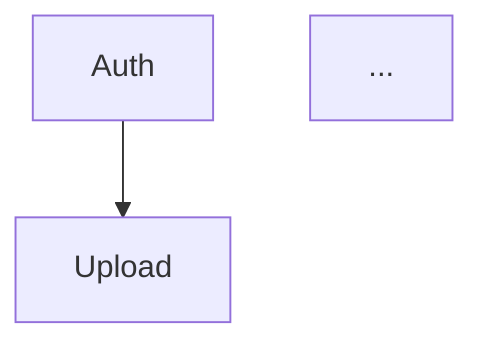

# PRD format and progress schema

Current user requirements and the project skill entrypoint govern decisions.

### PHASE 3: PRD Construction

Generate the PRD based on PHASE 2 answers + project context. Do not ask for approval section by section. Write and present the entire PRD at once. Use the language requested by the user.

**Golden Rule:**
- If user answered something specific: USE their answer
- If not answered: record the unresolved requirement or label an assumption; do not invent a business decision

**Feature ID System:**
- Every functionality receives a unique ID: `F01, F02, F03...F99`
- IDs are zero-padded to 2 digits and sequential with no gaps
- IDs are used in Sections 5, 6, 8, and 9
- Sections 1-4 and 7 use descriptive names only (no IDs)
- Typical PRDs have 5-15 features. If fewer than 3, features may be grouped too broadly. If more than 20, consider consolidating related capabilities.

**The 9 PRD sections (in this order):**

#### Section 1: Executive Summary
2-3 paragraphs covering the following points:
- What is the product?
- For whom?
- What is the core value?
- How does it work at a high level?

#### Section 2: Problem and Opportunity
**The Problem** - 3-5 pain categories:
- Bold title
- 3-4 bullets with quantified impact when possible

**The Opportunity** - How the product solves:
- Connect each problem -> solution
- Be specific about the differentiator

#### Section 3: Target Audience
**Primary Users** - Distinct profiles based on real usage diversity:
- Bold name
- 3 bullets of characteristics/needs
- Generate as many personas as the product genuinely requires — do NOT force a fixed number. If the product has a homogeneous audience, 1-2 personas is enough. If it has distinct user groups with different journeys, use more.

**Behavioral Profile** - Common characteristics for all personas
- Omit this subsection when there is only 1 persona — its characteristics are already fully covered by that persona's bullets.

#### Section 4: Objectives
**Product Objectives** (3-5):
- Action verb in bold
- Specific and verifiable

**Success Metrics** - For each objective:
- Measurable metric with specific number
- Measurement condition

#### Section 5: User Stories
Group stories by feature using feature IDs:

```markdown
### F01. User Registration and Authentication
- As a user, I want to register with email and password so that I can access the platform
- As a user, I want to reset my password via email so that I can recover my account

### F02. Video Upload
- As a user, I want to drag files into a drop zone so that upload starts immediately
- As a user, I want to see upload progress with speed and percentage so that I know when it finishes
```

- Generate as many stories as the feature requires — no fixed range
- Stories must describe concrete interactions with the product, not abstract goals
- Do NOT generate stories by persona — group by feature only
- For infrastructure/backend features with no direct user interaction, write stories from the system perspective (e.g., "As the system, I want to automatically process uploaded videos so that transcriptions are available within the SLA")

#### Section 6: Functionalities
Structure: F01, F02, F03, etc. Every feature must have at minimum **Capabilities** and **Experience** blocks. All other blocks are conditional — omit them when empty/not applicable.

**1. Consumes** (omit if feature has no functional data dependencies):
- List what data/outputs this feature requires from other features
- Reference the providing feature by ID
- Semi-technical level: name the business data objects and their key fields (e.g., "video file path, duration, format"), but do not use programming types (e.g., not "string", "int", "VideoMetadata interface")
- Do NOT list authentication/session — auth is assumed for all features. Also do NOT list auth in Provides blocks.
- Only list **functional data** dependencies (data that flows between features)

**2. Provides** (omit if no other feature consumes functional data from this one):
- List what data/outputs this feature makes available to other features
- Indicate which features consume it in parentheses
- Same semi-technical level as Consumes
- Do NOT list authentication/session data — consistent with the Consumes exclusion
- Grouping rule: when the same data is consumed by multiple features, list them together in a single entry — `(used by F04, F06)`. When different features consume different data from this feature, use separate entries, one per data set.

**3. Core Scope** (omit if the entire feature is essential — all capabilities have the same priority):
- List the minimum set of capabilities required for this feature to fulfill its primary purpose
- Only include this block when the feature has capabilities of mixed priorities (some essential, some enhancement)

**4. Full Scope additions** (omit if Core Scope is omitted):
- List capabilities that enhance the feature beyond Core Scope
- These are improvements to be added after the core is implemented

**5. Capabilities**: SPECIFIC limits (sizes ex: 2GB, quantities ex: 20 items, times ex: 5h SLA), formats, business rules

**6. Experience**: detailed user flow, visual feedback, validations, messages, states

**7. Error Handling** (ONLY for critical functionalities): 3-5 failure scenarios with specific messages
- Include Error Handling when the feature involves AT LEAST ONE of: (a) authentication/authorization, (b) payments or financial operations, (c) data loss risk (create, upload, delete, mutate persistent state), (d) security-sensitive operations, (e) long-running or irreversible operations where partial failure is possible.
- Skip for read-only or display features where failure just means retry or reload: basic navigation, viewing, filtering, sorting, searching within already-loaded data, rendering pre-computed content.
- When in doubt, ask: "If this feature fails silently, does the user lose data, money, or security?" If yes, include Error Handling. If no (user just reloads), skip.

MANDATORY:
- NEVER: generic functionality descriptions — be specific about what exactly the feature does, with concrete numbers, formats, and flows
- Use specific numbers when grounded in user requirements; record unresolved limits explicitly
- ALWAYS: detailed flow with fields, validations, order

#### Section 7: Out of Scope
Group by category what the product will NOT do in this version.

#### Section 8: Dependency Graph
This section defines the dependency relationships between features and their implementation priority. It contains up to five parts: a dependency table, Foundation Features (when applicable), execution waves, a priority legend, and a Mermaid visualization.

**Part numbering:** The labels "Part 1, 2, 3, 4, 5" are stable. When Part 2 (Foundation Features) does not apply to this PRD and is omitted, subsequent parts keep their original numbers — do not renumber. A PRD without Foundation emits Part 1, Part 3, Part 4, Part 5 (Part 2 is simply absent).

**Part 1: Dependency Table**

| # | Feature | Priority | Dependencies |
|---|---------|----------|--------------|

Rules:
- Every feature from Section 6 must appear exactly once
- **Table order: topological** — every dependency referenced in the "Dependencies" column must appear in a row ABOVE the current row. The reader never encounters a forward reference.
- Dependencies column: list feature IDs separated by comma (always AND semantics). Use "None" for root features.
- A dependency exists when Feature B cannot function without Feature A being implemented first. This includes both functional data dependencies (which also appear in Consumes) and infrastructure dependencies (e.g., auth). Dependencies is always a superset of Consumes.
- Priority: integer 1-3 reflecting the importance of the feature's minimum viable version (Core Scope if defined, otherwise the full feature). Full Scope additions are not represented in the table — they are implicitly lower priority and handled by the implementation plan.
- When multiple features share the same dependency and there is no ordering constraint between them, the topological tie-break is by feature ID (lower ID first)
- If a feature can work with either of two alternative dependencies (OR semantics), pick the primary/most-likely option and note the alternative in the feature's Section 6 description. The dependency table only supports AND semantics.

**Part 2: Foundation Features** (include ONLY when one or more features carry shared project infrastructure)

Identify features that set up shared project infrastructure — scaffolding, base layout, database and ORM initialization, authentication wiring, routing conventions, global styling, CI setup. These features cannot run in parallel with each other in a greenfield project because they all touch the same foundational files.

Format:
```markdown
### Foundation Features
These features set up shared project infrastructure. In a greenfield project they must be implemented sequentially before or alongside any feature that depends on them:
- **F<ID> <Name>** — <what this feature contributes to the shared infrastructure>
- **F<ID> <Name>** — <what this feature contributes to the shared infrastructure>
```

Rules:
- Omit this part entirely when no feature carries foundation responsibilities (e.g., when the PRD targets adding features to an already-mature codebase).
- **Foundation criterion:** a feature is Foundation if its **primary purpose** is to set up shared project infrastructure — top-level layout and routing, global styling, database/ORM setup, cross-cutting middleware (auth, logging), or other scaffolding that every later feature will implicitly rely on. A feature is NOT Foundation if its primary purpose is a user-facing domain capability, even if it creates UI structure along the way (e.g., a dashboard page that establishes a `/app` subtree is still a product feature, not Foundation).
- A useful test: if implementing this feature means running project-bootstrapping or scaffolding commands (framework/CLI initializers, ORM initializers, installing and configuring framework-level dependencies) or setting up a core library that subsequent features consume without naming it in their Consumes block, it is Foundation. The criterion is stack-agnostic — it applies equally to web (Next.js, Rails, Django), backend services (Go, Java, FastAPI), CLIs, mobile, or data pipelines.
- List foundation features in topological order (matching the dependency table order).

**Part 3: Execution Waves**

This part makes parallelism explicit. Features within the same wave can be built in parallel; a wave starts only after every feature in earlier waves is complete.

Wave calculation (mechanical — derived from the dependency table):
- **Wave 1**: every feature with `Dependencies: None`.
- **Wave N** (for N ≥ 2): every feature whose entire set of dependencies is already covered by waves 1..N-1. Formally, `wave(feature) = max(wave(dep) for dep in dependencies) + 1`.

Ordering within a wave:
- Sort by priority ascending (1 first, then 2, then 3).
- Tie-break by feature ID (lower ID first) when priorities are equal.

Format — a simple bullet list, one wave per line:
```markdown
### Execution Waves
Features within the same wave can be built in parallel. A wave starts only after every feature in earlier waves is complete.

**Note:** When the "Foundation Features" part is present, foundation features cannot run in parallel in a greenfield project even if they appear together in a wave — they share scaffolding files and must be implemented sequentially until the base is in place.

- **Wave 1**: F01
- **Wave 2**: F02
- **Wave 3**: F03
- **Wave 4**: F04, F06
- **Wave 5**: F05
```

The "Note:" line is included ONLY when the Foundation Features part was emitted. If the PRD has no Foundation Features, omit the note.

(This illustrative wave list corresponds to the example PRD in the OUTPUT section of this skill — see there for the matching dependency table.)

**Part 4: Priority Legend**

Always include:
```markdown
### Priority levels
- **1** = Essential — product does not work without it
- **2** = Important — significant value addition
- **3** = Desirable — incremental improvement
```

**Part 5: Mermaid Diagram**



Rules:
- Direction: `graph TD` (top-down)
- Node labels: feature ID + short name (1-2 words max)
- Edge direction: `A --> B` means "A must be implemented before B" (A is a prerequisite of B). Equivalently, B depends on A.
- Edges must correspond exactly to the Dependencies column in the table
- The diagram is a visualization aid — the table is the source of truth

#### Section 9: Acceptance Criteria
Organize by feature using feature IDs. After all per-feature criteria, include a **Cross-Feature Integration** block.

Per-feature criteria:
- Verifiable (can test: passed or not)
- Specific (no ambiguity)
- Cover success AND failure

**Cross-Feature Integration block:**
- Placed at the end of Section 9
- Derive one or more criteria from each Consumes declaration in Section 6
- Each criterion tests that data actually flows between the features as declared
- If a feature has no Consumes, it generates no integration criteria

---

## PROGRESS FILE SCHEMA

The progress file (`prd_progress.json`) is a deterministic, machine-readable record of feature implementation status. This skill creates and merges it; downstream skills (`implement-feature`, `evaluator`, `fix-runner`, `implement-and-evaluate`) read and write to it during their own runs.

**Top-level structure:**

```json
{
  "schema_version": 1,
  "prd_path": "<path to PRD>",
  "generated_at": "<RFC 3339 UTC timestamp, set on first creation only>",
  "features": {
    "F01": { ... },
    "F02": { ... }
  }
}
```

**Per-feature structure:**

```json
{
  "name": "Authentication System",
  "priority": 1,
  "wave": 1,
  "dependencies": [],
  "status": "pending",
  "cycles": 0,
  "failure_reason": null,
  "report_path": null,
  "started_at": null,
  "updated_at": "2026-05-02T14:30:00Z",
  "completed_at": null
}
```

**Field semantics:**

- `name` / `priority` / `wave` / `dependencies` — copied from the PRD's Section 8 dependency table. Refreshed on every PRD regeneration.
- `status` — one of:
  - `pending` (terminal) — not started
  - `implementing` (transient) — `implement-feature` is actively running. Set on Step 5 start; replaced by `implemented` when implement-feature finishes successfully (or by `fail` on abort). You will rarely see this in a paused JSON — it persists only for the duration of the implement-feature run.
  - `implemented` (terminal-checkpoint) — implement-feature finished its work; the feature is in the implement → evaluate → fix loop awaiting a terminal verdict from the evaluator. Persists across skill invocations.
  - `done` (terminal) — evaluator passed; contract honored
  - `fail` (terminal) — evaluator failed terminally OR implement-feature aborted irrecoverably OR orchestrator exhausted retry budget / tripped circuit breaker
  - `pr-blocked` (terminal) — feature was successfully implemented and validated (eval clean), but the orchestrator could not open the pull request because merging the project's default branch into the feature branch produced conflicts that `fix-runner` could not resolve automatically. Distinct from `fail` because the implementation work itself is sound — only integration with main is blocked. Resolution is human: rebase/merge manually, push, then re-invoke or open the PR by hand.
  - `removed` (terminal) — feature existed in a prior PRD revision but is no longer in the current PRD
- `cycles` — count of `fix-runner` cycles consumed for this feature. Used by `implement-and-evaluate` to enforce the retry budget.
- `failure_reason` — required when `status: "fail"` or `status: "pr-blocked"`. Short string (under 200 chars) naming the cause of the failure (e.g., `"3 contract item(s) failed; first: API-UPLOAD-03 — endpoint returned 500"`, `"cycle budget exhausted (5 cycles); last eval: ..."`, `"unresolvable merge conflict in apps/web/lib/session.ts, apps/backend/src/main.ts"`). May also persist on `status: "removed"` as a forensic record of the prior failure. `null` for all other statuses (`pending`, `implementing`, `implemented`, `done`).
- `report_path` — optional pointer to the latest `eval-report-<ts>.md` for this feature. May be set on `done` (last successful eval) or `fail` (last failing eval), and persists on `removed` as forensic record. `null` when no eval has run.
- `started_at` — RFC 3339 UTC timestamp when status first left `pending`. `null` until then. Reset to `null` only when a `removed` feature is resurrected into a new PRD revision (a fresh lifecycle begins).
- `updated_at` — RFC 3339 UTC timestamp of the last write to this entry. Always set.
- `completed_at` — RFC 3339 UTC timestamp set when status becomes `done`. `null` otherwise.

**Invariants:**

- Every feature ID present in Section 6 of the PRD MUST exist as a key in `features`. The reverse is not required (`removed` entries persist beyond the current PRD).
- `cycles >= 0`.
- Every ID in `dependencies` must exist as a key in `features` (current or `removed`).
- All timestamps are UTC, RFC 3339 (`2026-05-02T14:30:00Z`).

---

