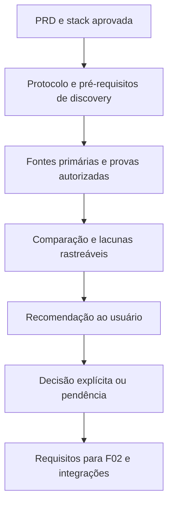

# F01 — Discovery e viabilidade de integrações

<!-- current-execution:start -->
> **Situação em 2026-11-13:** `done` — [avaliação registrada](eval-report-2026-11-10T19-53-58Z.md); o [progresso canônico](../prd_progress.json) conserva ciclos e datas.
> Menções à feature ainda não iniciada ou à ausência do scaffold refletem a elaboração original. Consulte o [estado consolidado](../status-atual.md) para implementação e limites atuais. Evoluções explícitas do PRD e contratos posteriores prevalecem nos pontos alterados; IDs e evidências históricas são preservados.
<!-- current-execution:end -->

Data: 2026-11-10. Complexidade: **média**, pela diversidade de integrações e de evidências. Dependências: nenhuma. Onda: 1. Estado na elaboração original: **especificação documental; discovery não executado**.

Fontes: [PRD §§2, 6, 8 e 9](../PRD.md), [stack aprovada](../stack.md), [arquitetura proposta](../architecture/README.md), [harness](../harness.md) e [AGENTS.md](../../AGENTS.md). O [contrato](contract.md) cobre F01-AC01–AC04; o [plano](plan.md) ordena o trabalho futuro. Criar estes três documentos não implementa F01 nem altera `docs/prd_progress.json`.

## 1. Visão técnica e escopo

A F01 produz uma comparação rastreável que permita escolher a primeira plataforma e a estratégia de acesso compatíveis com o MVP. Avalia OLX, Facebook Marketplace, Enjoei e Mercado Livre, além de referências de usados/novos, WAHA e capacidade local. Não pressupõe acesso gratuito, API disponível, sessão utilizável ou viabilidade de scraping.

**Incluído:** protocolo de investigação, preparação mínima para executá-lo, evidências ou lacunas por alternativa, avaliação de cobertura e operação, recomendação e registro separado da decisão. O resultado inclui requisitos para F02 e as limitações que as especificações de F03/F04/F06/F09 precisarão resolver.

**Limite desta solicitação:** preparar apenas `spec.md`, `plan.md` e `contract.md`. Relatórios, medições, consultas externas, instalação, contas, provas de conceito, scaffold, contêineres e envios não são executados nesta entrega.

**Trabalho futuro da F01:** investigação documental em fontes primárias; inventário e provas práticas somente dentro de escopo registrado antes da execução. O escopo prático ainda não está autorizado. Bloqueios de acesso ou falta de recursos geram lacunas explícitas, não resultados fictícios.

**Fora da F01:** criar aplicação Django, migrar scripts, integrar scaffold na árvore do produto, implantar fila, coletor contínuo, banco funcional, interface ou envio de alertas. Isso pertence à F02 e às features seguintes. A preparação e a integração seletiva solicitadas são especificadas abaixo como protocolo de discovery e requisitos de passagem para F02, preservando a divisão do PRD.

## 2. Impacto de arquitetura e ambiente

F01 não adiciona superfície HTTP, CLI própria, worker ou modelo de negócio. Sua superfície pública é a documentação consumida pelo usuário e pelas features seguintes. Não há dependência da aplicação futura para comparar alternativas.

### Preparação verificável para a execução futura

| Requisito | Como preparar/criar | Como verificar e registrar | Se ausente |
|---|---|---|---|
| Fontes canônicas e diretório de execução | Conferir checkout e alterações existentes; reservar diretório temporário do sistema com `mktemp -d` | `git status --short`; existência do PRD, stack e harness; caminho temporário identificado privadamente | Interromper operações que poderiam sobrescrever trabalho; não substituir o harness |
| Ferramentas do harness | Disponibilizar Git, Bash e Node no ambiente de execução; registrar versões efetivamente utilizadas | `git --version`, `bash --version`, `node --version`; executar as duas verificações de harness da seção 7 | Registrar pré-requisito faltante e comando afetado; não declarar gate aprovado |
| Escopo das provas | Registrar em `environment.md` quais ações serão feitas, plataformas, contas, limites de requisição/duração, custo permitido, artefatos e limpeza | Referência à autorização atual que cobre as ações; qualquer ponto não definido permanece pendente | Limitar-se a pesquisa documental; não iniciar prova prática |
| Inventário WSL2 e computador | Na execução autorizada, levantar CPU/arquitetura, memória, disco, limites WSL2/Docker e disponibilidade real | `uname -srm`, `lscpu`, `free -h`, `df -h .`; confrontar com limites do host/WSL2 e Docker quando acessíveis | Separar capacidade observada no WSL2 da capacidade total desconhecida; não concluir compatibilidade |
| Docker e serviços de prova | Somente se necessários e autorizados, definir imagens/versões, nomes próprios, portas locais e volumes antes de criar recursos | `docker version`, `docker compose version`; verificação específica de propriedade, bind e prontidão dos recursos criados | Falha é lacuna de ambiente; não iniciar serviços alternativos implicitamente |
| Navegação | Se houver prova de navegação autorizada, seguir a skill local `playwright-cli` e usar sessão isolada | Versão do CLI, browser disponível e evidência sanitizada da jornada real | Registrar indisponibilidade; pesquisa documental continua distinguida de teste real |
| Contas, CEP e mensagens | Solicitar apenas entradas necessárias à prova aprovada; indicar a origem e manter valores privados no ambiente/sessão | Confirmar presença sem imprimir valores; confirmar plataforma/sessão/destinatário de teste antes de qualquer envio autorizado | Marcar cenário bloqueado; não usar conta, CEP ou destinatário fictício como evidência real |

O inventário deve separar recursos configurados, recursos disponíveis no instante da medição e consumo observado sob carga. Registrar data, ferramenta, condições e limitações, sem nome de usuário, hostname ou saídas privadas desnecessárias. Não fixar mínimos de RAM ou intervalos sem evidência.

Antes de trabalho que necessite da aplicação, seguir `./scripts/init.sh` e encerrar processos próprios por `./scripts/stop.sh`, conforme AGENTS. No estado atual, `init.sh` apenas anuncia ausência de scaffold; isso não inicia Django nem comprova prontidão. Uma eventual prova isolada terá comandos próprios registrados no ambiente temporário; não será apresentada como suporte Python dos scripts canônicos.

### Preparação da integração seletiva do scaffold — execução em F02

F01 entrega o mapa de adaptação e as restrições; F02 detalha versões e comandos no seu próprio contrato e executa a integração **sequencialmente**. A base Django deve ser gerada em temporário, com versões e dependências verificadas antes da cópia. O gerador em `.agents/skills/clean-arch/scripts/scaffold.mjs` gera TypeScript, não Django; sua existência não autoriza usá-lo como base do produto nem executar instalação/gates antigos como validação Python.

| Recurso atual | Destino da integração em F02 | Evidência exigida antes de aceitar a fundação |
|---|---|---|
| `AGENTS.md`, `README.md`, `.gitignore`, `.codex/`, `.agents/`, PRD, progresso, arquitetura e design | Preservar conteúdo; mesclar apenas ajustes necessários e revisáveis | Diff de cada arquivo tocado; nenhuma sobrescrita pelo scaffold, nenhum `--force` para integração |
| `apps/backend/` ainda ausente | Integrar seletivamente projeto Python/Django, templates e estáticos, conforme arquitetura; sem workspace web separado obrigatório | Inventário da base gerada, versão, origem e arquivos aceitos/rejeitados; bootstrap Django real |
| `scripts/init.sh`, `resolve-env.sh`, `spawn-detached.mjs`, `stop.sh` | Adaptar web/worker Python, propriedade de processos, isolamento, prontidão, preservação de configuração e parada | Dois ambientes isolados; falha de recurso obrigatório impede sucesso; parada normal preserva dados/sessão |
| `scripts/migrate-dev.sh` e futura configuração Docker | Substituir Prisma por migrations Django/fila; PostgreSQL/WAHA locais com recursos identificados | Banco `garimpei_` explicitamente identificado, migrations e volumes verificados; sem limpeza implícita |
| `scripts/run-gates.mjs` e validadores TypeScript | Preservar a entrada canônica e implementar seis coberturas Python da seção 7 | Comandos reais, arquivos analisados e rejeição de violações representativas; nenhum gate vazio |
| `scripts/test/harness.test.mjs`, `check-harness.mjs` e pressupostos das skills/templates | Adaptar expectativas npm/Prisma preservando regressões pertinentes | Testes de lifecycle, propriedade, colisões de portas, prontidão e preservação de dados |

F02 deve traduzir `domain` ← `usecase` ← `infra`, DI por construtor, configuração central e composição explícita para Python/Django; não copiar convenções TypeScript literalmente. `Procrastinate` permanece candidato a validar. Não introduzir Redis, React/Next.js, Prisma ou novo runtime do produto por herança do scaffold.

## 3. Decisões, hipóteses e pendências

| Decisão | Abordagem | Alternativa considerada | Consequência |
|---|---|---|---|
| Natureza da F01 | Entrega documental com evidências e limites | Antecipar implementação da fundação | Mantém F02 como fundação sequencial dependente da escolha de integrações |
| Direção técnica | Preservar Python/Django, templates/HTMX, PostgreSQL e worker separado, local e sem Redis inicial | Reabrir stack por conveniência dos templates | Necessidades incompatíveis são levadas ao usuário; não alteram stack automaticamente |
| Protocolo de evidência | Diferenciar documentação, observação prática, inferência e lacuna | Tratar documentação de fornecedor como teste local | Impede afirmar compatibilidade ou cobertura que não foi observada |
| Método de seleção | Avaliar cobertura indispensável e depois esforço, recursos, custo e manutenção | Escolher a candidata mais conhecida ou pontuação com pesos inventados | Não fabrica ranking numérico; uma recomendação pode ser condicionada a lacunas |

Hipóteses: F01 não precisa de banco do produto, seeds, fixtures de anúncios ou credenciais para a revisão documental. Não existe convenção de fixtures Python no produto atual; sua definição pertence à F02. Exemplos sintéticos, se usados, terão identificação explícita e não comprovarão acesso externo, preços ou entrega.

Pendências com bloqueio delimitado:

| Pendência | Como resolver | Bloqueia |
|---|---|---|
| Escopo de investigação prática/PoC (P01) | Apresentar ações, entradas, duração, custo e limpeza; registrar autorização antes de executar | Provas práticas, instalações e envios; não a redação destes documentos |
| Recursos reais, WAHA/engine, sessão e custo (P02) | Inventário e fontes primárias; prova delimitada quando autorizada | Conclusão de compatibilidade; setup correspondente em F02/F09 |
| Primeira plataforma e estratégia (P01) | Apresentar recomendação e obter decisão explícita, rastreada no repositório | Aceite final da escolha e passagem para F02 |
| Cobertura geográfica, acesso e referências (P03/P05/P07/P09) | Relatar evidências, lacunas e decisões a resolver por feature | Fechamento dos comportamentos afetados em F03/F04/F06/F09 |
| Versões, gerenciador, fila e ferramentas Python | Definir comandos executáveis e verificar compatibilidade na especificação de F02 | Implementação e aceite da fundação; não comparação documental de F01 |

## 4. Artefatos e responsabilidades

Somente os três primeiros arquivos são produzidos nesta solicitação. Os demais são **entregáveis futuros da execução de F01**, não arquivos presumidos existentes nem anexos já aprovados.

| Caminho na pasta `docs/F01-discovery-e-viabilidade-de-integracoes/` | Estado nesta entrega | Responsabilidade |
|---|---|---|
| `spec.md` | Novo | Escopo, protocolo, preparação e estratégia de verificação |
| `plan.md` | Novo | Ordem das fases e suas condições de saída |
| `contract.md` | Novo | Comportamentos documentais observáveis e cobertura do PRD |
| `report.md` | Futuro | Matriz das quatro candidatas, cobertura, referências, WAHA, custo, intervalo/latência e recomendação |
| `evidence-index.md` | Futuro | IDs de evidências, fonte/data/método, observações sanitizadas, limitações e referências cruzadas |
| `environment.md` | Futuro | Escopo autorizado, pré-requisitos, recursos, comandos e condições das provas, se houver; mapa para F02 |
| `decisions.md` | Futuro | Escolha final separada da recomendação, registro de aprovação ou pendência, condições e impactos |

Artefatos temporários, capturas brutas e ambientes de prova ficam fora da raiz, em temporário do sistema. Somente evidência necessária e sanitizada poderá integrar a pasta da feature. Não versionar cookies, tokens, QR codes de sessão, credenciais, telefone, CEP privado ou armazenamento do navegador. As referências públicas devem apontar para anúncios/fontes sem parâmetros secretos.

## 5. Contratos de saída e integrações

Não há endpoint ou API de produto nesta etapa. O formato abaixo é o contrato de informação dos documentos futuros.

### Comparação e evidências

Cada candidata terá acesso/API/página pública/sessão autenticada/scraping avançado, antirrobô, autenticação, dados, atualização, esforço inicial, custos, estabilidade e manutenção avaliados separadamente. Para cada modalidade, indicar `documentado`, `observado em prova autorizada`, `inferido`, `indisponível` ou `não verificado`, além das condições de acesso. Ausência de evidência não significa impossibilidade; publicidade de um anúncio não comprova acesso automatizado estável.

Cada afirmação relevante aponta para um ID de evidência. O índice registra: plataforma/serviço, URL pública ou artefato sanitizado, data de consulta/observação, método, contexto/versão quando aplicável, fato observado, limite e se a conclusão é inferência. Fontes primárias oficiais devem sustentar capacidades/custos atuais; falta de fonte fica explícita. Falha, timeout, autenticação exigida e bloqueio são resultados distintos de lista vazia ou acesso bem-sucedido.

### Cobertura do MVP

| Dimensão | Informação que o relatório deve permitir conferir |
|---|---|
| Interesses | Obtenção de categorias/subcategorias e anúncios associados; busca por nome/modelo; limites de correspondência e sobreposição |
| Anúncio | Identidade, link, preço, condição e localização disponíveis; alterações, remoção, duplicatas/republicações e confiança do vínculo |
| Geografia | Retirada em São Paulo (SP) até 20 km do CEP configurado; envio nacional com entrega no CEP; origem da localização e lacunas |
| Frete | Disponibilidade e origem do frete informado; distinção de frete estimado; estimativa não comprova entrega |
| Retomada | Paginação/janela histórica, ordenação, anúncios publicados na interrupção e mudanças recuperáveis; limites sem promessa de recuperação integral |
| Referências | Usados semelhantes separados de novos; campos para equivalência, atualidade, quantidade, discrepantes e confiança; fontes possíveis e limitações |

Dados ausentes não viram preço zero, produto equivalente, entrega confirmada ou compatibilidade. F01 identifica limites para definir políticas de amostra/identidade depois; não escolhe limiares de negócio nem algoritmo de revenda.

### Operação, recomendação e passagem

Avaliar WAHA por versão/imagem/engine considerada, requisitos, arquitetura de CPU, dependência de navegador, configuração de sessão e persistência, prontidão e custos/licenças documentados. Processo/porta disponível, sessão autenticada e mensagem recebida são evidências diferentes. Um envio real exige autorização específica, conta/sessão/destinatário definidos e confirmação observada; não integra esta solicitação.

Para intervalo e latência, distinguir tempo da coleta, atualização da fonte, fila/processamento e envio. Registrar condições, duração e número de observações quando houver medição. Uma estimativa documental fica identificada como tal; latência sem horário de publicação confiável não é latência ponta a ponta medida. Limites de acesso e consumo local fundamentam a proposta, sem inventar SLA, custo zero ou execução 24 horas.

A recomendação identifica primeira plataforma e estratégia sugeridas, alternativas descartadas/condicionadas, evidências, esforço, recursos, custos e limitações. Se nenhuma candidata tiver cobertura demonstrada, registrar recomendação condicionada ou inviabilidade e a decisão necessária, sem reduzir o MVP implicitamente.

`decisions.md` registra separadamente estado `pendente` ou `aprovada`, plataforma, estratégia, data, referência à decisão do usuário, condições e impactos. Recomendação não é aprovação. Escolha ausente mantém o aceite correspondente pendente e impede a passagem para F02. Lacunas aceitas como risco devem ter consequência e destino explícitos; requisito obrigatório inviabilizado exige decisão sobre o PRD, preservando IDs e histórico.

## 6. Dados e estado persistente

Nenhuma tabela, migration, banco ou seed de produto é criado na F01. Evidências e decisões são Markdown junto da feature; eventuais estados de prova são temporários ou privados conforme autorização. Não reutilizar sessão WhatsApp pessoal em ambientes descartáveis nem apagar volumes existentes.

Os entregáveis futuros referenciam o requisito/pendência do PRD e a feature consumidora. Relatórios de implementação/avaliação serão separados do contrato e preservarão os anteriores. A especificação não altera estados, ciclos, timestamps ou dependências do progresso.

## 7. Estratégia de testes, gates e evidências

### Validação da F01

| Verificação | Modo e resultado esperado |
|---|---|
| Cobertura do PRD | Conferir cada texto F01-AC01–AC04 no Coverage Manifest e seus itens GWT; nenhum critério sem evidência correspondente na avaliação |
| Rastreabilidade | Abrir as referências da matriz; verificar fonte, data, método e limites; conclusões sem suporte precisam aparecer como inferência/lacuna |
| Falhas e ausências | Revisar cenários de acesso bloqueado, dado ausente, ambiente não medido e aprovação pendente; não podem aparecer como sucesso |
| Coerência de escopo | Conferir stack, dependências, divisão F01/F02, preservação de IDs e histórico; revisar links locais e ausência de segredos nos artefatos |
| Harness estrutural | `node scripts/check-harness.mjs` — estrutura, referências e sintaxe do harness válidas; não valida Django |
| Regressão do harness | `node --test scripts/test/harness.test.mjs` — testes existentes aprovados; não comprova integrações externas |

Não criar testes unitários que apenas repitam texto de documentos. Provas de integração, se autorizadas, precisam de entrada/estado inicial, ação delimitada, observação esperada e evidência sanitizada. Simulação cobre somente o caso simulado; não substitui acesso real. Revisão documental pode atestar que uma lacuna foi corretamente registrada, sem aprovar a capacidade não verificada.

### Gates da aplicação — pré-requisitos de F02, não aprovação de F01

A entrada canônica será `node scripts/run-gates.mjs`. Atualmente ela requer backend TypeScript e dependências; sem eles retorna erro de pré-requisito, código 64. Sua aprovação futura precisa representar Python efetivamente analisado. Não executar ou aceitar os validadores TypeScript como substitutos; não marcar ausência como sucesso nem usar `--no-gates` para concluir a fundação.

| Gate | Cobertura requerida no contrato de F02 |
|---|---|
| Tipos | Tipos Python nos módulos usados, incluindo entradas web/worker |
| Lint | Python autoral e verificações pertinentes a templates/JavaScript autoral |
| Limites de dependências | Importações para dentro, sem Django/I/O em domínio/casos de uso |
| Arquitetura | Estrutura Python, configuração central, composição explícita e DI |
| Ciclos | Detecção efetiva de ciclos entre módulos Python |
| Código/dependências não utilizados | Análise com entradas do framework registradas explicitamente, sem exclusões amplas que ocultem código |

F02 deve fixar ferramentas/versões/comandos, configuração e abrangência antes de implementar. Deve demonstrar que cada controle rejeita uma violação representativa em cópia descartável e passa no código válido. Acrescentar testes significativos de configuração/lifecycle, migrations e integração PostgreSQL/fila, bootstrap web/worker e preparação de templates/estáticos aplicável. Jornadas de produto seguem `playwright-cli` quando existirem. Não há aplicação a compilar ou testar neste pedido; esses checks permanecem pré-requisitos futuros verificáveis, não gates executados ou aprovados.
