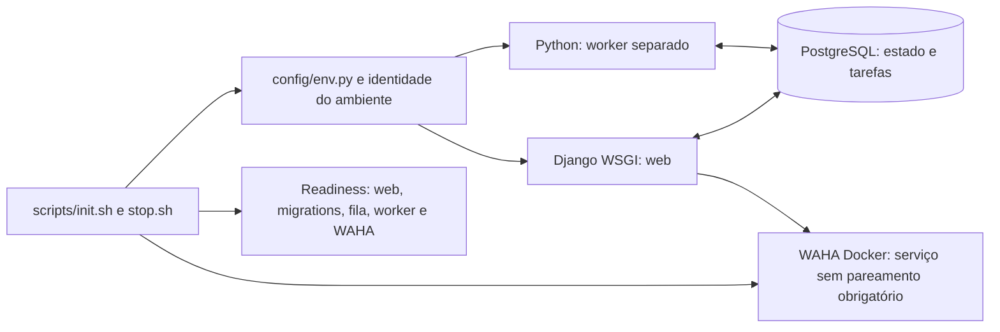

# F02 — Fundação técnica e ambiente local

<!-- current-execution:start -->
> **Situação em 2026-11-13:** `done` — [avaliação registrada](eval-report-2026-11-10T21-15-47Z.md); o [progresso canônico](../prd_progress.json) conserva ciclos e datas.
> Menções à feature ainda não iniciada ou à ausência do scaffold refletem a elaboração original. Consulte o [estado consolidado](../status-atual.md) para implementação e limites atuais. Evoluções explícitas do PRD e contratos posteriores prevalecem nos pontos alterados; IDs e evidências históricas são preservados.
<!-- current-execution:end -->

Data: 2026-11-10. Complexidade: **alta**, pela integração do lifecycle, persistência/fila, dois processos e validadores. Onda: 2. Dependência: **F01**. Estado na elaboração original: **especificada; implementação não iniciada**.

Fontes canônicas: [PRD, F02 e seus quatro ACs](../PRD.md), [stack](../stack.md), [AGENTS.md](../../AGENTS.md), [harness](../harness.md), [arquitetura](../architecture/README.md) e [diretrizes](../development-guidelines.md). Estas últimas distinguem regras vigentes de propostas; esta especificação seleciona detalhes técnicos para F02 sem transformar recomendações de produto em decisões aprovadas. [Plano](plan.md) e [contrato](contract.md) são complementares.

## 1. Visão técnica e limites

A F02 prepara uma aplicação Django local com PostgreSQL, worker Python independente e tarefas persistentes, servida por WSGI. Integra os scripts existentes à stack Python, preserva o harness e estabelece verificações reais para arquitetura, tipos, lint, dependências, ciclos e código não utilizado. A reprodutibilidade inclui dependências travadas, migrations, configuração privada, propriedade de recursos, diagnóstico e parada sem perda de dados.

**Incluído:** geração Django em temporário e integração seletiva em `apps/backend/`; configuração central tipada; web/worker; PostgreSQL e WAHA locais em Docker; Django ORM/migrations e validação de Procrastinate; templates/estáticos preparados para HTMX; endpoints técnicos; prova técnica de fila; lifecycle, testes e seis gates Python; documentação de preparação/operação.

**Fora:** coletor ou navegador da plataforma, contas/cookies de marketplace, configuração guiada, anúncios/interesses reais, classificação, cálculos, telas F03/F08, agenda de coleta, política de alertas e envio WhatsApp. Não criar login na aplicação, Redis, workspace Next.js, dados fictícios de negócio ou adoção implícita da OLX. Pareamento e destinatário WAHA pertencem à validação específica de F09.

**Dependência ainda aberta:** [F01](../F01-discovery-e-viabilidade-de-integracoes/decisions.md) permanece `implemented`, avaliação `pending`, com DOC-RECOMENDACAO-02 MANUAL. O pedido atual autoriza **especificar F02**, não aprova plataforma/acesso nem fecha F01. Antes da implementação, exigir F01 concluída pelo seu contrato e revisar impactos da escolha na fundação. Lacunas de fonte não resolvidas mantêm seu destino em F04/F06/F09; não são ocultadas por uma base Django funcional.

O inventário F01 observou WSL2/x86_64, recursos visíveis e Docker, mas não carga conjunta. A F02 revalida condições e mede a base efetivamente instalada. Sem coletor escolhido, seu consumo continua fora da capacidade demonstrada. Nenhum mínimo de máquina, SLA de coleta ou gratuidade total é deduzido desse inventário.

## 2. Arquitetura e execução

As setas acima são chamadas em execução. Imports seguem `domain` ← `usecase` ← `infra`; `main.py` compõe adapters por construtor e `config/` fornece bootstrap. Não importar Django, ORM, HTTP, fila, ambiente ou filesystem nas regras/casos de uso. Biblioteca padrão pura é permitida. Endpoints técnicos usam um caso de uso de prontidão com contratos puros e adapters injetados; não inventar entidades de negócio para justificar a fundação.

Web e worker têm grupos de processo distintos; web não supervisiona worker. Inicializar Django antes de compor adapters ORM. Importações e `AppConfig.ready()` não iniciam consultas, coleta, processos ou envios. Registro técnico sem I/O é permitido; construção de handlers/adapters permanece explícita em `main.py`. Usar módulos concretos, sem barrels. Nomes Python em `snake_case`; pacotes `__init__.py` não reexportam uma fachada genérica.

### Identidade, isolamento e propriedade

`GARIMPEI_ENV` distingue `dev` de `eval`; `GARIMPEI_INSTANCE` identifica a instância estável. O padrão de desenvolvimento deriva de checkout canônico e branch, com hash curto que evita colisões entre nomes normalizados iguais, worktrees e branch sem commit. Avaliação exige nome explícito exclusivo. A identidade **não muda** entre reinícios do mesmo ambiente; cada início recebe `run_id` UUID distinto.

- Banco: `garimpei_<identidade>`, somente letras minúsculas/dígitos/underscore e até 63 bytes. Testes Django usam banco próprio `garimpei_test_<hash>`, nunca `test_` sem o prefixo exigido.
- Compose: projeto e labels com identidade, checkout e propriedade; serviços PostgreSQL/WAHA e seus volumes são exclusivos da instância.
- Todas as publicações usam `127.0.0.1`. Resolver colisões de web, PostgreSQL e WAHA; não reutilizar serviço por porta aberta ou nome genérico.
- Manifesto privado sob `.runtime/<identidade>/` contém checkout, ambiente, run_id, portas, recursos e PIDs/PGIDs com instante de criação. Não contém senhas, tokens ou DSN. Diretório ignorado e acesso restrito.
- Reserva de identidade/portas e início são serializados por lock exclusivo por ambiente. Checagem de porta livre não substitui bind real; colisão na janela entre reserva e bind termina em falha identificada.
- Antes de sinalizar um processo, conferir PID, início, grupo, comando e checkout. PID reutilizado/alheio nunca é encerrado. Não procurar processos com um `grep python` genérico. Manifesto inconsistente causa diagnóstico, sem limpeza alheia.

### Prontidão e parada

`init.sh` valida configuração/ferramentas, sincroniza dependências travadas, sobe serviços próprios, aplica migrations e inicia web/worker. Só termina com exit 0 e mensagem `Ready` após as provas abaixo, dentro de `GARIMPEI_STARTUP_TIMEOUT_SECONDS` (padrão técnico 60 s). Falha retorna exit 1; uso/pré-requisito inválido retorna 64. Esses números são limites de operação local, não intervalos de monitoramento.

| Recurso | Prova exigida |
|---|---|
| PostgreSQL | Identidade/label, conexão autenticada ao banco previsto e consulta simples; porta/TCP isoladamente insuficientes. |
| Schema | Migrations Django, da aplicação e da fila aplicadas; nenhuma pendente. |
| Web | PID/PGID próprios e HTTP `/health/ready` com corpo da instância/run corretos. |
| Worker | PID próprio e tarefa técnica desta execução realmente consumida, com recibo persistente recente; `kill -0` sozinho insuficiente. |
| WAHA | Contêiner/label próprios, imagem/digest registrado e `GET /health` autenticado com 200 e estado saudável. Não exigir sessão conectada ou mandar mensagem. |

`stop.sh` sinaliza parada, deixa de aceitar novas tarefas e aguarda até 30 s por padrão técnico; encerra web/worker e para os contêineres próprios, **sem remover** bancos, volumes ou sessão. Se o prazo for excedido, encerra somente o grupo próprio, retorna falha e registra trabalho possivelmente interrompido; não afirma conclusão de tarefas. Repetir parada sem recursos ativos é exit 0. Falha durante `init.sh` desfaz apenas processos/contêineres iniciados naquela tentativa, conserva volumes e deixa diagnóstico; não encerra recursos que já estavam ativos e válidos.

`stop.sh --clean` fica restrito a instância `eval` explicitamente descartável e com marcador de propriedade verificável, por exemplo após autorização do ciclo de avaliação para seus próprios dados. Nega execução em `dev`, sessão real/desconhecida ou recurso sem marcador, antes de apagar algo. Não adicionar confirmação interativa que substitua esses controles. Parada normal nunca executa `down -v` ou `dropdb`.

## 3. Decisões técnicas e condições

### Matriz de dependências

As séries abaixo são a direção técnica desta especificação, **sem instalação executada**. Patches e digests são resolvidos e registrados na preparação anterior à integração, não por uma tag móvel em cada início. Referências oficiais consultadas em 2026-11-10 estão na seção 7.

| Decisão | Escolha para a base / alternativa | Condição e trade-off |
|---|---|---|
| Python e Django | Python **3.13**, Django **5.2 LTS** (`>=5.2,<5.3`); alternativas: séries mais recentes. | Combinação documentada, evitando escolher a versão máxima do interpretador sem matriz compatível. Fixar patch mantido do Python em `.python-version` e dependências exatas no lock antes de integrar. |
| Dependências | **uv**, `pyproject.toml` e `uv.lock`, build com **hatchling**; alternativa: pip/requirements manuais. | Usar versão exata do uv registrada na preparação. `uv sync --locked --all-groups` recusa lock desatualizado; início não atualiza dependências nem instala ferramentas de sistema. |
| PostgreSQL/driver | PostgreSQL **17**, `psycopg` **3** com suporte binário/pool conforme fila. | Imagem por patch/digest compatível com x86_64; não compartilhar volume com major diferente. Sem SQLite como substituto em integração. |
| Fila | **Procrastinate 3.10.0 como candidato delimitado**, integração Django e migrations oficiais; alternativa: reavaliar mecanismo PostgreSQL se a prova falhar. | Metadados/documentação não provam combinação local. Antes de integrar, testar migrations, enqueue transacional, worker, retomada e tipos. Falha não autoriza Redis ou outra biblioteca silenciosamente. |
| Servidor web | **Gunicorn WSGI**, 1 worker de servidor inicialmente; alternativa: servidor dev com autoreload. | Evita duplicação de processos pelo autoreloader; validar sinais e registrar versão travada. Não é promessa de capacidade de produção. |
| Templates/HTMX | Templates Django e asset HTMX **2.x** local fixado, com licença/hash; sem CDN obrigatório em runtime. | Preparar `base.html` e estáticos sem antecipar telas F03/F08. Não adicionar JavaScript autoral nesta fundação; quando existir, o gate de lint deverá cobri-lo. |
| WAHA | Release de referência **2026.10.1**, engine candidata **GOWS/x86**, volume local de sessão; alternativa WEBJS se a validação exigir. | Conforme F01, família `devlikeapro/waha:gows`; tag versionada/manifesto/digest precisam ser comprovados antes de pull/uso. Nenhum digest inventado nem substituição por `latest`. Falha da engine volta à decisão técnica explícita. |
| Ferramentas de qualidade | mypy + django-stubs, Ruff, djLint, Import Linter, Grimp, Vulture, deptry e verificadores Python próprios. | Versões compatíveis ficam em grupo de desenvolvimento travado. Exceções do framework são explícitas, locais e justificadas; não ignorar camadas inteiras. |

`versions.md`, produzido **antes de copiar o scaffold**, registra versões exatas de Python/uv/pacotes, origem, licenças pertinentes, hashes/digests, arquitetura, resultados da PoC de fila e compatibilidade. O contrato só aceita a fundação depois desses valores e provas. Resolução de patches é rotina técnica; indisponibilidade da série/engine ou incompatibilidade que mude estas escolhas exige revisão explícita, não aprovação presumida. Não alterar ADRs/AGENTS ou a escolha de stack para fazer a base passar.

### Configuração central

Leitura autoral de variáveis e de arquivo privado opcional concentra-se em `config/env.py`, que devolve configuração imutável tipada por finalidade: bootstrap, migrations, web/worker ou qualidade. Wrappers shell não fazem `source` de arquivo `.env` nem usam `eval`; o adapter operacional consome o bootstrap central. Precedência: ambiente explícito → arquivo privado indicado por `GARIMPEI_ENV_FILE` → padrões **técnicos** abaixo. Não sobrescrever chaves extras ou segredos existentes ao resolver portas/identidade.

| Chave | Regra / preparação | Ausência ou erro |
|---|---|---|
| `GARIMPEI_ENV` | `dev` padrão técnico ou `eval` explícito. | Outro valor: chave, valor não secreto e enum esperado. |
| `GARIMPEI_INSTANCE` | Identidade derivada em dev; nome explícito em eval, `^[a-z0-9_]{1,40}$`. | Eval sem nome: exit 64; sem reutilizar default. |
| `DJANGO_SECRET_KEY` | Segredo não vazio e não placeholder; gerar privadamente com ferramenta segura e exportar. | Diagnóstico só com chave/formato, nunca conteúdo/tamanho que revele valor. |
| `POSTGRES_PASSWORD` | Senha privada do banco próprio; demais parâmetros não secretos resolvidos pelo ambiente. | Ausente: falha antes de subir serviços. |
| `DATABASE_URL` | DSN construído pelo bootstrap a partir da identidade/porta e credencial privada. Override explícito deve corresponder ao recurso próprio e banco `garimpei_`. | Destino alheio/ambíguo: recusar; diagnóstico sem DSN ou senha. |
| `WAHA_API_KEY` | Chave privada para serviço local e chamadas de health. | Ausente: falha de preparação, sem desabilitar WAHA implicitamente. |
| `GARIMPEI_WEB_PORT`, `GARIMPEI_PG_PORT`, `GARIMPEI_WAHA_PORT` | Inteiros 1024–65535; resolver livres se omitidos, persistindo seleção não secreta. | Porta explícita ocupada: falha; não matar dono ou escolher outra silenciosamente. |
| `GARIMPEI_STARTUP_TIMEOUT_SECONDS` | Inteiro 1–300, padrão 60. | Erro de formato: falha antes de iniciar. |
| `GARIMPEI_SHUTDOWN_TIMEOUT_SECONDS` | Inteiro 1–120, padrão 30. | Mesmo tratamento. |
| `LOG_LEVEL` | `DEBUG`, `INFO`, `WARNING`, `ERROR`, `CRITICAL`; padrão INFO. | Não aceitar valor desconhecido. |

Host web fixado em `127.0.0.1`, `ALLOWED_HOSTS` explícito para localhost/loopback, sem curinga; `DEBUG=False` no processo normal. Test settings não fazem I/O no carregamento, não exigem conta WAHA e são selecionados explicitamente para análise/unitários. Testes de integração usam banco e configuração isolados. Entradas F03 (CEP, custos e interesses) não são variáveis técnicas obrigatórias da F02 e não recebem defaults.

Logs de aplicação/Gunicorn/worker são linhas JSON com `timestamp` UTC, `level`, `logger`, `event`, `environment_id`, `run_id` e `error_code` quando aplicável. Identificadores de tarefa/probe são permitidos; senha, token, DSN completo, cabeçalhos, cookies, QR, CEP/telefone e exceção externa bruta são proibidos. Mapear exceções no adapter central de HTTP e na fronteira de CLI/worker. CLI escreve texto legível, com chave/recurso e formato esperado; valores não secretos inválidos podem ser mostrados. Não usar mensagens de segredo com interpolação do valor problemático.

## 4. Componentes e integração seletiva

Todos os caminhos de aplicação abaixo são **entregáveis futuros**, não arquivos presumidos existentes. Criar módulos somente quando usados; módulos de monitoring/listing/valuation/alert surgem em suas features.

| Caminho / grupo | Tipo | Responsabilidade |
|---|---|---|
| `apps/backend/{pyproject.toml,uv.lock,.python-version}` | Novo | Runtime e ferramentas travados; pacote `src`, configuração dos seis gates e pytest. |
| `apps/backend/manage.py`, `src/garimpei/config/{env,settings,test_settings,wsgi}.py` | Novo | Entradas finas; bootstrap central e registro Django/ORM sem I/O de negócio na importação. |
| `src/garimpei/main.py` | Novo | Fábricas web/worker/operação e injeção explícita de contratos/adapters. |
| `src/garimpei/domain/runtime/{readiness_gateway,readiness_result}.py` | Novo | Contratos puros de estado técnico e resultados, sem framework; não são entidades de produto. |
| `src/garimpei/usecase/runtime/check_readiness_usecase.py` | Novo | Compor resultados dos probes injetados, sem ler ambiente ou implementar I/O. |
| `src/garimpei/infra/http/{urls,routes,health_handler,error_handler}.py` | Novo | Rotas técnicas e tradução central de erros; handler chama caso de uso. |
| `src/garimpei/infra/http/{templates/base.html,static/vendor/htmx.min.js}` | Novo | Base de renderização e asset local com licença/hash; não copia protótipos como aplicação. |
| `src/garimpei/infra/persistence/{apps,models}.py`, `migrations/` | Novo | Descoberta explícita ORM e modelos técnicos; migrations ligadas às dependências da fila. |
| `src/garimpei/infra/runtime/` | Novo | Lifecycle, propriedade, probes PostgreSQL/processo/WAHA, logs e configuração de comandos. |
| `src/garimpei/infra/worker/`, comandos Django `runworker` e `runtime_probe` | Novo | Registro explícito de handlers e consumo Procrastinate; tarefa técnica sem acesso a marketplace/WhatsApp. |
| `scripts/{init,resolve-env,stop,migrate-dev}.sh` | Adaptar | Entradas canônicas para Python; eliminar dependência de package npm/Prisma no produto. |
| `scripts/spawn-detached.mjs` | Adaptar/reutilizar | Contrato de grupos/PIDs/propriedade Python; Node segue ferramenta do harness. |
| `scripts/run-gates.mjs` | Adaptar | Preflight e execução dos seis gates Python, sem download ou fallback TypeScript. |
| `apps/backend/scripts/quality/` | Novo | Checkers de estrutura, ciclos, allowlists/entradas e testes negativos. |
| `apps/backend/quality/{entrypoints.json,vulture_whitelist.py}` | Novo | Consumidores dinâmicos do framework e exceções por símbolo com justificativa; metadados inspecionados, sem execução como aplicação. |
| `compose.yaml` | Novo | PostgreSQL e WAHA locais, imagens fixadas, labels e volumes por ambiente. |
| `scripts/test/harness.test.mjs`, `scripts/check-harness.mjs` | Adaptar | Preservar intenção das regressões; reconhecer Python e contratos atuais. |
| `README.md`, `.gitignore`, `docs/harness.md` | Mescla pontual futura | Comandos/configuração reais e diretórios privados ignorados. Preservar contexto e recursos do harness. |
| `docs/F02-fundacao-tecnica-e-ambiente-local/{versions,environment,operations,impl-report}.md` | Novo na implementação | Compatibilidade, requisitos/resultados, instruções e evidências da entrega. |

Caminhos abreviados `src/...` e `tests/...` referem-se a `apps/backend/`. Antes da cópia: snapshot de conteúdo atual, origem/versão/inventário do temporário e lista de arquivos aceitos/rejeitados. Preservar `AGENTS.md`, `.codex/`, `.agents/`, configuração pessoal, PRD/progresso, arquitetura/design e alterações existentes. Não copiar instruções do gerador sobre o arquivo canônico nem usar `--force` como integração. Ajustes das skills/templates para remover pressupostos TypeScript precisam ser locais e revisáveis, preservando suas finalidades; o acervo TypeScript não vira runtime do produto.

## 5. Interfaces públicas e comportamento operacional

### HTTP técnico

Sem autenticação do Garimpei, somente loopback. GET não altera dados. Nenhum endpoint de negócio ou formulário nesta etapa. `Cache-Control: no-store` e `Content-Type: application/json` nas respostas de saúde; host não permitido recebe 400, método não permitido (como OPTIONS) recebe 405 sem efeito colateral. Manter CSRF ativo nas entradas mutáveis futuras; o teste de método não exige criar formulário/login nesta etapa.

| Método/caminho | Sucesso | Falha |
|---|---|---|
| `GET /health` | 200, `{"status":"alive"}`: processo web responde, sem consultar dependências. | Processo morto: transporte indisponível; não confundir liveness com prontidão. |
| `GET /health/ready` | 200, `{"status":"ready","environment_id":"<id>","run_id":"<uuid>","checks":{"database":"ready","migrations":"ready","worker":"ready","waha":"ready"}}`. | 503, mesmo envelope com `status:"not_ready"`, cada check em `ready`/`unavailable`, `error:{code:"DEPENDENCY_UNAVAILABLE",message:"Dependência obrigatória indisponível"}`. Sem DSN/credenciais/erros brutos. |

Cada probe tem timeout de 2 s; orçamento agregado de resposta até 10 s no ambiente de avaliação. Worker pronto exige recibo técnico do `run_id` ativo com idade máxima de 15 s. Falha do banco torna indisponíveis checks que dependem dele; não afirmar estado saudável usando cache de execução anterior. WAHA pronto aqui significa serviço saudável, **não** sessão WhatsApp conectada. Endpoint de health do fornecedor não tem seu corpo bruto repassado.

### CLI

Wrappers executados da raiz; comandos `uv` da tabela de qualidade executados em `apps/backend/`. Os scripts aceitam o ambiente/instância pelo bootstrap central; não executar comandos propostos antes de implementá-los.

| Entrada | Contrato |
|---|---|
| `./scripts/init.sh` | Prepara/inicia ambiente configurado e espera prontidão real; segunda chamada saudável é idempotente, sem duplicar web/worker/contêiner ou reescrever segredos. |
| `./scripts/stop.sh` | Para recursos próprios e mantém volumes/dados/sessão. Idempotente. |
| `./scripts/stop.sh --clean` | Só avaliação descartável explicitamente marcada/autorizada; recusa caso contrário. |
| `./scripts/migrate-dev.sh --check` | Exit 0 sem migrations pendentes; exit 1 com pendências; sem criar/aplicar migration. |
| `./scripts/migrate-dev.sh --apply` | Aplica migrations versionadas Django/fila ao banco próprio; repetição sem mudança é segura. |
| `./scripts/migrate-dev.sh --make <nome>` | Cria migration local com nome válido e diagnóstico; não altera banco implicitamente. |
| `node scripts/run-gates.mjs` | Seis gates Python reais; resumo e código não zero em qualquer falha, 64 se source/dependências/configuração de gate ausentes. Não instalar ferramentas. |
| `uv run --frozen --no-sync python manage.py runworker` | Compõe/registera handlers e aciona consumo com integração Django/Procrastinate oficial; requer configuração do ambiente. Não iniciar dentro do web. |
| `uv run --frozen --no-sync python manage.py runtime_probe --wait` | Enfileira tarefa técnica própria, aguarda recibo até timeout de início e retorna texto/exit 0 ou falha/exit 1; não envia mensagem. |

O comando `runworker` deve delegar ao fluxo oficial `manage.py procrastinate worker` após registro explícito, evitando depender da API instável de connector customizado. A prova inicial verifica essa composição. Auxiliares de diagnóstico não imprimem ambiente inteiro nem URL com credenciais.

## 6. Persistência e tarefas técnicas

Usar somente PostgreSQL real nos cenários de integração; migrations Django incluem `procrastinate.contrib.django`. Não recriar manualmente tabelas internas da biblioteca. Banco vazio precisa suportar `check`/descoberta de migrations sem consulta antecipada a tabelas; somente depois aplicar schema.

| Modelo técnico | Campos e restrições | Finalidade |
|---|---|---|
| `RuntimeState` | `environment_id` PK varchar(64), `run_id` UUID não nulo, `started_at` UTC, `stopped_at` UTC nullable, `last_probe_at` UTC nullable, `probe_sequence` inteiro não negativo. | Estado da execução atual e sinal de consumo da fila. Não armazena config do usuário ou segredos. |
| `RuntimeProbe` | `id` UUID PK, `environment_id` varchar(64), `run_id` UUID, `kind` em `control`/`manual`, `sequence` inteiro não negativo, `created_at` UTC, `completed_at` UTC nullable. Unique `(environment_id,run_id,kind,sequence)`; índice por `(environment_id,run_id,completed_at)`. | Recibo técnico verificável e idempotência local do probe. Não é histórico de alertas. |

Início grava nova execução e primeiro probe de controle. A tarefa de controle, a cada **5 s técnicos**, confirma o consumo atual e agenda a sucessora; comparar `run_id`/sequência sob transação impede que tarefa de execução antiga renove prontidão ou que duplicata abra outra cadeia. Na parada, marcar execução encerrada antes de impedir novos claims; tarefas de controle antigas tornam-se no-op, sem nova cadeia. Probes manuais explícitos são independentes dessa cadeia: se confirmados antes da parada, podem concluir com seu run_id original após reinício, sem atualizar a prontidão do run atual. A sequência de cada kind é alocada atomicamente no seu contexto. Esse intervalo não define agendamento de coleta ou envio.

Criação de probe/atualização técnica e enqueue devem compartilhar transação PostgreSQL pela integração validada; rollback deixa ambos ausentes. `transaction.on_commit()` com segunda conexão não comprova atomicidade. A prova observa filas/recibos antes e depois de commit/rollback em conexões separadas. Se a combinação escolhida não suportar a garantia, suspender integração e registrar incompatibilidade, sem apresentar banco compartilhado como atomicidade demonstrada.

Após reinício, tarefas técnicas **já confirmadas no banco e ainda não iniciadas** continuam disponíveis; tarefas em execução na parada graciosa terminam ou permanecem com estado real de interrupção/falha. A F02 não promete recuperação automática de todo job em andamento após SIGKILL: procedimento de diagnóstico e recuperação da fila deve ser documentado/testado antes de usar tarefas de negócio. Deduplicação de recibo técnico é local, não garantia de entrega WhatsApp exatamente uma vez. Não implementar retry de envio ou intervalos de coleta nesta etapa.

Fixtures e sementes: não há seed de dados de negócio. `tests/conftest.py` e factories próprias criam banco técnico, RuntimeState/RuntimeProbe, canários e marcadores descartáveis por execução. Essa é convenção **nova** desta fundação; não é recurso preexistente. Código deliberadamente inválido dos controles negativos é gerado apenas em cópia temporária a partir de casos JSON/texto; não deixar arquivos Python inválidos sob o escopo normal dos gates. Nada gera CEP/custo/interesse padrão para F03. Marcador de sessão é arquivo sintético em volume privado, sem conta, QR ou cookies reais.

## 7. Verificação, qualidade e fontes

### Seis gates executáveis a implementar

Todos os comandos abaixo rodam em `apps/backend/`, com `.venv` e lock sincronizados, **sem** baixar ferramentas durante a validação. O wrapper da raiz executa os seis grupos na ordem, preserva saída/código por grupo e falha se faltar grupo, fonte analisável ou ferramenta. Fonte/escopo analisado ficam em evidência; zero arquivos analisados não é PASS.

| Gate | Comandos reais planejados | Escopo e prova negativa obrigatória |
|---|---|---|
| 1 — Tipos | `uv run --frozen --no-sync mypy --strict src tests scripts/quality manage.py` | Todo Python autoral, configuração e entradas web/worker. Plugin django-stubs configurado com settings de teste sem I/O. Cópia temporária com retorno anotado incompatível deve ser rejeitada. |
| 2 — Lint | `uv run --frozen --no-sync ruff check src tests scripts manage.py`; `uv run --frozen --no-sync ruff format --check src tests scripts manage.py`; `uv run --frozen --no-sync djlint src/garimpei/infra/http/templates --lint --profile=django` | Python e templates da aplicação, sem vendor HTMX. Import/variável não usados e template com violação representativa devem falhar. Não há JS autoral F02; adicioná-lo exige definir e rodar lint pertinente, não excluí-lo. |
| 3 — Limites | `uv run --frozen --no-sync lint-imports --config .importlinter` | Contratos com descendentes e imports indiretos; vedar saída de domain/usecase e Django/fila/rede/disco/config nesses pacotes. Casos de I/O da stdlib também proibidos. Violação direta e transitiva devem falhar. |
| 4 — Arquitetura | `uv run --frozen --no-sync python scripts/quality/check_architecture.py` | AST + manifesto de entradas/allowlists: ambiente apenas em env.py, montagem concreta apenas main.py, contratos/DTOs/handlers por papel, registro ORM/worker, sem I/O em importação, exceções centrais e no máximo dois níveis de bloco autoral. Fixtures com env fora do bootstrap, adapter criado no caso de uso e caminho fora da estrutura devem falhar. |
| 5 — Ciclos | `uv run --frozen --no-sync python scripts/quality/check_cycles.py` | Grafo completo de imports internos `garimpei` por Grimp, incluindo guardas de tipo; detectar componentes fortemente conexos e reportar cadeia. Imports dinâmicos autorais só por registro explícito inspecionado. Ciclo de dois módulos deve falhar mesmo se não envolver camadas diferentes. |
| 6 — Não utilizados | `uv run --frozen --no-sync vulture src scripts/quality quality/vulture_whitelist.py --min-confidence 60`; `uv run --frozen --no-sync deptry .` | Código autoral e dependências runtime/dev conforme uso; entradas Django/WSGI/tarefas em allowlist por símbolo, motivo e consumidor real. Função órfã e dependência declarada sem uso devem falhar. Sem ignorar pacote/camada por inteiro. |

O checker próprio de arquitetura não promete provar toda a semântica de DI/ausência de I/O; define regras detectáveis acima, usa testes negativos e complementa com revisão e testes comportamentais. Exceções de framework, migrations geradas e entrypoints têm escopo exato e justificativa verificável; todo arquivo efetivamente executado participa dos gates pertinentes. Validação não pode ser concluída aumentando confiança mínima do Vulture para esconder funções nem retornando constante de sucesso.

### Comandos complementares

| Comando / diretório | Evidência necessária |
|---|---|
| `uv run --frozen --no-sync pytest` em `apps/backend/` | Unitários, integração PostgreSQL/fila, HTTP, controles negativos de qualidade e lifecycle. Sem skip silencioso de PostgreSQL/WAHA obrigatório, sem testes vazios. |
| `uv run --frozen --no-sync python manage.py check` em backend | Registro Django e settings sem erros; sem depender de dados de negócio. |
| `uv run --frozen --no-sync python manage.py makemigrations --check --dry-run` em backend | Nenhuma mudança ORM sem migration versionada. |
| `./scripts/migrate-dev.sh --check` na raiz, após init | Nenhuma migration pendente no banco próprio. |
| `uv run --frozen --no-sync python manage.py collectstatic --noinput` em backend | Assets locais coletados em diretório ignorado próprio; hash/licença HTMX verificados por teste. |
| `uv build --no-build-isolation` em backend | Wheel/sdist construídos com backend de build já provisionado e travado; sem resolver dependência de build nova durante o gate. |
| `node --test scripts/test/harness.test.mjs`; `node scripts/check-harness.mjs` na raiz | Harness preservado e expectativas Python adaptadas, sem confundir com gates do produto. |

Build e análise usam configuração de teste explícita quando necessário, sem executar I/O no carregamento de settings. O runner de testes usa contêineres/bancos marcados próprios e prepara pré-requisitos antes das verificações dependentes. Qualquer comando ausente/falho permanece pendente; o runner TypeScript atual não satisfaz a tabela.

### Matriz de regressão

| Área / testes previstos em `tests/` | Verificações significativas |
|---|---|
| `unit/test_config.py`, `test_readiness.py`, `test_logging.py` | Missing/invalid config, precedência sem sobrescrever extras, adapters via fakes nomeados, estado degradado e canários redigidos. |
| `integration/test_migrations.py`, `test_queue.py` | Banco vazio, migração repetida, enqueue/rollback atômicos, dois consumidores sem duplicação de recibo e retomada de tarefa pendente. |
| `http/test_health.py`, `test_templates.py` | Formato/status/cache/host/método; render de base e asset local, sem precisar criar tela do produto. |
| `quality/test_gate_failures.py` | Casos negativos por gate em cópia temporária, incluindo função órfã e imports transitivos; árvore original preservada. |
| `lifecycle/test_start_stop.py`, `test_isolation.py` | Inicialização fria/repetida, falha de dependência, dois ambientes, PID alheio, rollback parcial e parada preservando dados/sessão sintética. |

A avaliação usa todos os itens do contrato, além dos gates, e registra versões, comandos/códigos, URLs locais sem segredo, IDs/labels de recursos próprios e resultados observados. Um fixture WAHA HTTP pode testar diagnóstico isolado, mas **não substitui** contêiner real nos itens que exigem compatibilidade/prontidão/persistência. Falta de Docker/imagem é bloqueio real. Nenhuma captura de sessão pessoal é necessária. Sem UI de produto nesta etapa, não há avaliação visual ou jornada F08 implícita; quando telas forem criadas, usar `playwright-cli` e design canônico.

### Fontes oficiais e limites da consulta

Consulta em **2026-11-10**; documentação comprova capacidades descritas, não combinação instalada. Context7 foi usado para Django **5.2.18** (evitando requisitos da branch main) e Procrastinate; páginas oficiais foram consultadas para completar as decisões.

| Fonte | Suporte usado |
|---|---|
| [Django 5.2: Python](https://github.com/django/django/blob/5.2.18/docs/faq/install.txt), [PostgreSQL](https://github.com/django/django/blob/5.2.18/docs/ref/databases.txt) | Python 3.13 incluído; série 5.2 suporta PostgreSQL 14+ e psycopg 3.1.8+. Escolher PG17 não é prova de carga. |
| [Gunicorn/Django](https://docs.djangoproject.com/en/5.2/howto/deployment/wsgi/gunicorn/) | Entrada WSGI em Linux; configuração/processos próprios ainda serão testados. |
| [Procrastinate: configuração](https://procrastinate.readthedocs.io/en/stable/howto/django/configuration.html), [worker](https://procrastinate.readthedocs.io/en/stable/howto/django/basic_usage.html), [migrations](https://procrastinate.readthedocs.io/en/stable/howto/django/migrations.html), [metadados 3.10.0](https://github.com/procrastinate-org/procrastinate/blob/3.10.0/pyproject.toml) | Integração Django, comando oficial e migrações; metadados da tag permitem Python 3.10+. Isso não certifica a combinação de versões escolhida. |
| [Conexão externa/transação](https://procrastinate.readthedocs.io/en/stable/howto/production/external_connection.html) | Enqueue na conexão/transação fornecida é mecanismo possível; integração efetiva com Django exige prova, não inferência. |
| [uv lock/sync](https://docs.astral.sh/uv/concepts/projects/sync/), [mypy](https://mypy.readthedocs.io/en/stable/running_mypy.html), [Ruff](https://docs.astral.sh/ruff/linter/), [djLint](https://github.com/djlint/djLint) | Interfaces das ferramentas escolhidas. Página dedicada djLint retornou timeout; repositório oficial é a referência consultada. |
| [Import Linter](https://import-linter.readthedocs.io/en/stable/contract_types/forbidden/), [Grimp](https://grimp.readthedocs.io/en/stable/usage.html), [Vulture](https://github.com/jendrikseipp/vulture), [deptry](https://deptry.com/usage/) | Imports diretos/indiretos, grafo, análise de código e dependências; requerem configuração e provas negativas do projeto. |
| [WAHA health](https://waha.devlike.pro/docs/how-to/observability/), [evidências F01](../F01-discovery-e-viabilidade-de-integracoes/evidence-index.md) | `/health` não comprova sessão/entrega; versão, engine e persistência avaliadas documentalmente, instalação pendente. |

### Pendências com bloqueio delimitado

- **Antes de implementar F02:** decisão/encerramento canônico F01, revisão das consequências da fonte e autorização de execução própria. O pedido atual só produz documentos.
- **Antes de integrar scaffold:** patches/uv/digests registrados e prova da combinação Procrastinate/Django/PostgreSQL, imagem WAHA/engine e ambiente. Falha bloqueia a integração dependente; não elimina a exigência.
- **Antes de concluir F02:** todos os itens e gates reais, lifecycle e persistência verificados. Instalação indisponível, validação ausente ou skipped impede done.
- **F03/F04/F06/F09:** permanecem categorias, nome/modelo, identidade, CEP/entrega, amostragem, frequência/latência e sessão/envio. Não são resolvidos por defaults técnicos de readiness.

A especificação não modifica PRD, progresso, AGENTS, ADRs, arquitetura ou os relatórios F01; não executa scaffold, instalação, serviços, envio ou operações Git.
