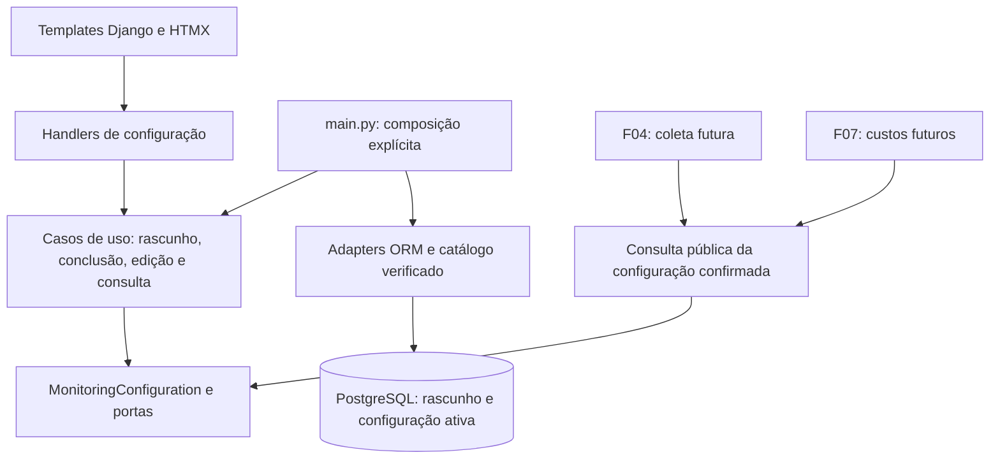

# F03 — Configurações e interesses de monitoramento

<!-- current-execution:start -->
> **Situação em 2026-11-13:** `done` — [avaliação registrada](eval-report-2026-11-10T22-12-38Z.md); o [progresso canônico](../prd_progress.json) conserva ciclos e datas.
> Menções à feature ainda não iniciada ou à ausência do scaffold refletem a elaboração original. Consulte o [estado consolidado](../status-atual.md) para implementação e limites atuais. Evoluções explícitas do PRD e contratos posteriores prevalecem nos pontos alterados; IDs e evidências históricas são preservados.
<!-- current-execution:end -->

## 1. Visão técnica

Especificação de 2026-11-10. Complexidade **média**: fluxo guiado, edição posterior, persistência transacional e interfaces para F04/F07. Dependência: **F02**, `done` em [prd_progress.json](../prd_progress.json), com [avaliação completa](../F02-fundacao-tecnica-e-ambiente-local/eval-report-2026-11-10T21-15-47Z.md). Na elaboração original, F03 estava `pending`; este documento não inicia implementação ou serviços.

Fontes: [PRD §6/§9 F03](../PRD.md), [stack](../stack.md), [decisão F01](../F01-discovery-e-viabilidade-de-integracoes/decisions.md), [arquitetura](../architecture/organizacao-e-dependencias.md), [design](../design/MASTER.md) e [fluxos](../design/flows-reference.md). As descrições anteriores à implementação em stack/arquitetura/design são históricas: o código e a avaliação F02 comprovam a fundação atual. Python/Django, templates/HTMX, PostgreSQL e Procrastinate já existem; os módulos de monitoramento ainda não.

**Included**

- Primeiro uso em três etapas: região → custos → interesses; rascunho persistido e conclusão atômica.
- Categorias reais do Facebook Marketplace e produtos informados somente por nome/modelo; seleção independente ou combinada.
- CEP, frete estimado e percentual provisório; edição posterior com confirmação de gravação.
- Leitura pública interna da configuração confirmada para F04/F07, inclusive estado que autoriza o início da coleta.
- Estados de validação, erro, conflito, retomada e verificação visual das telas implementadas.

**Excluded**

Coletor de anúncios, geocodificação/validação de existência do CEP, comprovação de retirada/entrega, correspondência produto-anúncio, deduplicação de anúncios, cálculo de lucro, classificação, listagem F08 e envio WhatsApp. O cadastro não comprova a disponibilidade de anúncios. F03 não cria tarefas de coleta, alertas ou marcos de carga inicial: fornece a autorização persistente; F04 inicia/retoma a primeira coleta silenciosa após observar essa autorização. Sem dados de F04, a página de acompanhamento informa que a integração de coleta ainda não está disponível, sem simular processamento.

## 2. Impacto de arquitetura

Preservar `domain ← usecase ← infra`, DI por construtor e composição em `main.py`, conforme `clean-arch` e a adaptação Python da F02. Domínio contém invariantes e portas; casos de uso orquestram; handlers validam formato; adapters fazem I/O. Nenhum import Django/ORM/HTTP/fila em domínio ou casos de uso. Não criar singleton de negócio em configuração ou módulos importados.

A consulta pública é uma interface de aplicação, não o acesso direto às tabelas por outras features. O catálogo é um adapter de dados externos versionados; não consulta a plataforma em cada renderização. Web e worker poderão construir as mesmas consultas por funções explícitas da composição.

## 3. Decisões e regras

| Decisão | Abordagem | Alternativa considerada | Consequência |
|---|---|---|---|
| Categorias | Catálogo local versionado, verificado na plataforma e com proveniência | Descoberta por rede em cada formulário | Requer verificação e atualização explícita; não presume taxonomia estável |
| Primeiro uso | Rascunho no PostgreSQL separado da configuração ativa | Estado apenas no navegador | Reinício conserva etapas salvas; campos ainda não enviados não são prometidos como duráveis |
| Confirmação | Transação única publica configuração completa | Publicar cada campo isoladamente | Consumidores nunca recebem mistura de versões ou rascunho |
| Valores | Decimal com até duas casas e limites abaixo | Float ou arredondamento silencioso | Rejeita precisão excedente; valores explícitos, inclusive zero, são preservados |
| Edição concorrente | Revisão otimista e atualização condicional na transação | Última gravação vence | Formulário antigo recebe conflito recuperável |

### Catálogo de categorias — P03 e lacuna L-02

F01 não comprovou a taxonomia do Facebook. **Pré-requisito externo ainda não satisfeito:** obter e conferir ao menos uma categoria de eletrônicos selecionável no Marketplace, com identificador/chave navegável estável, rótulo da fonte, URL e data de observação. A implementação entrega `infra/gateway/monitoring/facebook_categories.json`, com `source="facebook_marketplace"`, `verified_at` UTC, `evidence_url` e entradas `{id, label, parent_id, source_url}`; `parent_id` pode ser nulo. Registrar a prova sanitizada em `docs/F03-configuracoes-e-interesses-de-monitoramento/evidence/`. Não importar categorias de demonstração de `docs/design/prototypes/`.

A preparação consiste em inspecionar a navegação real da fonte, registrar os identificadores e conferir os links correspondentes; não exige coletar anúncios nesta feature. O arquivo e a prova devem concordar, sem credenciais/cookies. Se acesso exigir sessão, sua obtenção será um pré-requisito explícito, com material privado fora do repositório. Ausência de catálogo verificável mantém a parte de categorias pendente; cadastro por texto não substitui F03-AC01.

Apresentar apenas categorias verificadas do recorte de eletrônicos e seus ancestrais necessários. Agrupadores não selecionáveis devem ser identificados como tal. Exibir caminho de rótulos para subcategorias, mantendo IDs originais, sem criar equivalências entre plataformas. Selecionar pai não marca filhos automaticamente; cada seleção representa seu próprio filtro. A abrangência real de cada filtro e a sobreposição dos anúncios serão verificadas em F04.

IDs desconhecidos, repetidos ou de agrupadores são tratados respectivamente como erro de campo, seleção única ou erro de campo. Catálogo ausente/inválido torna a seleção indisponível com mensagem e tentativa de recarga; não é lista vazia bem-sucedida. É possível concluir só com produto válido, mas a entrega de F03 exige também demonstrar a seleção de categoria real. Catálogo já verificado pode ser usado offline, mostrando a data de verificação, sem afirmar atualidade em tempo real. Atualização futura não remove silenciosamente seleções salvas; ID retirado fica identificado para revisão, sem conversão para busca textual.

### Entrada e validação — P05/P08

| Campo | Formato aceito na borda | Regra e armazenamento |
|---|---|---|
| `cep` | `01001-000` ou `01001000`, espaços externos removidos | Exatamente oito dígitos ASCII; guardar `01001000`; mostrar `01001-000` |
| `shipping_estimate` | `0`, `25,50` ou `25.50` | Decimal entre 0 e 999999.99 inclusive, até duas casas; guardar escala 2 |
| `resale_fee_percent` | `0`, `12,50` ou `12.50` | Decimal entre 0 e 100 inclusive, até duas casas; guardar escala 2 |
| `product_names[]` | Texto com 1–120 caracteres após normalização | NFC, trim e espaços internos consecutivos reduzidos a um; manter texto de exibição; chave casefold para unicidade |
| `category_ids[]` | Identificadores do catálogo | Somente IDs selecionáveis da fonte aprovada; conjunto sem repetição |
| `revision` | Inteiro não negativo emitido pelo servidor | Precondição da gravação; nunca substitui validação de campos |

Custos não aceitam moeda, `%`, separador de milhar, expoente, sinal negativo/positivo, `NaN`, infinito ou precisão superior a duas casas. O teto de frete é um limite técnico de armazenamento, não sugestão de custo. Não arredondar entradas: `1,005` é inválido. Campo vazio não é zero. Aceitar zero apenas quando digitado pelo usuário. Na interface usar rótulos/ajuda em reais e percentual; valores monetários são BRL. A multiplicação/arredondamento do custo de revenda calculado é de F07, não desta feature.

CEP valida somente formato. Mostrar contexto fixo “Retirada: São Paulo (SP), até 20 km do CEP” e “Envio: Brasil, quando houver entrega neste CEP”. Informar que localização e entrega serão verificadas na coleta; não consultar serviço externo nem declarar que todo CEP sintaticamente válido pertence à cidade. O raio não é editável e frete estimado não comprova entrega.

Não exigir marca, geração, armazenamento ou categoria no cadastro de produto. Não inferir atributos estruturados a partir do texto. `PlayStation 5`, ` playstation   5 ` e `PLAYSTATION 5` resultam em um único interesse, com indicação de duplicidade; produtos diferentes permanecem distintos. Texto parecido e categoria podem coexistir. Escape na renderização; nomes são texto, nunca HTML executável.

A conclusão exige CEP e dois custos válidos e ao menos um interesse (categoria **ou** produto, ou ambos). Campo de novo produto vazio só é erro ao acionar “Adicionar produto”; não impede concluir com categoria/produto já presente. Adicionar/remover interesses na tela modifica o rascunho até a confirmação. Na edição ativa, remover o último interesse sem adicionar outro é inválido e mantém a configuração anterior.

### Estados, transações e retomada

- Banco novo: nenhuma configuração ativa; CEP e custos vazios, sem produto ou categoria pré-selecionados. Antes do primeiro POST, apresentar formulário vazio com revisão 0 sem inserir linha por GET; criar o rascunho no primeiro salvamento válido, sem defaults fictícios.
- Etapas: salvar região válida → custos; salvar custos válidos → interesses. Só a etapa enviada é validada e persistida; navegar para trás conserva os valores salvos. URLs de etapas posteriores sem pré-requisitos redirecionam para a primeira etapa incompleta. Falha ao salvar conserva a etapa e os dados enviados na resposta.
- Rascunho nunca contém `completed_at` e nunca é retornado a F04/F07. Reiniciar com rascunho incompleto retoma a primeira etapa incompleta. Consultas GET não concluem configuração nem disparam jobs.
- Concluir valida novamente o conjunto e publica o estado completo, `completed_at` e revisão na mesma transação. A ausência de confirmação do commit é falha; rollback deixa a configuração incompleta. O rascunho é removido na mesma transação. Não usar `on_commit` para simular a integração com coletor inexistente.
- Após sucesso, navegar para `/acompanhamento/`; mostrar “Configuração concluída” e, enquanto F04 não existir, “Coleta ainda não disponível nesta versão”. Ao integrar F04, essa rota poderá apresentar a primeira coleta real silenciosa. Não exibir coleta concluída ou ofertas fictícias.
- Duplo envio da mesma conclusão aceita apenas uma transição: primeira resposta 303; reenvio equivalente retorna 303 para o mesmo destino, sem novo `completed_at` ou nova revisão. Payload diferente de formulário antigo recebe 409.
- Edição posterior publica todo o conjunto em uma única transação; falha/conflito conserva versão ativa anterior. `completed_at` original não muda, e não se repete o primeiro uso. Revisão aumenta uma vez por alteração efetiva. Reenvio equivalente não incrementa revisão; reenvio antigo com valores diferentes é conflito.
- Configuração concluída sobrevive a fechar navegador e parada/reinício normal dos processos. A página inicial encaminha ao acompanhamento em vez de repetir o assistente. Mudanças não apagam marcos, classificações ou histórico das features futuras. F04/F09 devem definir o efeito de novos interesses sobre carga inicial e alertas antes de implementar esses efeitos; F03 só publica a nova revisão.

## 4. Componentes e dados afetados

Os caminhos abaixo são entregáveis propostos, não arquivos já implementados. Distribuir módulos pequenos conforme limites dos gates, evitando um único módulo com todas as ações.

| Caminho relativo a `apps/backend/src/garimpei/` | Estado | Responsabilidade |
|---|---|---|
| `domain/monitoring/` | Novo | Agregado, valores CEP/custos/interesse, erros e portas repository/queries/catalog/unit-of-work |
| `usecase/monitoring/` | Novo | Casos de uso separados para consultar, salvar etapa, concluir e atualizar; DTOs explícitos |
| `infra/repository/monitoring/` e `infra/queries/monitoring/` | Novo | Mapeamento ORM e consultas sem vazar modelos Django |
| `infra/gateway/monitoring/` | Novo | Leitura e validação do catálogo com proveniência |
| `infra/persistence/monitoring_models.py` | Novo | Modelos ORM; registrar explicitamente em `models.py` |
| `infra/persistence/migrations/0002_monitoring_configuration.py` | Novo | Schema sem sementes de preferências pessoais |
| `infra/persistence/monitoring_unit_of_work.py` | Novo | Atomicidade, revisão e bloqueio necessários à publicação |
| `infra/http/monitoring/` | Novo | Formulários, handlers e rotas injetados |
| `infra/http/templates/monitoring/` | Novo | Assistente, edição, fragmentos de erro e estado de acompanhamento |
| `infra/http/static/monitoring/` | Novo | Estilos da composição e interações pequenas, sem engine do protótipo |
| `main.py`, `infra/http/urls.py`, `infra/http/error_handler.py` | Modificado | Composição, montagem de rotas e mapeamento central de erros |

Reutilizar HTMX local e CSS gerado do design; fontes locais e licenças existentes devem acompanhar os assets consumidos. Não importar `data.js`, `model.js`, fixtures ou barra de ferramentas do laboratório. Se forem necessários ajustes de tokens, alterar a fonte canônica e executar o gerador; não criar uma segunda paleta. Registrar entradas reais do Django nas allowlists de qualidade existentes, sem exclusões amplas de negócio.

## 5. Superfícies públicas

### HTTP e navegação

HTML servido em localhost, sem login. GET não grava negócio; POST exige CSRF. As rotas recebem formulário `application/x-www-form-urlencoded`; não há API REST JSON adicional. Formulários completos continuam funcionais sem JavaScript. HTMX pode melhorar envio/ocupação, preservando o mesmo resultado de navegação, erros e persistência.

| Método e rota | Entrada | Resultado |
|---|---|---|
| `GET /` | — | 302 para primeira etapa incompleta ou acompanhamento se concluído |
| `GET /configuracao/<etapa>/` | `regiao`, `custos`, `interesses` | 200 formulário; 302 se etapa bloqueada ou configuração já concluída |
| `POST /configuracao/regiao/` | `cep`, `revision` | 303 para custos após persistir rascunho |
| `POST /configuracao/custos/` | `shipping_estimate`, `resale_fee_percent`, `revision` | 303 para interesses após persistir rascunho |
| `POST /configuracao/interesses/` | `category_ids[]`, `product_names[]`, `revision` | 303 para interesses após salvar rascunho, sem concluir |
| `POST /configuracao/concluir/` | Interesses da tela e revisão atual do rascunho | 303 acompanhamento após publicar o conjunto; reenvio equivalente é idempotente |
| `GET /configuracoes/` | — | 200 edição da configuração ativa; 302 assistente se inexistente |
| `POST /configuracoes/` | Todos os campos e revisão ativa | 303 para configurações com confirmação; publicação atômica |
| `GET /acompanhamento/` | — | 200 com estado confirmado e limite da integração; 302 assistente se incompleto |

Exemplo de entrada de conclusão: `revision=2&category_ids[]=<id-verificado>&product_names[]=PlayStation+5`. CEP/custos vêm do rascunho persistido, não de campos ocultos confiados ao cliente. Exemplo de edição: `revision=1&cep=01001-000&shipping_estimate=25,50&resale_fee_percent=12,50&product_names[]=PlayStation+5`. Os números são entradas ilustrativas, nunca sementes/defaults.

Adicionar produto é ação local do formulário com validação também no servidor ao salvar; incluir todo nome digitado válido na conclusão, evitando perda silenciosa por não clicar antes em “Adicionar”. O botão de adicionar vazio mostra erro local recuperável. A lista enviada continua sujeita à validação do domínio.

| Código | HTTP | Comportamento |
|---|---|---|
| `INVALID_CONFIGURATION` | 422 | Campo/valor problemático e formato esperado; resumo e erro associado, entradas preservadas |
| `CONFIGURATION_CONFLICT` | 409 | Alteração mais recente existe; preservar entrada, oferecer recarregar; não sobrescrever |
| `CATEGORY_CATALOG_UNAVAILABLE` | 503 | Falha de seleção claramente distinta de catálogo vazio; preservar demais entradas |
| `CONFIGURATION_SAVE_FAILED` | 503 | Não foi possível confirmar gravação; permitir tentar novamente, sem sucesso ou liberação |
| `CSRF_FAILED` | 403 | Sem mutação; mensagem recuperável |
| `INTERNAL_ERROR` | 500 | Mensagem genérica recuperável, sem exceção/segredo |

Método não suportado retorna 405; etapa inexistente, 404. Erros delegados ao middleware central; adaptar respostas HTML para negócio preservando o comportamento JSON de `/health*`. HTMX deve renderizar os estados 409/422/503, inclusive foco/feedback, sem descartá-los por política padrão de respostas. Não registrar corpo de formulário ou CEP em logs; registrar código e correlação conforme F02, sem texto bruto de exceções.

### Serviço interno consumido por F04/F07

`ReadMonitoringConfigurationUseCase.execute()` retorna DTO imutável: `configured`, `configuration_id`, `revision`, `completed_at`, `source`, `cep`, `pickup_city="São Paulo"`, `pickup_state="SP"`, `pickup_radius_km=20`, `shipping_scope="BR"`, `category_ids`, `product_names`, `shipping_estimate`, `resale_fee_percent`.

A porta de leitura e o formato imutável desse snapshot pertencem a `domain/monitoring/`. F04/F07 recebem essa porta por construtor; a composição pode fornecer a consulta pública, sem imports de casos de uso ou adapters de F03 nos casos de uso consumidores.

Se não houver ativa: `configured=false`, identificadores/timestamp/CEP/custos nulos e listas vazias. Com ativa: `configured=true`, custos Decimal (na serialização externa usar string de duas casas), CEP de oito dígitos, listas da mesma revisão confirmada. O booleano permite à F04 decidir pelo início; não significa tarefa executada. F07 não recebe zero artificial na ausência de configuração. Falha de persistência produz erro explícito, sem ser convertida em `configured=false`.

F04 recebe IDs originais da categoria e nomes normalizados para suas buscas, sem promessa de equivalência ou cobertura. F07 recebe percentual na unidade de **porcentagem**, por exemplo `12.50` significa 12,5%, não fator 12,5; a conversão no cálculo será especificada em F07. Leituras durante gravação observam a versão anterior ou a nova integral, nunca rascunho ou conjunto parcial.

## 6. Modelo de dados

Sem tabela de usuário: a configuração é única por banco isolado da instância. Não atrelar preferências a `run_id`, que muda no reinício. Datas UTC conscientes de timezone; IDs UUID gerados no domínio.

**MonitoringConfiguration** (tabela Django `persistence_monitoringconfiguration`):

| Coluna | Tipo | Nulo/default | Uso |
|---|---|---|---|
| `id` | UUID PK | Não | Identidade estável da configuração |
| `slot` | varchar(8) UNIQUE | Não, `draft` ou `active` | No máximo um rascunho e uma configuração confirmada |
| `revision` | bigint não negativo | Não, 0 | Concorrência; ativa publicada começa em 1 |
| `source` | varchar(32) | Não, `facebook_marketplace` | Fonte aprovada, não preferência selecionada implicitamente |
| `cep` | varchar(8) | Sim | Nulo só em rascunho incompleto |
| `shipping_estimate` | numeric(8,2) | Sim | Sem default de custo |
| `resale_fee_percent` | numeric(5,2) | Sim | Sem default de taxa |
| `completed_at` | timestamptz | Sim | Nulo no rascunho; primeiro commit válido na ativa |
| `updated_at` | timestamptz | Não | Atualização confirmada |

**MonitoringInterest** (`persistence_monitoringinterest`): `id UUID PK`, `configuration_id FK CASCADE`, `kind varchar(8)` (`category`/`product`), `key varchar(512)`, `label varchar(255)`. Para produto, chave normalizada e rótulo de exibição; a chave comporta a expansão Unicode de casefold dos nomes aceitos. Para categoria, ID da fonte e rótulo verificado, ambos com no máximo 255 caracteres, validados ao carregar o catálogo. Unique `(configuration_id, kind, key)`; índice FK; nenhuma obrigação de categoria no produto. O snapshot público pode ordenar listas por chave para comparação idempotente.

Constraints: slot/kind válidos, revisão não negativa, frete/taxa nos limites quando não nulos; ativa exige CEP/custos/`completed_at`; rascunho exige `completed_at` nulo. Domínio verifica formato, unicidade normalizada e ao menos um interesse para publicar; inserção de interesses e configuração pertence à mesma transação. Não exigir trigger para contar filhos. A promoção pode transformar a linha draft em active mantendo seu UUID; edição altera a ativa sob revisão, sem criar outra instalação. Solicitações concorrentes de criação devem respeitar a unicidade de slot e ser traduzidas para reenvio equivalente/conflito, sem erro SQL bruto.

Migration aditiva preserva tabelas runtime e fila F02. Não criar preferências por data migration. Leitura do catálogo estático não insere custos ou interesses no banco. Exclusão em cascata só remove interesses do próprio rascunho/configuração; não vincular futuros anúncios e históricos por cascade destrutivo.

## 7. Estratégia de verificação e pendências

| Arquivo proposto em `apps/backend/tests/` | Evidência significativa |
|---|---|
| `unit/test_monitoring_configuration.py` | Limites/vazio versus zero, normalização, conclusão válida e alteração sem perder marco |
| `unit/test_monitoring_usecases.py` | Fakes nomeados de persistência/catálogo; erro não publica estado nem retorna falsa ausência |
| `http/test_monitoring.py` | Formulários reais, CSRF, PRG, erros HTML, HTML escapado, retomada de rota e métodos |
| `integration/test_monitoring_persistence.py` | PostgreSQL real: rollback, publicação completa, concorrência, reenvio e preservação após reinício |
| `integration/test_monitoring_consumers.py` | Consulta pública dos dados que F04/F07 consumirão, antes/depois da conclusão e edição |

Reutilizar factories de `tests/factories/` e instâncias isoladas de F02, com novos cenários em `tests/factories/monitoring.py` e entradas estáticas em `tests/fixtures/monitoring/cases.json`. Criar factories para banco novo, rascunho parcial e ativa válida, somente no banco descartável identificado. Números/CEP fictícios de teste não são dados de produção. Falhas determinísticas por adapters injetados/cópias de teste, sem endpoint público para quebrar gravação ou alterar catálogo. Confirmar que nenhum job de coleta/alerta foi produzido; probes técnicos F02 podem existir.

Na implementação, executar os seis gates pela entrada `node scripts/run-gates.mjs`, suíte Python/PostgreSQL, checks/migrations/static/build F02 e regressões do harness conforme contrato. Usar `playwright-cli` nas jornadas reais e `frontend-ui-design` para a avaliação visual com evidências em pasta da feature. Verificar uso por teclado, resumo de erro/foco após HTMX, estado ocupado, layout a 360/768/1440 px e zoom de 200%, sem confundir acesso local desktop com requisito de acesso por celular. Não abrir serviços para a rede.

Pendências que permanecem explícitas:

- **Catálogo real e evidência**: bloqueia verificar a seleção de categorias até ser produzido, sem inventar IDs ou tratar fixture como disponibilidade da fonte.
- **F04/P04/P05**: matching, sobreposição de anúncios, geocodificação, CEP fora de SP, entrega e início/retomada efetiva. F03 preserva entradas e autorização, sem declarar cobertura.
- **F04/F09/P04**: efeito de acrescentar interesses após conclusão sobre baseline e alertas; nenhuma política é inferida da revisão salva.
- **F07/P08**: arredondamento da multiplicação de taxa e demais custos; limites/formatos das entradas F03 ficam definidos neste documento.

Nenhuma decisão de preferência pessoal ou valor inicial foi presumida. As escolhas técnicas acima são parte da proposta de F03; não alteram IDs, dependências, ondas nem o estado de implementação no PRD.

## Apresentação atual — 2026-11-13

Configuração e primeiro uso compartilham orientação por rota, campos obrigatórios identificáveis, estados de seleção, foco nos erros e preservação de entrada em falhas de transporte. Veja as [convenções da interface](../design/implementation.md), a [auditoria original](../design/audit-2026-11-13/README.md) e a [verificação integrada](../design/audit-2026-11-13/integration-master.md). Este complemento preserva IDs e critérios do contrato original.
