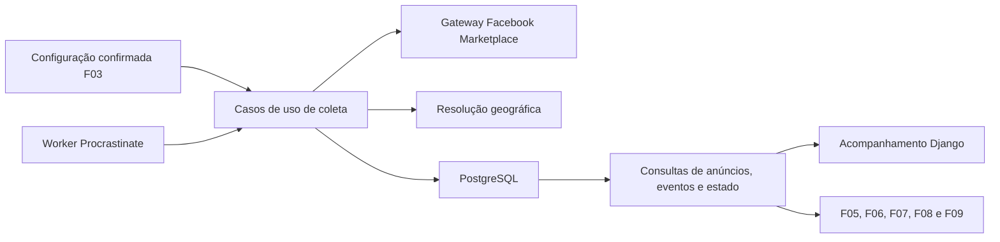

# F04 — Especificação técnica de coleta e acompanhamento de anúncios

<!-- current-execution:start -->
> **Situação em 2026-11-13:** `done` — [avaliação registrada](eval-report-2026-11-11T14-50-42Z.md); o [progresso canônico](../prd_progress.json) conserva ciclos e datas.
> Menções à feature ainda não iniciada ou à ausência do scaffold refletem a elaboração original. Consulte o [estado consolidado](../status-atual.md) para implementação e limites atuais. Evoluções explícitas do PRD e contratos posteriores prevalecem nos pontos alterados; IDs e evidências históricas são preservados.
<!-- current-execution:end -->

## 1. Visão técnica

**Complexidade alta.** A F04 transforma interesses e CEP confirmados em buscas recorrentes no Facebook Marketplace e entrega um histórico de anúncios, observações e eventos duráveis. A coleta roda no worker local e usa PostgreSQL. O web lê seu estado em `/acompanhamento/`, reaproveitando a rota da F03.

A dependência direta é [F03](../F03-configuracoes-e-interesses-de-monitoramento/spec.md). O código atual já oferece `ReadMonitoringConfigurationUseCase` e o catálogo de categorias. A implementação da F04 depende da avaliação da F03. A infraestrutura usa o worker Django/Procrastinate e o lifecycle já avaliados na [F02](../F02-fundacao-tecnica-e-ambiente-local/operations.md). A escolha da fonte e o acesso inicial sem login vêm da [decisão da F01](../F01-discovery-e-viabilidade-de-integracoes/decisions.md). A [prova PlayStation 5](../F01-discovery-e-viabilidade-de-integracoes/probe-playstation5-2026-11-10.md) tem alcance amostral.

F05 recebe evidência de condição. F06 recebe identificação textual e dados disponíveis do produto. F07 recebe preço e frete observados. F08 recebe anúncios, cobertura e estado da coleta. F09 recebe eventos duráveis ligados à observação que os originou. Classificação, comparáveis, cálculo, lista editorial, remoção definitiva e entrega de alertas pertencem às respectivas etapas do [PRD](../PRD.md).

## 2. Impacto arquitetural



O módulo `listing` segue [os limites do projeto](../architecture/organizacao-e-dependencias.md). Domínio aplica correspondência, cobertura e transições. Casos de uso coordenam portas de configuração, fonte, geografia, relógio e persistência. A composição em `main.py` adapta o caso de leitura da F03 à porta da F04, sem leitura direta das tabelas de configuração pelo coletor. Se necessário, estender o adapter de leitura F03 para a leitura transacional de escopo. Django ORM, Procrastinate e navegador ficam na infraestrutura. Toda leitura de ambiente passa por `config/env.py`.

## 3. Decisões técnicas

| Decisão | Abordagem | Alternativa considerada | Efeito |
|---|---|---|---|
| Interesses | União das buscas independentes por categoria e produto. Título do produto com sequência contígua de tokens normalizados de nome/modelo. | Interseção entre categoria e produto ou correspondência aproximada. | Um produto pode aparecer em várias buscas. Apelidos e grafias sem a mesma sequência podem escapar. |
| Identidade | Chave `(source, external_id)` extraída da rota de detalhe verificada. Preservar UUID local e URL canônica. | Usar URL bruta ou similaridade entre títulos/fotos. | Uma republicação com outro ID é outro anúncio. Similaridade entre anúncios fica fora desta etapa. |
| Cobertura | Retirada com referência aproximada de 20 km e candidatos com envio informado. Conservar a certeza e a origem de cada evidência. | Exigir precisão geográfica e confirmação de entrega antes da coleta. | A oferta expõe “localização aproximada” e “entrega no CEP a confirmar” quando aplicável. |
| Marco inicial | Um marco por configuração ativa e fonte. Todos os anúncios identificados antes do marco são silenciosos. Alterar interesses ou CEP após o marco mantém o histórico. | Um novo marco silencioso a cada edição ou por interesse. | Anúncio desconhecido encontrado após uma edição é descoberta, inclusive quando já estava publicado. |
| Retomada | Varredura das últimas 48 horas de publicação, combinada com revisita dos anúncios conhecidos no escopo. Eventos transacionais com identidade estável. | Janela limitada por quantidade de anúncios ou páginas. | O ciclo fixa sua fronteira temporal, registra sua comprovação e conserva o histórico dos anúncios já conhecidos. |
| Acesso | Candidato técnico Playwright Python com Chromium, páginas de busca/detalhe autorizadas e sessão isolada se necessária. A escolha de versão depende da prova de acesso e operação no WSL2. | Driver CLI como dependência do worker ou endpoints privados. | O CLI continua disponível para verificação manual. A operação real depende de acesso e cobertura demonstrados. |

### Correspondência e normalização

Cada combinação de interesse e modalidade gera uma consulta quando a fonte oferece a operação correspondente. Usar o ID ou a rota da categoria do catálogo verificado pela F03, incluindo subcategorias selecionáveis. Atribuir correspondência quando houver evidência de associação no resultado da consulta validada ou nos dados da fonte. Para produtos, usar o nome/modelo para buscar e verificar o título da oferta, com Unicode NFKC, `casefold`, remoção de diacríticos e separação de tokens por caracteres que não sejam letras ou números. `PlayStation 5` casa com `PlayStation 5 Slim`; `PS50` e `PlayStation 50` são outros tokens. O texto cadastrado pela F03 permanece intacto. Acumular os interesses correspondentes da mesma coleta em uma identidade, sem multiplicar observações nem eventos. Entre páginas conflitantes, detalhe com evidência válida prevalece sobre cartão. Se houver conflito equivalente sem ordem confiável, preservar a incerteza e registrar a degradação.

Aceitar somente origem e ID verificados em link HTTPS do Marketplace. Conservar o link de detalhe canônico sem parâmetros de rastreio. Um cartão sem identidade verificável é falha de extração, com motivo registrado e sem criação de anúncio anônimo. Guardar preço de compra e frete como valores decimais em BRL com evidência e escopo conhecidos. Tratar ausência, faixa, moeda ambígua e texto de negociação como valor desconhecido. Zero exige indicação explícita da fonte. Preço e frete de um cartão e de um detalhe devem manter a proveniência de cada campo.

### Retirada e envio

- **Retirada** — O município de referência é São Paulo, UF SP. Os 20 km a partir do CEP configurado são uma referência aproximada, conforme decisão do usuário em 2026-11-11. Quando houver coordenadas do CEP e do anúncio, calcular e identificar a distância como aproximada. Uma localização de cidade, bairro ou região pode sustentar o filtro aproximado observado na fonte, preservando a proveniência e o aviso “localização aproximada”. Sem coordenadas utilizáveis, a distância numérica fica nula. Município distinto ou distância estimada fora do raio ficam identificados como fora do recorte de referência. Modalidade presencial explicitamente indisponível exclui retirada.
- **Envio** — Coletar candidatos de origens no Brasil com envio explicitamente informado. Dar preferência aos campos estruturados da fonte e conservar a evidência do anúncio. Uma indicação genérica de envio permite apresentar o candidato com “entrega no CEP a confirmar”. Confirmação positiva ou negativa vale somente para o CEP a que se refere. Entrega só para outro CEP conserva o destino vigente como desconhecido. Um valor de frete ou o frete estimado F03, isoladamente, não prova oferta de envio ou entrega no CEP.
- **Projeção** — Expor separadamente candidatura ao recorte, grau de precisão da retirada e confirmação de entrega no destino. Uma candidatura aproximada ou com envio informado pode ser lida pelas features consumidoras. Dados desconhecidos e recusas explícitas permanecem distinguíveis. O frete observado conserva sua origem e escopo. Frete aplicável ao CEP fica nulo sem vínculo verificável com o destino.
- **Contexto da busca** — Conferir os filtros efetivamente aplicados pelo Facebook, incluindo centro, raio, interesse e alcance da consulta de envio. A localização salva na conta pode divergir da URL. Localização aproximada do anúncio é uma informação válida do candidato. Um filtro de busca divergente ou sem verificação é falha de execução.
- **Escopo vigente** — Reavaliar a evidência contra o CEP atual. Edição do CEP invalida confirmações específicas do anterior até nova avaliação. Conservar observações antigas, revisão e data.

### Janela de publicação das últimas 48 horas

A janela de cada ciclo é o intervalo inclusivo entre `started_at - 48 horas` e `started_at`, com instantes em UTC. Persistir os dois limites antes da navegação e reutilizá-los em tentativas e retomadas do mesmo ciclo. Uma nova execução lógica calcula sua própria janela. A definição de política de janela participa da identificação do escopo; o instante móvel pertence ao ciclo.

A coleta pode comprovar a fronteira por filtro temporal nativo com semântica verificada, por ordenação cronológica e continuação verificadas até ultrapassar o início da janela, ou pelo esgotamento verificável do resultado. Um anúncio antigo isolado não comprova que os seguintes são antigos. Resultados promovidos ou fora de ordem exigem continuar a busca ou registrar que a fronteira ficou sem comprovação. Um filtro de “dois dias” precisa demonstrar sua equivalência às 48 horas móveis antes de servir como prova.

Anúncios novos com publicação conhecida fora do intervalo não integram a descoberta dessa janela. Data ausente permanece nula. Um filtro temporal nativo comprovado pode sustentar a associação à janela mesmo quando o anúncio omite sua data. Sem essa evidência, a associação temporal fica desconhecida e não pode comprovar o término da janela. Preservar os dados válidos com a incerteza correspondente. A identificação local e a publicação conservam campos separados.

O acompanhamento revisita anúncios já conhecidos quando acessíveis, inclusive quando a publicação ultrapassa 48 horas. Esses anúncios conservam identidade, histórico e transições de preço. Uma parada superior a 48 horas pode deixar publicações anteriores fora da janela de recuperação; a leitura do estado informa esse alcance.

O limite de páginas protege a execução. Atingi-lo antes de comprovar a janela produz parcialidade, preserva o marco e o último sucesso integral. O número de páginas deixa de ser o critério de sucesso.

### Execução, falhas e retomada

1. O worker reconcilia agendamento e configuração confirmada ao iniciar e em ticks periódicos enquanto estiver ativo. Sem configuração confirmada, não há consulta à fonte. Falha ao ler F03 é falha de dependência. O primeiro tick após a confirmação pode iniciar a coleta, inclusive após queda do web entre commit e resposta. O GET de acompanhamento lê estado local.
2. A chave do escopo combina fonte, CEP e conjunto normalizado de interesses. Guardar também a revisão F03 usada. Edição de custos conserva o escopo. Mudança de interesses ou CEP invalida avanço e gravações de uma execução antiga após a detecção da mudança. Validar o escopo no limite de gravação por uma porta que lê a configuração vigente sob o mesmo bloqueio transacional usado pela publicação da F03. Reprogramar imediatamente o escopo atual. Se a carga inicial estiver em curso, exigir uma passagem bem-sucedida sobre o novo escopo antes de concluir o marco, conservando o histórico já gravado como silencioso.
3. Cada ciclo percorre as buscas e continuações necessárias para comprovar a janela de 48 horas e atualiza os anúncios conhecidos vinculados ao escopo vigente, inclusive por detalhe quando sumirem dos resultados. Ausência em resultado é insuficiente para declarar remoção. Teto de segurança atingido antes da fronteira temporal, página repetida, erro de acesso, falha técnica na leitura de detalhe obrigatório ou contexto divergente degradam o ciclo. Vazio só conclui a busca com contexto e ausência verificáveis. Localização aproximada e entrega no CEP a confirmar são estados de dados aceitos; isoladamente, não impedem concluir a passagem.
4. Fazer I/O externo fora de transações. Guardar resultados normalizados em preparação durável durante a varredura. Ao terminar a passagem, inclusive quando parcial, consolidar os resultados por identidade e gravar observação, evento e progresso em lotes transacionais curtos. O marco inicial é gravado somente após todas as consultas previstas terminarem com sucesso e todos os lotes estarem confirmados. Ciclo parcial preserva os dados válidos confirmados, o marco anterior e o último sucesso integral. Após interrupção, retomar o mesmo ciclo lógico quando o escopo for o mesmo. Reabrir buscas incompletas desde a primeira página quando a continuidade for efêmera, substituindo a preparação incompleta dessa busca. Se a passagem já estiver consolidada, retomar apenas a gravação dos lotes pendentes. Uma nova tentativa após passagem parcial finalizada inicia novo ciclo e revisita a janela sem depender exclusivamente de data de publicação.
5. Reusar fila PostgreSQL. Registrar tarefa de coleta em fila própria atendida pelo worker existente, preservando `runtime`. O reconciliador grava a programação e a tarefa com o mesmo commit via conexão Django, conforme o padrão F02. Guardar próxima tentativa, ID de ciclo e lease com geração. Usar uma execução válida por instalação/fonte. Ao expirar a lease, o reconciliador pode emitir uma nova tentativa, inclusive quando a tarefa anterior permanecer em execução no registro técnico da fila. Uma geração vencida jamais grava dados, conclui um ciclo ou altera o marco. Limitar duração de I/O e renovar a lease de forma compatível com esse limite. A programação seguinte depende do estado durável, permitindo recuperar falha ou reinício sem um callback em memória.
6. Timeout e falhas transitórias geram nova tentativa com espera crescente e limitada. Respeitar espera mínima indicada pela fonte quando disponível. Bloqueio ou sessão expirada deixa acesso indisponível até recuperação pelas condições autorizadas. Registrar motivo, escopo, horário e contadores em logs JSON. Manter diagnóstico do ciclo distinto do estado anterior e omitir CEP, URLs com dados privados, material de sessão e conteúdo bruto dos logs. A janela de publicação é de 48 horas. Intervalo, timeout, teto de segurança e espera serão medidos e documentados no perfil operacional. Usar relógio controlado na avaliação.

### Eventos de anúncio e preço

- A primeira observação de cada identidade produz `initial_load` enquanto o marco estiver aberto, ou `discovered` após o marco. A origem dessa observação fica gravada e pode ser consultada após reinício. Cobertura desconhecida ou excluída é sinalizada no evento e na leitura vigente. Identificar um anúncio e confirmar sua cobertura são fatos distintos.
- Na carga inicial, registrar observações e preservar o último preço conhecido, mantendo todos os eventos desse período silenciosos para F09. Em acompanhamento, cada mudança entre dois preços conhecidos da mesma moeda e identidade produz `price_decreased` ou `price_increased`. Aumentos ficam disponíveis como histórico e não se qualificam como redução. Releitura do mesmo preço e primeira obtenção de preço anteriormente desconhecido não geram evento de alteração. Se houver lacuna de preço, comparar com o último preço conhecido e identificar as datas das duas observações. Uma nova queda depois de uma alta tem identidade própria, mesmo se o valor já tiver ocorrido.
- A observação e seu evento são confirmados juntos. Evento persistido é a fonte durável para consulta e processamento posterior. A F09 terá seu próprio cursor de consumo, histórico de envios e política para eventual confirmação de cobertura após descoberta. São candidatos à sua avaliação os eventos `discovered` ou `price_decreased` registrados após o marco, respeitando cobertura e as demais regras da F09. Eventos silenciosos jamais viram descoberta por edição, confirmação posterior ou reinício.

## 4. Componentes e migração

Caminhos relativos a `apps/backend/src/garimpei/`, salvo indicação.

| Caminho | Mudança | Responsabilidade |
|---|---|---|
| `domain/listing/listing.py`, `coverage.py`, `interest_match.py`, `ports.py` | Novo | Identidade, evolução da observação, políticas puras e portas tipadas. |
| `usecase/listing/collect_listings_usecase.py`, `schedule_collection_usecase.py` | Novo | Coordenar fontes e transações, reconciliar agenda e tentativas. |
| `usecase/listing/read_listing_usecase.py`, `read_listing_changes_usecase.py`, `read_collection_status_usecase.py` | Novo | Leituras imutáveis para consumidores. |
| `infra/gateway/listing/facebook_marketplace.py`, `cep_geocoding.py` | Novo | Navegação, tradução de falhas, evidência de cobertura e resolução de CEP. |
| `infra/repository/listing/postgres_repository.py`, `mapper.py`, `infra/queries/listing/postgres_queries.py` | Novo | Escrever agregados, mapear estado persistido e fornecer projeções. |
| `infra/persistence/listing_models.py`, `infra/persistence/models.py`, `infra/persistence/migrations/0003_listing_collection.py` | Novo e modificado | Migração aditiva sobre F03 e registro de modelos. |
| `infra/worker/listing_handler.py`, `infra/persistence/management/commands/runworker.py`, `main.py`, `config/env.py` | Novo e modificado | Atender tarefas, registrar composição e centralizar parâmetros e sessão privada. |
| `infra/queries/monitoring/postgres_queries.py` e unidade de trabalho F03 | Modificado se necessário | Oferecer leitura da configuração com garantia de serialização no commit da coleta. |
| `infra/http/monitoring/monitoring_handler.py`, `infra/http/templates/monitoring/tracking.html` | Modificado | Expor o estado persistido na rota F03, com o mesmo padrão de navegação. |
| `apps/backend/pyproject.toml`, `apps/backend/uv.lock` | Modificado se o driver for confirmado | Fixar a dependência e documentar a instalação do navegador compatível. |

## 5. Interfaces consumidas e fornecidas

| Interface | Entrada | Saída e semântica |
|---|---|---|
| F03 `ReadMonitoringConfigurationUseCase.execute()` | Sem entrada | Snapshot confirmado, com ID, revisão, fonte, CEP e interesses da mesma publicação. `configured=false` é distinto de falha de leitura. |
| `ReadListingUseCase.execute(listing_id)` | UUID interno | Projeção ou ausência explícita. Inclui fonte, ID externo, URL, título, texto/condição fornecidos, data da primeira identificação e de publicação quando disponível, observação vigente e última observação válida se a consulta mais recente falhou. Preço/frete monetários em BRL, nulos quando desconhecidos. Expõe modalidades, evidência, escopo, motivos de incerteza e vínculo de interesses. |
| `ReadListingChangesUseCase.execute(after, limit)` | Cursor da última sequência confirmada ou vazio e limite positivo | Página ordenada de eventos imutáveis e cursor do último retornado. Cada evento tem sequência, ID, tipo, anúncio, observação, preço anterior/novo quando aplicável, timestamps e marca de silêncio. Cursor vazio começa do início e página vazia conserva o cursor. Consumidores avançam após seu próprio processamento durável. |
| `ReadCollectionStatusUseCase.execute()` | Instalação local confirmada | Estado inicial/ativo, fase agendada/em execução/concluída/degradada, instante do último ciclo e último sucesso integral, limites UTC da janela de 48 horas, alcance da recuperação, motivo resumido e indicador de escopo vigente. Falha de leitura é explícita. |
| `GET /acompanhamento/` | Navegação local existente, sem parâmetros | Redireciona para o assistente sem configuração ativa. Exibe estado pendente/em andamento, concluído, parcial ou indisponível conforme a leitura F04, com último sucesso quando houver. Falha de banco usa tratamento central. A página conserva o acesso às configurações. |

Exemplo de representação de um evento de redução, com IDs de fixture e valores decimais serializados como strings.

```json
{
  "sequence": 17,
  "type": "price_decreased",
  "listing_id": "cc0cdf91-bfb9-4ab8-a890-fb2b9932061a",
  "observation_id": "2e9fae53-feda-4181-ae22-83d975fb3139",
  "previous_price": "2300.00",
  "price": "2200.00",
  "currency": "BRL",
  "silent": false
}
```

## 6. Modelo de dados

Nomes conceituais para os modelos Django. Timestamps em UTC com fuso, valores monetários `numeric(14,2)` não negativos e IDs de domínio UUID. A migration acrescenta estado vazio e preserva configuração, probes e fila existentes.

| Modelo | Dados e invariantes | Chaves e índices |
|---|---|---|
| `Listing` | UUID, fonte, ID externo, URL canônica, primeira identificação, origem inicial ou posterior, ponteiros para última observação e último preço conhecido, revisão monotônica. | Unique `(source, external_id)`. FK de observação com consistência verificada na unidade de trabalho. |
| `ListingObservation` | UUID, anúncio e ciclo, revisão F03/escopo, ordinal por anúncio, instante da observação e publicação opcional, título, texto e evidência de condição opcionais, preço/frete opcionais, modalidades, distância opcional e proveniência sanitizada. Manter observações imutáveis e distinguir dado ausente de confirmação negativa. | Unique `(listing_id, ordinal)` e `(cycle_id, listing_id)`. Índice de histórico por anúncio. Consolidar resultados sobrepostos antes da observação do ciclo. |
| `ListingInterestMatch` | Vínculo de observação com tipo e chave normalizada do interesse, preservando histórico de sobreposição. | Unique `(observation_id, kind, key)`, índice por tipo/chave. |
| `CollectionState` | ID da instalação F03, fonte, ciclo corrente, marco inicial opcional, último sucesso integral, próxima tentativa, geração e vencimento de lease. Preservar sem cascata destrutiva a partir da configuração. | Unique `(configuration_id, source)`; índice de próxima tentativa. |
| `CollectionCycle` | UUID, estado pai, revisão, chave de escopo, início/fim opcionais conforme a fase, limites UTC da janela de 48 horas, evidência de término temporal, resultado por consulta, contadores e falha resumida. Registra unidades previstas, concluídas ou pendentes para retomada. | Índice `(state_id, started_at)`; uma execução efetiva por estado com validação da geração. |
| `CollectionCandidate` | Resultado normalizado temporário por ciclo, consulta e identidade, com proveniência e campos disponíveis para consolidação. Remover após finalizar ou invalidar a passagem. | Unique `(cycle_id, query_key, external_id)`; índice por ciclo e ID externo. |
| `ListingEvent` | UUID, sequência de publicação, tipo, anúncio, observação, preço anterior e sua observação quando houver, silêncio e horário. | Unique `sequence` e `(listing_id, observation_id, kind)`. O escritor serializado globalmente assegura ordem de visibilidade dos commits para avançar o cursor sem saltar eventos. |

A unidade de trabalho usa constraints e atualização sob bloqueio para proteger identidade, checkpoint, transição de preço e geração da lease. Se uma observação já foi confirmada no ciclo, o replay mantém aquela observação e seu evento. Diferenças verificadas em nova varredura entram no ciclo seguinte. Registro de detalhe inacessível fica no estado da coleta e na projeção de atualidade do anúncio. Consultas bem-sucedidas com campos ausentes podem gravar nulos, preservando o histórico conhecido.

## 7. Verificação e decisões pendentes

| Verificação planejada | Cenários |
|---|---|
| `apps/backend/tests/unit/test_listing_policy.py` | Tokens, sobreposição, limites geográficos e precisão, moeda e campos desconhecidos, silêncio e transições de preço. |
| `apps/backend/tests/integration/test_collection.py` | Migração F03 → F04 em PostgreSQL, rollback e repetição, F03 confirmada, edição durante ciclo, concorrência e geração vencida, cursor, acesso parcial, recuperação da janela e reinício de worker. |
| `apps/backend/tests/integration/test_facebook_gateway.py` | Páginas e sequências sanitizadas em servidor local, sessão inválida, contexto incorreto, resultado vazio, continuação, dados incompletos e falha intermediária. |
| `apps/backend/tests/http/test_tracking.py` e jornada com `playwright-cli` | Estado pendente/em execução/concluído/parcial, continuidade da F03, acesso ao histórico depois de reinício e leitura sem acesso externo. |
| Prova real | Evidência por modalidade, categoria, produto, navegação, limites e retomada conforme [contrato](contract.md). |

**Pendências de validação externa**

- **P01 — Acesso e driver.** Confirmar o acesso permitido para automação, a ferramenta/versão definitiva, comportamento sem login e condições da sessão privada, caso necessária. A Meta declara que automação para obter dados requer sua permissão. Verificar as condições aplicáveis ao coletor antes de habilitar execução real. [Publicação oficial da Meta](https://about.fb.com/br/news/2021/04/como-combatemos-a-raspagem-de-dados/).
- **P03/P05 — Cobertura.** Demonstrar categorias e contexto territorial da busca, resolução do CEP de referência, indicação da localização aproximada e evidência de envio informado com confirmação de destino quando disponível. Selecionar e registrar provedor ou base de CEP, versão, licença, precisão e falhas. O catálogo F03 comprova navegação por categorias, com localização pública padrão fora do Brasil na amostra. [Evidência da F03](../F03-configuracoes-e-interesses-de-monitoramento/evidence/catalog-verification.md).
- **P09 — Operação.** Medir duração, custo/consumo local, limites da fonte e periodicidade. Comprovar a consulta da janela escolhida de 48 horas e a recuperação dentro desse intervalo. Registrar a fronteira escolhida, perfil operacional e condição de recuperação em configuração e evidência versionadas. A estabilidade contínua segue condicionada à operação da fonte.

A implementação determinística pode avançar conforme o plano. O aceite de integração real exige evidência das capacidades obrigatórias. Se alguma delas for inviável para a fonte escolhida, registrar o resultado para decisão explícita sobre a cobertura do PRD.

## Atualização autorizada em 2026-11-11

O usuário solicitou scraping real com stealth e forneceu sessão própria, renovada durante a execução. A integração passou a usar Playwright Python com Chromium e playwright-stealth, estado privado externo ao repositório, idioma pt-BR e fuso America/Sao_Paulo. O acesso autenticado foi verificado nas buscas e nos detalhes. A autorização atual cobre essa execução e a integração ao coletor.

A implementação extrai os documentos Relay da página e as respostas de continuação produzidas pela navegação do navegador. O evento de navegação fica em uma thread dedicada, pois a fachada síncrona do Playwright mantém um event loop e conflita com operações síncronas do Django na mesma thread. A publicação continua passando pelas mesmas transações da F04.

A fonte pode devolver candidatos válidos e um diagnóstico de recorte incompleto. O worker conserva esses candidatos, percorre a continuação e registra parcialidade. A configuração de localização salva na conta pode divergir dos parâmetros da URL. Coordenadas aproximadas do Marketplace e coordenadas de CEP sem raio de erro publicado mantêm a precisão desconhecida. A confirmação específica de entrega ao CEP depende de evidência real. A revisão de requisitos abaixo admite candidatos com envio informado e confirmação de destino pendente.

O perfil executável e suas limitações estão em [operations.md](operations.md). As avaliações anteriores permanecem como histórico.

## Revisão de requisitos aprovada em 2026-11-11

As respostas do usuário no brainstorming definiram retirada aproximada com indicação de incerteza, candidatos com envio informado e aviso de entrega no CEP a confirmar, e janela das últimas 48 horas. Os critérios F04-AC02, F04-AC04 e F04-AC05 e os itens correspondentes do contrato passam a seguir essas regras.

A implementação atual precisa substituir o diagnóstico geográfico incondicional, implementar a consulta real de envio e comprovar a fronteira temporal. O marco inicial termina depois da passagem e dos commits da janela válida. Incertezas aceitas nas informações do anúncio ficam disponíveis para os consumidores. Falhas técnicas de acesso, paginação, contexto ou gravação conservam a passagem parcial.

Avaliações anteriores descrevem o contrato vigente em suas datas. A revisão documental prepara a implementação e sua nova avaliação. A interface exportará os qualificadores de cobertura e janela para F05–F09. F07, F08 e F09 aplicam suas próprias regras de cálculo, apresentação e elegibilidade aos dados exportados; a integração precisa ser conferida ao preparar essas features.

## Indisponibilidade confirmada — decisão aprovada em 2026-11-11

O usuário aprovou preservar o histórico, registrar a indisponibilidade e continuar quando a própria Meta confirmar que um anúncio já acompanhado está indisponível. Essa confirmação é uma observação de estado, distinta de erro HTTP, sessão inválida, extração incompleta ou ausência na busca. Uma confirmação verificável não impede concluir a carga inicial quando todas as buscas, demais detalhes e gravações estiverem completos. Sem confirmação explícita, a falha continua parcial. Para uma identidade ainda não acompanhada, a indisponibilidade não é promovida automaticamente à conclusão da sua primeira leitura.

A evidência exporta `source_available` e `availability_evidence`, opcionais para registros anteriores. A observação confirmada indisponível conserva identidade e vínculos históricos, expõe preço atual desconhecido e cobertura excluída, sem gerar alteração de preço. O último preço conhecido e a última observação válida permanecem recuperáveis. Se o anúncio voltar a ficar acessível, a mesma identidade recebe nova observação e uma redução usa o último preço conhecido anterior à indisponibilidade.

A prova real encontrou redirecionamento explícito com `unavailable_product=1` para uma oferta anteriormente observada. Somente essa confirmação vinculada ao ID solicitado sustenta o estado; uma resposta sem os campos esperados é falha de extração. A tela geral pode concluir o ciclo, enquanto a leitura do anúncio comunica sua indisponibilidade para os consumidores F05–F09.
