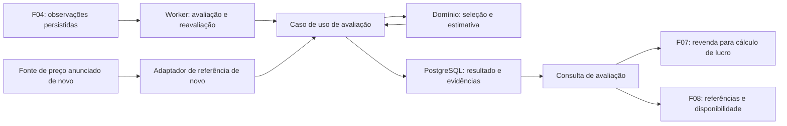

# F06 — Referências de preços e estimativa de revenda

## 1. Visão técnica

**Complexidade média.** A F06 avalia automaticamente a revenda de um eletrônico a partir de anúncios comparáveis e acrescenta, quando disponível, uma referência de produto novo. Cada avaliação identifica a oferta, o recorte de dados e os preços que sustentam o resultado. A F07 consome a revenda estimada e a F08 consome o resultado e as referências para os detalhes.

A dependência direta é a F04, responsável pela coleta, identidade e observações do anúncio. A F06 pode avaliar ofertas de qualquer condição usando a referência de uma unidade usada funcional equivalente. Essa é uma hipótese de especificação para a referência de mercado. Desconto pelo estado da unidade ofertada e custo de reparo continuam pendentes no PRD. A condição e a aba da oferta pertencem à F05. Lucro, interface de exploração e alertas pertencem a F07, F08 e F09.

A F01 aprovou o Facebook Marketplace para a primeira coleta, com uma prova de acesso por PlayStation 5. A política abaixo é uma proposta de partida para P07 e L-04. Sua adoção depende da validação de comparáveis reais e da definição de uma fonte de novos. [PRD](../PRD.md#f06-referências-de-preços-e-estimativa-de-revenda), [Decisão F01](../F01-discovery-e-viabilidade-de-integracoes/decisions.md).

## 2. Impacto na arquitetura

Reusar o PostgreSQL, Django e worker persistente de F02. `valuation` recebe dados de F04 por contratos tipados e compõe as dependências por construtor no `main.py`. O domínio aplica a política com dados e instante explícitos. Consultas, fila, Django ORM e acesso externo ficam na infraestrutura. [Stack aprovada](../stack.md), [Organização e dependências](../architecture/organizacao-e-dependencias.md).

## 3. Decisões técnicas propostas

| Decisão | Escolha | Alternativa avaliada | Consequência |
|---|---|---|---|
| Fonte de usados | Observações persistidas pela F04 para a cobertura efetivamente coletada no Facebook Marketplace. | Busca própria em múltiplas plataformas. | Reaproveita a coleta e herda seus limites de interesses, cobertura e identificação. Uma amostra insuficiente continua possível. |
| Equivalência e método | Correspondência explícita de produto e variante, preços em BRL e mediana após filtro de discrepância e teste de dispersão. | Média simples por nome ou categoria. | Dá um cálculo reproduzível e exige identificação mais precisa. |
| Produto novo | Fonte varejista com consulta autorizada, produto idêntico, venda unitária e disponibilidade verificável. Começar com um fornecedor a definir na fase 1. | Misturar anúncios marcados como novos na amostra de usados. | Permite apresentar preço de varejo com origem própria, inclusive quando a amostra de usados é insuficiente. |
| Publicação | Registrar avaliação e evidências juntas, com versão e validade. | Recalcular a partir dos preços correntes a cada leitura. | Os consumidores conseguem reproduzir o preço publicado e distinguir evidências atuais de avaliações históricas. |

### Política inicial para usados

1. Usar a identificação de produto de F04. Comparar marca, modelo e atributos determinantes para a família, como geração, capacidade e edição. Normalizar caixa, espaços e aliases explícitos validados por família. A ausência ou ambiguidade de atributo determinante exige excluir o candidato ou, se for da oferta avaliada, retornar `produto_indeterminado`. Para PlayStation 5, distinguir pelo menos geração/edição, disco ou digital e capacidade quando ela diferenciar a variante. Registrar os atributos exigidos nas famílias exercitadas.
2. Por identidade acompanhada por F04, considerar a última observação confirmada até o instante da avaliação. A identidade da própria oferta fica fora da amostra. Repetições do mesmo ID contam uma vez, e republicações só compartilham identidade quando a F04 já as reconhece como tal. Usar apenas preço anunciado integral, positivo em BRL, de unidade usada com funcionamento indicado pela evidência da fonte e disponibilidade na última observação. Excluir anúncios removidos/vendidos, lotes, acessórios avulsos, peças, defeitos, condição incerta e preços de parcela, entrada ou troca. O valor do comparável é o preço anunciado da unidade, sem adicionar frete. A decisão manual sobre a oferta alvo não serve de evidência sobre outros anúncios. A avaliação da F06 independe da entrega no CEP e da aba do anúncio alvo.
3. Incluir observações com idade de até 14 dias corridos, inclusive, medidos em UTC a partir do instante da avaliação. Exigir ao menos cinco identidades distintas após os filtros anteriores. Calcular a mediana preliminar e manter preços entre 50% e 150% dela, inclusive, numa única passagem. A mediana de uma quantidade par é a média dos dois valores centrais.
4. Exigir ao menos cinco comparáveis restantes e razão entre maior e menor preço de até 1,50, inclusive. Resultado válido é a mediana final, em BRL, com precisão decimal e arredondamento ao centavo mais próximo, meio centavo para cima. Comparações de limites usam valores sem arredondamento intermediário. Expor os comparáveis efetivamente usados. Se falhar o mínimo ou a dispersão, expor o motivo e contagens sem preço estimado. O mínimo e a dispersão definem suficiência operacional, sem prometer probabilidade ou preço de venda.
5. A avaliação disponível perde validade quando qualquer observação usada ultrapassa sua janela. Reavaliar ao vencer, ao mudar a identificação ou ao mudar o conjunto de candidatos do produto. Enquanto uma mudança de identidade do produto aguarda avaliação, a consulta vigente retorna indisponibilidade para aquela oferta, inclusive para a referência de novo. Uma mudança exclusiva no preço de compra mantém a mesma base de revenda enquanto a amostra continuar válida e os comparáveis permanecerem iguais. A F07 recebe o preço de compra por F04.

### Política inicial para referência de novo

Usar preço anunciado à vista, integral e positivo em BRL, de unidade nova e disponível, com equivalência de produto e variante. Guardar o preço, título, origem, identificador ou URL estável do produto, URL consultável e data de observação. Uma referência observada há até sete dias corridos, inclusive, pode ser usada. Quando a fonte devolver mais de uma oferta válida, usar a menor cotação e desempatar pela URL canônica em ordem lexicográfica.

Quando uma consulta bem-sucedida deixar de encontrar referência equivalente, informar `sem_referencia`. Agendar nova consulta ao vencer uma cotação disponível. Enquanto essa consulta estiver pendente, uma cotação vencida fica indisponível. Em falha da fonte, usar a última referência válida e guardar o diagnóstico da tentativa em separado. Quando ela vencer ou faltar após a falha, informar `fonte_indisponivel`. A revenda de usados segue a sua própria política.

### Validação de P07

Os números, o recorte de usados, a equivalência e a política de novo acima são hipóteses deste documento. Na fase 1, usar uma amostra datada do produto exercitado em F01 e de uma segunda família distinta dentro da cobertura real de F04. Registrar candidatos aceitos e rejeitados, identificação da variante, datas de observação, preços anunciados, disponibilidade, resultado calculado e limitações. Demonstrar ao menos um conjunto real suficiente, um caso de amostra insuficiente e uma referência de novo equivalente obtida pela fonte escolhida. Registrar a forma de acesso, os limites e a cobertura do fornecedor de novos. Se os dados motivarem ajustes, registrar a decisão e alinhar spec, plan, contrato e fixtures antes de implementar a política final. Se um requisito ficar inviável, levar a lacuna à decisão de produto.

## 4. Componentes

Os caminhos abaixo são de implementação prevista em `apps/backend/src/garimpei/`, sujeitos aos pontos de integração entregues por F04.

| Caminho | Alteração | Responsabilidade |
|---|---|---|
| `domain/valuation/` | Novo | Equivalência, elegibilidade, suficiência, cálculo, estados e contratos de I/O. |
| `usecase/valuation/` | Novo | Obter recorte, avaliar, publicar e consultar resultados tipados. |
| `infra/queries/listing/` e `infra/queries/valuation/` | Adaptar/adicionar | Projetar observações confirmadas de F04 e expor a avaliação vigente ou por ID. |
| `infra/gateway/valuation/` | Novo | Obter preço e disponibilidade de novo pela fonte definida e traduzir falhas. |
| `infra/worker/` e `main.py` | Adaptar | Registrar tarefas, recompor dependências, agendar vencimentos e retomar trabalho pendente. |
| `infra/persistence/valuation_models.py`, `infra/persistence/models.py`, `infra/persistence/migrations/` e `infra/repository/valuation/` | Adicionar/adaptar | Persistir e restaurar avaliações, evidências e progresso da revisão. |

## 5. Interfaces de integração

| Superfície | Entrada | Saída ou efeito |
|---|---|---|
| F04 → worker F06 | Identidade da oferta, revisão confirmada dos dados de F04, identificação do produto e observações de candidatos, inclusive retirada de candidatos confirmada pela fonte. | Avaliação automática após persistência da coleta, inclusive na carga inicial. Mudança do conjunto de candidatos atualiza as ofertas atingidas para aquele produto. |
| F06 → F07/F08, consulta vigente por anúncio | ID conhecido de F04. | Estado disponível com preço de revenda em BRL, ou “estimativa indisponível” com motivo e preço ausente. Entrega também o ID/versão da avaliação publicada, sua validade, a lista de comparáveis usados e o estado independente da referência de novo. |
| F06 → F07/F08, consulta por avaliação | ID de avaliação publicada. | Evidência histórica da revisão exata com valores e observações originais. A consulta vigente aplica o prazo de validade e sinaliza indisponibilidade se a nova avaliação ainda estiver pendente. |

Cada comparável usado inclui origem, ID na fonte, título, URL, preço anunciado e momento observado. Identidade desconhecida retorna ausência de registro. Anúncio conhecido ainda sem avaliação retorna indisponibilidade com motivo `aguardando_avaliacao`. Amostra insuficiente, amostra dispersa, produto indeterminado e evidência vencida são estados de leitura esperados. Os consumidores acessam dados persistidos por interface programática, e as leituras não acionam a fonte externa.

Uma falha de F04 não equivale a um recorte bem-sucedido sem candidatos. Preservar a avaliação confirmada até o seu vencimento, sinalizar o motivo técnico e retomar pela política operacional de F04. Se faltar avaliação válida, publicar ou expor indisponibilidade. Falhas transitórias da fonte de novo têm retry com backoff limitado e parâmetros definidos a partir da fonte na fase 1. Ausência confirmada de novo é resultado normal.

## 6. Modelo de dados e publicação

| Registro | Dados e chaves |
|---|---|
| Avaliação | ID próprio, ID de anúncio F04, revisão monotônica de avaliação, revisão da entrada F04, instante avaliado em UTC, versão do método, estado e motivo de revenda, preço decimal opcional, validade, contagens antes e depois do filtro de discrepância. Chave única por anúncio e revisão. |
| Comparável usado | ID de avaliação, identidade externa com origem, título, URL, preço decimal e instante observado. Uma linha por identidade acompanhada naquela avaliação. |
| Referência de novo | Estado e motivo vinculados à avaliação. Com referência disponível, preservar ID/URL, título, origem, preço e instante observado. |
| Progresso por anúncio | Revisão solicitada e avaliação vigente, com instante de reavaliação quando aplicável. Índice para localizar trabalho devido. |

Aplicar migration aditiva à base de F04 e conservar anúncios e histórico da coleta. A revisão solicitada muda quando novas entradas confirmadas ou vencimentos exigem trabalho. Persistir a necessidade de processamento com a mudança correspondente, usando a transação e fila de F02 ou retomada por trabalho pendente conforme integração de F04. Chamadas externas ficam fora de transações de escrita. Guardar valores e evidências juntos e publicar a revisão de forma condicional. Reentregar o mesmo trabalho produz no máximo uma avaliação publicada para aquela revisão, e uma conclusão antiga não toma o lugar de uma mais recente. Se a gravação falhar, a versão anterior permanece íntegra e o trabalho continua recuperável. A consulta por ID conserva a evidência já usada mesmo depois de nova observação, retirada do comparável ou vencimento.

## 7. Estratégia de testes

| Escopo | Evidências |
|---|---|
| Política pura | Identidade e variantes, condição e disponibilidade do candidato, preço integral, duplicatas, seleção da última observação, fronteiras de 14 e sete dias, mínimo, filtros, dispersão, mediana par/ímpar e arredondamento. |
| Consulta e persistência real | Retorno para anúncio conhecido, desconhecido e ainda sem resultado; coerência entre valor e comparáveis, referência de novo independente, histórico, migração sobre dados de F04, rollback, concorrência e reentrega. |
| Worker | Processamento após carga confirmada, candidato que muda ou vence, retomada após parada, ausência confirmada e falha simulada das fontes. Injetar relógio e fakes nomeados nas bordas. |
| Prova externa | Reproduzir o cálculo a partir das observações reais da fase 1 e confirmar a proveniência da referência de novo. |

Usar factories, fixtures e cenários do [contrato](contract.md). Rodar os seis gates Python, testes e build declarados no contrato durante a implementação.
