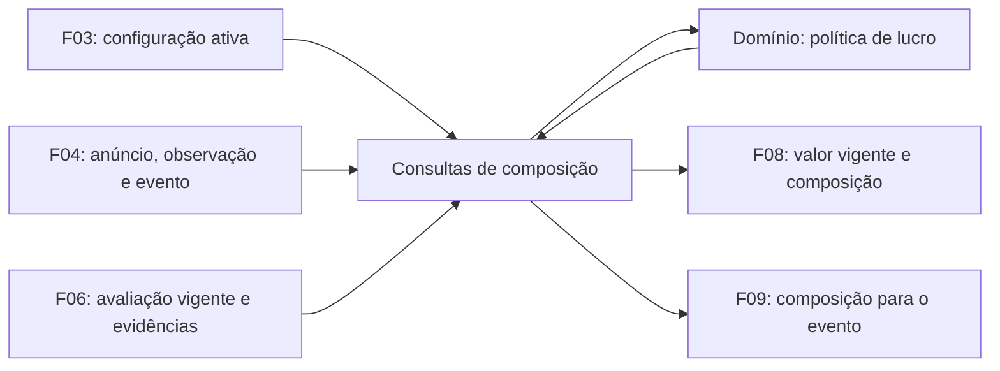

# F07 — Cálculo e composição do lucro estimado

<!-- current-execution:start -->
> **Situação em 2026-11-13:** `done` — [avaliação registrada](eval-report-2026-11-11T17-53-22Z.md); o [progresso canônico](../prd_progress.json) conserva ciclos e datas.
> Menções à feature ainda não iniciada ou à ausência do scaffold refletem a elaboração original. Consulte o [estado consolidado](../status-atual.md) para implementação e limites atuais. Evoluções explícitas do PRD e contratos posteriores prevalecem nos pontos alterados; IDs e evidências históricas são preservados.
<!-- current-execution:end -->

## 1. Visão técnica

**Complexidade média.** A F07 combina os custos configurados na F03, a observação de compra, modalidade e frete da F04 e a estimativa de revenda de usado da F06. A saída identifica cada componente e sua origem. A F08 consome o lucro vigente e a composição. A F09 consome a composição vinculada à observação de um evento da F04.

A mesma política atende os dois consumidores e preserva a distinção entre um lucro calculado de R$ 0,00 e a falta de informação. A F05 mantém a condição e a aba da oferta. Ordenação, apresentação e elegibilidade para alertas ficam nas respectivas etapas do [PRD](../PRD.md#f07-cálculo-e-composição-do-lucro-estimado).

## 2. Impacto na arquitetura

Implementar em `valuation`, com política pura no domínio, orquestração nos casos de uso e portas de leitura injetadas no `main.py`. Reutilizar os serviços de F03, F04 e F06 e a persistência PostgreSQL. Uma composição deve usar dados confirmados e coerentes, obtidos em snapshot de leitura consistente ou com revalidação de revisões. [Stack aprovada](../stack.md), [Arquitetura](../architecture/organizacao-e-dependencias.md).

## 3. Decisões técnicas

| Decisão | Abordagem | Alternativa considerada | Efeito |
|---|---|---|---|
| Taxa e dinheiro | Decimal em BRL. Calcular a taxa sobre a revenda usada e arredondar a taxa ao centavo, meio centavo para cima, antes de subtrair. | Arredondar somente o lucro ao final. | As parcelas exibidas fecham com o total. |
| Modalidades | Compor cada modalidade confirmada pela F04 para o CEP vigente. Com ambas confirmadas, usar retirada como composição principal e fornecer a composição de envio separada. | Eleger a modalidade que maximiza o lucro. | A escolha principal é estável e o consumidor pode distinguir os custos de cada opção. |
| Custos do MVP | Considerar taxa provisória e frete de aquisição quando aplicável. Transporte próprio para retirada, reparo, embalagem, impostos e frete de revenda ficam fora da estimativa. | Preencher custos sem origem com R$ 0,00. | O consumidor recebe o escopo da estimativa e pode explicar os custos ausentes. |
| Atualidade e histórico | Derivar a composição na leitura. Para alertas, fixar o resultado e suas referências quando a F09 registrar a decisão de envio. | Manter uma cópia persistida e atualizada em segundo plano na F07. | Uma alteração confirmada é visível na próxima consulta. A F09 pode repetir o envio com os mesmos dados capturados. |

### Cálculo e composição

- **Compra:** usar o preço BRL da observação selecionada pela consulta. F04 define se o preço é conhecido e guarda sua proveniência. Um zero explicitamente informado pela fonte é conhecido.
- **Revenda:** usar a estimativa de usado vigente da F06, com ID/versão de avaliação e validade. Preço de novo pertence à consulta separada da F06. Se a avaliação estiver indisponível, vencida, pendente ou incompatível com o produto da observação, a revenda e o lucro ficam indisponíveis.
- **Taxa provisória:** multiplicar a revenda estimada pelo percentual da configuração ativa e dividir por 100. Preservar escala e limites de entrada de F03. Por exemplo, `12.50` representa 12,50%. Usar arredondamento decimal ao centavo com meio centavo para cima. Expor percentual configurado e valor calculado como taxa estimada. Sem revenda, conservar o percentual conhecido e deixar o valor da taxa indisponível.
- **Envio confirmado:** se houver frete informado pela F04 aplicável ao CEP, usá-lo, inclusive quando o valor informado é R$ 0,00. Se o frete aplicável estiver ausente, usar o frete estimado da configuração ativa, inclusive zero explicitamente configurado. Identificar fonte ou configuração como origem. Um preço de frete observado sem escopo aplicável segue a regra de ausência. A confirmação da modalidade vem da F04.
- **Retirada confirmada:** marcar frete como `nao_aplicavel`, sem valor de frete na composição. Somente a taxa é subtraída como custo. Deslocamento do comprador não integra a estimativa. Com ambas as modalidades confirmadas, calcular retirada e envio separadamente. Sem modalidade confirmada, conservar os valores conhecidos e retornar lucro indisponível.
- **Lucro:** subtrair compra, taxa arredondada e, para envio, o frete selecionado, todos em BRL. Manter valores positivos, zero e negativos. Compra desconhecida, revenda indisponível, taxa indisponível, ausência de modalidade confirmada ou ausência de frete exigível deixam o lucro indisponível. Retornar os componentes restantes e os motivos aplicáveis. Sem configuração ativa, campos dependentes de configuração ficam ausentes; rascunho e valores padrão não preenchem lacunas.
- **Falha técnica:** leitura malsucedida de F03, F04 ou F06 retorna falha identificável e passível de nova tentativa. Preservar a distinção entre falha técnica, entrada desconhecida e oferta sem estimativa. Diagnóstico estruturado usa identificação e código sem expor CEP ou credenciais.

A política de arredondamento, a prioridade para retirada e a exclusão de custos sem fonte são propostas da F07 para P08. Na oferta com defeito, a revenda da F06 pode representar uma unidade funcional equivalente. A composição informa esse escopo, sem aplicar desconto ou estimar reparo. A inclusão futura de deslocamento, reparo e outros custos e a calibração das despesas reais dependem de decisão de produto.

## 4. Componentes

| Caminho previsto em `apps/backend/src/garimpei/` | Responsabilidade |
|---|---|
| `domain/valuation/` | Política de cálculo, componentes, origens, indisponibilidade e portas tipadas. |
| `usecase/valuation/` | Consultar composição vigente por anúncio e composição por evento, com a mesma política. |
| `infra/queries/` e `main.py` | Adaptar leituras existentes, compor dependências e garantir o recorte consistente da consulta. |

## 5. Interfaces de integração

| Operação | Entrada | Resultado |
|---|---|---|
| Composição vigente para F08 | ID de anúncio conhecido na F04. | Usa a observação vigente, configuração ativa e avaliação vigente. Permite que F08 leia a avaliação por ID para exibir os mesmos comparáveis. Uma consulta posterior reflete preço, modalidade, frete, custos ou revenda confirmados que mudaram. |
| Composição do evento para F09 | ID de evento `discovered` ou `price_decreased` da F04. | Usa a observação imutável do evento, inclusive seu preço de compra novo, e a configuração e avaliação vigentes na hora da consulta. Verificar a aplicabilidade da modalidade e do frete ao CEP atual e a equivalência da revenda com o produto observado no evento. Se a equivalência não puder ser estabelecida, retornar revenda indisponível. |
| Identidade ou tipo inválido | ID inexistente, ou tipo de evento fora da entrada suportada. | Ausência de registro ou erro de tipo explícito, respectivamente. Uma composição indisponível é um resultado de anúncio conhecido. |

As duas operações são consultas programáticas. A composição inclui identidade de anúncio, identidade da observação, ID de evento quando usado, revisão da configuração, ID e versão da avaliação quando disponíveis, versão da política, instante de cálculo, moeda BRL e modalidade principal. Cada componente devolve estado e origem, com valor quando conhecido. A taxa também devolve o percentual configurado. Para modalidades confirmadas, devolver suas composições, cada uma com lucro calculado ou indisponível e os respectivos motivos. Sem modalidade confirmada, devolver os componentes comuns, lucro indisponível e motivo. Se houver serialização, usar decimais como strings de duas casas e ausência como nulo.

## 6. Modelo de dados e consistência

A F07 deriva a composição a partir do snapshot ativo de F03, dos registros imutáveis de F04 e da consulta de F06. Esse desenho dispensa tabelas e jobs próprios. A F09 recebe a composição com os valores e referências suficientes para conservar o cálculo original junto ao registro de alerta, inclusive após mudança de configuração ou de anúncio. A F08 recebe a identidade da revisão de avaliação necessária para alinhar composição e referências.

## 7. Estratégia de testes

| Escopo | Evidência |
|---|---|
| Unidade | Aritmética decimal, taxa de 0% e 100%, meia casa de centavo, valores de compra e frete iguais a zero, retirada/envio, ausência de preço/modalidade/taxa e lucros positivo/zero/negativo. |
| Integração com PostgreSQL | Consultas a partir dos serviços F03/F04/F06, estado parcial, edição confirmada dos custos, preço do evento de redução após nova coleta, escopo de CEP, leitura consistente e falha técnica de dependência com fake nomeado. |

Executar os gates declarados no [contrato](contract.md) ao implementar. As evidências da F07 usam dependências integradas e dados de teste, sem exigir nova coleta externa ou envio de mensagem.
