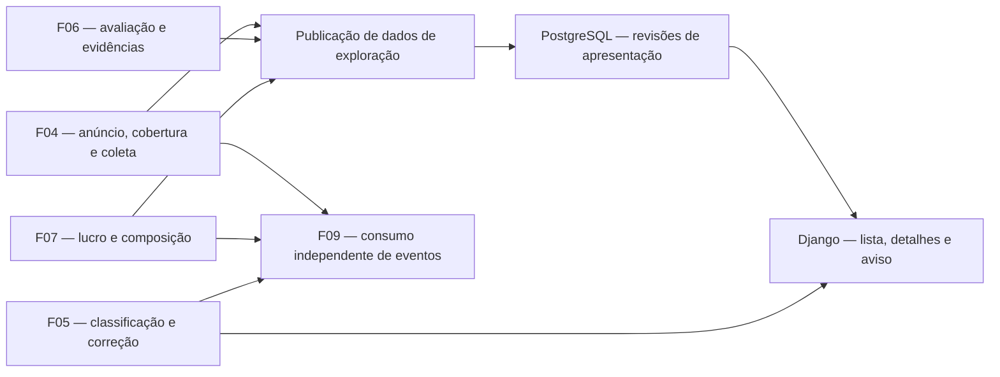

# F08 — Exploração, detalhes e acesso ao anúncio

## 1. Visão técnica

**Complexidade** alta · **Onda** 7 · **Dependências diretas** F04, F05, F06 e F07

A F08 entrega a exploração editorial em Django/HTMX. A lista reúne os anúncios no escopo vigente, a condição efetiva e os resultados financeiros publicados. Os detalhes permitem conferir a origem, as referências e a composição, acessar o anúncio original e usar a classificação manual da F05. A interface distingue disponibilidade na fonte, cobertura da coleta e disponibilidade do cálculo.

O [PRD](../PRD.md) define a ordenação e a paginação. O [design aprovado](../design/DESIGN.md) e a [referência de fluxos](../design/flows-reference.md) definem a composição editorial e a atualização explícita. A tela lê dados locais. Coleta, avaliação, cálculo e alertas continuam nos seus próprios fluxos enquanto o usuário explora.

## 2. Arquitetura e contratos de integração



| Dependência | Dados usados pela F08 |
|---|---|
| [F04](../F04-coleta-e-acompanhamento-de-anuncios/spec.md) | UUID estável, origem, URL HTTPS canônica, primeira identificação, observação vigente e seus campos disponíveis, vínculos de interesse, cobertura por modalidade, último dado válido e estado do ciclo. A data de publicação é opcional. A lista considera o escopo vigente e usa a evidência de cobertura da própria F04. |
| [F05](../F05-classificacao-por-condicao/spec.md) | Regra de condição automática aplicada à observação publicada, escolha manual, revisão, aba e conflito. Reusar o caso de uso de escrita e seus estados de sucesso, falha e conflito. |
| [F06](../F06-referencias-de-precos-e-estimativa-de-revenda/spec.md) | ID da avaliação, validade, motivo de indisponibilidade, revenda, comparáveis usados e referência independente de novo. Quando houver lucro calculado, usar os comparáveis da avaliação exata que sustenta a revenda. |
| [F07](../F07-calculo-e-composicao-do-lucro-estimado/spec.md) | Consulta vigente por anúncio, com IDs da observação e da avaliação, revisão de custos, modalidade principal, composição por modalidade confirmada, valores em BRL e motivos de indisponibilidade. Ler a composição na mesma fronteira de leitura dos dados de origem. |

A publicação usa uma leitura coerente dos dados confirmados no PostgreSQL. A F07 deriva a composição vigente nessa leitura. Se faltar entrada compatível, publicar os componentes conhecidos com a indisponibilidade correspondente. Se a avaliação vigente vencer, o reconciliador publica a indisponibilidade seguindo F06. Referência de novo ausente recebe estado próprio e preserva a revenda e o lucro válidos. Regras de taxa, arredondamento e frete vêm de F07. F08 formata os valores em pt-BR e ordena pelo lucro da modalidade principal de F07, inclusive quando um filtro seleciona outra modalidade confirmada. Identificar a modalidade do lucro no cartão. Nos detalhes, apresentar as composições separadas quando retirada e envio estiverem confirmados.

## 3. Decisões de apresentação

### População, filtros e ordem

- Exibir ofertas associadas ao escopo vigente de F04. Incluir cobertura confirmada e cobertura não confirmada, indicando a incerteza. Ofertas explicitamente fora do recorte de ambas as modalidades ficam fora da lista. Vínculos múltiplos com interesses e modalidades correspondem à mesma oferta.
- Usar as abas **Funcionam bem**, **Com defeito** e **Condição não confirmada**. A busca considera título e nomes de categorias associadas, por trecho, com caixa, acentos e espaços normalizados. Categoria compara o ID de um vínculo de categoria conhecido pela coleta. Sem vínculo, a oferta continua visível em **Todas**. **Retirada** e **Envio** filtram pela modalidade confirmada no CEP do recorte. Oferta com as duas modalidades confirmadas aparece em cada filtro pertinente e uma única vez em **Todas**.
- Aplicar os filtros em conjunto. Em cada aba, ordenar primeiro os resultados com lucro disponível, por valor decrescente, incluindo zero e negativos. Ordenar empates e o grupo indisponível por primeira identificação decrescente e UUID crescente. Paginar depois em blocos de 20. Exibir total filtrado, intervalo exibido, página atual e controles. Mudança de aba, busca, categoria ou modalidade começa na página 1. Paginação mantém a versão e os filtros. Página superior à última se ajusta à última existente. Recorte vazio usa página 1, sem intervalo de resultados.
- Usar a hierarquia editorial do design aprovado, com a primeira oferta do recorte exibido em destaque e as seguintes em grade. Mostrar lucro ou indisponibilidade, preço conhecido e condição. Quando faltar imagem utilizável, mostrar fallback acessível. Nos detalhes, manter legíveis custos e referências conhecidos mesmo com informação incompleta.

### Publicação e atualização explícita

- Publicar uma revisão imutável da projeção quando mudar algum conteúdo exibido ou sua pertinência à lista. A revisão abrange as três abas e todos os filtros. Reaplicar entradas idênticas e registrar apenas progresso de tarefa não cria revisão. Dados com efeito em validade são reconciliados mesmo sem nova coleta. O reconciliador roda no worker existente, sem I/O de marketplace na web. Usar processamento serializado e publicação atômica, com leitura em lote. Uma geração incompleta ou falha conserva a última publicação.
- Ao entrar em uma URL sem revisão, abrir a publicação mais recente. Aba, filtros, página e revisão viajam na URL enquanto a pessoa navega. Ao abrir detalhes da lista e voltar, preservar o contexto de leitura. Usar polling de status com HTMX, com intervalo inicial proposto de 30 s enquanto a página estiver visível, retomando a verificação ao voltar a ela. A resposta altera apenas o aviso **Há atualizações**. Polling informa somente a existência de publicação posterior e pode refletir mudanças fora do filtro atual. O intervalo de reconciliação no worker será ajustado por medição local.
- **Atualizar lista** seleciona a revisão mais recente publicada no início da requisição. Conserva aba e filtros, mantém a página se válida e ajusta para a última existente se o resultado diminuir. Exibir confirmação textual e mover o foco para a primeira oferta visível ou para o título dos resultados quando vazios. Uma revisão publicada depois da escolha continua disponível para o próximo clique. Ao atualizar dados nos detalhes, manter o mesmo ID e levar a nova revisão para o retorno com a aba, filtros e página anteriores. Descartar respostas de navegação ou polling que já não correspondam ao contexto exibido.
- O retorno do POST de condição da F05 confirma a escolha manual e atualiza a aba da própria oferta imediatamente. Aplicar a escolha manual atual sobre as ofertas da versão exibida ao consultar abas e detalhes. Essa exceção de interação cobre apenas a classificação manual. Preço, lucro, composição, evidência automática e demais dados da lista continuam na revisão selecionada. A gravação usa a elegibilidade e a revisão vigentes da F05. Nos detalhes, quando a evidência vigente divergir da classificação manual, mostrar o aviso F05 com indicação da observação vigente. O conflito é informativo e não altera a aba.
- Sem versão publicada, distinguir configuração pendente, primeira coleta em andamento, primeira coleta válida vazia e consulta indisponível. Mostrar o estado de coleta parcial, falha da fonte ou acompanhamento interrompido usando o diagnóstico local de F04/F02, junto dos últimos dados disponíveis e seu horário. Um erro de leitura ou de aplicação conserva a lista já exibida e permite tentar novamente. Em acesso inicial sem dados legíveis, apresentar erro explícito. A indisponibilidade da consulta é distinta de filtros sem resultados.

### Disponibilidade na origem

Política proposta para P10. Ausência nos resultados ou falha de consulta preserva a última oferta conhecida do escopo e seu contexto de atualização. Quando F04 confirmar que o anúncio ficou indisponível, retirar o item das próximas revisões da lista. Em uma revisão já aberta, preservar a ordenação até a atualização explícita. Enquanto houver registro histórico em F04, os detalhes continuam acessíveis com o aviso **Anúncio indisponível na origem** e a data da última observação válida. O acesso ao link identificado permanece disponível com o aviso. ID desconhecido responde 404.

**Pendências para implementação** — verificar os campos de F04 e F07 nas interfaces entregues, os sinais de disponibilidade fornecidos pela fonte e a política de retirada quando houver confirmação da fonte. Validar o intervalo de polling, a frequência de reconciliação e a retenção de revisões com dados do ambiente local.

## 4. Componentes

Caminhos relativos a `apps/backend/src/garimpei/`. Reusar os módulos de anúncio e condição entregues pelas dependências.

| Componente | Responsabilidade |
|---|---|
| `domain/listing/exploration.py` e portas de consulta | Critérios tipados de busca, paginação, projeção e regra de ordenação. |
| `usecase/listing/read_offers_usecase.py`, `read_offer_detail_usecase.py`, `read_exploration_updates_usecase.py` | Leituras tipadas, validação do contexto e coordenação das consultas. |
| `usecase/listing/publish_exploration_usecase.py` | Reconciliar mudanças visíveis a partir das portas F04/F06/F07. Reusar a política de condição F05. |
| `infra/queries/listing/` e `infra/persistence/` | Consultas em lote, filtros, ordenação e paginação no PostgreSQL. Publicação, retenção e leitura consistente de revisões. |
| `infra/worker/`, `main.py` e configuração central | Registro e composição explícita do reconciliador no worker, parâmetros de intervalo e retenção. |
| `infra/http/listing/`, `infra/http/urls.py`, `infra/http/templates/listing/`, `infra/http/static/listing/` | Rotas HTML, parciais HTMX, foco, estados de erro, detalhes e integração com a ação F05. Incluir acesso à exploração na navegação após F03 e em `/acompanhamento/`. |

## 5. Interfaces HTTP

| Método e caminho | Entrada | Resposta |
|---|---|---|
| `GET /ofertas/` | `aba` aceita `funcionam`, `defeitos` ou `incerta`. `q` tem até 120 caracteres. `categoria` usa ID conhecido. `modalidade` aceita `todas`, `retirada` ou `envio`. `pagina` é inteiro positivo e `versao` é UUID publicado. Os campos são opcionais, com busca/categoria em branco, aba `funcionam`, modalidade `todas`, página 1 e revisão mais recente por padrão. | `200` com lista ou estado correspondente, página e URL canônica da versão efetiva. Parciais HTMX mantêm os mesmos valores. |
| `GET /ofertas/atualizacoes/` | `versao` exibida. | `200` com parcial do aviso ou região vazia. Indica expiração da revisão exibida, quando aplicável, e oferece atualização explícita. |
| `GET /ofertas/<uuid:id>/` | ID de F04, versão opcional e os filtros/página de retorno opcionais. | `200` com detalhe, contexto de retorno e links de evidência/origem. `404` para identidade desconhecida. Detalhe acessado diretamente usa os dados mais recentes publicados ou o último detalhe histórico aplicável com aviso. |
| `POST /ofertas/<uuid:id>/condicao/` | Campos e CSRF de F05, com contexto validado de exploração quando presente. | Preservar códigos e confirmação de F05. Retorno à aba efetiva usa página 1 e conserva versão e demais filtros. |

O clique de atualização usa a rota de leitura sem `versao`, com os filtros e página atuais, e recebe a versão selecionada na resposta. Um ID de categoria válido no catálogo continua como filtro selecionado mesmo sem ofertas na nova revisão. Sem HTMX, links e formulários continuam navegáveis. Entrada malformada recebe `400` com erro específico. Uma revisão expirada solicitada para listar ou abrir detalhe recebe `410` com ação explícita para carregar a atual e conservar o recorte. Uma falha técnica de consulta recebe `503`. Se o usuário ainda estiver na lista, manter seus resultados visíveis durante a falha e ao tentar novamente. Separar URL de retorno em campos tipados, sem aceitar um destino externo arbitrário. Renderizar texto da fonte escapado e links originais e de evidência somente a partir das URLs HTTPS validadas pelas dependências. Os links ficam disponíveis diretamente no HTML.

Exemplo de lista com contexto persistido na navegação.

```text
GET /ofertas/?aba=funcionam&q=camera&modalidade=retirada&pagina=2&versao=9a2a527f-2c8e-4ea2-804f-c13d6bc5808a
```

## 6. Dados e consistência

Migração aditiva em PostgreSQL. Os dados de negócio permanecem nos módulos de origem. A projeção guarda os campos de apresentação e as referências necessárias para reproduzir a visão em leituras posteriores.

| Modelo conceitual | Dados e restrições |
|---|---|
| Revisão de exploração | UUID público, sequência crescente única, instante de publicação em UTC. Uma publicação ativa por instalação local. Revisões anteriores legíveis durante a janela de retenção. |
| Projeção por oferta | ID F04, intervalo de revisões em que os dados valem, primeira identificação, título e texto pesquisável, categorias, modalidades e evidências, condição automática, observação e referências de avaliação/composição. Valores exibidos e procedência precisam ser reproduzíveis durante toda a retenção, com cópia quando a fonte puder substituir ou expirar os dados. Lucro decimal nulo significa indisponibilidade. Intervalos ativos da mesma identidade não se sobrepõem. |
| Consulta por recorte | Índices por revisão/validade e identidade, com índices adicionais de filtragem e ordenação conforme plano de consulta medido. Contagem e página leem a mesma revisão e o mesmo estado manual F05 em uma transação de leitura consistente. |

Uma implementação inicial pode compartilhar entre revisões as projeções cujo conteúdo não mudou. A fronteira de publicação torna linhas e revisão visíveis no mesmo commit. O reconciliador serializa publicações, retoma a partir dos dados duráveis e não substitui a versão mais recente por resultado de execução anterior. Proposta de retenção inicial de 24 h para revisões substituídas, sempre preservando a revisão atual. Limpar apenas projeções que deixaram de ser referenciadas por revisões legíveis. A expiração visual não interfere no histórico de origem nem no consumo de eventos.

## 7. Verificação

| Área | Evidência prevista |
|---|---|
| `apps/backend/tests/unit/test_exploration.py` | Ordem de lucro, desempates, busca, modalidades, ausência de valores e compatibilidade de dados publicados. |
| `apps/backend/tests/integration/test_exploration.py` | PostgreSQL real, recortes consistentes, publicação atômica, revisão expirada, concorrência, atualização de F04/F06/F07, perda de validade, classificação F05 e independência do consumo de eventos. |
| `apps/backend/tests/http/test_exploration.py` | HTML completo e parciais, validação, preservação de versão/filtros, erros, links e navegação de detalhes. |
| Jornadas do [contrato](contract.md) | `playwright-cli` sobre Django, com teclado, foco, responsividade e confirmação textual. Aplicar a direção e os tokens aprovados, sem usar o laboratório como evidência de integração. |

Usar o ambiente de [F02](../F02-fundacao-tecnica-e-ambiente-local/operations.md) e os gates declarados no contrato.
