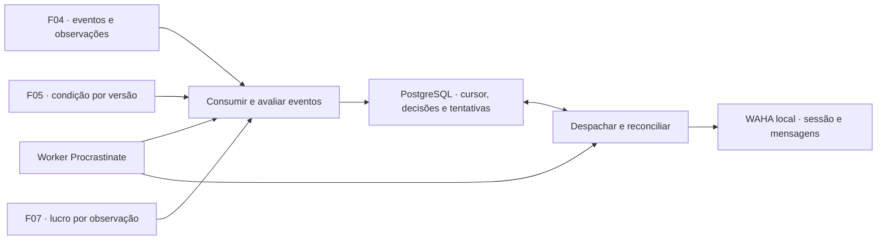

# F09 — Especificação técnica de alertas individuais pelo WhatsApp

## 1. Visão técnica

**Complexidade alta.** O worker transforma eventos elegíveis de coleta em mensagens individuais via WAHA. Decisão de elegibilidade, tentativa e confirmação sobrevivem a reinícios no PostgreSQL. A F09 consome eventos persistidos da [F04](../F04-coleta-e-acompanhamento-de-anuncios/spec.md), classificação da [F05](../F05-classificacao-por-condicao/spec.md) e a composição de lucro por evento da [F07](../F07-calculo-e-composicao-do-lucro-estimado/spec.md), conforme [PRD §6 e §9](../PRD.md).

A operação reutiliza a imagem WAHA/GOWS e o volume de sessão da [F02](../F02-fundacao-tecnica-e-ambiente-local/versions.md). O serviço local já foi verificado, enquanto o pareamento, o envio e a leitura de confirmação na imagem fixada são provas da F09. A F09 funciona em segundo plano, inclusive enquanto a apresentação da F08 aguarda atualização. O produto envia texto para um destinatário individual configurado. Pareamento e manutenção da sessão são operações locais do WAHA.

## 2. Impacto arquitetural



O módulo `alert` define a política e as transições no domínio. Casos de uso coordenam portas para F04/F05/F07, relógio, persistência e mensageria. Adapters de integração e fila ficam na infraestrutura e são compostos em `main.py`. Reusar a conexão transacional da F02 quando houver agendamento na mesma unidade de trabalho. O registro de decisão/intenção no banco é a fonte durável para o reconciliador do worker. O histórico de F09 é operacional e separado das tarefas técnicas.

## 3. Decisões e regras

| Decisão | Abordagem | Alternativa considerada | Efeito |
|---|---|---|---|
| Destino | Um chat direto e uma sessão por instalação, configurados no ambiente privado. | Tela de cadastro de destinos ou múltiplos destinatários. | Operação local explícita e encaminhamento previsível da fila. |
| Identidade | Uma decisão por ID de evento F04. Cada descoberta ou queda elegível tem sua própria intenção. | Deduplicar por preço, ID de tarefa ou título. | A mesma queda republicada no feed técnico não se repete. Outra queda ao mesmo valor após uma alta tem identidade própria. |
| Elegibilidade | Condição e cobertura da observação do evento, com revalidação da oferta antes do envio. | Reavaliar todos os eventos anteriores sempre que um dado mudar. | Alterações manuais ou atualizações de dados sem evento elegível não criam alerta retroativo. |
| Confirmação | Evidência de que o servidor aceitou a mensagem identificada, por confirmação do WAHA para o chat e a sessão esperados. | Considerar qualquer HTTP 2xx ou ausência de erro suficiente. | Resposta parcial e falhas ambíguas entram em reconciliação. |
| Incerteza | Reconciliação por ID WAHA ou referência exclusiva gravada antes do POST. Sem novo POST automático quando o envio pode ter acontecido. | Repetir POST após timeout. | Uma tentativa incerta pode permanecer sem confirmação mesmo que o alerta seja importante. |
| Conteúdo | Uma mensagem de texto por evento com valores da observação e referência operacional. | Resumo periódico, anexos ou consulta da lista visual. | A mensagem tem contexto suficiente para agir e pode ser correlacionada pelo histórico do WAHA. |

### 3.1 Entrada e elegibilidade

1. Consumir `ReadListingChangesUseCase.execute(after, limit)` da F04 em ordem. Começar sem cursor na primeira instalação da F09. Persistir o evento aceito para avaliação, ou sua exclusão, junto com o avanço do cursor em uma transação. Falha no histórico ou no banco pausa ingestão e envio até restabelecer a leitura e reconciliar o trabalho em curso. Cursor perdido em banco restaurado pode ser reconstruído desde o início com deduplicação pelos registros restaurados. Antes de ativar envios após restauração que possa ter perdido registros de envio, conferir o intervalo perdido com histórico do WAHA e evidência operacional. Manter despacho suspenso enquanto a integridade do histórico estiver indeterminada.
2. Considerar apenas `discovered` e `price_decreased` fora da carga silenciosa. A descoberta exige que a observação do evento tenha cobertura confirmada e esteja vinculada a interesse monitorado. A redução exige essas condições e ao menos um envio anterior confirmado para a mesma identidade, ligado a evento anterior. Se um envio anterior estiver em andamento, esperar sua confirmação ou o término de sua janela automática antes de decidir a redução. Se essa janela terminar sem confirmação, a redução só é elegível quando já houver outro envio anterior confirmado. Uma confirmação tardia fica no histórico para eventos futuros. Eventos de um anúncio conservam ordem de avaliação quando houver essa dependência. Anúncios distintos progridem independentemente.
3. Usar a aba da F05 para a observação do evento, com a última escolha manual confirmada **antes** da publicação daquele evento. Uma correção posterior nunca torna aquele evento elegível. Para obter esse corte com concorrência, usar histórico mínimo de escolhas manuais e ordem de publicação compartilhada por anúncio, sob o mesmo bloqueio de identidade previsto pela F05. F04 e F05 devem expor a ordem ou identificador equivalente, por seus próprios contratos de leitura. Se a escolha histórica de dados legados não puder ser determinada com a evidência persistida, registrar indisponibilidade da condição para o evento e manter a exclusão explícita.
4. Consultar a composição F07 pelo ID do evento e conferir o ID da observação e o preço de compra retornados. Usar o lucro da modalidade principal e o motivo de indisponibilidade da F07. Uma avaliação da F06 ainda em processamento mantém a decisão em espera. Um resultado final sem lucro exclui o evento. A avaliação pronta exige preço de compra e lucro estimado calculados para a observação do evento. O lucro negativo ou zero continua elegível. Falha de consulta mantém espera recuperável, com diagnóstico distinto de indisponibilidade final. Fixar a versão do resultado financeiro na intenção, sem recálculo local na F09.
5. Antes de autorizar o POST, consultar o escopo e a condição vigentes. Se a atualização da coleta para a configuração atual ainda estiver pendente, aguardar. Se o anúncio deixou os interesses, perdeu cobertura confirmada ou saiu da lista principal, encerrar a intenção ainda não despachada com motivo registrado. Validar e registrar a autorização local sob a fronteira transacional que serializa as versões de anúncio e classificação. Uma mudança posterior à autorização não pode cancelar um efeito externo já iniciado. Preço e lucro da mensagem sempre se referem à observação do evento e aparecem com a data de identificação, inclusive na retomada.
6. A primeira identificação depois do marco mantém o significado da F04, inclusive após inclusão de interesse, na retomada ou em republicação com outro ID externo. Uma edição que apenas amplia o alcance para uma identidade já conhecida não gera novo alerta. Confirmação tardia de entrega, primeira obtenção de preço, atualização de comparáveis/custos, aumento, repetição de preço e classificação manual não reabrem eventos excluídos. Uma futura queda real do mesmo anúncio é avaliada de acordo com o histórico de envio e a condição aplicável àquela queda.

### 3.2 Configuração e conteúdo

Usar a porta local e `WAHA_API_KEY` existentes, `GARIMPEI_ALERTS_ENABLED` desligado até configuração explícita, `GARIMPEI_WAHA_SESSION` e `GARIMPEI_WAHA_RECIPIENT` sem valores padrão operacionais. O destino é o ID de chat direto canônico comprovado pela imagem em uso para o número autorizado. Na configuração inicial, conferir a identidade do chat e da conta pareada. Exigir sessão em `WORKING` e verificar a conta quando disponível na resposta. QR, API key, chat ID completo, corpo e respostas brutas ficam fora dos logs operacionais e relatórios compartilhados. Sem vínculo confirmado, conservar a decisão elegível em espera de configuração. Vincular a intenção ao destino/sessão/conta com identidade estável e comparar a conta pareada antes de despachar ou reconciliar. Uma troca de destino, conta ou sessão suspende intenções existentes para o vínculo anterior até que ele seja restaurado ou a operação o encerre explicitamente. Histórico confirmado continua associado ao vínculo original.

Enviar texto em português, com cabeçalho **Nova oferta** ou **Preço reduzido**, título, origem, preço de compra, lucro estimado, data da observação e link canônico. Nas reduções, exibir preço anterior e novo. Valores em BRL com sinal preservado. Exemplo de redução, com dados sintéticos:

```text
Preço reduzido · PlayStation 5 Slim
Facebook Marketplace
Compra: R$ 2.300,00 → R$ 2.200,00
Lucro estimado: R$ 180,00
Observado em 10/11/2026 às 19:42 (São Paulo)
https://www.facebook.com/marketplace/item/123456789/
Ref. 30fac894-6b50-4f95-a4e9-95bdb5e09d14
```

Normalizar o título para uma linha e usar o link canônico validado pela F04. A referência é o UUID público da intenção, persistido antes do envio e conservado nas tentativas comprovadamente não transmitidas. Congelar corpo e destino antes do POST. Sem anexos ou preview. No primeiro uso em operação real, verificar sessão e recebimento com destinatário autorizado usando a própria jornada de alerta de teste.

### 3.3 Envio, tentativas e reconciliação

| Situação | Estado e recuperação |
|---|---|
| Falta de configuração, chave inválida na verificação, sessão fora de `WORKING` ou conta divergente | Bloqueado antes do POST, com diagnóstico e próxima verificação. Volta à fila quando a mesma sessão/conta e destino forem restabelecidos. |
| Erro transitório comprovadamente anterior à transmissão ou rejeição cujo significado de não aceitação foi verificado na imagem | Volta à fila com espera crescente. Respeitar eventual espera mínima do provedor. Revalidar a oferta antes da nova chamada. |
| Evidência da mesma mensagem enviada ao servidor | Confirmar com ID do WAHA e ACK documentado equivalente a `SERVER` ou posterior. Registrar horário e proveniência. Confirmação no servidor é distinta dos estados de entrega e leitura. |
| ID conhecido, ACK pendente/ausente | Persistir o ID e consultar por ID, sem novo POST. |
| Resposta incompleta sem ID, timeout após possível transmissão, 5xx ambíguo ou queda após autorizar o POST | Manter tentativa incerta. Procurar pelo identificador já conhecido ou pela referência exata no histórico do mesmo chat e sessão. |
| Busca vazia, 404, erro de consulta, ACK de erro sem prova de não aceitação ou resultados conflitantes | Manter incerteza com diagnóstico. Encerrar as sondagens frequentes ao fim da janela operacional e conservar a tentativa para reconciliação posterior quando houver evidência. Ausência no histórico nunca libera novo POST por si só. |

A confirmação exige mensagem de saída, chat e conta esperados e vínculo inequívoco com o corpo/referência persistidos. Uma resposta de sucesso com ACK verificável pode confirmar de imediato se atender a esses requisitos. Sem ID, paginar histórico do chat no intervalo da tentativa com margem de relógio, dentro de limites configurados. Aceitar uma única correspondência inequívoca de referência e corpo, com ACK positivo. A consulta por ID também verifica o vínculo. Nunca promover uma incerteza a sucesso só por correspondência de título ou horário. Expor estados, referências locais e motivos nos logs JSON e em consulta de diagnóstico ao banco documentada para a operação local. A decisão de enviar de novo em caso incerto fica fora da automação.

A fila usa leases e geração para reclamação de trabalho. Antes de chamar a rede, persistir a tentativa autorizada e o token de execução sob bloqueio. Um worker que recupera tentativa já autorizada faz apenas reconciliação. A chamada HTTP fica fora da transação e sem retry implícito do cliente. Se a geração mudar, uma resposta tardia não sobrescreve o estado novo. A recuperação procura a confirmação pelo mesmo ID ou referência. Separar ingestão, avaliação, envio e reconciliação para indisponibilidade do WAHA não bloquear coleta, web nem outras decisões de elegibilidade.

**Perfil inicial proposto para validação** — ticks de 5 s em operação saudável, timeout de 10 s por requisição, tentativas seguras após 15 s com progressão exponencial limitada a 5 min. Continuar com o teto enquanto a intenção for válida e a falha comprovadamente segura. Reconciliação automática com a mesma progressão por até 24 h de tempo decorrido desde a tentativa, e consulta adicional ao voltar de uma interrupção antes de encaminhar para revisão local. Medir separadamente publicação F04 → avaliação F07 disponível, avaliação pronta → POST e POST → confirmação. Ajustar o perfil à imagem, à máquina e às condições do serviço. Nenhuma latência ponta a ponta é assumida antes dessa medição.

## 4. Componentes

Caminhos relativos a `apps/backend/src/garimpei/`.

| Caminho | Responsabilidade |
|---|---|
| `domain/alert/alert.py`, `eligibility.py`, `ports.py` | Entidades, resultado de elegibilidade, transições e portas tipadas. |
| `usecase/alert/consume_listing_events_usecase.py`, `evaluate_alert_usecase.py` | Consumo e decisão durável com dados versionados. |
| `usecase/alert/send_alert_usecase.py`, `reconcile_alert_usecase.py` | Reclamação de trabalho, autorização e confirmação de mensagens. |
| `infra/gateway/alert/waha_gateway.py` | Sessão, envio, ACK e tradução de falhas pelo contrato da imagem validada. |
| `infra/repository/alert/postgres_repository.py`, `infra/persistence/alert_models.py`, `infra/persistence/migrations/` | Unidade transacional, modelos e próxima migração aditiva depois das dependências integradas. |
| `infra/worker/alert_handler.py`, `main.py`, `config/env.py` | Fila própria atendida pelo worker F02 e parâmetros privados centralizados. |
| Adapters de leitura de F04/F05/F07 | Expor observações e versões necessárias ao caso de uso. Quando exigido, migração aditiva para o histórico manual F05. |

## 5. Interfaces

| Interface | Contrato de consumo |
|---|---|
| F04 | Feed ordenado, IDs de evento/anúncio/observação, tipo, silêncio, observação com preço, escopo/cobertura e data. A leitura corrente informa se o anúncio segue no escopo vigente. |
| F05 | Condição efetiva para a observação e corte de publicação do evento, com proveniência/revisão, e condição vigente para autorização. Erro e histórico indeterminado são distintos da aba incerta. |
| F07 | Composição por ID do evento. Ler ID da observação, preço de compra, modalidade principal, lucro em BRL, revisão da configuração, ID/versão da avaliação F06 e motivo de indisponibilidade. Mapear motivo de avaliação pendente para espera, motivo definitivo para exclusão e falha técnica para tentativa recuperável. O adapter precisa preservar essa distinção. |
| WAHA | `GET /api/sessions/{session}`, `POST /api/sendText`, leitura por ID ou listagem do chat em `/api/{session}/chats/{chatId}/messages`. Autenticar com `X-Api-Key`. POST com `session`, `chatId`, `text` e `linkPreview=false`. Conferir formato, paginação e significado dos ACKs na imagem fixa. [Sessões](https://waha.devlike.pro/docs/how-to/sessions/), [Envio](https://waha.devlike.pro/docs/how-to/send-messages/), [Chats e ACKs](https://waha.devlike.pro/docs/how-to/chats/). |

## 6. Modelo de dados e consistência

| Modelo | Campos e restrições principais |
|---|---|
| `AlertFeedCursor` | Chave da instalação, última sequência consumida e atualização UTC. Unique por instalação. |
| `AlertEventDecision` | Evento, sequência, instalação, anúncio, observação, tipo, estado e motivo, referências das versões de condição e avaliação, próxima avaliação. Unique por instalação/evento, índice por anúncio/sequência e estado/data. |
| `AlertIntent` | UUID de referência, decisão única, destino/sessão/conta vinculados, corpo congelado, estado, próxima ação, lease/geração, confirmação e ACK quando disponíveis. Índice por estado e próxima ação, destino protegido como configuração privada. |
| `AlertAttempt` | UUID, intenção, ordinal, autorização, transmissão possível, resultado e motivo, ID de mensagem, ACK e timestamps. Unique por intenção/ordinal. ID de mensagem confirmado único no vínculo WAHA. Um resultado confirmado requer evidência e instante de confirmação. |

Aplicar migração em base com histórico das dependências e em base nova. Uma avaliação sem intenção é estado explícito. Usar transações curtas para cursor/decisão, autorização/tentativa e transição de confirmação. Conservar recibos na parada e no reinício normais. Logs usam estado, motivo e referências locais, com tempos agregados e sem identificadores pessoais.

## 7. Verificação técnica e pendências

| Verificação planejada | Evidência |
|---|---|
| `apps/backend/tests/unit/test_alert_policy.py` | Elegibilidade, lucro sem corte, versões, estados de falha e formatação. |
| `apps/backend/tests/integration/test_alert_delivery.py` | PostgreSQL real com WAHA local programável, idempotência, falha de commit, interrupção antes/depois do POST, lease concorrente e reconciliação. |
| `apps/backend/tests/integration/test_alert_consumers.py` | Entradas reais F04/F05/F07, condição por corte, dados financeiros assíncronos, integração pós-reinício e reavaliação antes de enviar. |
| Prova WAHA/GOWS | Sessão pareada, destinatário individual autorizado, envio sintético rastreável, confirmação positiva por consulta e persistência do volume em parada normal. |

**Pendências para implementação e aceite** — F04, F05 e F07 avaliadas e integradas. Confirmar o mapeamento dos motivos da F07 e fechar o corte histórico F04/F05. Confirmar conta, sessão e destinatário no ambiente privado, API/ACK e busca no histórico da imagem GOWS fixada. Medir cadência, latência e janela de reconciliação. O contrato exige a prova real separadamente dos cenários determinísticos.
