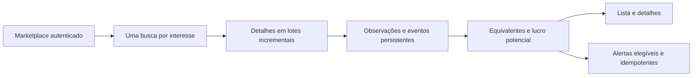

# F12 — Coleta e descoberta de oportunidades

<!-- current-execution:start -->
> **Situação em 2026-11-13:** `done` — [avaliação registrada](eval-report-2026-11-12T00-44-24Z.md); o [progresso canônico](../prd_progress.json) conserva ciclos e datas.
> Menções à feature ainda não iniciada ou à ausência do scaffold refletem a elaboração original. Consulte o [estado consolidado](../status-atual.md) para implementação e limites atuais. Evoluções explícitas do PRD e contratos posteriores prevalecem nos pontos alterados; IDs e evidências históricas são preservados.
<!-- current-execution:end -->

## 1. Objetivo e escopo

Extensão autorizada na conversa de 2026-11-11: analisar o Marketplace autenticado, ampliar categorias dentro de eletrônicos e melhorar coleta e oportunidades. Decisões aceitas: lucro antes de frete/transporte; categorias somente de eletrônicos; alertar publicação comprovadamente nova desde o início do monitoramento mesmo com histórico parcial.

O diagnóstico real encontrou busca duplicada por logística, catálogo com rotas redirecionadas, detalhes acumulados até o final de consultas longas e bloqueio global dos alertas enquanto a carga inicial permanecesse parcial. A pesquisa está em `platform-analysis-sources.md`. Não se promete completude do Marketplace, preço de venda realizado, estabilidade indefinida da sessão ou acesso indetectável.

## 2. Arquitetura

Preservar Python/Django/PostgreSQL, perfil exclusivo e worker persistente. Domínio determina escopo, identidade, condição e lucro; caso de uso intercala descoberta, enriquecimento e publicação; infraestrutura mantém leases, observações imutáveis, eventos, paginação e projeções.

## 3. Decisões

- Ajuste explícito solicitado pelo usuário em 2026-11-12 UTC: intervalo normal de 60 segundos entre ciclos, inclusive parciais com progresso; falhas gerais sem progresso usam 15 segundos iniciais e teto de 300 segundos. Um `Retry-After` maior da fonte prevalece. Reconciliar esperas antigas de uma hora sem sobrepor prazo da fonte. Três falhas consecutivas de detalhe interrompem a tentativa; navegador fechado suspende acesso; diagnóstico distingue timeout, rede, contexto e status HTTP sem divulgar mensagens privadas.
- Uma busca `marketplace` por interesse; por decisão do usuário em 2026-11-12, o raio solicitado passa a ser fixo em 20 km em torno do CEP cadastrado, substituindo os 500 km anteriores. A solicitação não comprova que a fonte aplicou o filtro. Separar parâmetros solicitados e contexto observado; remover prova sintética de filtro. A fronteira cronológica só vale com ordenação nativa observada e datas coerentes.
- Sem comprovação do contexto geográfico da resposta, registrar a página como parcial e impedir publicação de novos candidatos. Essa restrição não reavalia retroativamente dados ou intenções anteriores.
- Lucro potencial = revenda estimada − compra − taxa provisória de revenda. Frete/transporte não são deduzidos e não bloqueiam coleta, exibição ou alertas. Valores desconhecidos permanecem indisponíveis. Preservar decodificação de revisões históricas e corpos de mensagem já congelados.
- `monitoring_started_at` persistente: instalações existentes recebem o instante de adoção da regra, evitando alertar estoque histórico. Novas instalações recebem o instante da primeira coleta configurada. Publicação posterior ao marco e não futura pode gerar descoberta não silenciosa após detalhe confirmado. Datas ausentes/antigas continuam silenciosas. Redução mantém exigência de alerta anterior confirmado.
- Intercalar enriquecimento a cada página e publicar lotes de até dez detalhes, antes de terminar todas as consultas; preservar cursor/contexto da busca ao navegar para detalhes; deduplicar detalhes por ciclo e observações por anúncio/ciclo. Matches adicionais são unidos sem duplicar evento. Falha parcial não equivale a vazio, acesso negado suspende o trabalho.
- Ampliar apenas rotas nativas de eletrônicos validadas na sessão real, com contexto e continuação comprovados. Rotas inválidas permanecem identificáveis no histórico e não selecionáveis; mostrar indisponibilidade das escolhas antigas.
- Enquanto detalhes/comparáveis chegam incrementalmente, falta de amostra, dispersão ou referência vencida mantém o evento aguardando por até 48 horas desde a observação. Não criar intenção sem estimativa; vencido esse prazo, excluir. Decisões já excluídas permanecem fechadas. Isso evita perder uma oportunidade pela ordem de chegada dos comparáveis.
- A preparação de avaliações identifica modelos uma vez, agrupa equivalentes e prepara assinaturas fora da trava compartilhada. Requisições alteradas/due são gravadas em lotes curtos com conferência de marco de observações; nova coleta invalida o restante da preparação. Isso evita que análise longa impeça coleta/alertas sob o timeout do banco.
- Preço de entrada, parcela ou oferta somente para troca não sustenta lucro potencial; preservar preço observado e explicar a ausência da estimativa.
- Identificar famílias adicionais conservadoramente, com variantes/capacidades explícitas, rejeitando combinações contraditórias, acessórios e lotes. Expandir frases de funcionamento somente com evidência afirmativa e precedência de defeito/negação. Comparáveis continuam preços pedidos, mínimo e dispersão preservados.

## 4. Superfícies e componentes

| Área | Responsabilidade |
|---|---|
| F03 configuração/catálogo | Taxa obrigatória, frete dispensável; catálogo validado e aviso de escolhas indisponíveis |
| F04 escopo/coletor/repositório | Busca única, publicação incremental, marco temporal persistente, proveniência honesta |
| F05/F06 condição/identidade | Mais modelos equivalentes e reconhecimento conservador de funcionamento |
| F07 composição | Política versionada de lucro antes de frete/transporte |
| F08 projeções/templates | Lucro único, sem filtro ou composição por logística, diagnóstico legível |
| F09 elegibilidade/mensagem | Elegibilidade independente de logística, fórmula identificada e idempotência preservada |

## 5. Interfaces

Sem endpoints novos. Os formulários existentes mantêm CEP/interesses/taxa e deixam de exigir frete. Parâmetros legados de modalidade podem ser aceitos por compatibilidade, mas não filtram a exploração nova. Mensagem identifica anúncio, compra, lucro potencial antes de frete/transporte, data, link e referência técnica de reconciliação.

## 6. Dados e adoção

Adicionar `CollectionState.monitoring_started_at` e estado de descoberta emitida quando necessário. Migration não apaga observações, eventos, decisões nem recibos; marco de adoção impede recuperação retroativa de descoberta. Versionar chave de escopo para não retomar unidades antigas com semântica nova. Preservar payloads históricos de composição. Atualizar constraint de configuração para taxa sem exigir frete. Reprojetar dados com nova política sem reabrir decisões excluídas.

## 7. Verificação

Regressões de serviço para fórmula/taxa/arredondamento, capacidades/modelos, condições negativas, busca única; integração PostgreSQL para publicação antes do fim, retomada sem duplicata, fronteira temporal e transição segura; regressões de alertas, projeções e formulários. Jornada via playwright-cli em ambiente isolado e prova real de cada categoria adicionada. Seis gates Python por `node scripts/run-gates.mjs`, suíte aplicável e relatório por item. Evidência real contém apenas metadados públicos agregados; perfil/cookies e dados pessoais não entram nos relatórios.
