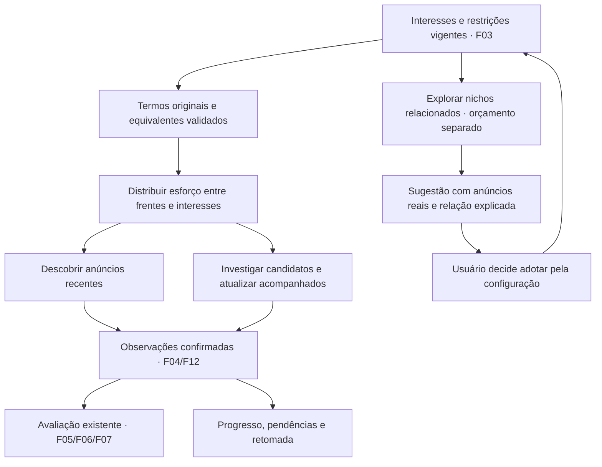

# F13 — Navegação ativa em busca de oportunidades

Desenho de produto e operação consolidado pelo brainstorming. Fonte de requisitos: [PRD](../PRD.md). Direção técnica existente: [stack](../stack.md). Este documento registra decisões e uma proposta de funcionamento; não substitui `spec.md`, `plan.md`, `contract.md` ou avaliação. F13 permanece `pending`.

## Decisões confirmadas pelo usuário

| Decisão | Escolha | Consequência |
|---|---|---|
| Distribuição do esforço | Equilibrar descoberta e investigação | As duas frentes e os interesses aptos precisam avançar; sugestões têm orçamento separado e limitado. |
| Reformulação de pesquisa | Variações controladas automaticamente | Abreviações e nomes equivalentes validados preservam modelo e restrições, sem exigir aprovação por consulta. |
| Alcance das sugestões | Nichos relacionados aos interesses atuais | Cada sugestão apresenta anúncios reais e explica a relação; inclusão no monitoramento exige escolha explícita. |
| Agendamento das sugestões | Automático em tempo livre entre os interesses ativos | Não adia trabalho ativo; orçamento próprio continua obrigatório. |

As três primeiras escolhas foram registradas nas respostas “1” do brainstorming anterior; o agendamento automático em tempo livre foi confirmado na conversa de especificação. Não há proporção, duração ou meta numérica aprovada. Pesquisa, inspeção de anúncio e sugestão não autorizam negociação, contato com vendedor ou compra.

## Base observada e mudança pretendida

O coletor atual já percorre páginas, obtém detalhes e publica lotes durante a exploração. No código consultado, `_scan` percorre interesses em sequência e `_pages` chama enriquecimento entre páginas; `_enrich` percorre seus alvos antes de devolver o controle. Há limites e tratamento de falhas existentes, mas esse encadeamento não comprova distribuição equilibrada entre os interesses e as duas frentes.

Referências da leitura: [coleta](../../apps/backend/src/garimpei/usecase/listing/collect_listings_usecase.py), [escopo](../../apps/backend/src/garimpei/domain/listing/scope.py) e [acesso ao Marketplace](../../apps/backend/src/garimpei/infra/gateway/listing/facebook_marketplace.py). Trata-se de inspeção de código, sem nova execução na fonte real.

F13 organiza o esforço, amplia termos equivalentes de forma controlada e torna propósito, evidência e interrupções consultáveis. Não precisa aguardar a IA para navegar; fotos, análise multimodal e inferência local são extensões de F14/F15/F19. F18 usará a navegação complementar para investigar atributos e comparáveis; a política de equivalência e preço continua em F06, e o cálculo em F07.

## Alternativas consideradas

| Abordagem | Benefício | Custo ou limite | Resultado |
|---|---|---|---|
| Equilibrar descoberta e investigação | Evita acumular somente anúncios novos ou somente revisitar candidatos | Requer orçamento e retomada por unidade | Escolhida |
| Priorizar candidatos encontrados | Concentra esforço em completar evidências | Pode atrasar descoberta recente | Não escolhida |
| Priorizar novidades | Amplia descoberta recente | Pode acumular itens sem avaliação | Não escolhida |
| Aprovar cada variação ou usar somente termo literal | Restringe reformulação | Exige intervenção ou perde nomes equivalentes | Preferida a autonomia controlada |
| Explorar qualquer nicho de eletrônicos | Amplia diversidade | Consome esforço fora da relação com interesses atuais | Escolhida a exploração relacionada |

## Fluxo proposto

O diagrama descreve fluxo funcional, não dependências de implementação. A avaliação e os alertas existentes continuam recebendo lotes antes de terminar toda a navegação. A recuperação respeita a política de alertas vigente; F13 não antecipa a implementação da primeira elegibilidade de F16.

### Distribuição e prioridade

A proposta técnica é trabalhar em unidades limitadas de busca/continuação e detalhe, devolvendo o controle entre unidades. A distribuição considera frente, interesse, trabalho pendente, tempo de espera e último progresso útil. A estratégia exata e seus desempates serão fixados no contrato com medição; a decisão de equilíbrio não impõe alternância rígida nem uma divisão de 50%/50%.

Uma unidade lenta ou com falha tem tentativa e espera limitadas e não monopoliza unidades independentes. Suspensão de acesso ao perfil compartilhado pode impedir todas as tarefas que dele dependem; não contornar esse bloqueio nem confundi-lo com falha isolada de anúncio. O orçamento de sugestões é separado contabilmente, mas compartilha o navegador e os limites da fonte; não significa outro navegador concorrente no mesmo perfil.

### Termos equivalentes

Exemplo de comportamento: “PlayStation 5 Slim” pode usar o alias validado “PS5 Slim”. “PS5 Pro” é outro produto; não vira alias nem passa a ser monitorado automaticamente.

A especificação deverá definir um catálogo versionado de equivalências e sua validação. Como proposta técnica inicial, usar equivalências explícitas e verificáveis, sem depender de geração livre por IA. Toda variação conserva interesse de origem, restrições, termo original, termo pesquisado e justificativa da equivalência. Cada resultado ainda exige evidências próprias de identidade; aparecer numa consulta não comprova modelo ou variante.

As variações compartilham o orçamento do interesse e a identidade do anúncio por fonte/ID. F13 estende a regra de pesquisa da F12 com termos equivalentes, sem recuperar a antiga duplicação por envio/retirada. A mesma oferta encontrada em consultas diferentes não cria outra descoberta ou outro primeiro alerta.

### Sugestões relacionadas

A pesquisa pode investigar nichos próximos dos interesses atuais, com orçamento próprio limitado. Cada sugestão precisa identificar o interesse de origem, explicar uma relação concreta e apresentar links/identidades, datas e evidências dos anúncios observados. Pertencer genericamente a “eletrônicos” não basta para justificar relação com um interesse específico.

Outro modelo pode ser uma sugestão relacionada, mas isso não prova equivalência de produto, preço de revenda, lucro ou liquidez. Os critérios de relação, agrupamento e atualização serão especificados com exemplos positivos e negativos. Sem evidência suficiente, registrar investigação inconclusiva, sem inventar recomendação.

Sugestões e seus anúncios ficam separados do conjunto monitorado. A ação de adotar usa a configuração de F03, com gravação confirmada; só então o novo interesse entra no monitoramento e nas regras vigentes de avaliação/alerta. Ignorar uma sugestão não altera o escopo.

## Entradas, saídas e recuperação

| Fronteira | Dados necessários ou resultado |
|---|---|
| Configuração → navegação | Interesses ativos, restrições, CEP e revisão aplicável; termos equivalentes validados |
| Navegação → coleta | Fonte/ID, observação, contexto solicitado/observado, termo, origem do interesse e evidências obtidas |
| Distribuição → acompanhamento | Frente/interesse, unidade, orçamento consumido, último progresso, pendência, motivo e próxima ação |
| Navegação → F18 | Contexto verificável, percurso, limites e possibilidade de pesquisa complementar no acesso dedicado |
| Exploração → sugestões | Nicho, interesse relacionado, relação explicada, anúncios reais, data e limitações |

Cada unidade precisa conservar contexto e progresso confirmado. Reutilizar continuação apenas se ainda válida para o mesmo contexto; se o cursor não sobreviver à pausa, reconstruir a busca com deduplicação e informar o retrabalho. Não prometer retomar um cursor que a fonte não aceita. Mudança de configuração não autoriza publicar trabalho antigo como pertencente ao escopo novo.

Página inesperada, contexto não verificado e limite atingido deixam cobertura parcial, não prova de ausência de anúncios. Login/desafio exige recuperação manual. Resultados repetidos sem nova evidência não contam como avanço. Conteúdo de anúncio, página ou eventual modelo não pode alterar escopo, acessar segredos ou acionar contato/compra.

## Experiência pretendida

Em Acompanhamento, o usuário identifica qual interesse está sendo pesquisado, qual termo equivalente foi usado, o que já avançou e por que uma unidade aguarda ou foi suspensa. A apresentação distingue descoberta, investigação e exploração de sugestões, sem exigir leitura de logs.

Sugestões aparecem separadas, com relação, anúncios de suporte e limitações antes da ação de adotar. Este documento não define layout final; o detalhamento deve preservar filtros, leitura estável e atualização mediante clique já existentes.

## Validação necessária na especificação

- Dois ou mais interesses com ambas as frentes pendentes: catálogo extenso e detalhe lento não impedem progresso das outras unidades aptas dentro dos limites do contrato.
- Termo original e alias validado encontram a mesma oferta: uma identidade e nenhum evento/primeiro alerta duplicado. Alias não validado e modelo diferente não ampliam o interesse ativo.
- Sugestão relacionada com anúncios reais é explicável; candidato sem relação demonstrada não é apresentado como sugestão válida. Nenhuma sugestão ignorada gera monitoramento ou mensagem por si só.
- Interrupção, cursor inválido, mudança de revisão, resultado fora de ordem e falta de acesso preservam o progresso confirmado e não fabricam completude.
- Orçamento de sugestões esgotado e falha persistente de candidato não monopolizam trabalho independente. Provar com controles saudáveis e falhas em recursos isolados.
- Exercício autorizado na fonte real registra contexto, percurso, tempos e limitações; sucesso apenas em fixtures não comprova comportamento atual do Marketplace.

## Pendências para especificação e contrato

Fixar limites medidos de duração, páginas, detalhes, consultas equivalentes, tentativas, recuo, orçamento de sugestões e distribuição entre interesses. Materializar catálogo de aliases, critérios verificáveis de relação entre nichos, estados de retomada e apresentação das sugestões. Não há metas aprovadas de precisão, cobertura, latência comercial ou retorno financeiro.

Dependências permanecem F03/F04/F11/F12, prioridade 1 e onda 11. A execução deve coordenar alterações no coletor e nas projeções com as outras features; a onda não autoriza trabalho paralelo. Nenhuma implementação, execução de navegador ou envio de mensagem foi iniciado por este brainstorming.
