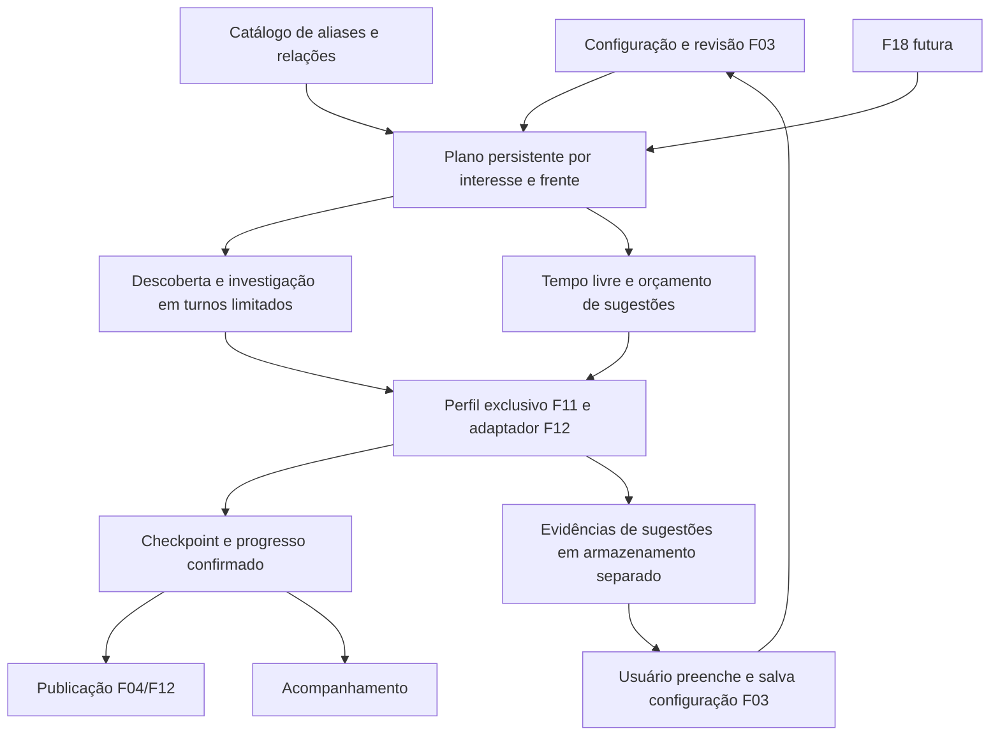

# F13 — Navegação ativa em busca de oportunidades

<!-- current-execution:start -->
> **Situação em 2026-11-13:** `done` — [avaliação registrada](eval-report-2026-11-12T19-32-55Z.md); o [progresso canônico](../prd_progress.json) conserva ciclos e datas.
> Menções à feature ainda não iniciada ou à ausência do scaffold refletem a elaboração original. Consulte o [estado consolidado](../status-atual.md) para implementação e limites atuais. Evoluções explícitas do PRD e contratos posteriores prevalecem nos pontos alterados; IDs e evidências históricas são preservados.
<!-- current-execution:end -->

## 1. Visão técnica e escopo

**Estado:** especificação documental, sem implementação ou avaliação. Fontes: [PRD](../PRD.md), [desenho da F13](design.md), [stack](../stack.md) e código existente de F03/F04/F11/F12. Dependências: F03, F04, F11 e F12; prioridade 1, onda 11. Complexidade: complexa pela retomada, persistência e integração externa, mesmo com poucas rotas.

**Included:** distribuição equilibrada entre descoberta e investigação, aliases explícitos, checkpoints persistentes, publicação incremental, diagnóstico e retomada, sugestões de nichos relacionados separadas do monitoramento e fronteira de navegação reutilizável por F18. Decisão desta conversa: explorar sugestões automaticamente **quando houver tempo livre entre os interesses ativos**.

O coletor já busca páginas e enriquece detalhes. `CollectListingsUseCase._pages` mantém continuação em memória, `_enrich` percorre alvos antes de devolver controle e `FacebookMarketplace.search` usa contador de página associado ao estado do navegador. F13 deve tornar o trabalho retomável entre processos; gravar apenas o número da página não resolve essa limitação.

**Excluído:** aquisição/armazenamento de fotos de F14, análise multimodal de F15/F19, política de primeira elegibilidade de F16, diagnóstico geral/backups de F17 e identificação/busca de amostras de F18. F13 não altera regras de condição, equivalência, cálculo ou envio vigentes, não agrega fontes novas nem executa contato ou compra.

## 2. Impacto de arquitetura

Preservar `domain/ ← usecase/ ← infra/`, DI por construtor, configuração em `config/env.py` e composição em `main.py`. Navegador, ORM, relógio e fila entram por portas. O domínio decide perímetro, alternância, orçamento, equivalência de termos e validade de revisão; a infraestrutura adapta os checkpoints à sessão real. Reutilizar o caminho de publicação F04/F12, sem segundo escritor de observações/eventos.

## 3. Decisões técnicas

| Decisão | Escolha | Alternativa | Consequência |
|---|---|---|---|
| Distribuição | Round-robin persistente entre interesses aptos; alternar descoberta/investigação quando ambas têm pendências | Esgotar uma consulta antes da próxima | Um catálogo extenso não monopoliza o perfil; não promete proporção de tempo 50/50 |
| Variação de termos | Catálogo versionado explícito, termo literal primeiro, aliases preservando modelo e restrições | Geração livre por IA | Auditável e independente de F15/F19; cobertura limitada ao catálogo |
| Continuação | Checkpoint com contexto, cursor opaco quando reutilizável e assinaturas de páginas; reconstrução deduplicada quando inválido | Salvar contador local de páginas | Retomada honesta, com retrabalho informado quando necessário |
| Sugestões | Automáticas em tempo livre, somente nichos relacionados por regras explícitas e evidências reais | Exploração ampla de eletrônicos | Não expande interesses nem cria ofertas/alertas por si só |
| Prioridade de detalhes | Dentro da frente, pendência válida mais antiga; desempate por fonte/ID | Ordenar pelo lucro ainda desconhecido | Não exige estimativa para investigar e evita fome das pendências |
| Persistência | Registro da unidade, publicação e checkpoint na mesma transação curta | Transação envolvendo rede | Não perde fronteira confirmada; I/O acontece fora de locks do banco |

### 3.1. Limites operacionais iniciais

São parâmetros técnicos conservadores para a primeira implementação, não metas comerciais nem medições concluídas. Registrar valores efetivos e medições em `operations.md`; ajuste que altere aceite exige regenerar os documentos antes da avaliação.

| Limite | Valor inicial e comportamento |
|---|---|
| Perfil | Uma operação de navegação por vez; o lock existente abrange login/coleta/sugestão/F18 |
| Turno | Uma página **ou** um detalhe por interesse/frente antes de devolver o controle |
| Fatia ativa | Até 120 s, 2 páginas e 10 detalhes; primeiro limite vence, pendências permanecem persistidas |
| Ciclo por interesse | Até 100 páginas e 3 termos, incluindo literal; limite atingido registra parcialidade, sem anunciar janela completa |
| I/O | Timeout de 20 s por operação, reaproveitando configuração F12; não iniciar ação cujo timeout mais cadência não caiba na fatia |
| Falhas | Três falhas consecutivas de detalhe pausam a tentativa; recuo 15 s, teto 300 s, prazo maior da fonte prevalece |
| Sugestões | Até 45 s, 1 página e 1 detalhe por fatia; máximo uma fatia por 300 s, sem compensar tempo ocioso com rajadas |
| Admissão de sugestão | Nenhuma unidade ativa apta agora; tempo até próximo trabalho ativo deve comportar timeout + cadência + margem de 5 s |
| Pendências | Até 500 detalhes por interesse; ao atingir, parar descoberta desse interesse e continuar investigação, sem descartar pendências |
| Registros de sugestões | Até 100 sugestões correntes e 10 evidências por sugestão; teto suspende novas inclusões com motivo, sem apagar evidência silenciosamente |

Valores entram em configuração central com validação de inteiros positivos, limites coerentes e nomes `GARIMPEI_NAV_*`. Não duplicar `GARIMPEI_LISTING_TIMEOUT`, cadência, lease ou recuo. Persistir consumo de páginas/termos e orçamento de sugestões; reinício não concede orçamento novo à mesma janela. Tempo de execução de uma fatia é medido por relógio monotônico; agendamento persistido usa UTC.

Se houver trabalho apto de N interesses nas duas frentes e não houver suspensão de acesso, cada par interesse/frente recebe uma oportunidade em até 2N turnos ativos. Falha de um item consome seu turno; espera imposta pela fonte é inelegível até vencer. Sugestões não entram nessa fila nem adiam a próxima coleta normal de 60 s da F12; a concessão termina na próxima fronteira de operação, sem navegação paralela para compensar atraso.

### 3.2. Aliases e relação entre nichos

`navigation_catalog.json` terá versão, família, termo canônico, aliases, restrições preservadas e relações dirigidas com justificativa. Controle positivo obrigatório: `PlayStation 5 Slim ↔ PS5 Slim`. Negativos: `PS5 Pro` não é alias de Slim; `iPhone 13 128 GB` não perde capacidade nem vira `iPhone 13 Pro`. Fora do catálogo, usar só o termo literal; não bloquear cadastro livre de F03. Cada resultado requer evidência própria de identidade; aparecer na consulta do alias não comprova modelo/variante nem autoriza match incompatível.

Uma relação pode sugerir outro modelo da mesma família para investigação, identificando que é **outro produto**, nunca comparável equivalente automaticamente. O catálogo inicial deve conter relação documentada entre PS5 Slim e PS5 Pro, sem tratá-los como aliases; não recomendar item só porque pertence a eletrônicos. A relação só se torna sugestão publicada após obter pelo menos um anúncio com identidade/link e contexto verificados. Apresentar relação, referência de origem, data, evidência e limites, sem afirmar lucro ou liquidez não calculados.

Anúncios vistos exclusivamente nessa exploração ficam no armazenamento de sugestões e não entram em `Listing`, amostras, listas ou eventos monitorados. Se o mesmo anúncio for encontrado independentemente por um interesse ativo, o caminho ativo permanece válido; não atribuir esse efeito à sugestão. A adoção apenas preenche o formulário existente: gravação explícita e confirmada em F03 é a fronteira que autoriza monitoramento.

### 3.3. Retomada, contexto e publicação

Checkpoint inclui configuração/revisão, hash de escopo/termo/restrições, propósito, janela, cursor da fonte quando seguro, assinaturas de páginas, unidade seguinte e geração da posse. Nunca persistir ou expor payload GraphQL com cookies/tokens como checkpoint. Reconstruir a consulta autenticada com F11 e verificar o contexto antes de aplicar um cursor opaco; quando a fonte rejeitar a retomada, refazer desde a busca e registrar `cursor_rebuilt`.

Cada página recebida tem seus candidatos e continuação confirmados atomicamente. Cada detalhe tem recibo da unidade e observação publicados atomicamente pelo caminho existente. Repetir unidade confirmada não cria outra observação/evento; observação nova em ciclo posterior continua permitida. Identidade permanece fonte/ID; IDs distintos não são fundidos por título/foto. União de matches de literal/aliases/interesses não duplica descoberta.

O commit verifica geração da posse e revisão vigente. Resultado atrasado não altera checkpoint, matches atuais ou observação mais recente; histórico confirmado é conservado. Mudança de interesse invalida trabalho antigo; retomar cria planejamento para a revisão atual, sem reiniciar marco de monitoramento ou recibos. Perfil suspenso requer confirmação manual de F11; botão de retomada não libera acesso.

Página/contexto errados, cursor/página repetidos, teto e data ausente conservam parcialidade. Parâmetros da URL não comprovam filtro aplicado. Publicação/data/condição incertas não recebem certeza adicional por terem vindo de navegação ativa. Publicar cada detalhe confirmado antes de concluir a exploração; reunir até dez quando disponíveis sem esperar para completar lote.

## 4. Componentes e caminhos

Os caminhos abaixo são o destino proposto; arquivos novos não existem nesta entrega documental. Prefixo backend: `apps/backend/src/garimpei/`.

| Componente | Operação e responsabilidade |
|---|---|
| `domain/navigation/{work,policy,catalog,ports,read_models}.py` | Novos: perímetro, orçamento, elegibilidade de turno, agregados e portas de escrita/leitura/navegação |
| `usecase/navigation/{run_slice,read_status,resume_work,read_suggestions,request_research}_usecase.py` | Novos: um `execute` por caso, DI e orquestração; F18 futura consome pesquisa |
| `infra/repository/navigation/{postgres_repository,mapper}.py` | Novos: posse, checkpoints e escrita transacional integrada ao publicador existente |
| `infra/queries/navigation/postgres_queries.py` | Novo: DTOs de progresso e sugestões, sem reconstruir entidades para leitura |
| `infra/persistence/navigation_models.py` e `migrations/<next>_navigation.py` | Novos: extensão aditiva; registrar modelos conforme o app existente |
| `infra/gateway/navigation/navigation_catalog.json` | Novo: aliases e relações explícitos; versão acompanhando assinaturas |
| `infra/gateway/listing/{facebook_marketplace,marketplace_browser}.py` | Alterados: continuação verificável entre fatias sem serializar sessão privada |
| `usecase/listing/collect_listings_usecase.py`, `domain/listing/ports.py` | Alterados: decompor trabalho em turnos e manter publicação F04/F12 única |
| `infra/worker/navigation_handler.py`, `infra/persistence/management/commands/runworker.py` | Integrar fila persistente ao worker; nenhum browser em handler HTTP |
| `infra/http/navigation/{routes,navigation_handler}.py`, `infra/http/urls.py` | Novos/alterado: leitura e comandos com tratamento central de erros |
| `infra/http/templates/navigation/{progress,suggestions}.html` e `templates/monitoring/tracking.html` | Novos/alterado: estados e sugestões; reutilizar tokens e componentes existentes |
| `infra/http/monitoring/{forms,presentation}.py` | Pré-preencher sugestão identificada sem salvar via GET |
| `config/env.py`, `main.py` | Configuração validada, factories e ligação explícita das portas |

## 5. Interfaces públicas e experiência

Loopback, sem novo login do Garimpei. Formulários POST têm CSRF e verificação de revisão; GET não muda dados. Não criar API pública de comandos livres ou expor URL arbitrária ao navegador automatizado.

| Método e caminho | Entrada | Resposta e falhas |
|---|---|---|
| `GET /acompanhamento/` | Configuração existente | Acrescenta painel de navegação; não depende de F17 |
| `GET /acompanhamento/navegacao/` | Sem corpo | Fragmento HTML 200 com escopo, horário, versão, frente, termo, último progresso, pendências, limites, razão/próxima ação; 503 recuperável |
| `POST /acompanhamento/navegacao/retomar/` | `work_id` UUID, `revision` inteiro, CSRF | 303 para acompanhamento após confirmar intenção persistida; 400 formato, 403 CSRF, 404 unidade, 409 revisão/acesso bloqueado, 503 gravação |
| `GET /sugestoes/` | Página positiva opcional, 20 sugestões por página | HTML 200 com relação/evidência/data; vazio explica ausência de sugestão fundamentada; entrada inválida 400 |
| `GET /configuracoes/?sugestao=<uuid>` | Identificador de sugestão existente | Prévia preenchida sem mutação; origem indisponível 404; adoção só por POST já existente de F03 |

Exemplo de comando: corpo de formulário `work_id=550e8400-e29b-41d4-a716-446655440000&revision=7`, além do CSRF. Não há JSON de navegador obrigatório. Exemplo de DTO de leitura interno: `{work_id, scope_revision: 7, purpose: "discovery", phase: "partial", reason: "budget_exhausted", remaining: 12, last_progress_at, next_attempt_at}`. Cursor e payload privado não compõem esse DTO.

Fronteira para F18: `RequestResearchUseCase.execute(request_id, scope_revision, origin_interest, canonical_term, constraints, purpose)` aceita consulta justificada no perímetro e devolve identificador, estado/limites e referências às observações confirmadas, via leitura posterior. Propósitos não concedem privilégio adicional. Pedido repetido é idempotente; revisão antiga ou termo sem correspondência/justificativa cadastrada é rejeitado. Exercitar diretamente com cliente de teste, sem implementar F18.

Interface distingue descobrindo, investigando, esperando horário/fonte, orçamento esgotado, contexto inconclusivo, acesso suspenso e sem pendências. Mostrar quantidades percorridas e pendentes conhecidas, sem inventar total da fonte ou percentual completo. A atualização gera aviso aplicado por clique, preservando rota/filtros/página; falha conserva leitura válida. Usar [design existente](../design/DESIGN.md); avaliar por `frontend-ui-design` e navegar com `playwright-cli` na implementação, incluindo teclado e largura de 360 px.

## 6. Modelo de dados e migração

Tipos descrevem a persistência proposta, sem impor DDL manual. UUIDs gerados no domínio; horários timezone-aware em UTC; contadores não negativos; enums validados por constraints. Não alterar migrations históricas; escolher próximo número disponível ao implementar.

| Registro | Campos e restrições principais |
|---|---|
| `NavigationWork` | UUID; configuração UUID, source, scope_key, revision bigint, origin_interest, purpose, phase, reason, generation bigint, lease_until nullable, next_attempt_at nullable, last_progress_at nullable; único por escopo/interesse/propósito/termo/ janela; índices de estado/vencimento e interesse |
| `NavigationCheckpoint` | FK protegida de work, termo/catálogo/restrições/janela, cursor seguro nullable, assinaturas, pending_unit, contadores; único por work; CAS por geração |
| `NavigationUnitReceipt` | FK work, unit_key/hash, input_revision, resultado confirmado, referências à observação/evento, horário, ordem do turno, orçamento consumido e razão da seleção; único por work/unit_key/revisão; sem corpo privado da fonte |
| `NicheSuggestion` | UUID, configuração/revisão, interesse de origem, tipo/termo normalizados, relation_key/catalog_version, estado, motivo, datas; único por configuração/origem/nicho/relação; índice de data/estado |
| `SuggestionEvidence` | FK protegida de sugestão, source/external_id, canonical_url verificada, trecho público limitado, observed_at e contexto/hash; único por sugestão/fonte/ID/versão |

Cursores e evidências não vão para logs/respostas sem sanitização. Catálogo e checkpoints são versionados; DB indisponível não vira configuração ausente. Migração preserva IDs, observações, escolhas manuais, marcos, eventos, intenções e recibos; inicializa somente planejamento novo. Não migra sugestões para anúncios monitorados. Limpeza geral fica em F17; F13 suspende inclusão no teto, sem apagar confirmação para liberar espaço.

## 7. Estratégia de verificação

Convenções existentes: `tests/factories/` para estado/fakes nomeados, `tests/fixtures/` para entradas, `prepare_instance` para PostgreSQL isolado, configurações privadas temporárias e `GARIMPEI_ENV=eval`. `test_settings.py` usa banco dummy: não serve como comprovação de transações. Documentar o bootstrap e a verificação dos recursos em `operations.md` durante a implementação.

| Testes propostos em `apps/backend/tests/` | Casos e observações |
|---|---|
| `unit/test_navigation_policy.py` | `test_both_fronts_progress`, `test_alias_keeps_variant`, `test_idle_budget_admission`: justiça por turnos, variantes, prazos e tetos |
| `integration/test_navigation.py` | `test_checkpoint_survives_restart`, `test_cursor_rebuild_is_idempotent`, `test_stale_generation_is_rejected`, `test_suggestions_are_isolated`: fronteiras reais PostgreSQL, queda antes/depois do commit e revisão concorrente |
| `integration/test_navigation_fairness.py` | Dois interesses, ambas as frentes, detalhe lento e controle saudável; testar 2N turnos e ausência de disputa do perfil |
| `http/test_navigation.py` | Formatos, CSRF, 404/409, falha de gravação, GET sem mutação e pré-preenchimento sem adoção |
| `factories/navigation.py`, `fixtures/navigation/cases.json` | `NavigationSourceFake`, relógio controlado, páginas repetidas/erradas, desafio, cursor vencido, dados entre aspas/instruções, aliases e sugestões relacionadas/não relacionadas |

Na implementação: `node scripts/run-gates.mjs` para seis grupos Python; `uv run --project apps/backend --frozen --no-sync pytest` para suíte; `uv run --project apps/backend --frozen --no-sync python apps/backend/manage.py check --settings=garimpei.config.test_settings`; build `uv build --project apps/backend`. Exercitar migrations no ambiente isolado e jornadas com `playwright-cli`; testes unitários sozinhos não comprovam retomada, UI ou fonte real.

Prova real somente de leitura, com perfil dedicado exclusivo e acesso confirmado: termo original/alias, continuação e detalhe, pausa/retomada e sugestão relacionada. Medir percurso, páginas úteis, tempos e limites em manifesto sanitizado; fonte sem resultados/desafio não passa como sucesso. Falta de acesso mantém o item real pendente, sem rebaixar critério. Sem envio real ao WhatsApp necessário. Cobertura dos sete ACs e da integração INT-15 consta do contrato; F18 é apenas consumidor futuro da fronteira.

## Apresentação atual — 2026-11-13

Sugestões é destino direto do menu; limites detalhados da exploração ficam em disclosure. Carregamento do percurso apresenta recuperação e erro de página mantém shell e orientação. Veja as [convenções da interface](../design/implementation.md), a [auditoria original](../design/audit-2026-11-13/README.md) e a [verificação integrada](../design/audit-2026-11-13/integration-master.md). Este complemento preserva IDs e critérios do contrato original.
