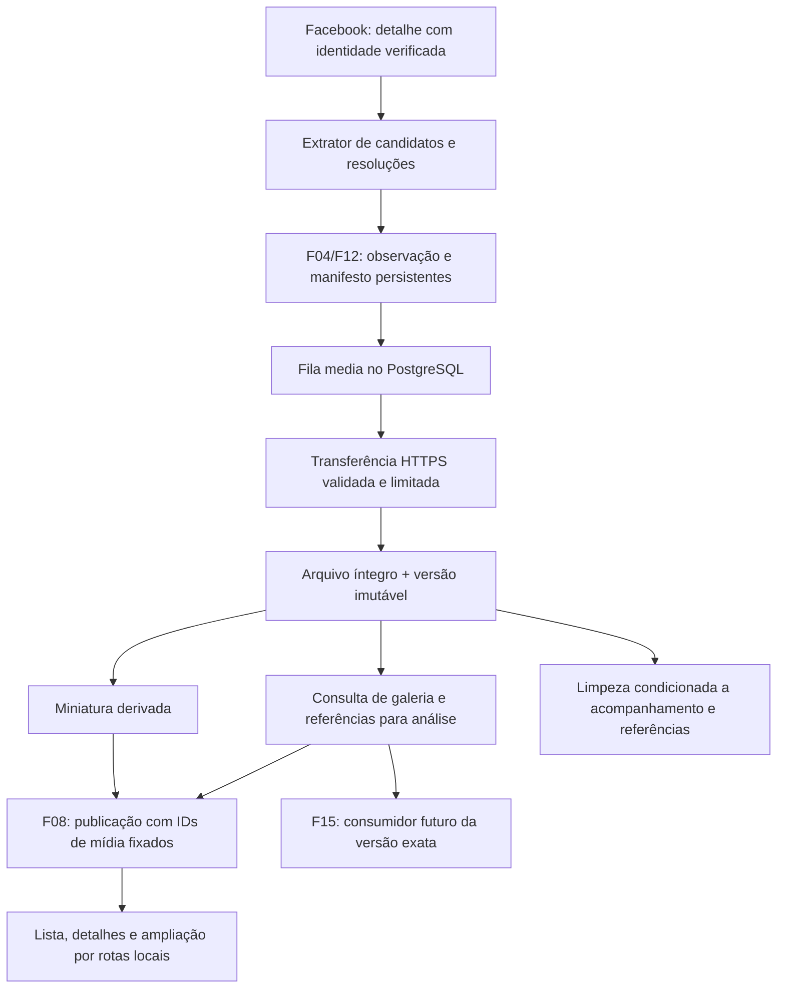

# F14 — Coleta e exibição confiável de imagens

<!-- current-execution:start -->
> **Situação em 2026-11-13:** `done` — [avaliação registrada](eval-report-2026-11-13T12-24-34Z.md); o [progresso canônico](../prd_progress.json) conserva ciclos e datas.
> Menções à feature ainda não iniciada ou à ausência do scaffold refletem a elaboração original. Consulte o [estado consolidado](../status-atual.md) para implementação e limites atuais. Evoluções explícitas do PRD e contratos posteriores prevalecem nos pontos alterados; IDs e evidências históricas são preservados.
<!-- current-execution:end -->

## 1. Visão técnica e escopo

Especificação de complexidade **complexa**, por integrar fonte autenticada, arquivos, PostgreSQL, tarefas, projeções e navegador. Fontes: [PRD](../PRD.md), [stack](../stack.md), [design Mineral](../design/MASTER.md) e contratos/relatórios de F04, F08 e F12. Dependências diretas: **F04, F08, F12**, todas `done` no progresso consultado; prioridade 1, onda 11. Este documento não inicia implementação nem altera seu estado `pending`.

**Incluído:** obter fotos do anúncio correto no Facebook, conservar bytes locais da melhor versão efetivamente obtida, derivar miniaturas, servir mídia por identificadores locais, exibir galeria/ampliação, recuperar estoque acompanhado e falhas, versionar entradas para análise e limpar somente arquivos sem proteção. Inclui migração compatível, concorrência, configuração de armazenamento e prova real de extração e carregamento. Todos os oito aceites F14 do PRD estão no contrato.

**Excluído:** executar análise de condição ou inferência F15/F19, implementar primeira elegibilidade F16, backups F17, navegação exploratória F13, redesenhar a composição financeira F20, enviar fotos pelo WhatsApp, editar imagens do vendedor, reconhecer fotos como prova de funcionamento ou criar uma jornada de deixar de acompanhar anúncios. Integrações futuras consomem a fronteira de mídia entregue aqui; não são pré-requisitos circulares.

**Base verificada em arquivos:** `Evidence.image_url` e seu JSON são opcionais; `relay_parser.py` lê apenas `primary_listing_photo.image_uri`; `media.py` valida HTTPS de forma genérica; os templates usam diretamente a URL externa. Não há galeria persistente, arquivo local ou pin de análise. A expectativa desse campo não comprova que ele corresponda ao payload real atual. O diagnóstico do PRD encontrou 1.563 anúncios sem URL, mas a causa concreta deve ser demonstrada com extração real sanitizada, sem atribuí-la previamente à expiração.

**Hipóteses e limites:** fonte e acesso privados existentes continuam disponíveis na implementação. Quantidades, formatos e prazos abaixo são parâmetros técnicos iniciais verificáveis, ajustáveis somente com atualização coerente dos documentos/evidências; não são metas de negócio. Não há orçamento de disco ou prazo de retenção aprovados. O orçamento será informado por configuração antes de habilitar obtenção de mídia, sem inventar valor para a instalação real.

## 2. Arquitetura e fluxo

Preservar Python 3.13, Django 5.2, PostgreSQL e Procrastinate. `domain/media/` contém regras e protocolos, `usecase/media/` orquestra, `infra/` implementa fonte, arquivos, persistência e HTTP; composição concreta somente em `main.py`. Adaptar o padrão Python existente, com tipos explícitos, DI por construtor e erros no middleware central. Sem I/O no domínio ou acesso ao ambiente fora de `config/env.py`.

1. Extrair a principal e as fotos adicionais apenas de estruturas vinculadas ao ID do item aberto, conservando ID da foto, ordem, origem, URLs candidatas e dimensões quando disponíveis. Recomendações, avatar e imagens de interface não entram. Campos desconhecidos ou galeria cuja fronteira não foi comprovada geram estado desconhecido/parcial, nunca “sem fotos”. Não adivinhar URLs de alta resolução nem alterar assinaturas.
2. Persistir o manifesto associado à observação na publicação F04, com trabalho de mídia transacionalmente enfileirado. Não baixar dentro da transação da coleta. Ausência de configuração de mídia conserva manifesto e diagnóstico, sem fazer falhar texto/preço ou o ciclo inteiro.
3. O worker baixa uma foto por unidade limitada, valida os bytes, publica o arquivo e sua versão e deriva a miniatura em tarefa independente. Falha de uma foto não interrompe as demais. A entrega de mídia não é evento de descoberta/preço e não cria intenção de alerta.
4. Uma mudança visível de estado/galeria aumenta a revisão de mídia e permite nova projeção F08. O payload da exploração fixa observação, revisão de mídia e IDs/versões ordenados; lista já aberta mantém sua revisão até o clique de atualização. Não consultar a galeria mais recente ao renderizar uma revisão antiga. O detalhe segue a revisão selecionada pela jornada existente.
5. Renovação e backfill solicitam releitura de detalhe pelo fluxo que já detém o perfil exclusivo, com alvo identificado e execução limitada. Não abrir outro perfil ou concorrer com login/coleta. Quando a releitura alterar os dados da fonte, usar uma nova observação normal; o resultado atrasado continua histórico e não substitui a galeria de uma observação nova.

A disponibilidade física de um identificador já fixado pode mudar por falha ou limpeza legítima. Na renderização, conferir somente essa disponibilidade/tombstone pelos IDs selecionados para informar a remoção; essa conferência não substitui a foto por outra, não carrega a galeria mais recente e não altera preços/condição da revisão apresentada.

## 3. Decisões e políticas técnicas

| Decisão | Abordagem escolhida | Alternativa e custo aceito |
|---|---|---|
| Conservação | Arquivo recebido imutável, SHA-256, dimensões/formato e origem; miniatura em outro arquivo | Usar só URL externa perderia consulta após expiração; cópia local consome disco |
| Melhor qualidade | Entre variantes comprovadas da mesma foto, tentar primeiro a de maior área de pixels conhecida; preservar a melhor obtida dentro dos limites | Não assumir que nome de URL ou tamanho em bytes prova qualidade; resolução desconhecida fica explícita |
| Processamento | Fila persistente `media`, sem transação de banco aberta durante rede/decodificação | Exige reconciliação arquivo/banco e controle de geração, mas não bloqueia coleta |
| Exibição | Rotas Django de mídia por UUID, com galeria fixada na revisão F08 | Evita proxy arbitrário por URL e exposição de endereço assinado/perfil |
| Retenção | Proteção por acompanhamento OU referência durável, sem TTL automático | Pode atingir orçamento; suspender novas transferências em vez de apagar evidência |
| Derivação | Pillow, dependência nova a fixar em `pyproject.toml`/`uv.lock`, apenas na infraestrutura | Não está instalado por esta especificação; conservar o original mesmo se falhar a derivação |

### Perfil inicial e configuração central

| Configuração | Valor/regra |
|---|---|
| `GARIMPEI_MEDIA_ROOT` | Opcional: diretório privado externo ao checkout, por padrão `~/.local/share/garimpei/media/<environment_id>`; permissões 0700, arquivos 0600; instâncias nunca compartilham raiz |
| `GARIMPEI_MEDIA_BUDGET_BYTES` | Obrigatório, inteiro positivo, sem padrão para a instalação real; inclui originais, miniaturas, temporários e reservas concorrentes. Ausente/inválido: obtenção suspensa com `media_configuration_required`, cópias existentes continuam legíveis |
| `GARIMPEI_MEDIA_MAX_PHOTOS` | 12 fotos distintas por observação, principal primeiro e demais na ordem da fonte; excesso produz parcialidade e quantidade conhecida/limite, sem afirmar cobertura total |
| `GARIMPEI_MEDIA_MAX_FILE_BYTES` | 20 MiB por arquivo recebido; verificar tamanho anunciado e contador real de bytes, inclusive sem Content-Length |
| `GARIMPEI_MEDIA_MAX_PIXELS` | 40.000.000 pixels por imagem; aceitar JPEG, PNG ou WebP estáticos identificados por assinatura e decodificação; rejeitar animação, HTML, SVG, mídia truncada e dimensões inválidas |
| `GARIMPEI_MEDIA_THUMB_EDGE` | 640 px no maior lado, sem ampliar a fonte, mantendo proporção e orientação EXIF; WebP estático qualidade 85, sem metadados privados no derivado |
| `GARIMPEI_MEDIA_TIMEOUT_SECONDS` | 20 s de prazo total de transferência; conexão até 5 s; contador monotônico também durante streaming |
| `GARIMPEI_MEDIA_MIN_FREE_BYTES` | Reserva de disco livre de 256 MiB, além do orçamento; ajuste isolado no laboratório para exercitar o limite |
| `GARIMPEI_MEDIA_LEASE_SECONDS` | 60 s; uma transferência por ambiente, geração conferida na publicação; derivação em unidade limitada a 20 s, com encerramento controlado se exceder |
| Recuperação | Uma tentativa inicial e até três repetições: 15, 60 e 300 s; prazo maior da fonte prevalece. Depois, falha visível; nova evidência de origem pode iniciar outra geração |
| Backfill e limpeza | Reconciliação a cada 30 s, até cinco alvos de detalhe por rodada; varredura de limpeza a cada 300 s, até 100 versões por lote. Sem promessa de prazo para o estoque inteiro |
| Origem de produção | HTTPS/443, host exato ou subdomínio de `fbcdn.net`/`fbsbx.com` comprovado no detalhe; até três redirecionamentos, todos novamente validados |
| Laboratório | Uma origem HTTP `127.0.0.1:<porta>` explicitamente injetada somente com `GARIMPEI_ENV=eval`; nunca habilita loopback, esquema HTTP ou host arbitrário em produção |

MiB = 1.048.576 bytes. Os valores com variável acima têm validação central de formato/faixa e são injetados no domínio como política. Usar valores menores no laboratório para testar fronteiras sem criar arquivos gigantes; cenários de limite referem-se ao valor configurado e não a uma constante duplicada.

### Obtenção e recuperação

O transporte dedicado não carrega cookies, Authorization, perfil do navegador ou variáveis de proxy do ambiente. Resolver e bloquear destinos privados, loopback, link-local, reservados e metadados; conferir também o endereço efetivamente conectado, mantendo hostname/SNI e validação TLS corretos, para impedir troca de DNS entre verificação e conexão. Validar cada Location antes da próxima conexão. URLs de origem ficam em estado privado de obtenção, sem query string em logs, HTML, DTO público ou evidências compartilhadas. A lista permitida não é ampliada automaticamente por conteúdo da página.

Enviar `Accept-Encoding: identity`; contar e validar os bytes de imagem efetivamente recebidos. MIME deve corresponder ao formato decodificado permitido. Usar verificação de integridade e reabertura para decodificação, com limite de pixels e warnings de descompressão tratados como erro. A validação não regrava o arquivo original. Orientar e reduzir somente o derivado. Não inventar uma foto genérica para representar produto real.

Reservar orçamento sob trava curta antes da transferência, incluindo espaço temporário e margem do derivado; liberar reserva não consumida após conclusão/falha. Se a resposta não informar tamanho, reservar o teto do arquivo. Gravá-lo temporariamente na mesma raiz, validar/hash, fazer rename atômico e só então publicar estado disponível. Não substituir versão íntegra por arquivo parcial ou inferior. Queda entre arquivo e commit deixa um órfão reconciliável, nunca uma linha disponível sem arquivo confirmado. Após commit, a disponibilidade não depende do sucesso da miniatura.

Serializar a contabilização de quota por ambiente com trava PostgreSQL de chave estável; todas as operações de reserva, publicação, liberação e limpeza usam o mesmo protocolo. Contar cada arquivo físico uma vez, mesmo se servir várias observações. Renovações do mesmo endereço que entreguem bytes idênticos não criam nova versão de conteúdo nem duplicam sua cobrança de armazenamento.

403/404/410 de CDN indicam endereço recusado/vencido ou mídia indisponível, não anúncio removido. Solicitar no máximo uma renovação de detalhe por geração; suspensão de acesso segue F11 e precisa de recuperação manual apropriada. Falhas transitórias respeitam recuo; mídia inválida aguarda nova evidência ou reprocessamento controlado, sem loop imediato. Se a melhor variante exceder um limite, uma menor pode ser conservada com estado parcial, dimensões reais e motivo; nunca anunciá-la como a melhor disponível obtida sem limitação. A cópia anterior íntegra permanece consultável, identificada pela observação/data originais.

### Retenção, referências e concorrência

Toda versão permanece protegida se `media_tracking_active` da oferta for verdadeiro OU existir referência durável de análise. Inicializar o marcador de acompanhamento como verdadeiro para todo anúncio legado; ausência em busca, mudança de interesse, fim das 48 horas, indisponibilidade da fonte e foto nova não desligam esse marcador implicitamente. F14 não entrega uma ação de deixar de acompanhar: sem transição explícita, a proteção continua; o laboratório prepara a condição negativa por factory.

A consulta para análise entrega bytes/identificador opaco da versão exata, observação, foto, hash, dimensões, obtenção e proveniência sanitizada. A reserva de referência deve ser durável antes de o consumidor usar a entrada. F15 poderá reduzi-la para inferência sem alterar o arquivo preservado; F14 verifica esse contrato com consumidor controlado, sem implementar IA. Não liberar referências automaticamente por idade ou por uma análise deixar de ser a mais recente; liberação explícita e idempotente conserva histórico da associação.

A limpeza bloqueia a versão e revalida ambas as proteções junto da exclusão lógica; aquisição de referência concorre pela mesma trava. Marcar remoção, remover arquivo e miniatura e finalizar tombstone de forma retomável. Se a versão já entrou em remoção, aquisição de referência falha com conflito e não promete bytes preservados. Referência confirmada antes da seleção impede a exclusão. Conservar origem sanitizada, hash/versão, motivo e datas após a remoção; pedidos aos bytes removidos retornam 410. Limpeza protege todas as versões do anúncio ainda acompanhado, inclusive as antigas. Não há TTL fixo. Arquivos órfãos/temporários só podem ser coletados depois de comprovar ausência de tarefa/lease/referência ativa.

## 4. Componentes e responsabilidades

Caminhos existentes abaixo de `apps/backend/`; diretórios espelhados `media` são novos. Nomes de migrations serão definidos sobre a ponta atual, sem assumir que `0013` estará livre.

| Caminho relativo | Estado | Responsabilidade |
|---|---|---|
| `src/garimpei/domain/media/{media,policy,ports,queries,errors}.py` | Novo | Identidade, estados, proteção, regras de versão/limite e protocolos sem I/O |
| `src/garimpei/usecase/media/*_usecase.py` | Novo | Um execute por classe: obter, derivar, reconciliar, limpar, ler e adquirir/liberar referência de análise |
| `src/garimpei/domain/listing/{listing,consolidation}.py` | Alterado | Evidência de galeria tipada, principal e completude; compatibilidade da URL opcional |
| `src/garimpei/infra/gateway/listing/{relay_parser,facebook_marketplace,marketplace_browser,fixture_source}.py` | Alterado | Extrair galeria do ID correto e renovar no perfil exclusivo; fonte sintética equivalente |
| `src/garimpei/infra/gateway/media/{image_transport,local_store,thumbnail}.py` | Novo | HTTPS limitado, arquivos atômicos e Pillow; nunca instanciar em caso de uso |
| `src/garimpei/infra/persistence/media_models.py` e `migrations/*_listing_media.py` | Novo | Captura, associação, versão, tarefa e referência duráveis; registro em `models.py` |
| `src/garimpei/infra/persistence/listing_models.py` | Alterado | Marcador conservador de acompanhamento para proteção de mídia |
| `src/garimpei/infra/repository/media/{postgres_repository,mapper}.py` | Novo | Claims, gerações, reservas de quota, pins e limpeza transacional |
| `src/garimpei/infra/repository/listing/{mapper,postgres_repository}.py` | Alterado | Persistir manifesto com observação e enqueue atômico; nenhum evento de mídia no feed financeiro |
| `src/garimpei/infra/queries/media/postgres_queries.py` | Novo | Galeria e versões exatas como DTO; não retornar entidades ORM |
| `src/garimpei/domain/listing/exploration.py` e `infra/queries/listing/exploration_{source,mapper}.py` | Alterado | Fixar mídia no payload/signature; ler payload legado sem galeria como estado desconhecido |
| `src/garimpei/infra/http/media/{media_handler,routes}.py` e `infra/http/{urls,error_handler}.py` | Novo/alterado | Servir arquivos e solicitar reprocessamento, validação de entrada e erros centrais |
| `src/garimpei/infra/http/listing/exploration_presentation.py`, `templates/listing/{results,offer_detail}.html`, `static/` | Alterado | Miniatura local, estados, galeria e ampliação acessíveis, mantendo Mineral |
| `src/garimpei/infra/worker/media_handler.py`, `main.py`, `infra/persistence/management/commands/runworker.py` | Novo/alterado | Fila media, reconciliação independente, paralelismo limitado e recuperação após reinício |
| `src/garimpei/config/{env,settings,test_settings}.py`, `pyproject.toml`, `uv.lock`, `quality/entrypoints.json` | Alterado | Configuração isolada, dependência Pillow fixada e entradas explícitas nos gates |
| `tests/factories/{media,media_lab}.py`, `tests/fixtures/listing/media/`, `scripts/media_lab.py` | Novo | Massa reproduzível e laboratório somente eval, fora das rotas do produto |

O reconciliador de mídia tem tratamento de falha próprio e não fica depois de uma chamada longa de coleta no mesmo bloco sequencial. O worker existente passa a consumir `media` sem eliminar as filas runtime/listing/valuation/alert. Testar saturação da mídia com avanço do controle saudável; locks de banco não envolvem rede nem arquivos grandes. Ajustar somente registro de novas entradas nos validadores, nunca enfraquecer gates para aceitar violações.

## 5. Fronteiras públicas

### Consulta para F08 e F15

`ReadMediaGalleryUseCase.execute(listing_id, observation_id, expected_revision?)` retorna DTO com revisão da captura, estado/motivo, principal, ordem das fotos, IDs das versões, hash, dimensões, formato, qualidade obtida e datas. Não retorna URL assinada nem caminho absoluto. Revisão/observação incompatível produz `MEDIA_REVISION_CONFLICT`; captura desconhecida é estado desconhecido, não galeria vazia comprovada. F08 fixa esse DTO na publicação; F15 poderá consumir as versões por `AcquireMediaForAnalysisUseCase` e liberar uma referência por caso de uso separado. Chave idempotente da referência: consumidor + execução + versão; repetição não duplica proteção.

### HTTP local

Sem login novo, preservando localhost e middleware existentes. Não aceitar parâmetro com URL remota ou caminho de arquivo. HTTP GET/HEAD nunca baixa da fonte nem cria trabalho por efeito de leitura.

| Método e caminho | Entrada | Saída/validação |
|---|---|---|
| `GET/HEAD /ofertas/<listing_id>/imagens/<version_id>/<variant>/` | UUIDs e `variant` igual a `original` ou `miniatura` | 200 com bytes da versão vinculada à mesma oferta, MIME validado, Content-Length, ETag do arquivo servido, `nosniff`, `Cache-Control: private, no-cache`; HEAD sem corpo e If-None-Match válido pode retornar 304 |
| Mesma rota | Oferta/versão inexistente ou versão de outra oferta | 404 `MEDIA_NOT_FOUND`, sem revelar URL privada ou caminho |
| Mesma rota | Versão removida com tombstone | 410 `MEDIA_REMOVED`; não redirecionar à CDN |
| Mesma rota | Arquivo que deveria estar disponível ausente/corrompido, ou miniatura pendente | 503 `MEDIA_FILE_UNAVAILABLE` ou `MEDIA_THUMBNAIL_PENDING`; ausência não vira bytes vazios com 200 |
| `POST /ofertas/<listing_id>/imagens/reprocessar/` | Formulário com CSRF, `capture_id` UUID, `revision` inteiro positivo e recorte de retorno F08 validado | 303 para o detalhe do mesmo recorte com confirmação de solicitação; operação idempotente conserva next_attempt/Retry-After, não baixa na requisição |
| Mesma rota | Forma inválida, CSRF inválido, captura de outra oferta, revisão ultrapassada ou orçamento não configurado | Respectivamente 400, 403, 404, 409 ou 409 `MEDIA_CONFIGURATION_REQUIRED`; preservar leitura anterior |

Exemplo de DTO público, com UUIDs sintéticos: `{listing_id, observation_id, revision: 2, state: "partial", reason: "photo_limit", photos: [{photo_key, version_id, position: 0, primary: true, width: 1600, height: 1200, sha256, original_url: "/ofertas/.../imagens/.../original/", thumbnail_url: "/ofertas/.../imagens/.../miniatura/"}]}`. Campos indisponíveis são nulos, nunca dimensões inventadas. Rotas locais não conferem uma versão nova à foto por alteração visual ou de URL de origem.

### Interface e mensagens

Manter página completa de detalhes, card e tokens Mineral. Lista usa miniatura da principal; detalhe alterna fotos, mostra posição/quantidade conhecida, parcialidade, dimensões e data da obtenção e permite abrir a cópia de maior qualidade. Usar imagem contida, sem corte na ampliação; a lista pode usar o enquadramento existente. Não colocar originais em preload nem baixar todas as fotos na abertura da lista. Navegação de galeria por controles nativos com nome acessível e teclado; ampliação em link/página local, sem impor modal complexo. Preservar filtros, página, foco e revisão na volta aos resultados.

Estados textuais distintos: “Fotos ainda não verificadas”, “Sem fotos na fonte” somente com ausência comprovada, “Obtendo fotos”, “Não foi possível obter a foto”, “Foto indisponível”, “Miniatura em preparação”, “Cópia local obtida em …”, “Coleta de fotos parcial — …” e “Foto removida após encerramento da retenção”. Falha do `` produz fallback de erro carregável e não mensagem de ausência na fonte. Foto antiga íntegra conserva observação/data e não recebe selo de verificação atual por uma falha de renovação. Texto, origem e classificação continuam acessíveis em todos os estados.

## 6. Dados, adoção e integridade

| Registro | Campos e vínculos essenciais | Restrições e índices |
|---|---|---|
| `Listing` existente | Adicionar `media_tracking_active`, inicialmente verdadeiro | Ausência na busca e expiração não o alteram |
| `MediaCapture` | UUID; FK PROTECT observação; revisão positiva; estado da fonte/manifesto; completude/quantidade conhecida; motivo; datas de observação, tentativa e última verificação | Uma captura por observação; índice estado/próxima ação; associação da observação à oferta validada |
| `MediaEntry` | FK captura; chave da foto na fonte; posição; principal; referências candidatas privadas com dimensões; FK nullable versão selecionada; geração | Único captura/chave e captura/posição; principal no máximo uma; versão pertence à mesma oferta/foto |
| `MediaAsset` | UUID de versão; FK oferta; chave da foto; SHA-256; MIME, dimensões, bytes; chaves locais relativas; obtenção; estado da miniatura; remoção/motivo | Único oferta/chave/hash; índices oferta/estado; bytes e dimensões positivos quando disponível; não sobrescrever bytes/metadados da versão |
| `MediaJob` | UUID; captura/entrada; tipo; geração; estado; tentativas; próxima ação; lease; reserva de bytes | Único entrada/tipo/geração; índice estado/próxima ação/lease; reserva não negativa e única contabilização por arquivo |
| `MediaReference` | UUID; FK PROTECT versão; consumidor, execução, criação e liberação | Único consumidor/execução/versão; índice versão/liberação; referências ativas impedem limpeza |

UUIDs gerados no domínio; timestamps UTC; MIME/extensão são derivados do conteúdo aceito, não do nome remoto. URLs privadas de obtenção não entram na projeção pública. A mesma versão pode atender observações diferentes do mesmo anúncio por associações explícitas, sem afirmar nova transferência/verificação; não deduplicar anúncios diferentes por hash ou foto.

Tipos persistentes: identificadores UUID, datas `DateTimeField` UTC, contadores de revisão/geração e bytes inteiros não negativos, SHA-256 hexadecimal de 64 caracteres, dimensões inteiras positivas e chaves de arquivo relativas. Estruturas candidatas e proveniência usam JSON validado por DTO tipado na fronteira, sem `Any`. URLs assinadas podem superar o comprimento padrão de um campo URL; armazená-las como texto privado validado, com limite técnico explícito de 8.192 caracteres por referência e até três referências de resolução por foto, registrando parcialidade se excedido.

Separar presença na fonte (`unknown`, `none`, `present`) de processamento (`pending`, `running`, `ready`, `partial`, `failed`, `configuration_required`) e disponibilidade da versão (`available`, `unavailable`, `removing`, `removed`). Miniatura tem estado próprio (`pending`, `ready`, `failed`, `removed`). Transições conservam motivo/datas; `none` exige ausência comprovada e `ready` da captura exige todas as fotos do recorte obtidas sem limitação conhecida. Um original pode estar disponível com miniatura falha, e uma captura pode estar parcial com cópias utilizáveis.

Usar ID de foto estável da fonte quando comprovado. Se ele faltar, criar chave local da captura/posição e registrar identidade de foto não correlacionada entre observações; não unir fotos de capturas diferentes só porque ocupam a mesma posição ou têm URLs parecidas. Uma troca de assinatura do endereço não prova foto nova. Reutilização entre observações exige correlação comprovada da mesma foto e conteúdo, mantendo a proveniência da associação.

Migration aditiva, sem exigir rede ou arquivos para aplicar. Observações antigas conservam `image_url` para decodificação histórica, mas uma URL sozinha nunca vira estado disponível local ou prova de ausência. Projeções antigas sem dados de mídia mostram estado desconhecido; nova publicação incorpora a mídia após o backfill. Manifestos/registros não apagam eventos, escolhas manuais, preços, recibos ou estados de alertas. Numeração da migration depende da ponta atual e seu rollback não pode excluir arquivos protegidos silenciosamente.

Backfill tem cursor persistente, deduplicação por observação/foto/geração e retoma após queda. Prioriza novas observações e dá progresso limitado ao estoque sem foto. Reutiliza detalhe acessível dentro dos interesses existentes, sem iniciar exploração de novos nichos. O sucesso de mídia modifica somente manifesto/galeria e publicação da apresentação; mudanças reais de texto/preço encontradas na releitura seguem o fluxo normal e mantêm suas próprias causas.

## 7. Estratégia de verificação e evidências

Seguir `tests/factories/`, `tests/fixtures/listing/` e `tests/integration/` existentes. Fakes nomeados para relógio, origem de fotos, disco e fonte; não simular que uma URL significa download concluído. Os pré-requisitos do contrato especificam como criar e conferir massa, arquivos e serviços. Nenhum dos arquivos novos ou comandos de laboratório abaixo existe antes da implementação de F14.

| Arquivo proposto | Cenários relevantes |
|---|---|
| `tests/unit/test_media_policy.py` | Proteção OR, ausência versus desconhecido, limites/contagem, decisão de melhor variante e revisão incompatível |
| `tests/unit/test_media_usecases.py` | Download isolado, repetição limitada, thumbnail retomável, resultado atrasado, referências idempotentes e ausência de evento financeiro |
| `tests/integration/test_media_transport.py` | Streaming sem tamanho, MIME falso, truncamento, limite de pixels, redirecionamento, DNS/endereço efetivo, cookies/proxies ausentes e exceção eval restrita |
| `tests/integration/test_media_persistence.py` | Claims/leases, quotas concorrentes, queda em rename/commit, backfill, retenção, pin versus limpeza e tombstone |
| `tests/integration/test_media_http.py` | Bytes/hash/MIME reais, isolamento entre ofertas, HEAD/304/410/503, CSRF/reprocessamento e revisões antigas |
| `tests/integration/test_media_pipeline.py` | Fonte controlada → observação → fila → original → miniatura → projeção, sem descoberta ou envio extra |
| Regressões existentes | `test_collection.py`, `test_concurrency.py`, `test_exploration.py`, `test_facebook_gateway.py`, `test_marketplace_browser.py`, `test_alert_consumers.py`, `test_alert_delivery.py` |

Executar os seis gates Python pela entrada atual `node scripts/run-gates.mjs`; o arquivo foi inspecionado e já executa mypy, Ruff/djlint, import-linter, arquitetura, ciclos e vulture/deptry. A descrição histórica TypeScript não é o comportamento deste runner. Acrescentar suíte, Django, migrations, estáticos e build conforme contrato. Este pedido só gera documentos; não registra esses gates como executados nem a aplicação como pronta.

UI/E2E usam `playwright-cli` e avaliação `frontend-ui-design` durante a implementação/avaliação: 390 e 1440 px, teclado e zoom 200%, lista/detalhes/ampliação e recuperação. Conferir pixels naturais e requisições 200 locais, além do DOM; screenshot ou `` isolado não comprova bytes. Não criar outro projeto de E2E.

Prova real obrigatória: amostra datada de ao menos dois anúncios acessíveis diferentes, incluindo galeria com principal e adicional e um caso com duas resoluções comprovadas da mesma foto. Esse tamanho é mínimo de evidência de integração, não meta de cobertura. Registrar mapa sanitizado de IDs, observações, campos usados, quantidade observada/obtida, dimensões oferecidas/escolhidas, SHA-256 recebido/conservado e respostas locais verificadas no navegador. Se a fonte não oferecer esse caso, registrar a lacuna e manter o item real pendente; fixture não substitui prova externa. Usar perfil dedicado autorizado com exclusividade; não instalar cookies, mudar interesses ou testar alertas reais como parte da prova de mídia.

Manter evidências junto da feature, sem credenciais/URLs assinadas, retratos/contatos identificáveis ou cópias privadas de payload completas. Bytes reais preservados ficam na raiz privada; relatório pode guardar hashes/dimensões e screenshots recortados/sanitizados. Operação entrega `operations.md` com configuração do orçamento, caminhos, interrupção/retomada e preparo reproduzível do laboratório. Backup automático é responsabilidade de F17; documentar os arquivos que ele deverá incluir.

Referências técnicas consultadas para a proposta: [Django 5.2 — FileResponse](https://docs.djangoproject.com/en/5.2/ref/request-response/#fileresponse-objects), [Pillow — abertura, integridade e limite de pixels](https://pillow.readthedocs.io/en/stable/reference/Image.html), [Pillow — orientação EXIF](https://pillow.readthedocs.io/en/stable/reference/ImageOps.html#PIL.ImageOps.exif_transpose). O uso de FileResponse não implementa sozinho regras de versão, retenção ou validação de origem.

## Apresentação atual — 2026-11-13

Galeria reutiliza foco global e largura responsiva. A auditoria não acrescenta comprovação real para todas as combinações de imagens removidas/indisponíveis. Veja as [convenções da interface](../design/implementation.md), a [auditoria original](../design/audit-2026-11-13/README.md) e a [verificação integrada](../design/audit-2026-11-13/integration-master.md). Este complemento preserva IDs e critérios do contrato original.
