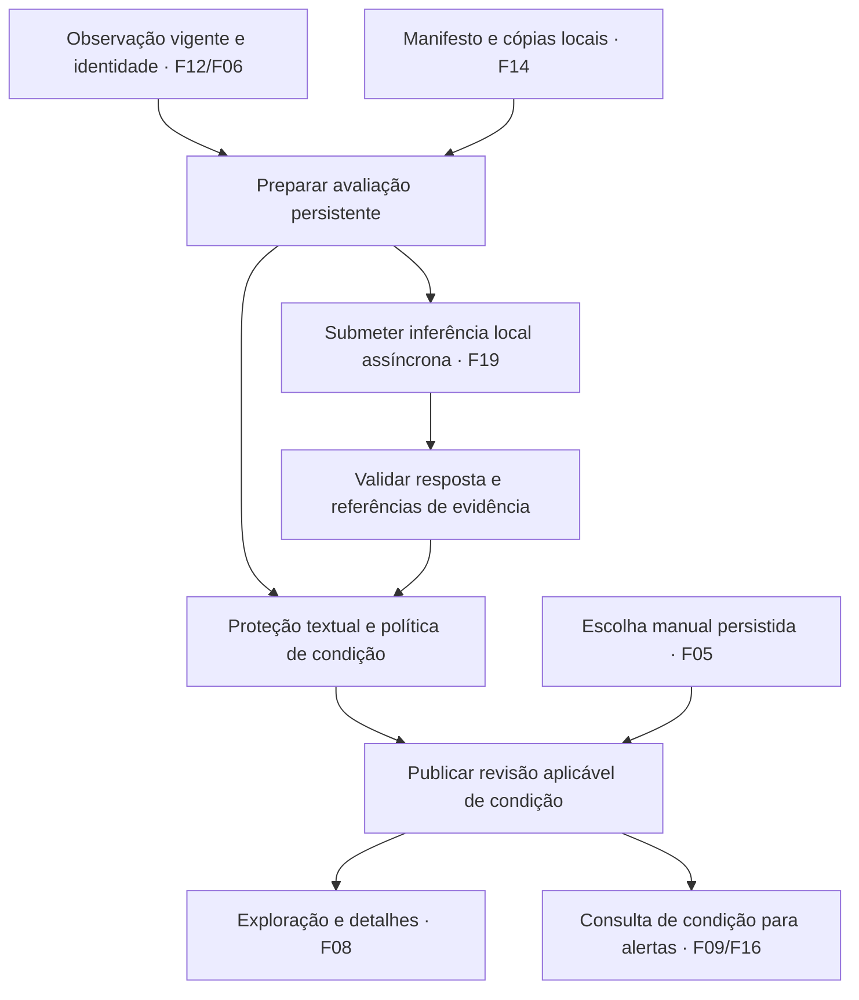

# F15 — Avaliação conjunta de imagens e descrição

## 1. Visão técnica

**Complexidade:** complexa · **Onda:** 12 · **Dependências:** F05, F06, F14 e F19.

F15 combina evidências textuais e visuais em uma avaliação versionada de condição. O modelo local descreve sinais; o domínio decide a condição automática, a precedência manual e a suficiência da avaliação para os consumidores. Uma resposta JSON válida não comprova o estado físico do produto. As fontes são o [PRD](../PRD.md), a [stack](../stack.md), o código atual e as decisões desta conversa.

**Incluído:** proteção textual das três regressões observadas; critérios iniciais por categoria; análise assíncrona de fotos e texto via F19; validação de evidências; histórico, cache e concorrência; integração da condição com exploração e alertas existentes; detalhes de avaliação, ressalvas e limitações; corpus de referência com autoria explícita e relatório de avaliação.

**Fora do escopo:** implementar coleta/armazenamento de fotos de F14 ou instalar Ollama/GPU de F19; busca de comparáveis de F18; política de primeira elegibilidade/48 horas de F16; novos cálculos de preço, desconto por dano, reparo ou lucro; negociação; envio real de WhatsApp durante validação; treinamento do modelo.

Decisões de produto: desgaste cosmético leve é aceitável com ressalva; dano relevante claramente identificado ou falha funcional é defeito; suspeita e contradição não resolvida exigem revisão. O usuário confirmou aguardar fotos analisadas antes do primeiro alerta e manter condição não confirmada sem fotos, em falha ou inconclusão. Essas regras passam a valer quando F15 for ativada; documentação não muda o runtime atual. A escolha manual continua prevalecendo na aba, mas não transforma análise ausente em concluída.

F05/F06 estão avaliadas no progresso. F14/F19 permanecem pré-requisitos externos pendentes na leitura desta especificação; ainda não há seus módulos implementados. Os contratos de integração abaixo são requisitos para conectar essas entregas, não alegações de APIs existentes. Não concluir F15 com fakes no lugar da prova real de F14/F19.

## 2. Arquitetura e integrações

Regras puras e tipos ficam em `domain/listing/`; orquestração em `usecase/listing/`; ORM, tarefas, templates e adaptação de F14/F19 em `infra/`. Injeção por construtor e composição em `main.py`. Configuração apenas em `config/env.py`. Domínio não importa Django, filesystem, Ollama ou fila.

### Fronteiras de entrada

| Provedor | Entrada exigida e verificação de integração |
|---|---|
| F05 | `ConditionState`, escolha/revisão manual e histórico existentes. Continuar usando `ReadConditionUseCase`/`ConditionQueries` como fronteira pública de leitura; a avaliação multimodal compõe o estado, sem criar classificação paralela. |
| F06 | Identidade conhecida, revisão, família/variante, atributos comprovados e conflitos. Identidade desconhecida não vira modelo inferido por aparência; a análise pode registrar sinais gerais e abster-se de concluir a condição quando faltam critérios aplicáveis. Estimativa financeira ausente não impede analisar danos. |
| F14 | Manifesto por anúncio/observação: revisão, fotos com identidade estável, hash dos bytes, tipo, cópia local, origem e disponibilidade; distinção entre nenhuma foto na fonte, aguardando obtenção e falha. A leitura de bytes usa porta interna com validação e associação ao manifesto. Conservar fotos referenciadas por análises conforme retenção de F14. |
| F19 | Submissão e consulta assíncronas, chave idempotente, IDs das solicitações, modelo/revisão exatos, prompt/schema, resposta estruturada, fotos examinadas/omitidas e diagnóstico de erro. Perfil e limites finitos de imagem/contexto/saída/fila/timeout/tentativas vêm do contrato e medições de F19. Não duplicar servidor, cliente Ollama ou fila de inferência em F15. |

### Consistência dos consumidores

Hoje `condition_mapper.py`, `ExplorationSource`, o fallback de `exploration_mapper.py` e `infra/queries/alert/event_source.py` chamam o classificador textual em caminhos distintos. F15 deverá compartilhar uma política pura de resolução e o mesmo snapshot de avaliação. Uma análise positiva não pode aparecer apenas nos detalhes enquanto a lista ou o canal usa outra revisão.

`ConditionState` conserva `analysis`, `manual`, `revision`, `effective`, `tab` e `editable`. Acrescentar um DTO imutável de avaliação com status, suficiência, motivos, evidências e referências de versão. `satisfies_alert_condition` exige condição efetiva boa **e** avaliação multimodal atual concluída, suficiente e sem abstenção. Uma decisão manual boa pode preservar a aba mesmo diante de conflito; o aviso permanece. Sem avaliação suficiente, não satisfaz a condição para envio. Gravar a escolha manual continua sem criar trabalho de envio.

Para eventos, separar duas leituras: condição aplicável ao evento/observação e condição vigente antes de autorizar envio. Registrar o ID e revisão de avaliação usados na decisão. Nunca aplicar análise de outra observação nem reescrever decisões, corpos ou recibos já confirmados. Um evento ainda aguardando condição pode prosseguir quando sua avaliação aplicável chega; exclusões terminais antigas não são reabertas. A reavaliação geral do estoque recente pertence a F16.

Publicar alteração de avaliação incrementa a ordem de publicação do anúncio e pede nova projeção de exploração. A revisão de lista já aberta continua congelada até “Há atualizações” → clique; a escolha manual mantém a semântica vigente de F05. Persistir no payload da projeção a avaliação e as referências correspondentes, evitando buscar uma avaliação nova para uma observação antiga. A checagem de alertas não depende de o usuário atualizar a lista.

## 3. Decisões e política

| Decisão | Abordagem | Alternativa e consequência |
|---|---|---|
| Condição | Regras determinísticas sobre evidências validadas e três abas existentes | Aceitar diretamente a classe produzida pela IA tornaria a decisão opaca e ignoraria precedência/manual. |
| Fotos | Avaliação suficiente obrigatória para condição automática boa e envio automático | Usar apenas declaração positiva foi rejeitado pelo usuário, inclusive sem fotos. |
| Estética | Desgaste leve com ressalva; dano relevante claro é defeito | Exigir item impecável excluiria desgaste aceito nesta conversa. |
| Incerteza | Abstenção qualitativa com motivo e evidência | Percentual de confiança sem calibração não é adotado. |
| Execução | Fila persistente já existente e inferência isolada de F19, sem espera em GET ou no coletor | Espera síncrona afetaria navegação e progresso de coleta. |
| Preço | F06/F07 continuam autoritativas; atributos visuais não alteram equivalência/preço automaticamente | Desconto cosmético ou orçamento de reparo não foram definidos. |

### Resolução da condição automática

Aplicar nesta ordem, antes da precedência manual:

1. Declaração inequívoca de defeito do item principal ou dano relevante claro apoiado em evidência válida: `defect`, mesmo sem IA/fotos completas. Descrição positiva não neutraliza defeito. Dano do acessório não é automaticamente defeito do produto principal.
2. Ressalva relevante, contradição não resolvida, suspeita de dano, identidade incompatível ou critério de categoria insuficiente: `uncertain`, com motivo. Não acusar fraude.
3. Sem declaração textual explícita e não contraditória de funcionamento do item principal: `uncertain`. Tela ligada ou boa aparência não suprem essa declaração.
4. Sem fotos úteis, análise pendente/falha, resposta inválida ou cobertura parcial do conjunto exigido: `uncertain`. Uma avaliação parcial pode estabelecer defeito claro, mas não boa condição.
5. Declaração positiva válida, fotos úteis analisadas, sem sinal relevante negativo/conflito e critério aplicável: `good`, com qualificação “Funcionamento declarado pelo vendedor; aparência avaliada nas fotos disponíveis”. Partes não mostradas permanecem desconhecidas; não exigir fotografias de todos os ângulos para fingir inspeção completa.

“Concluída e suficiente” exige análise válida de todas as fotos distintas e disponíveis do manifesto aceito, consideradas úteis para o recorte, sem omissão por limite técnico ou sinal pendente que afete a decisão. Duplicatas por hash são analisadas uma vez e continuam rastreáveis. Se o conjunto excede os limites de F19, processar em chamadas limitadas e agregar; se ainda houver omissão, sinalizar parcial e abster-se de boa condição. Não truncar trecho decisivo silenciosamente. Resultado textual negativo continua eficaz sem o modelo.

### Critérios iniciais por categoria

| Categoria | Desgaste leve permitido com ressalva | Dano relevante claro | Exemplo que exige abstenção |
|---|---|---|---|
| Eletrônicos gerais | Marcas superficiais na carcaça sem quebra visível | Carcaça quebrada expondo componentes, corrosão evidente | Objeto não identificável ou reflexo semelhante a trinca |
| Câmeras | Riscos superficiais externos | Lente/visor quebrado ou corrosão claramente visível | Mancha que pode ser sujeira/reflexo; funcionamento interno desconhecido |
| Computadores | Marcas superficiais na tampa/base | Tela trincada, dobradiça quebrada, bateria visivelmente estufada | Foto sem identificação do componente ou aparente inchaço não confirmável |
| Videogames/consoles | Riscos externos superficiais | Conector/carcaça claramente quebrados no console | Defeito de controle sem conclusão sobre o console, imagem genérica |
| Fones | Marcas superficiais sem ruptura | Haste/estrutura quebrada, condutor exposto | Almofada desgastada sem clareza de extensão ou item incompleto não confirmado |
| TVs | Marcas leves na moldura/base | Painel claramente trincado ou estrutura quebrada | Mancha/linha que pode pertencer ao conteúdo exibido ou ao reflexo |

A mesma foto pode ser insuficiente para decidir a gravidade. O modelo deve poder dizer “suspeita” e apontar a foto; ausência de pista visual não significa ausência de defeito. A rubrica deve conter exemplos revisados de cada distinção, identificando autoria e método. Família desconhecida usa somente sinais gerais inequívocos; nunca recebe `good` com critério específico inventado. “Só funciona na tomada” é restrição relevante para produto com bateria; não é defeito presumido de TV ou console que depende normalmente da rede elétrica.

### Proteção textual independente de IA

Avaliar contexto do anúncio completo, com escopo do item principal, negativas, ressalvas e frases vizinhas; uma frase positiva posterior não apaga “não foi testado”. Preservar trecho original e campo. Correções incluem `Funciona perfeitamente, mas desliga sozinho depois de dez minutos` → defeito funcional; `Funciona perfeitamente, mas só funciona conectado na tomada` → defeito quando o item é portátil com bateria e, se o contexto for desconhecido, incerteza; `Não foi testado. Funciona perfeitamente.` → incerteza. O controle positivo permanece sinal textual positivo, mas a condição combinada só vira boa com fotos suficientes. `O aparelho não liga` permanece defeito.

### Versões, concorrência e falhas

A impressão de entrada é SHA-256 de conteúdo canônico com anúncio, texto original, campos relevantes de identidade/categoria, hashes ordenados das fotos, revisão da política, prompt/schema e revisão completa do modelo. Preço isolado não muda condição; vínculo com observação é sempre explícito. Entrada idêntica reutiliza resultado confirmado; se a observação mudar sem mudança de conteúdo, criar vínculo da avaliação à nova observação após conferir equivalência, sem copiar cegamente o ID da observação anterior.

Revisão nova torna a anterior não aplicável à decisão vigente imediatamente, sem apagar histórico. Preparação registra geração e entrada desejada em transação curta; inferência ocorre fora de qualquer lock de publicação. Publicação compara geração, observação, manifesto e versões novamente. Resultado atrasado fica histórico/superado, sem substituir avaliação nova. Concorrentes da mesma chave convergem para uma solicitação aplicável. Queda após inferência e antes de publicação reutiliza o resultado idempotente de F19, sem prometer exatamente uma execução física em falhas incertas.

Timeout, indisponibilidade, OOM, resposta inválida e evidência insuficiente têm motivos distintos. Retentativas técnicas são limitadas pelo perfil fixado em F19; evidência insuficiente aguarda nova entrada ou política, sem loop de inferência idêntica. Nova tentativa não apaga análise anterior; histórico antigo é rotulado como anterior e não sustenta condição automática atual. Logs JSON incluem IDs, versões e códigos, nunca cookies, perfil, QR, destinatário ou prompt com dados privados.

## 4. Componentes

Caminhos relativos a `apps/backend/src/garimpei/`. Nomes novos são propostos; portas/modelos físicos de F14/F19 devem ser conciliados quando entregues, preservando as fronteiras e observáveis deste contrato.

| Caminho | Mudança | Responsabilidade |
|---|---|---|
| `domain/listing/condition.py` | Alterar | Proteção textual e composição da condição com precedência manual. |
| `domain/listing/assessment.py`, `assessment_policy.py` | Novos | Agregado de avaliação, estados, evidências e rubrica versionada, sem I/O. |
| `domain/listing/assessment_ports.py` | Novo | Repository, Queries, acesso tipado a fotos, submissão/consulta de inferência, DTOs e erros. |
| `domain/listing/condition_ports.py` | Alterar | Expor diagnóstico e referências de avaliação junto da condição efetiva. |
| `usecase/listing/prepare_assessment_usecase.py` | Novo | Obter entradas e preparar/reutilizar solicitação. |
| `usecase/listing/complete_assessment_usecase.py` | Novo | Consultar trabalho de F19 e publicar resultado aplicável. |
| `infra/repository/listing/assessment_repository.py`, `assessment_mapper.py` | Novos | Persistência e concorrência; reidratar agregado, sem regras duplicadas. |
| `infra/queries/listing/assessment_queries.py` | Novo | DTO de avaliação por observação e snapshot. |
| `infra/gateway/listing/assessment_inputs.py` | Novo | Adaptar portas de F06/F14/F19 e validar schema/referências externas. |
| `infra/repository/listing/condition_mapper.py`, `infra/queries/listing/condition_queries.py` | Alterar | Resolver condição e prontidão com o snapshot aplicável. |
| `infra/queries/listing/exploration_source.py`, `exploration_mapper.py`, `exploration_queries.py`, `infra/repository/listing/exploration_repository.py` | Alterar | Congelar diagnóstico/condição na revisão, incluir mudanças semânticas de avaliação na assinatura e manter filtros/paginação. |
| `infra/queries/alert/event_source.py` e consumidores em `infra/repository/alert/` | Alterar | Condição do evento e guarda vigente de envio, com motivo e revisão registrados. |
| `infra/worker/assessment_handler.py` | Novo | Preparar/concluir avaliações sem esperar inferência no coletor. |
| `infra/persistence/assessment_models.py`, `models.py`, migrations | Novo/alterar | Descoberta ORM, avaliação e ponteiro atual; migration aditiva. |
| `infra/http/listing/exploration_presentation.py`, `condition_presentation.py`, templates `listing/offer_detail.html`, `results.html` | Alterar | Evidências, ressalvas, revisão, abstenção e atualização explícita. |
| `config/env.py`, `main.py` | Alterar | Perfil validado, DI e registro de tarefas conforme fila de F19. |

Não criar endpoint público de Ollama nem nova API de classificação. Critérios e preços não ficam nos templates, adapters ou handlers. Layout segue [referência de fluxos](../design/flows-reference.md), subordinada às regras atuais do PRD.

## 5. Interfaces e experiência

### HTTP existente

| Método/rota | Entrada e validação | Saída e erros |
|---|---|---|
| `GET /ofertas/` | Critérios e versão existentes de F08 | HTML 200 com as mesmas três abas e indicação resumida de avaliação; nenhuma inferência síncrona. |
| `GET /ofertas/<uuid>/` | Identidade e contexto de exploração existentes | HTML 200 com avaliação da revisão apresentada; 404 desconhecido; falha de consulta segue tratamento central 503. Falha exclusiva de IA é estado da oferta, não erro HTTP global. |
| `GET /ofertas/atualizacoes/` | Critérios e versão existentes; rota `exploration-updates` registrada em `infra/http/urls.py` | Aviso de nova revisão sem aplicar automaticamente à leitura. Não criar rota alternativa. |
| `POST /ofertas/<uuid>/condicao/` | `choice=good|defect`, revisão manual atual e CSRF | 303 após commit; 400 inválido, 403 CSRF, 404 desconhecido, 409 revisão/elegibilidade alterada e 503 persistência. Preservar a escolha em erro e não criar envio pela ação. |

F15 amplia o conteúdo das rotas existentes, sem mudar seu contrato de navegação. Acesso permanece localhost sem login no Garimpei. Não adicionar controle humano para forçar “análise concluída”.

### Contrato interno consumido por exploração/alertas

DTO de avaliação: `listing_id`, `observation_id`, `assessment_id` opcional, `input_fingerprint`, `policy_version`, `status`, `reason`, `automatic_condition`, `effective_condition`, `manual_revision`, `sufficient`, `satisfies_alert_condition`, `model_revision`, `analyzed_at`, `findings`, `limitations`, `photo_coverage`. Consumidores recebem valores tipados, sem ORM, caminhos privados ou bytes de imagens.

Resposta aceita de F19 usa schema versionado: lista de sinais com dimensão (`appearance`, `function_claim`, `completeness`, `identity`, `consistency`), avaliação (`clear_defect`, `suspected`, `light_wear`, `declaration`, `unknown`), descrição curta e referências; lista de conflitos/limitações; fotos examinadas/omitidas com motivo. Referência textual exige campo permitido e trecho literal pertencente à entrada; referência visual exige ID/hash do manifesto. Campos desconhecidos, enum inválido, referência inexistente, trecho fabricado ou atributos não comprovados rejeitam a resposta para decisão. O modelo não devolve condição efetiva autoritativa ou valor financeiro.

| Campo da resposta de evidências | Tipo e validação |
|---|---|
| `schema_version` | Texto igual à versão solicitada. |
| `findings` | Lista finita de objetos com `dimension`, `assessment`, `description` e `references`; cada sinal conclusivo exige referência válida. |
| `references` | Em cada sinal, lista de referências `text` com `field=title|description|condition` e `quote` literal, ou `image` com `photo_id` e `sha256` do manifesto. |
| `conflicts`, `limitations` | Listas finitas de descrições com referências quando sustentam um conflito; ausência de dado é limitação, não fato inventado. |
| `examined_photos` | Lista dos IDs/hashes efetivamente enviados e examinados, conferida contra o resultado de transporte de F19. |
| `omitted_photos` | Lista de IDs e motivos; não pode ocultar foto prevista no manifesto. |

Exemplo abreviado de sinal aceito, após conferir que o trecho pertence à descrição recebida: `{"dimension":"function_claim","assessment":"declaration","description":"Funcionamento declarado pelo vendedor","references":[{"kind":"text","field":"description","quote":"O aparelho funciona perfeitamente."}]}`. O domínio ainda verifica todas as demais entradas antes de decidir `good`. As listas e textos têm limites de saída do perfil de F19; excesso é resposta inválida, nunca truncamento silencioso de evidência.

Motivos públicos de avaliação incluem `no_photos`, `waiting_photos`, `waiting_inference`, `insufficient_visual_evidence`, `partial_photo_coverage`, `unresolved_conflict`, `unsupported_category`, `identity_conflict`, `model_unavailable`, `inference_timeout`, `gpu_resource_unavailable`, `invalid_analysis` e `superseded_input`. Eles são estados da oferta e não códigos HTTP 5xx. Falha de banco/leitura HTTP conserva os erros centrais existentes; não expor corpo bruto de erro do runtime.

Exemplo de conteúdo apresentado: “Riscos superficiais na tampa — foto 2”; “Vendedor declara que funciona — descrição: ‘O aparelho funciona perfeitamente.’”; “Bateria e portas precisam de teste presencial”. Sem resultado: “Aguardando análise das fotos”; sem fotos: “Condição não confirmada: não há fotos para avaliar”; falha: “Não foi possível concluir a análise local. A oferta aguarda revisão”. Conflito manual: “Sua classificação foi mantida; a avaliação automática aponta uma divergência”, com evidência acessível. Não atribuir funcionamento comprovado, fraude ou porcentagem de certeza.

Detalhes separam aparência, funcionamento declarado, conflitos e verificações presenciais. Mostrar data/modelo em informação secundária, cobertura por foto e análise anterior identificada. Lista não reordena sozinha. Foco, rótulos, mensagens de status e evidências devem funcionar por teclado e a 390 px, seguindo componentes existentes. Novos corpos de alerta, quando gerados pelo fluxo autorizado, recebem ressalva curta e referência à avaliação usada, sem alterar o trio financeiro de F20 nem corpos históricos.

## 6. Persistência e ativação

### Avaliação de condição — modelo novo

| Campo | Tipo e restrições |
|---|---|
| `id` | UUID de domínio, PK. |
| `listing`, `observation` | FKs obrigatórias para identidade/observação existentes, PROTECT; validar pertencimento na gravação. |
| `input_fingerprint` | Texto hexadecimal de 64 caracteres, obrigatório. |
| `policy_version`, `prompt_version`, `schema_version`, `model_revision` | Textos obrigatórios não vazios; revisão exata, sem `latest`. |
| `input_snapshot` | JSON tipado obrigatório: texto/referências originais, identidade/categoria e manifesto com hashes, sem segredos. |
| `generation` | Inteiro positivo; geração capturada para publicação. |
| `status` | `waiting`, `running`, `complete`, `partial`, `failed`, `superseded`; CHECK. |
| `condition` | `good`, `defect`, `uncertain`; CHECK, inicialmente `uncertain`. |
| `sufficient` | Booleano, inicialmente falso; boa condição automática exige verdadeiro. |
| `reason` | Código obrigatório para espera, parcial, falha e abstenção. |
| `inference_refs` | JSON tipado com IDs e revisões das solicitações de F19; nenhuma imagem base64. |
| `result` | JSON tipado opcional de sinais, conflitos, limitações e cobertura; preenchido somente após validação. |
| `created_at`, `updated_at`, `analyzed_at` | Instantes com fuso; último opcional até conclusão. |
| `publication_order` | Inteiro opcional, atribuído na publicação confirmada do resultado. |

UNIQUE (`listing`, `observation`, `input_fingerprint`); índices (`listing`, `created_at`), (`status`, `updated_at`) e (`listing`, `publication_order`). Foto pertence ao manifesto e nunca a outro anúncio; FKs físicas ao modelo de fotos dependem da entrega F14. Se referências forem lógicas, a integração deve verificar existência/pertencimento e impedir limpeza de foto ainda referenciada.

### Cabeça de avaliação — modelo novo

Uma linha por anúncio, FK/PK PROTECT. Campos: observação desejada (FK PROTECT), impressão desejada (64 caracteres), geração positiva, avaliação atual opcional (FK PROTECT), última confirmada opcional (FK PROTECT) e horário. Atualização usa lock curto e comparação de geração/entrada. Cabeça e resultado aplicável são publicados atomicamente com ordem de publicação e pedido durável de nova projeção. Não manter lock durante inferência ou leitura remota.

Migration aditiva preserva observações, escolhas manuais, revisões de exploração, intenções e recibos. Ativação versionada da política cria cabeças pendentes para ofertas atuais por lotes retomáveis; GET não faz backfill. Antes de ativar os novos consumidores, os dados sem cabeça já devem resolver como “pendente”, sem fallback positivo textual. Análises antigas continuam consultáveis; nunca criar eventos de descoberta/preço pelo backfill. Não reenviar nem reabrir exclusões antigas para validar migração.

F19 controla transporte, execução e tentativas de inferência; F15 controla suficiência e publicação da condição. Não manter duas contagens conflitantes de tentativa. Sem limites técnicos fixados e demonstrados em F19, a integração real permanece pendente. Testes podem usar limites baixos explícitos em ambiente `eval`, sem convertê-los em metas do produto.

## 7. Estratégia de verificação

| Área / arquivos propostos | Verificações significativas |
|---|---|
| `tests/unit/test_listing_condition.py`, `test_multimodal_condition.py` | Três regressões sem IA; controles; desgaste/dano/suspeita por categoria; escopo principal/acessório; ausência/inutilidade de foto; precedência manual; schema e referência fabricada. |
| `tests/integration/test_multimodal_condition.py` | PostgreSQL real; migration com histórico; entrada concorrente; crash antes/depois de publicação; observação/foto/modelo/política novos; reaproveitamento; resultado atrasado; análise sem identidade/preço suficientes; conservação de recibos. |
| `tests/http/test_multimodal_condition.py` | Rotas existentes, estados e erros; formulário manual/CSRF/conflito; leitura sem inferência; snapshot e status de atualização. |
| `tests/integration/test_multimodal_alert_condition.py` | Fonte/WAHA fakes nomeados: nenhum envio com análise ausente/parcial/falha; avaliação aplicável suficiente permite que o fluxo existente reavalie evento pendente; recibo e decisão histórica não mudam. Não depender de F16. |
| `tests/integration/test_multimodal_runtime.py` | F19 real na GPU e fotos autorizadas; relatório frio/quente, VRAM/RAM e latência; tarefa lenta não bloqueia publicação de outro anúncio ou resposta da interface. |
| `tests/factories/assessment.py`, `assessment_lab.py` | Lab descartável conforme `tests.factories.runtime`/`listing`: preparação por migrations/factories, portas/DB isolados e fakes nomeados, relógio controlado, mudanças de entrada e falhas determinísticas. |
| `tests/fixtures/listing/assessment_cases.json`, `tests/fixtures/listing/assessment_images/` | Manifesto versionado com IDs, campos de texto, família/atributos, fotos/hashes, origem e licença/autorização, rótulo de referência e método/autoria, sinais e trechos esperados. Controles sintéticos identificados e corpus real separados. |
| Navegador | `playwright-cli`: lista → detalhes → evidências → escolha manual → resultado conflitante → aviso/aplicação de revisão; teclado e 390 px. Usar skills `playwright-cli` e `frontend-ui-design` na implementação/avaliação. |

Fixtures são entregas futuras, não arquivos já disponíveis. O lab fornece comando de criação/verificação/limpeza e mapa de IDs sem segredos. Criar as fotos sintéticas deterministicamente ou fornecer arquivos autorizados com proveniência; não gerar uma foto sintética e rotulá-la como anúncio real. Nenhum teste usa perfil pessoal ou grupo real.

### Preparação reproduzível exigida da implementação

O módulo novo `tests.factories.assessment_lab` segue o lab F05 existente: executar da raiz `uv run --directory apps/backend --frozen --no-sync python -m tests.factories.assessment_lab`. O processo cria instância `eval` em temporário, usa `prepare_listing_instance`, migrations e `init.sh --disposable`, prepara as ofertas/eventos por factories e informa URL/IDs; aceita ações JSON por stdin. `{"action":"status"}` retorna prontidão, versões, hashes, avaliações, escolhas, estados de eventos e contador WAHA fake sem segredos; `{"action":"quit"}` encerra e limpa apenas a instância descartável. A saída de status comprova a presença dos handles do contrato antes de exercitá-los.

O lab entrega também ações `prepare_case` (ID do manifesto), `complete` (trabalho controlado), `change_input` (texto/foto/política/modelo), `fail`/`clear_fault`, `restart` e `collect`, com retorno de status. Fakes nomeados permitem bloquear/liberar uma resposta antiga e contar submissões, sem sleep arbitrário. Na execução real do corpus, `{"action":"evaluate_corpus","mode":"real"}` usa exclusivamente a instância F19 coordenada e escreve relatório sanitizado em diretório de execução ignorado, depois consolidado em `quality-report.md`. Esse modo rejeita runtime fake, revisão de modelo não fixada ou manifesto sem proveniência/rótulos de referência revisados; não conecta WAHA real. Os resultados reais não dependem de acesso ao Marketplace durante o teste, pois usam cópias autorizadas de F14.

Corpus inclui os casos de F15-AC01, as seis categorias e exemplos de cada distinção da rubrica. A revisão de referência assistida por IA ocorre antes de consultar as saídas do modelo local e preserva ambiguidades como tais. Relatório `quality-report.md` registra composição/IDs/hashes, versão da rubrica/modelo/prompt, matriz de condição de referência × automática, concordâncias, divergências e abstenções, erros de evidência e medições por chamada/anúncio. Separar conjunto de ajuste do conjunto reservado de avaliação e declarar limitações e categorias sem evidência suficiente. Sem meta numérica de precisão aprovada, não alegar taxa de qualidade “aprovada”; requisitos determinísticos do contrato e exemplos críticos da rubrica devem ser cumpridos e erros reais publicados.

Comandos a executar na implementação, a partir da raiz: `node scripts/run-gates.mjs`; `uv run --directory apps/backend --frozen --no-sync pytest tests/unit tests/http`; e suites de integração selecionadas acima, mais regressões de condição, exploração e alertas existentes. O runner atual contém seis grupos Python; a instrução histórica sobre TypeScript não é evidência de validação. Gates, migrations e corpus real ausentes/não executados impedem concluir implementação. Esta rodada valida documentos e cobertura, sem iniciar aplicação ou inferência.

## Adendo aprovado — referência assistida por IA (2026-11-13)

O usuário pediu revisão por Codex com auxílio de IA e aprovou explicitamente substituir o aceite humano F15-AC05. A referência usa `reference_method=ai_assisted`, autoria identificada e rótulos congelados antes de observar predições do Qwen local. Não representa revisão humana independente nem verdade de referência humana; o relatório mede concordância entre IAs e publica divergências/limitações por caso/categoria. A versão exata do serviço do assistente não é atestada; esse limite deve constar da proveniência. A inferência de produto avaliada permanece exclusivamente no F19 local com pins aprovados; não se afirma que a criação da referência pelo assistente tenha execução local atestada.

O pacote atual conserva 23 IDs e hash do manifesto; a referência foi congelada em arquivo separado, sem preencher os rótulos nulos das fixtures originais. Ilustrações e fotos reais são separadas. Lacunas por categoria e ausência de descrição/declaração de funcionamento continuam desconhecidas; dados ausentes não viram confirmação positiva. A comparação usa contagens neutras de concordância/divergência, sem percentual de certeza ou precisão humana fabricada.

## Ajuste de capacidade aprovado — 2026-11-13

A proposta da onda15-51-31 foi aprovada explicitamente: até 1024 tokens de saída somente no perfil de condição F15. O perfil legado F19 continua até 512; contexto total 4096, modelo/pins, política e schema estrito permanecem. Reservar a saída correta junto da entrada e da capacidade visual demonstrada; recusar excesso sem truncamento silencioso. O perfil novo e sua chave de reaproveitamento distinguem a alteração de versão dos resultados anteriores.

As sondagens v1/v2 que truncaram em 512 ficam preservadas como diagnóstico. Repetir o par físico frio/quente e o corpus na versão final, publicando rejeições/abstenções e recursos, sem meta de precisão inventada. O corpus reservado já foi exposto em rodadas anteriores; a nova execução é uma repetição técnica identificada, com referência/splits congelados e sem alegação de holdout novo. Nenhuma validação humana independente é fabricada.
