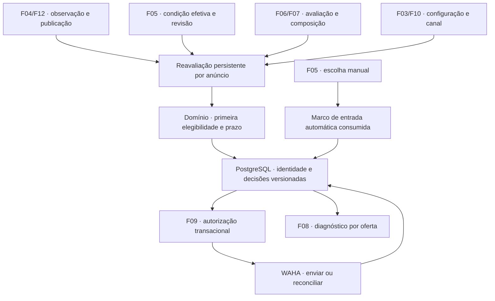

# F16 — Alertas pela primeira elegibilidade e diagnóstico

## 1. Visão técnica

**Complexidade alta.** Evoluir a decisão de primeiro alerta, hoje vinculada a `discovered`, para uma identidade durável por instalação/anúncio. Coleta, identidade, condição e valoração podem concluir em momentos diferentes; o primeiro alerta usa uma composição consistente da observação vigente quando o anúncio se torna elegível. O limite é a publicação confiável na fonte, nunca a primeira coleta ou o início do monitoramento.

**Included:** primeira elegibilidade automática; idade/publicação; adoção de anúncios e intenções existentes; reavaliação persistente; preservação da exceção manual; autorização, deduplicação e reconciliação pelo fluxo F09; diagnóstico por oferta na lista/detalhe F08; migração e percurso integrado até recibo no grupo F10. Dependências diretas: F04, F05, F07, F08, F09, F10 e F12, todas `done` no progresso consultado. F16 permanece `pending` nesta entrega documental.

**Fora desta etapa:** obtenção de imagens F14, análise multimodal F15, expansão de comparáveis F18, serviço GPU F19, reformatação financeira F20, novo critério de lucro mínimo, alteração da janela das reduções e reenvio automático de transmissão incerta. A extensão F15 poderá produzir condição pela mesma porta quando disponível; nenhum item depende dessa implementação. Mensagens usam o formato vigente na instalação; corpos anteriormente autorizados permanecem imutáveis.

A exceção manual deste documento é exclusivamente a classificação de **condição F05**. O PRD prevê que uma futura correção manual de **identidade F18** possa completar primeira elegibilidade, com dados consistentes, publicação confiável, prazo e deduplicação. A porta de reavaliação deve distinguir essa causa da escolha de condição, sem exigir que F18 já exista; criação e verificação da jornada de correção de identidade pertencem à F18.

Fontes: [PRD](../PRD.md), [stack](../stack.md), [F09](../F09-alertas-individuais-pelo-whatsapp/spec.md), [F10](../F10-configuracoes-de-integracoes/spec.md) e [F12](../F12-coleta-e-oportunidades/spec.md). Contratos antigos preservam seu contexto histórico; F16 substitui apenas as regras explicitamente indicadas aqui.

## 2. Impacto arquitetural

Regras ficam em `domain/alert/`; casos de uso importam somente o domínio e recebem relógio/portas por construtor. Django ORM, consultas, locks, Procrastinate e WAHA ficam em `infra/`. `main.py` compõe explicitamente os adapters; configuração operacional continua centralizada em `config/env.py`. Adaptar a skill clean-arch a Python conforme a arquitetura existente, sem introduzir um runtime TypeScript.

O estado atual tem `AlertEventDecision` exclusivo por evento e `AlertIntent.decision` obrigatório. `eligibility()` exclui carga silenciosa/condição não boa antes da valoração; exclusões deixam a fila de reavaliação. `financial_snapshot()` exige a observação do evento. F16 acrescenta uma origem de intenção por primeira elegibilidade, sem criar `ListingEvent` artificial nem mudar a semântica das quedas de preço. O agendamento atual que retorna quando não há `ListingEvent` deve admitir estoque/reavaliações F16 sem evento de descoberta.

## 3. Decisões e regras

| Decisão | Abordagem escolhida | Alternativa considerada | Consequência |
|---|---|---|---|
| Primeiro alerta | Chave única por instalação e identidade F04, sem revisão/política/grupo na chave | Um primeiro alerta por evento ou por revisão | Reanálise, reinício e mudança de grupo não criam outro primeiro alerta |
| Publicação | Instante absoluto da fonte, com origem comprovável e fuso normalizado | Primeira coleta ou horário inferido do feed | Dados insuficientes aguardam confirmação |
| Limite | `published_at <= now <= published_at + 48 horas`, em UTC | Fronteira exclusiva ou prazo desde coleta | Exatamente 48 horas ainda admite autorização; um microssegundo além impede novo POST |
| Reavaliação | Invalidação durável por anúncio, com geração e reconciliação incremental | Varredura global/reenvio do feed antigo | Retomada não perde trabalho e não refaz descobertas |
| Escolha manual | Marco semântico da entrada automática consumida, com a mesma ordem de publicação F05 | Disparar por revisão manual ou após reinício | Correção manual não se transforma em intenção adiada |
| Legado | Vincular recibos/intentos existentes antes de liberar despacho F16 | Apagar exclusões/reenfileirar tudo | Preservar referências, corpos, destinos e incertezas |

### 3.1 Publicação, elegibilidade e consistência

1. Uma publicação confiável é um instante absoluto obtido de campo da fonte identificado na proveniência, associado ao mesmo anúncio. Aceitar a precisão efetivamente oferecida; normalizar offset para UTC sem mudar o instante. Horário relativo sem precisão suficiente, valor inválido/sem fuso inequívoco, data futura ou mera posição na busca não autorizam envio. A confiabilidade é derivada da evidência pelo adapter e validada na fronteira; não é um booleano livre fornecido pela página. Expor `missing`, `untrusted`, `future` ou `trusted` e a origem sanitizada. Correção confirmada produz nova revisão e permite nova avaliação.
2. A primeira elegibilidade exige interesse vigente comprovado, escopo revalidado, disponibilidade confirmada, condição efetiva boa com precedência manual, identidade/estimativa aplicáveis e composição F07 calculável para a mesma observação/configuração. Lucro positivo, zero e negativo são admitidos. Recuperação inicial parcial não impõe silêncio global; a unidade precisa de dados confirmados, sem exigir catálogo completo.
3. Falta de condição, identidade, amostra, data, análise, configuração ou dependência técnica conserva espera com motivo. Item com defeito/fora do interesse/indisponibilidade confirmada recebe exclusão atual, reavaliável se uma entrada automática relevante mudar antes do prazo. Exclusões antigas F09 continuam históricas; uma decisão F16 nova não as reescreve. Falha de consulta não prova exclusão nem remoção.
4. Injetar a consulta corrente F07, composta por `build_read_profit()` em `main.py`, e executar `execute(listing_id, event=False)` para o primeiro alerta, validando `listing_id`, observação, configuração e avaliação. Casos de uso não importam a composição nem criam adapters concretos. A redução mantém a leitura `event=True`. Capturar condição, evidência de publicação e composição em snapshot coerente; resultado calculado fora do lock só é publicado após conferir novamente as referências sob a ordem de publicação compartilhada. Não aninhar a consulta atual de repeatable read em transação com isolamento incompatível; preparar fora e conferir versões antes do commit, ou prover leitura consistente própria.
5. Antes de cada autorização de POST, conferir novamente idade, condição efetiva, escopo, disponibilidade, validade financeira e vínculo do canal. Preparação anterior ao limite não autoriza envio depois do limite. Uma verificação lenta de sessão deve ocorrer antes dessa conferência final. A fronteira é a autorização local persistida imediatamente antes da chamada, não a chegada da mensagem ao grupo.
6. Mudança posterior à autorização não cancela um efeito externo possivelmente iniciado. Transmissão incerta, mesmo depois de 48 horas, continua somente em reconciliação; confirmar depois do prazo registra um envio anterior, sem autorizar outro. Falha comprovadamente não transmitida pode repetir apenas com a oferta ainda elegível e dentro da janela. Corpos autorizados nunca recebem valores de revisões posteriores. Intenção nunca autorizada pode ser atualizada por nova decisão consistente; se o corpo já estiver congelado e ficar incompatível, encerrar como comprovadamente não enviado antes de preparar outra intenção na mesma chave lógica.

### 3.2 Entradas automáticas e escolha manual

Uma geração de reavaliação representa mudança confirmada em descrição/detalhe útil, publicação, disponibilidade/interesse, identidade, condição automática ou avaliação/composição aplicável. Registrar causa, referências e assinatura semântica; ticks, reinício, mero `observed_at` novo, regravação equivalente, mudança de formato e foto sem mudança de análise não constituem nova evidência. Atualização real da amostra/validade pode constituir entrada relevante. Alteração de canal retoma trabalho automaticamente elegível já existente, sem criar elegibilidade a partir de escolha manual isolada. Reservar causa distinta para correção de identidade validada pela F18 quando disponível; não classificá-la como ação manual de condição.

Ao gravar/corrigir escolha manual, manter F05 e registrar atomicamente a assinatura automática presente como consumida por essa ação. Não enfileirar avaliação que crie primeiro alerta por esse motivo. Se havia trabalho preparado antes da ação e somente a escolha manual tornou a oferta boa, invalidá-lo para criação de intenção. Persistir esse marco mesmo quando ainda não existir identidade F16; na adoção, recuperá-lo pelo histórico/ordem de publicação ou registrar impossibilidade de determinar a origem. Sem prova de entrada independente posterior, manter `manual_change_only`, sem liberar por reinício ou varredura de reconciliação.

Uma entrada automática relevante posterior pode reavaliar a oferta usando a condição manual vigente. Escolha manual ruim continua prevalecendo. Escolha manual boa não exige nova escolha quando chegam comparáveis suficientes. Intenção já elegível por causa automática anterior não é duplicada por ação manual; mudanças que a tornem inelegível são conferidas na autorização. Repetir o mesmo conteúdo automático após classificar não contorna o marco manual.

### 3.3 Identidade durável, adoção e reduções

- A identidade de primeiro alerta usa a instalação `local` e o `Listing.id` já único por fonte/ID externo. Republicação com ID diferente permanece identidade distinta; não prometer deduplicação por foto/título ou entre vendedores.
- Adoção inventaria, em lotes retomáveis, anúncios e todas as intenções/decisões F09 associadas. Um recibo confirmado anterior, inclusive de redução, satisfaz a proteção contra novo primeiro alerta. Intenção autorizada/incerta/em revisão bloqueia criação de outro primeiro envio e conserva reconciliação no vínculo original. Nunca transformar ausência de recibo em prova de não transmissão.
- Intenção anterior ainda não transmitida é incorporada ou encerrada com motivo, sem despachar duas intenções de descoberta para a mesma identidade. Múltiplas tentativas legadas possivelmente transmitidas mantêm seus registros e ficam em `history_review`; nenhuma é cancelada como não enviada sem evidência. Histórico com intervalo perdido mantém suspensão de despacho, conforme F09.
- A migração de schema é aditiva e sem acesso à rede. A rotina de adoção executa no worker com despacho suspenso durante o inventário do legado e só libera após comprovar consistência do histórico/cursor. Sua conclusão e fronteira são persistidas; repetir não recria intenções. Concluída a adoção, a carga parcial do Marketplace não impede avaliar estoque recente.
- Ofertas recentes antes silenciosas ou excluídas por condição/amostra podem receber decisão F16 atual, respeitando o marco manual. Datas ausentes aguardam evidência; ofertas vencidas não geram primeiro envio. Fotos, migração de texto e mudança de política não fabricam descobertas.
- Quedas continuam deduplicadas por evento F04 e exigem envio anterior confirmado, preservando a espera F09 quando uma intenção anterior ainda está pendente. Quando não há confirmação anterior e a queda é a entrada que completa a primeira elegibilidade, ela pode originar um único primeiro alerta; registrar o vínculo causal e não enviar também a redução daquele mesmo evento após a confirmação desse primeiro alerta. Se o primeiro alerta já estava autorizado com a observação anterior à queda, a redução distinta pode aguardar sua confirmação conforme a política existente. A janela/espera histórica das reduções permanece a de F09/F12, sem estender a regra de 48 horas da publicação a elas.

### 3.4 Operação, falhas e limites técnicos

Reusar o perfil existente: tick de alertas 5 s, timeout HTTP 10 s, lease 60 s, retry comprovadamente seguro com base 15 s/teto 300 s e janela operacional de reconciliação 86.400 s. Esses valores são parâmetros técnicos existentes, não SLA; a janela de reconciliação não limita a preservação de incerteza. Reusar os limites configuráveis e os testes de fronteira de F09.

Adotar lotes de até 100 unidades para inventário, reavaliação e varredura de reparo, com cursor persistido e seleção justa por próxima ação/ID; cada execução limita uma página por estágio. Acrescentar agendamento separado `adopt`/`refresh` ao reconciliador existente. Enfileiramento e invalidação compartilham commit no PostgreSQL; uma varredura cíclica confirma assinaturas e corrige invalidações ausentes. Queda antes do commit não confirma progresso; queda depois dele não perde a unidade. Rede/WAHA fica fora dos locks. Um item com falha é adiado com motivo e permite avanço de outro.

Estados de negócio e tentativas ficam separados. Logs JSON usam referências locais, causa, versão e horários; não publicam corpo, destino, cookies, QR, conta ou chave. Indisponibilidade de banco/histórico suspende despacho. Falha de diagnóstico conserva a oferta e identifica a consulta indisponível. Registros de decisão, snapshot autorizado e recibo não são apagados nesta etapa.

## 4. Componentes e mudanças

Todos os caminhos abaixo são relativos a `apps/backend/src/garimpei/`; nomes novos são propostas para implementação, preservando as convenções Python atuais.

| Componente | Novo/modificado | Responsabilidade |
|---|---|---|
| `domain/alert/first_eligibility.py` | Novo | Janela, motivos, marco manual e transições puras da identidade de primeiro alerta |
| `domain/alert/diagnostic.py` | Novo | DTOs tipados de diagnóstico e porta de consulta consumida por F08 |
| `domain/alert/ports.py`, `alert.py` | Modificados | Portas de adoção/reavaliação, snapshots e origem da intenção; preservar contrato da mensageria |
| `usecase/alert/adopt_first_alerts_usecase.py` | Novo | Orquestrar inventário retomável do legado |
| `usecase/alert/refresh_first_eligibility_usecase.py` | Novo | Preparar entradas, avaliar domínio e publicar sob conferência de geração |
| `usecase/alert/read_alert_diagnostic_usecase.py` | Novo | Leitura programática consumida por F08 sem efeitos de envio |
| `usecase/alert/{evaluate_alert,send_alert,reconcile_alert}_usecase.py` | Modificados | Distinguir primeiro alerta corrente de redução por evento; preservar reconciliação |
| `infra/repository/alert/{postgres_repository,delivery_state,financial}.py` | Modificados | Persistência, locks, origem da composição, autorização e congelamento |
| `infra/repository/alert/first_alert_repository.py` | Novo | Agregado lógico, inventário, geração e invalidações duráveis |
| `infra/queries/alert/diagnostic_queries.py`, `event_source.py` | Novo/modificado | Projeção de decisão/recibo e contexto de publicação/condição |
| `infra/repository/listing/condition_repository.py` | Modificado | Marco manual atômico, sem criação de intenção |
| `infra/repository/listing/`, `infra/repository/valuation/` | Modificados quando necessário | Invalidar avaliação após publicação confirmada de entrada relevante |
| `infra/persistence/alert_models.py`, `models.py`, `migrations/` | Modificados/novo | Schema aditivo e registro dos modelos; reservar próximo número de migration livre |
| `infra/http/listing/`, `infra/http/templates/listing/` | Modificados | Diagnóstico na lista/detalhe, falha recuperável e separação entre revisão exibida e estado atual |
| `infra/worker/alert_handler.py`, `main.py` | Modificados | Composição e estágios de adoção/reavaliação, sem depender de descoberta no feed |

Preservar layout/tokens do [design existente](../design/MASTER.md). A interface adiciona informação operacional no contexto da oferta, sem redesenhar navegação, filtros ou integração WhatsApp.

## 5. Contratos de leitura e interface

### 5.1 Consulta programática consumida por F08

`ReadAlertDiagnosticUseCase.execute(listing_id: UUID, displayed_observation_id: UUID | None) -> AlertDiagnostic | None`. Retorna ausência para anúncio inexistente; falha técnica produz erro tipado, nunca `confirmed`, `not_sent` ou configuração ausente por inferência. Consultas não enfileiram envio, não chamam WAHA e não reavaliam automaticamente a oferta.

| Campo | Forma | Semântica |
|---|---|---|
| `listing_id`, `policy` | UUID, texto versionado | Identidade F04; política `first-eligibility-v1` |
| `state`, `reason`, `label` | Enum/código/texto | Estado atual e motivo legível, sem confundir decisão antiga |
| `first_alert_state` | Enum | Estado do primeiro alerta, separado da tentativa atual de uma redução |
| `reasons` | Lista ordenada de códigos | Bloqueios simultâneos; um principal e demais impedimentos conhecidos |
| `evaluated_at`, `next_action_at` | UTC ou ausente | Ausência de avaliação é explícita; próximo horário só quando conhecido |
| `observation_id`, `configuration_revision`, `valuation_revision`, `condition_revision` | Referências opcionais | Entrada da última decisão confirmada |
| `displayed_observation_id`, `matches_displayed_observation` | UUID opcional, booleano | Indica se o diagnóstico pertence à oferta exibida |
| `publication_status`, `published_at`, `first_alert_deadline` | Estado, instantes opcionais | Evidência e limite; prazo ausente quando a data não é confiável |
| `history` | Referências/estados sanitizados | Primeiro alerta e reduções anteriores, inclusive incerteza/recibo |
| `confirmed_at`, `intent_reference` | UTC/UUID opcionais | Confirmação exige recibo; referência é local, sem chat/conta |

O estado operacional principal prioriza integridade do histórico desconhecida, transmissão incerta e falha recuperável de intenção ativa; depois apresenta fila/trabalho ativo ou a confirmação anterior sem trabalho novo. Se ainda não houver envio, os motivos de espera seguem prazo/data, interesse/disponibilidade, condição, identidade/amostra/análise e configuração. A projeção mantém motivos secundários e `first_alert_state`: uma redução incerta não esconde o primeiro recibo confirmado, nem a confirmação anterior esconde a redução incerta. O impedimento da avaliação atual permanece separado do motivo histórico de envio.

### 5.2 HTTP/HTML existente

Reusar `GET /ofertas/` e `GET /ofertas/<uuid>/`, com os parâmetros F08 (`aba`, `q`, `categoria`, `pagina`, `versao`); nenhuma nova API JSON pública ou ação de “forçar envio” é criada. Autenticação continua a operação local da aplicação; regras de CSRF e erros centrais das alterações existentes são preservadas.

Lista apresenta estado resumido; detalhe expõe estado, motivo, data da avaliação, publicação/prazo quando confiáveis e histórico de mensagens. Rótulos incluem “Aguardando data de publicação”, “Aguardando condição”, “Aguardando identificação”, “Aguardando comparáveis”, “Aguardando configuração”, “Aguardando análise”, “Na fila”, “Envio incerto”, “Confirmado no servidor” e “Falha recuperável”. Confirmação nunca significa entrega/leitura no grupo.

O diagnóstico é um bloco de estado atual separado da oferta versionada. Mostrar explicitamente “Este estado usa uma observação mais recente que a oferta exibida” quando não houver correspondência; oferecer a ação de atualização F08. Não misturar preços da revisão visual com valores de mensagem autorizada. Polling/GET não reordena a lista nem altera filtros ou página.

Falha exclusiva de diagnóstico mantém HTML 200 da oferta legível, mostra “Não foi possível consultar o estado do alerta” e permite repetir a leitura na mesma rota/parâmetros. Anúncio inexistente conserva 404; revisão expirada conserva 410; entrada inválida conserva 400; falha da leitura essencial conserva 503, conforme tratamento central. Leitura atual de Integrações não é usada como prova de envio histórico.

## 6. Dados, migração e transações

Modelos novos propostos, com nomes físicos definidos pelo app Django `runtime`. Instantes timezone-aware, UUIDs gerados pelo domínio para os agregados novos e FKs `PROTECT` para evidências referenciadas.

| Modelo/campo | Tipo/nulabilidade | Regra |
|---|---|---|
| `FirstAlertState.id` | UUID, não nulo | PK estável |
| `installation`, `listing` | Texto(40), FK não nulos | Unique conjunto; não incluir grupo/política/revisão |
| `state`, `reason`, `policy` | Texto(32/64/40), não nulos | Estados/motivos versionados do domínio |
| `current_snapshot`, `active_intent`, `confirmed_intent` | FKs opcionais | Publicação/efeito vigente e recibo histórico; conferir pertencimento ao anúncio |
| `manual_input_signature`, `manual_order` | Texto(64), inteiro opcionais | Fronteira que impede envio adiado da ação manual |
| `generation`, `updated_at` | Inteiro não negativo, UTC não nulos | Fencing de publicação concorrente |
| `AlertEligibilitySnapshot.id`, `first_alert` | UUID PK, FK não nulos | Histórico imutável de decisões |
| `observation`, `valuation_id`, `valuation_revision`, `configuration_revision`, `condition_revision` | Referências/revisões opcionais | Campos ausentes significam entrada pendente, não valor zero |
| `input_signature`, `trigger`, `policy` | Texto(64/40/40), não nulos | Entrada semântica e causa automática/manual/adoption |
| `publication`, `financial`, `reasons` | JSON estruturado, não nulos | Fonte do instante, prazo, composição consistente e impedimentos |
| `state`, `evaluated_at` | Texto(32), UTC não nulos | Decisão e horário, independentes do recibo |
| `AlertReevaluation.listing` | FK única, não nula | Uma unidade durável por anúncio; invalidações se acumulam por geração |
| `generation`, `processed_generation`, `next_action`, `failures` | Inteiros não negativos e UTC | Repetição segura sem perder nova entrada |
| `AlertReevaluation.reason`, `input_signature` | Texto(64), não nulos | Causa e entrada; não usar assinatura de corpo de mensagem como elegibilidade |
| `AlertFeedCursor.adoption_cursor`, `adoption_completed_at` | Cursor/UTC opcionais | Fronteira retomável e prova de inventário concluído |
| `AlertIntent.first_alert`, `eligibility_snapshot` | FKs opcionais novas | Origem F16; legado continua referindo decisão/evento |
| `AlertIntent.decision` | FK única, passa a opcional | Obrigatória para redução; intenção tem ao menos origem legada ou `first_alert` |

Índices: unique `FirstAlertState(installation, listing)`; `AlertReevaluation(next_action, listing)`; snapshots por `(first_alert, evaluated_at)`; intenções por `(first_alert, state)` além dos índices atuais; adoção usa paginação por chave estável. Referências de snapshot/intenções devem pertencer à mesma identidade. Preserve constraints de recibo confirmado e mensagem única de F09. A possibilidade de várias intenções históricas não autoriza vários primeiros envios: `active_intent` é reclamado sob lock da identidade e só pode ser substituído após prova de não transmissão; confirmação ou incerteza impede substituição.

Ordem de locks: fronteira de publicação de monitoramento já usada, identidade F16, intenção e tentativa. Preparar dados sem segurar lock por I/O; publicar snapshot/geração e criação de intenção no mesmo commit. Antes de autorizar, conferir geração, referências e relógio, gravar tentativa/body/vínculo e só então chamar rede. Incerteza após queda é reconciliada, nunca reenviada porque o lease expirou. Uma resposta atrasada não pode substituir geração vigente; sua evidência continua disponível para reconciliação do mesmo envio.

Adicionar migrations compatíveis com base nova e base com F01–F12. Não excluir nem reescrever decisões históricas. Adoção preserva UUIDs, referências, corpos, datas, recibos e vínculos existentes. Duplicatas legadas em estados incertos ficam explicitamente bloqueadas para revisão; não criar índice que obrigue apagar registros para migrar. Contratos e relatórios anteriores permanecem intactos.

## 7. Estratégia de verificação, hipóteses e pendências

Reusar `apps/backend/tests/fixtures/alert/`, factories em `apps/backend/tests/factories/` e instâncias descartáveis F02. Criar `first_eligibility_cases.json` e factory `first_eligibility.py`; estender o servidor WAHA programável existente para grupos sintéticos e observabilidade das barreiras. Não mudar testes antigos apenas para manter aprovação: separar explicitamente a regra histórica substituída e conservar regressões de reconciliação, valores e quedas.

| Arquivo proposto/existente | Cobertura significativa |
|---|---|
| `tests/unit/test_first_eligibility.py` | Janela inclusiva, fuso, datas inválidas, motivos, lucro zero/negativo, assinatura e marco manual |
| `tests/integration/test_first_alert_adoption.py` | Migração, inventário retomável, legado confirmado/incerto/duplicado e estoque parcial sem descoberta |
| `tests/integration/test_first_alert_delivery.py` | PostgreSQL/fila, concorrência, falhas antes/depois de commit/POST, corpo congelado e vencimento entre preparo/autorização |
| `tests/integration/test_first_alert_consumers.py` | Entradas reais F04/F05/F07/F10/F12, enriquecimento tardio, marco manual, quedas e ordenação das confirmações |
| `tests/http/test_alert_diagnostic.py` | Lista/detalhe, parâmetros, erros 400/404/410/503 existentes, falha parcial e isolamento de revisões |
| `tests/integration/test_alert_delivery.py`, `test_alert_consumers.py` | Regressões de deduplicação, canal, recibos e incerteza |
| Jornada `playwright-cli` | Estados, leitura de motivo, atualização com filtros preservados e largura estreita no design existente |

Executar os seis gates por `node scripts/run-gates.mjs`; suíte Python, Django check, drift de migrations e build conforme contrato. Nesta especificação não há execução da aplicação nem declaração de aprovação desses gates.

**Hipóteses técnicas explícitas:** instalação `local` e chave F04 existentes; fronteira inclusiva interpreta “até 48 horas”; perfil técnico F09 preservado e lotes limitados a 100 como valor inicial de operação a medir. Validar que cada lote permite progresso sem longa transação, sem converter o valor em meta comercial. Assinatura semântica e marco manual devem ser demonstrados também em dados legados; ausência de prova mantém bloqueio, sem inventar origem automática.

**Pré-requisitos externos de execução:** grupo de teste explicitamente autorizado, conta/sessão WAHA verificadas, evidência sanitizada e ambiente isolado para a prova real. A criação dos documentos não autoriza enviar mensagem ao grupo do usuário. Sem esse acesso, o item real permanece pendente e F16 não recebe conclusão de avaliação completa. Nenhuma decisão de produto material permanece aberta; os detalhes de schema/fixtures e o preparo desses pré-requisitos fazem parte da implementação.
