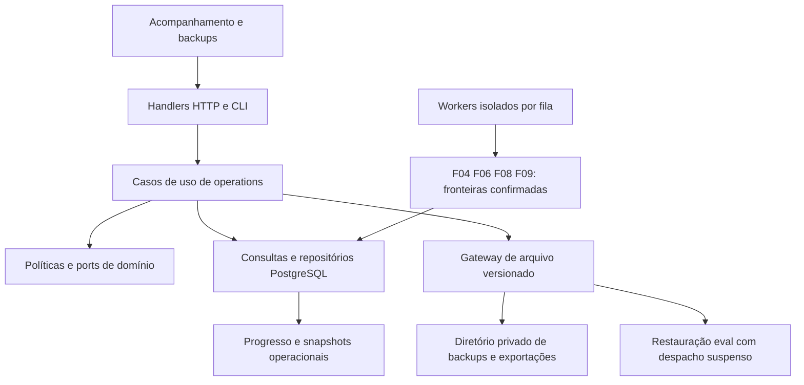

# F17 — Resiliência operacional e progresso verificável

## 1. Visão técnica

**Complexidade: alta**, por atravessar coleta, avaliações, projeções, mensageria, filesystem e recuperação de dados. Fontes: [PRD](../PRD.md), [stack](../stack.md), contratos/evidências de F02/F04/F06/F08/F09/F10/F12 e arquivos atuais em `apps/backend/`. F017 resolve para o ID canônico **F17**, prioridade 1, onda 11. Dependências: F02, F04, F06, F08, F09, F10 e F12; todas constam como `done` no progresso consultado. Esta especificação não inicia implementação.

**Estado documental:** especificação e plano emitidos; contrato preliminar enquanto faltar calibração dos limites novos. R07 e F17-AC01/AC07 exigem limites fundamentados em medição antes de fechar o contrato. O código atual não fornece a instrumentação/laboratório novos necessários; preparar o ensaio isolado é a primeira fase proposta, não trabalho executado nesta rodada. Após o ensaio, regenerar os três documentos com o perfil confirmado e sua evidência antes de liberar o contrato para implementação das políticas. A política de backup já foi decidida pelo usuário.

**Incluído:** progresso durável por etapa/unidade, funil consistente, recuperação limitada, isolamento de filas, estabilidade da leitura durante falhas, migração, backup automático local/exportação e restauração exclusivamente em instância isolada. Decisão do usuário: **uma cópia a cada 24 horas e retenção das 7 últimas cópias concluídas**, com uma cópia na inicialização se o agendamento estiver atrasado.

**Excluído:** alterar equivalência, preço, cálculo, condição ou elegibilidade; implementar F13–F16/F18/F19/F20; contato externo real para avaliação; backup remoto, restauração automática sobre dados em uso, garantia de RPO/RTO. A primeira elegibilidade permanece sob F12 até adoção de F16. Etapas futuras são indicadas como indisponíveis quando ausentes, sem simular sua implementação.

O código atual já possui probes técnicos, gerações/leases, eventos/recibos, publicação incremental e proteções contra resultados antigos. `runworker.py` combina reconciliadores e quatro filas, e `/acompanhamento/` mostra principalmente o ciclo de coleta. F17 deve aproveitar essas fronteiras, sem criar um segundo histórico financeiro ou mecanismo paralelo de envio.

## 2. Impacto de arquitetura

Preservar Python/Django, templates/HTMX, PostgreSQL 17 e Procrastinate 3.10.0; sem Redis. `domain/operations/` contém política, estados e ports; `usecase/operations/` orquestra ações unitárias; `infra/` implementa banco, arquivos, HTTP, CLI e worker. Dependências são injetadas em `main.py`; ambiente é lido somente em `config/env.py`. Exceções HTTP passam pelo tratamento central.



### Progresso, estados e contagens

Identificar a unidade por instalação, etapa, escopo/interesse e revisão de entrada. Registrar separadamente tentativa, atividade técnica e avanço. **Avanço útil** é uma fronteira persistida nova: página com identidades/cursor novos e prova de contexto; detalhe/observação nova; identidade ou avaliação aplicável publicada; revisão de exploração publicada; decisão de alerta resolvida ou recibo confirmado. Mesma entrada, mesmo cursor, heartbeat, log ou repetição de erro não renovam `last_progress_at`. Resultado antigo não renova progresso da revisão atual.

Estados: `idle`, `running`, `waiting`, `stalled`, `suspended`, `unavailable`; o DTO inclui motivo, horário da leitura, último progresso, pendências/idade da mais antiga, próxima tentativa, prazo da fonte e ação permitida. Acesso negado exige fluxo existente de recuperação. Sem pendências é `idle`; espera com `not_before` válido é `waiting`, mesmo ultrapassando o limiar normal. Em trabalho novo sem avanço, a idade começa em `pending_since`. Conclusão de coleta continua exigindo a prova de F04/F12.

Ler o funil em uma transação com snapshot consistente e publicar `snapshot_id`, `as_of`, revisão da configuração/escopo e marca de observações. Cada etapa inclui definição, quantidade e disponibilidade; grupos não são somáveis automaticamente. Distinguir:

| Contagem | Definição no recorte |
|---|---|
| Armazenados | Identidades distintas persistidas na instalação, incluindo histórico fora dos interesses atuais |
| Revalidados | Última observação confirmada pertence à configuração/escopo atual |
| Com detalhe | Há detalhe confirmado para a observação aplicável; card de busca não basta |
| Com foto | Há mídia utilizável segundo F14; antes disso, indisponível, não contagem de URLs |
| Reconhecidos | Identidade/atributos suficientes segundo F06, sem inferir por preço ou interesse |
| Com amostra | Avaliação da mesma revisão satisfaz amostra/equivalência/validade de F06 |
| Estimados | Composição aplicável e calculável de F06/F07 |
| Elegíveis | Decisão vigente de F09/F12 autoriza o tipo de evento, sem assumir a política futura F16 |
| Envio confirmado | Recibo aceito pelo servidor segundo F09; não entrega ou leitura pelo grupo |

Mostrar diferenças de população explicitamente: estoque global versus revisão atual; várias observações/eventos versus uma identidade; histórico de confirmação versus elegibilidade atual. Não recalcular classificação/financeiro para preencher o painel. Uma etapa ausente retorna disponibilidade `false` e quantidade `null`, nunca zero fictício.

### Recuperação e isolamento

Persistir checkpoint e orçamento por unidade/revisão. Retentativa respeita `Retry-After`, suspensão de acesso, geração e lease existentes. Uma mudança de entrada relevante inicia novo orçamento; probe e reinício não o zeram. A ação explícita de retomar valida revisão esperada, registra motivo e abre novo orçamento limitado. Não remove suspensão de autenticação nem libera transmissão incerta.

Separar capacidade de execução para `listing` (perfil serial), `valuation`, `alert`, `runtime/control` e `maintenance` (backup/exportação). `runworker` supervisiona consumidores próprios por grupo, cada qual com uma vaga inicial; lifecycle acompanha todos os processos filhos e encerra apenas os da instância. Reconciliadores têm fronteiras de erro independentes: falha de configuração/coleta não pula publicação/avaliação independente. Nenhum consumidor de outra fila abre simultaneamente o perfil Facebook. I/O externo ocorre fora da trava curta de publicação; encerramento por timeout invalida a geração antes de nova posse.

Enfileiramento e gravação de intenção de trabalho são transacionais; deduplicar por unidade/revisão. Fila cheia conserva pedido/checkpoint durável e suspende produção antes de ultrapassar o teto. Nunca descartar evento ou autorização de envio para reduzir fila. Trabalho que possa ter transmitido POST só usa a reconciliação de F09, inclusive após expiração da posse.

### Limites e calibração obrigatória

Os valores abaixo são **limites técnicos iniciais de engenharia**, não metas de produto nem medições de desempenho da F17. A evidência anterior F12 documentou 146 timeouts na trava, 69 observações em três minutos e a política 60/15/300; ela não mede todos os novos estágios. Antes de habilitar F17 no ambiente real, a primeira fase do plano deve medir o controle saudável e as falhas em recursos próprios, registrar `calibration.json` e confirmar este perfil. Se o perfil não comportar a medição, revisar spec/contrato antes da adoção; não elevar limites silenciosamente para aprovar testes.

| Recurso | Perfil inicial e regra observável |
|---|---|
| Espera entre ciclos e recuo | Preservar F12: 60 s com progresso; falha geral inicia em 15 s, teto 300 s; prazo maior da fonte prevalece |
| Chamada de fonte / WAHA | Preservar timeout configurado: 20 s de fonte real e 10 s de canal por padrão; não baixar o prazo da fonte |
| Posse de unidade | Preservar lease inicial de 60 s e geração; renovar posse não renova progresso |
| Estagnação | 180 s de trabalho pendente sem avanço, excluindo espera válida; reavaliar a cada 5 s, exibir até o primeiro tick posterior ao limiar |
| Recuperação automática | Máximo de 3 falhas recuperáveis consecutivas por unidade/revisão; contador persiste; três falhas de detalhe continuam pausando a tentativa F12 |
| Duração de uma unidade | Navegação limitada pelo timeout de cada página/detalhe e até 100 páginas por busca existentes; valoração/publicação no máximo 60 s por unidade, fora de trava longa |
| Backup ou exportação | Uma operação por vez por instalação; máximo 300 s por operação; timeout conserva a cópia anterior |
| Fila | Até 1.000 unidades pendentes por etapa; ao atingir, aplicar contrapressão antes de aceitar unidade adicional; chave idempotente evita multiplicação de ticks |
| Dados de negócio e mídia | Teto inicial de 10 GiB somando tamanho do banco da instância e mídia gerenciada; dados protegidos não são eliminados ao atingir o teto |
| Backups e exportações | Teto conjunto de 10 GiB, incluindo temporários; reservar espaço para próxima operação antes de iniciá-la |
| Reserva no filesystem | Manter ao menos 1 GiB livre; admissão exige caber tamanho conservador da operação mais a reserva; medir tamanho completo, não apenas compactado |
| Diagnóstico detalhado | Até 10.000 registros ou 7 dias, o primeiro limite atingido; resumir contadores/último progresso, conservar registros referenciados por investigação ou reconciliação |
| Revisões de exploração | Preservar retenção vigente de 24 h; revisão ainda apresentada pode expirar segundo F08, com aviso, sem troca silenciosa |
| Backups concluídos | Conservar as 7 últimas cópias; só remover a mais antiga após uma oitava cópia íntegra ser publicada; falha não antecipa remoção |
| Exportações temporárias | Até 24 h após conclusão, se não estiverem em transferência; sua remoção não apaga a cópia local selecionada |
| Evidências protegidas | Sem expiração automática para observações, escolhas, recibos, autorizações ou referências necessárias; ao atingir orçamento, suspender escrita afetada e solicitar espaço |

`calibration.json` deve conter versão/hash do perfil, versões instaladas, hardware agregado, recorte sintético, repetições, duração por etapa, idade de fila, bytes livres/pico e controle versus falha. Executar pelo menos cinco repetições saudáveis e cinco com cada falha temporal; isso é protocolo de ensaio, não meta de qualidade. Relatório explicita se o perfil foi confirmado ou exige revisão. Limites reduzidos de teste só são aceitos em `eval`, constam do relatório e não substituem medição com o perfil operacional. F13/F14/F15/F18/F19 acrescentarão seus próprios orçamentos; a ausência dessas etapas não impede validar as atuais.

Contrapressão atua na admissão de novas unidades antes do teto. A reserva mantém capacidade de finalizar checkpoint/recibo de uma operação já autorizada; não recusar a gravação de confirmação para cumprir quota de coleta. Se nem essa gravação for possível por falta física de disco/banco, suspender novas transmissões e conservar a tentativa como possivelmente transmitida para reconciliação. Limpeza não usa essa pressão como autorização para apagar recibos.

### Backup, exportação e restauração

Diretório padrão: `~/.local/share/garimpei/backups/<environment_id>/`, fora do checkout, permissão `0700`, arquivos `0600`, configurável centralmente por `GARIMPEI_BACKUP_DIR`. Subpastas `completed/`, `partial/` e `exports/`. Não copiar `.runtime/`, diretórios privados de integração ou volumes Docker indiscriminadamente.

Usar **arquivo de dados versionado por allowlist**, com manifesto JSON, registros JSONL tipados e, quando aplicável, mídia imutável identificada por hash. Ler todas as tabelas de negócio na mesma transação PostgreSQL `REPEATABLE READ READ ONLY`, antes de qualquer consulta; a exportação não combina consultas de snapshots distintos. Não produzir dump SQL executável de entrada externa. Preparar o arquivo privado, conferir relações, contagens e SHA-256 e só então renomear atomicamente no mesmo filesystem para concluído. Falha, interrupção ou limite produz estado de falha, sem arquivo final válido.

| Entra no pacote de dados | Tratamento |
|---|---|
| Configuração/interesses | IDs, revisões, CEP, taxa e histórico persistido preservados |
| Coleta | Identidades, observações, matches, eventos, marcos, cursores e evidência necessária; referência circular latest/known_price é religada após carga |
| Condição/avaliação | Escolhas atuais e histórico manual, trabalhos/avaliações e referências; manter revisão/proveniência e dados financeiros históricos |
| Exploração | Revisões ainda retidas e seus vínculos, com validade original |
| Alertas | Cursor, decisões, intenções, corpos congelados, tentativas, vínculos de conta/grupo e recibos exatamente preservados |
| Operação | Checkpoints, orçamento consumido e suspensões; agendamento/posses não são restaurados como execução ativa |
| Fotos quando F14 existir | Bytes/versionamento/hashes e vínculos das fotos protegidas; pin de versões impede limpeza durante cópia; falta de byte exigido impede anunciar backup completo |

Fora do pacote: cookies, perfil Facebook, arquivos de sessão WAHA, QR, tokens, chaves e valores de ambiente, logs brutos, processos/ports e jobs técnicos/probes do Procrastinate. IDs de sessão/conta/grupo que fazem parte do vínculo de uma intenção são dados privados necessários à reconciliação, não arquivos de autenticação: ficam no arquivo privado, nunca nos relatórios. Exportar `IntegrationSettings` por campos permitidos, sem caminhos de credenciais, pedidos de login em andamento ou estado autenticado. Reacesso Facebook e pareamento WAHA exigem recuperação separada. Blobs/URLs são validados por schema; campo com credencial não é copiado por ser JSON. Qualquer exclusão de evidência essencial deve ser declarada como escopo incompleto, não perda silenciosa.

Manifesto: `format_version=1`, UUID da cópia, instalação de origem, início/fim, instante do snapshot de dados, versão de código/migrations, perfil de limites, recursos presentes, último cursor/evento coberto, tabelas/arquivos com contagens e hashes, exclusões e instrução de recuperação de acesso. Um snapshot consistente representa dados já confirmados; não cobre commits ou envios posteriores. A configuração aprovada da política acompanha o pacote, mas a inicialização do destino mantém suspensão efetiva de despacho.

Agendamento persistente por instalação: primeira execução sem cópia concluída é devida; após sucesso, próxima execução = conclusão + 24 h. Se atrasado na inicialização, criar uma única cópia; não repetir todos os horários perdidos. Sem atraso, conservar a próxima data. Falha usa retentativa limitada e não desloca o último sucesso para agora. Estado de catálogo diferencia `creating`, `completed`, `failed`, e restauração `not_tested`, `verified` ou `failed`. Sete cópias não garantem sete dias se houver cópias manuais extras. Exportação de uma cópia selecionada gera outro arquivo íntegro com o mesmo conteúdo/hashes; sucesso permite download local. Original permanece. Nada é enviado a serviço externo; a interface informa que cópia no mesmo disco não cobre perda desse disco.

Uma cópia em exportação/transferência não pode ser removida por retenção concorrente. Se a mais antiga estiver em uso ao concluir a oitava, registrar limpeza adiada e preservar temporariamente o arquivo protegido dentro da quota; ao liberar a referência, convergir para as sete últimas. Falta de espaço para essa sobreposição impede a nova operação sem remover antecipadamente uma cópia válida.

Restauração é comando operacional **somente para destino `eval` próprio, descartável e sem dados de negócio**. Não oferecer restauração da instalação real pela interface. Validar paths, tamanho descompactado, manifesto, versão/migrations, hashes, unicidade e relações antes da importação. Rejeitar caminhos absolutos, travessia, symlinks, tipos desconhecidos ou arquivos extras. Importação é transacional; falha não deixa carga parcial nem altera a origem. Validar compatibilidade antes de aplicar qualquer transformação; migração suportada deve preservar identidades, ordem dos eventos e sequências.

Criar barreira de recuperação no destino **antes** de importar: arquivo privado de instalação e estado persistente de `RecoveryBarrier`, ambos exigidos pelo envio. `init`, alteração de grupo e retentativa não removem a barreira. Recriar jobs a partir dos pedidos de negócio após conferir integridade; nunca reproduzir jobs de envio exportados. Manter coleta/fonte reais desconectadas no exercício. A última cópia pode omitir mensagens posteriores: o intervalo entre snapshot e restauração fica explicitamente não reconciliado. Reconciliação requer evidência de F09 suficiente para cada autorização/evento potencialmente afetado, com vínculo original; histórico truncado/ausente mantém bloqueio. O exercício usa canal fake e nunca libera a instalação real. Somente uma reconciliação comprovada no destino isolado pode remover sua barreira; ausência de recibo não comprova ausência de envio. RPO/RTO e procedimento de substituição da instalação real continuam fora do escopo.

## 3. Decisões técnicas

| Decisão | Escolha | Alternativa | Consequência |
|---|---|---|---|
| Fonte do progresso | Fronteiras de negócio confirmadas e snapshot consistente | Inferir por logs/probe | Exige instrumentar commits, evita falso avanço |
| Isolamento | Capacidade reservada por fila e perfil Facebook serial | Uma fila/capacidade compartilhada | Mais consumidores supervisionados; falha lenta não ocupa todas as vagas |
| Recuperação | Orçamento persistente, geração e retomada explícita | Reinício zerar tentativas | Intervenção fica visível quando esgotado |
| Backup | Arquivo por schema/allowlist e snapshot transacional | Copiar volume ou dump integral | Mais trabalho de compatibilidade; evita incluir sessão e jobs ativos |
| Restauração | Destino isolado, barreira e reconciliação do intervalo | Retomar envio pelo estado antigo | Recuperação pode permanecer bloqueada quando faltam evidências |
| Limites | Perfil inicial acima, condicionado à calibração | Limites implícitos/infinitos | Medição é pré-requisito de habilitação, sem inventar desempenho |

Base técnica consultada: snapshots estáveis em [PostgreSQL 17 — isolamento](https://www.postgresql.org/docs/17/transaction-iso.html); exclusão de execução em [Procrastinate — locks](https://procrastinate.readthedocs.io/en/stable/howto/advanced/locks.html) e deduplicação de espera em [queueing locks](https://procrastinate.readthedocs.io/en/stable/howto/advanced/queueing_locks.html). Confirmar APIs contra a versão 3.10.0 instalada antes de implementar; trava de fila não substitui idempotência de negócio.

## 4. Componentes

Caminhos abaixo são relativos a `apps/backend/src/garimpei/`; os marcados novos são propostas, não arquivos existentes.

| Camada/caminho | Estado | Responsabilidade |
|---|---|---|
| `domain/operations/{progress,limits,backup,recovery,ports,errors}.py` | Novo | Invariantes, perfis, estados e interfaces de queries/repository/gateway |
| `usecase/operations/read_status_usecase.py` | Novo | DTO consistente de estado/funil |
| `usecase/operations/resume_stage_usecase.py` | Novo | Retomada explícita e versionada de unidade |
| `usecase/operations/{create_backup,export_backup,restore_backup,verify_recovery,prune_operations}_usecase.py` | Novo | Uma ação pública `execute` por classe, ports via construtor |
| `infra/repository/operations/{postgres_repository,mapper}.py` | Novo | Escritas transacionais, checkpoints e catálogo de cópias |
| `infra/queries/operations/postgres_queries.py` | Novo | Snapshot do funil, filas e estados, sem SQL no handler |
| `infra/gateway/operations/{archive_gateway,storage_gateway}.py` | Novo | Arquivo por allowlist, checksums, quotas e publicação atômica |
| `infra/persistence/operations_models.py` | Novo | Progresso, falhas, catálogo, barreira e exclusão de operações concorrentes |
| `infra/persistence/migrations/<next>_operational_resilience.py` | Novo | Acrescentar schema sem reescrever migrations históricas; resolver número no momento da implementação |
| `infra/http/operations/{routes,status_handler,resume_handler,backup_handler,export_handler,download_handler}.py` | Novo | Entradas HTTP pequenas e delegação ao tratamento central |
| `infra/http/templates/operations/{status,backups,error}.html` | Novo | Etapas, motivos, funil, catálogo e recuperação legível |
| `infra/http/templates/monitoring/tracking.html` | Alterado | Integrar diagnóstico mantendo rota pública |
| `infra/http/static/listing/exploration.js` e templates de erro | Alterado | Falha preserva DOM/contexto e oferece repetição na rota atual |
| `infra/http/error_handler.py`, `infra/http/urls.py` | Alterado | Erros recuperáveis e novas rotas |
| `infra/worker/operations_handler.py` | Novo | Execução de manutenção limitada e agendamento durável |
| `infra/persistence/management/commands/{operational_backup,operational_status}.py` | Novo | CLI de diagnóstico/exportação/restore isolado, saída legível |
| `infra/persistence/management/commands/runworker.py`, `infra/runtime/lifecycle.py` | Alterado | Consumidores supervisionados e reconciliação independente |
| `infra/repository/listing/postgres_repository.py`, `infra/repository/valuation/postgres_repository.py`, `infra/repository/alert/postgres_repository.py` | Alterado | Avanço vinculado ao commit, orçamento/geração e barreira de envio |
| `infra/queries/listing/exploration_queries.py`, `infra/repository/listing/exploration_repository.py` | Alterado | Coerência e preservação das revisões de leitura |
| `config/env.py`, `main.py` | Alterado | Configuração central e composição explícita |

Reutilizar tokens e direção [Mineral](../design/MASTER.md), sem redesenhar a exploração. UI mostra problema, horário e ação; nomes de tabelas/leases ficam nos diagnósticos técnicos, não no fluxo do usuário.

## 5. Interfaces públicas

Aplicação continua em loopback, sem novo login. POST exige CSRF; todas as respostas operacionais usam `Cache-Control: no-store`. Não aceitar path arbitrário no HTTP. Instância/escopo são resolvidos pelo servidor; destinatários privados não aparecem no DTO. GET não causa retomada nem restauração.

| Método e rota | Entrada | Resposta e falhas |
|---|---|---|
| GET `/acompanhamento/` | Sem campos novos obrigatórios | 200 HTML com último snapshot e ações; 503 recuperável se primeira leitura falhar, sem redirecionar para instalação |
| GET `/acompanhamento/estado/` | `interesse` opcional, chave existente; `versao` opcional, UUID do snapshot apresentado | 200 JSON com snapshot/estágios/funil; 400 filtro inválido; 409 revisão expirada; 503 leitura indisponível |
| POST `/acompanhamento/etapas/<stage>/retomar/` | `unidade` UUID, `revisao` inteiro não negativo; etapa em enum público | 303 para o contexto operacional da unidade; 400 forma inválida; 403 CSRF; 409 conflito/acesso suspenso/barreira; 503 dependência indisponível |
| GET `/acompanhamento/backups/` | Sem path de disco | 200 catálogo: data/escopo/estado/último teste e próxima cópia; 503 recuperável |
| POST `/acompanhamento/backups/<uuid>/exportar/` | `request_id` UUID para idempotência | 303 para catálogo com operação identificada; 404 cópia inexistente; 409 não concluída/operação em curso; 507 limite; 503 I/O indisponível |
| GET `/acompanhamento/exportacoes/<uuid>/arquivo/` | UUID de exportação concluída da instância | 200 arquivo integral com attachment; 404 desconhecida; 409 incompleta; 410 expirada; 503 erro de leitura |

Entrada JSON não é exigida nos formulários; POST usa campos de formulário. Exemplo reduzido do DTO `estado` (campos adicionais seguem §2):

```json
{"snapshot_id":"00000000-0000-4000-8000-000000000017","as_of":"2026-11-12T02:00:00Z","scope_revision":3,"stages":[{"stage":"valuation","state":"waiting","reason":"insufficient_sample","last_progress_at":"2026-11-12T01:59:00Z","pending":1,"oldest_pending_at":"2026-11-12T01:59:00Z","next_attempt_at":null,"action":null}],"counts":{"recognized":{"available":true,"value":1},"with_photo":{"available":false,"value":null}},"dispatch_suspended":false}
```

Erros JSON têm `error.code`, `error.message` seguro, `snapshot_id` quando conhecido e `retry_url` local validada. HTML/HTMX mantém leitura anterior e atualiza apenas a área de feedback em falha; timeout de rede também é visível. Primeira abertura retorna erro na própria rota com “Tentar novamente”. Configuração existente não é tratada como ausente por erro de leitura; POST com leitura falha não grava defaults. Aviso de atualização de F08 continua exigindo clique; respostas atrasadas de outro contexto não substituem o atual.

CLI nova, a implementar: `operational_status` lê diagnóstico; `operational_backup` aceita `list`, `create`, `export --id UUID`, `restore --archive PATH --isolated` e `verify --id UUID`. Execução pelo `manage.py` e `uv run --project apps/backend --frozen --no-sync python apps/backend/manage.py ...`. `restore` só funciona no `eval` descartável descrito nos pré-requisitos. Saída inclui ID, estado e motivo; exit 0 para ação concluída, 1 falha operacional/limite/barreira, 64 argumentos/configuração inválidos. `create/export/restore` só anunciam sucesso após conclusão; não imprimir credenciais nem conteúdo de arquivo. Não há comando para liberar despacho sem reconciliação.

## 6. Modelo e migração

Adicionar tabelas por migrations aditivas. UUIDs são gerados pelo domínio; timestamps em UTC; inteiros de revisão/geração não negativos. Interfaces internas usam dataclasses/Protocols tipados; mappers reidratam entidades sem executar regras de criação novamente.

| Tabela proposta | Campos principais e restrições |
|---|---|
| `OperationalUnit` | UUID PK; instalação/etapa/chave de unidade/escopo/revisão, estado/motivo; timestamps tentativa/progresso/pendência/próxima ação; checkpoint JSON versionado; geração/posse; falhas/orçamento; unique na identidade completa; índice estado/próxima ação e etapa/pendência |
| `OperationalDiagnostic` | UUID PK, FK unidade protegida, motivo permitido, contexto sanitizado limitado, horário, referência de investigação opcional; índice unidade/horário; não armazenar resposta bruta |
| `BackupSchedule` | Instalação PK, último sucesso/última falha/próxima data, revisão; intervalo 86.400 s e retenção 7; posse de manutenção exclusiva |
| `BackupRecord` | UUID PK, instalação, tipo backup/exportação, FK origem protegida para exportação, estado, versão de formato/migrations, snapshot/start/finish, chave de arquivo relativa gerada, bytes/hash, resumo de escopo, verificação de restauração; completed exige finish/hash/arquivo íntegro; índice instalação/conclusão |
| `RecoveryBarrier` | Instalação PK, UUID de restauração/cópia, início do intervalo não coberto, fim conhecido opcional, estado blocked/reconciled, resumo de evidências verificadas e horário; nenhum default de “reconciliado” |

Sem cascata sobre recibos/observações. Catálogo de backup não pode exigir arquivo de si próprio dentro do snapshot atual; manifesto descreve essa exclusão e a operação é registrada após publicação. Estado técnico de execução/probes é recriado, não prometido como dado recuperado. Invalidação de geração/checkpoint e eventos de progresso são atômicos com a mutação protegida; mudanças de leitura não geram eventos de negócio. Migração de instalação existente inicia progresso histórico como “não medido”, preserva seus horários confirmados e não anuncia avanço ocorrido durante a migração.

## 7. Estratégia de validação

Todos os nomes novos abaixo são artefatos a produzir durante a implementação, não pré-requisitos já existentes. Fakes nomeados para fonte/WAHA/relógio/armazenamento derivam de `tests/factories/{runtime,listing,valuation,alert_scenario,exploration}.py`. I/O persistente/conflitos usam PostgreSQL real da instância de avaliação. Medir cenário adverso e controle com a mesma carga; não alterar expectativa para ocultar erro.

| Arquivo proposto | Casos significativos |
|---|---|
| `tests/unit/test_operational_progress.py` | Heartbeat/mesmo cursor não avançam; espera válida/idle não estagnam; fronteira 180 s e geração antiga |
| `tests/integration/test_operational_recovery.py` | Contador persiste, teto e retomada explícita; uma unidade falha e outra avança; perfil serial |
| `tests/integration/test_operational_counts.py` | Contagens exatas, recortes/sobreposições, snapshot durante escrita concorrente, etapa ausente |
| `tests/http/test_operational_status.py` | Validação/CSRF, primeira falha, retry local, ausência de defaults sobre configuração |
| `tests/integration/test_operational_backup.py` | Consistência sob escrita, agendamento/atraso, retenção, quotas, interrupção, concorrência e exportação exata |
| `tests/lifecycle/test_operational_restore.py` | Antes/depois de commit/envio, alvo errado, cópia antiga, hash/schema/arquivo incompleto, migração, isolamento e barreira persistente |
| `tests/integration/test_operational_flow.py` | Dados suficientes → observação → estimativa → elegibilidade F12 → confirmação fake; queda e retomada sem POST extra |
| `tests/factories/operations_lab.py` | Instâncias próprias, falhas injetáveis, relógio controlado, inventário, calibração e cleanup |

Criar a fixture operacional descrita em `contract.md`, com comando reproduzível e manifesto sanitizado; não depender do banco do usuário. Cobrir perda de conexão/timeouts, item persistente falho, fila cheia, disco cheio, erro de gravação/rename, tarefa antiga, concorrência e pontos de queda antes/depois de autorização/POST/recibo. Para F14/F19 ausentes, exercitar contrato de indisponibilidade do estágio; não simular uma avaliação multimodal como feature entregue.

Gates de implementação: `node scripts/run-gates.mjs` já é runner Python atual; `uv run --project apps/backend --frozen --no-sync pytest apps/backend/tests`; checks Django/migrations; verificação do harness se lifecycle/scripts forem alterados. Navegação por `playwright-cli`, evidências desktop e janela estreita, com avaliação visual conforme `frontend-ui-design`. Registrar evidência por item e resultado de calibração/restauração; documentação produzida não comprova esses gates nem muda F17 para `done`.


## Evidência de calibração inicial — 2026-11-12

[calibration-initial.json](evidence/calibration-initial.json) registra cinco controles e cinco timeouts por adaptador com prazos operacionais (fonte20s, valoração30s, canal10s), além de cinco percursos completos com PostgreSQL e recibo fake F16 em19,30–20,02s incluindo startup. Estes resultados confirmam as fronteiras existentes. O primeiro incremento de manutenção, restauração, isolamento e a integração de mídia ainda requerem ensaio; o contrato continua preliminar e a habilitação real permanece desativada. Nenhum limite foi ampliado e nenhum gate foi dispensado.
