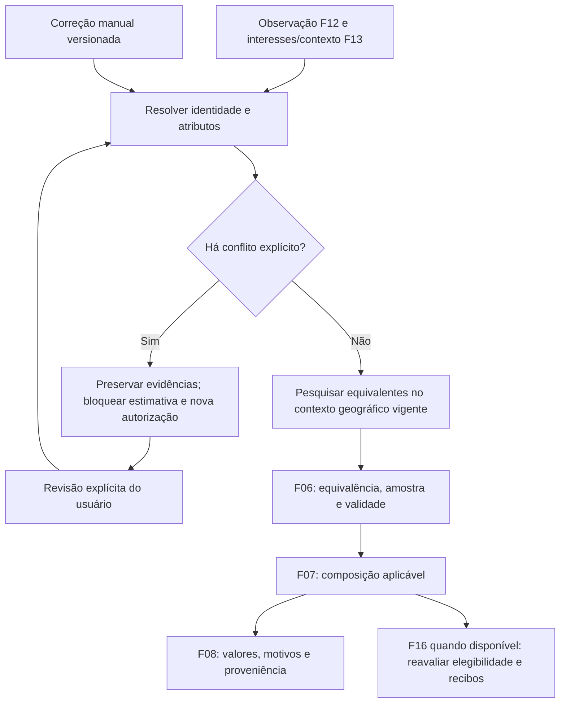

# F18 — Identificação de produtos e busca ativa de comparáveis

Brainstorming consolidado em 2026-11-12 UTC. As decisões de produto abaixo foram confirmadas na conversa e incorporadas ao [PRD](../PRD.md). A organização técnica é proposta para a futura especificação; este documento não substitui `spec.md`, `plan.md` ou `contract.md` e não declara implementação.

## Resultado esperado e base atual

Investigar ofertas dos interesses ativos, esclarecer identidade e buscar equivalentes quando faltar amostra, mantendo explícito o que ainda não é possível estimar. A implementação atual reconhece um catálogo limitado por regras em `domain/valuation/identity.py` e módulos de famílias; `identify` retorna uma identidade ou ausência dela. `policy.py` aplica equivalência e a política de usados, e `evaluate_usecase.py` publica avaliações. Buscar mais anúncios não resolve por si só uma família sem suporte ou uma variante desconhecida.

F18 depende de F06/F12/F13 e permanece na onda 12. A base textual funciona sem F15/F19; inferência multimodal posterior deve fornecer evidência versionada pela mesma fronteira, sem criar dependência obrigatória de IA para este fluxo.

## Decisões confirmadas

| Decisão | Comportamento escolhido | Alternativas consideradas |
|---|---|---|
| Região dos comparáveis | Usar o mesmo contexto geográfico do monitoramento; falta de amostra mantém indisponibilidade. | Ampliar após insuficiência ou buscar nacionalmente desde o início. |
| Identidade manual | Permitir corrigir opcionalmente modelo e atributos do anúncio, registrando origem manual e reavaliando. | Aguardar somente dados coletados automaticamente. |
| Contradição posterior | Preservar a correção, mostrar conflito e suspender estimativa/lucro aplicáveis e novos alertas até revisão. | Substituir a correção pela identificação automática mais recente. |
| Primeiro alerta após correção | A correção de identidade pode habilitá-lo com F16, dentro de 48 horas da publicação confiável, sem conflito, com todas as demais condições e deduplicação satisfeitas. | Recalcular, mas aguardar nova evidência automática para autorizar envio. |

Correção de identidade e correção de condição são ações distintas. A escolha de condição de F05/F16 continua sem gerar alerta por si só. Corrigir identidade não confirma funcionamento, não dispensa amostra, não redefine data de publicação e não cria um novo interesse.

## Fluxo proposto

1. Resolver família/modelo e atributos com trechos da fonte ou valores manuais identificados como tais. Ausência de atributo não é contradição. Uma nova observação sem informação divergente conserva a correção; uma divergência explícita exige revisão.
2. Registrar a correção para a identidade fonte/ID do anúncio, com valores informados, momento, observação examinada e revisão própria. Preservar a observação original e a escolha anterior. A edição não se propaga automaticamente a outros anúncios nem altera as regras de uma família inteira.
3. Investigar identidade e amostra conforme o dado faltante. Reutilizar pesquisa para produtos equivalentes somente com contexto geográfico e política compatíveis, excluindo a própria oferta da sua amostra. Normalizar aliases validados; uma correção não habilita arbitrariamente uma família sem suporte.
4. Registrar termos, percurso, contexto solicitado e observado, candidatos e exclusões. Não confundir raio solicitado com raio comprovado. Contexto divergente ou não verificado permanece explícito e não sustenta uma alegação de amostra local validada.
5. Aplicar a política F06: no mínimo cinco identidades distintas retidas, observações até 14 dias, filtro de 50% a 150% da mediana preliminar e razão máxima/mínima até 1,5. Referência de novo permanece independente. A janela de 48 horas para primeiro alerta não é a janela dos comparáveis.
6. Publicar apenas resultado compatível com observação, correção, política e contexto vigentes. Se uma revisão mudar durante a pesquisa, conservar evidência histórica e rejeitar a publicação ultrapassada.
7. Ao resolver conflito, reavaliar a identidade escolhida. A resolução não recupera automaticamente uma avaliação vencida nem libera alerta sem os demais dados. Intenções já possivelmente transmitidas conservam seu corpo e seguem reconciliação; bloqueio de novo envio não apaga recibo nem implica desfazer mensagem enviada.

## Fronteiras técnicas propostas

| Responsabilidade | Entrada e saída |
|---|---|
| Resolução de identidade no domínio | Evidências, correção e política → atributos com origem, ausências e conflitos explícitos, ampliando o resultado binário atual. |
| Orquestração em casos de uso | Correção ou observação nova → investigação persistente e reavaliação; dependências por construtor. |
| Navegação F13 | Consulta e contexto → percurso confirmado/candidatos/limites; acesso privado fica na infraestrutura. |
| Persistência | Histórico de correções, investigações e candidatos, com revisão para rejeitar resultado antigo. |
| Consumidores F06/F07/F08/F16/F17 | Avaliação financeira, apresentação, autorização e diagnóstico mantêm suas responsabilidades; F18 não despacha mensagens. |

Python/Django, PostgreSQL e worker persistente existentes são suficientes para essa organização. Domínio não acessa navegador, ORM ou fila; a composição permanece explícita em `main.py`. Nomes de interfaces e schema definitivo ficam para a especificação, após mapear os contratos consumidores atuais.

## Estados relevantes

| Estado | Efeito |
|---|---|
| Família sem suporte | Informar lacuna; edição manual não fabrica política de equivalência. |
| Atributo ausente | Investigar e oferecer correção opcional; sem preenchimento presumido. |
| Identidade manual sem conflito | Reavaliar com a origem manual visível. |
| Conflito com correção | Mostrar ambos os valores/evidências; suspender venda/lucro aplicáveis e autorização de novo alerta até revisão. |
| Pesquisa parcial ou contexto não comprovado | Conservar progresso e limitação; não afirmar busca concluída ou amostra local validada. |
| Amostra insuficiente/dispersa/vencida | Mostrar motivo; compra conhecida permanece e venda/lucro ficam indisponíveis. |
| Avaliação disponível | Identificar comparáveis, revisão e validade; F16 aplica sua política de envio. |

## Validação a incorporar ao contrato futuro

- Falta de amostra no contexto vigente não amplia região; resposta de outra região ou contexto não comprovado expõe a limitação.
- Correção opcional preenche identidade suportada, preserva origem manual, reavalia e sobrevive a reinício/coleta sem contradição.
- Nova capacidade/edição explicitamente divergente preserva a escolha e bloqueia avaliação/novo alerta; ausência de atributo sozinha não cria conflito.
- Resolução explícita permite nova avaliação; resultado de pesquisa anterior não reabre identidade ultrapassada.
- Comparáveis conhecidos suficientes levam a composição reproduzível; acessórios, parcelas, variantes e duplicatas da mesma identidade não completam a amostra.
- Correção de identidade pode habilitar primeiro alerta com F16; idade superior a 48 horas, publicação não confiável, conflito, recibo ou transmissão incerta impedem outro primeiro envio. Corrigir somente condição mantém a exceção vigente.
- Pesquisa interrompida retoma sem duplicar candidatos, eventos ou efeitos externos; indisponibilidade técnica conserva histórico e não fabrica preço.

## Pendências técnicas e limites

Materializar o corpus datado dos interesses atuais e os atributos/aliases por família. Medir e fixar duração, consultas, detalhes, tentativas, prioridade e próxima tentativa no contrato. Especificar a persistência e a concorrência da revisão manual, a ação de resolução e a validação do contexto geográfico contra o acesso real. A integração da correção de identidade com F16 deve ser exercitada quando ambas estiverem disponíveis; os contratos históricos não são alterados por este documento. Não há meta numérica nova de cobertura ou latência aprovada.
