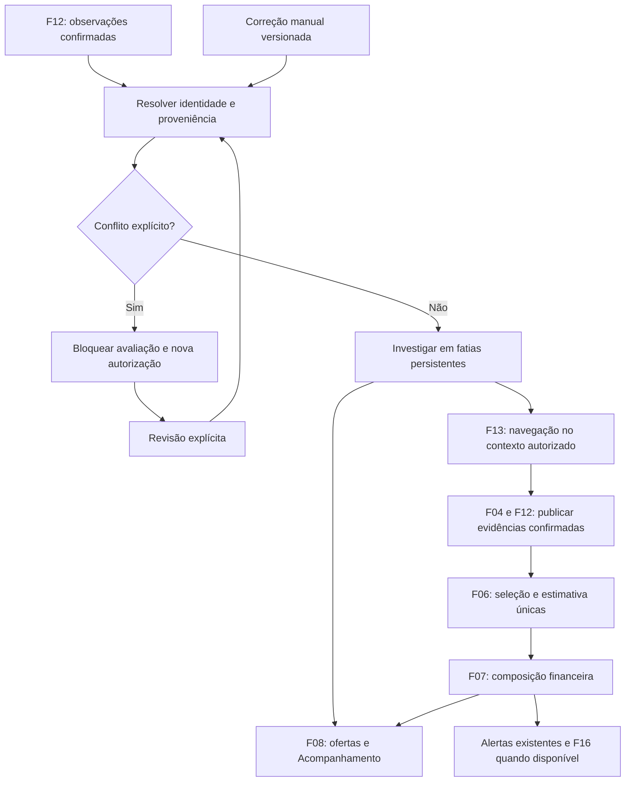

# F18 — Identificação de produtos e busca ativa de comparáveis

## 1. Visão técnica

**Complexidade: complexa**, pela navegação externa, persistência, correção manual concorrente e integração financeira. Fontes: [PRD](../PRD.md), F18-AC01–AC14, e [design aprovado](design.md). Dependências diretas: F06, F12 e F13; F13 está pendente no progresso consultado. Este documento especifica trabalho futuro, sem iniciar serviços, coletar dados ou alterar status de implementação.

A F06 já calcula a mediana com política conservadora, porém `domain/valuation/identity.py::identify` retorna apenas chave ou ausência. A F18 separa falta de suporte, atributo ausente e conflito; investiga o que falta e pesquisa equivalentes fora do catálogo inicial. Cada resultado aponta para observação, identidade efetiva, correção manual, contexto e políticas utilizados.

**Included:** corpus dos interesses ativos, identificação textual explicável, correção manual opcional de modelo/atributos, conflito bloqueante até revisão, pesquisa Facebook na mesma região, decisões de candidatos, orçamento/retomada, avaliação F06, composição F07 e apresentação nas páginas existentes. A base funciona sem IA.

**Excluded:** nova plataforma, expansão automática da região ou interesses, novos campos obrigatórios no cadastro, cobertura universal de famílias, inferência de atributo oculto, deduplicação especulativa entre IDs, cálculo financeiro alternativo, negociação/compra e despacho próprio de mensagens. F15/F19 não são requisitos. F16 é integração condicional para a nova regra de primeiro alerta; F17 pode consumir o diagnóstico quando disponível, sem inversão do DAG.

### Pré-requisitos ainda pendentes

- Entrega F13: navegação complementar, contexto comprovável, exclusividade do perfil e retomada. Alinhar a interface concreta antes de implementar o adaptador F18; os nomes abaixo são propostas, não interfaces já existentes.
- Recorte datado dos interesses ativos e corpus com anotação humana. Sem acesso autorizado, registrar pendência; não substituir silenciosamente pelos produtos convenientes a uma fixture.
- Medição dos limites de pesquisa. O PRD não fornece números específicos; o manifesto vinculante descrito adiante deve fixá-los antes da ativação. Ausência de medição não comprova F18-AC06.
- Integração real da correção de identidade com primeira elegibilidade: verificar quando F16 estiver disponível. A F18 não implementa novamente a política de 48 horas nem altera a exceção de correção manual de condição.

## 2. Impacto na arquitetura

Preservar `domain/` ← `usecase/` ← `infra/`, DI por construtor, tipos explícitos, casos de uso com um único `execute` e composição em `apps/backend/src/garimpei/main.py`. Domínio resolve identidade, conflito, exclusões e prioridade; infraestrutura acessa navegador, ORM, fila e ambiente. Interfaces de repositório/consulta ficam no domínio.

Reivindicar trabalho e publicar em transações curtas; navegar/extrair fora de transações e de `lock_monitoring_publication`. Lease com geração de posse impede worker antigo de publicar depois de perder acesso. Conferir novamente observação, revisão da correção, política e contexto ao publicar. Reusar enqueue transacional Procrastinate já presente no `main.py`; tarefa e estado confirmado não podem divergir por queda entre operações.

Bloqueios Django duram até o fim da transação; `select_for_update(skip_locked=True)` pode permitir reivindicar outro trabalho disponível. Verificar concorrência em PostgreSQL com transações independentes, não somente mocks ou uma transação implícita de teste. [Django 5.2: bloqueios](https://docs.djangoproject.com/en/5.2/ref/models/querysets/#select-for-update), [testes transacionais](https://docs.djangoproject.com/en/5.2/topics/testing/tools/#transactiontestcase).

## 3. Decisões técnicas

| Decisão | Escolha | Alternativa | Consequência |
|---|---|---|---|
| Identificação | Resultado estruturado e adaptador compatível com a chave atual. | Ausência genérica para toda falha. | Diferencia lacunas e conflito sem quebrar consumidores. |
| Correção manual | Histórico imutável por anúncio, revisão otimista e origem manual explícita. | Sobrescrever evidência coletada. | Preserva fonte e permite revisão de contradição posterior. |
| Região | Mesmo contexto geográfico vigente, comprovado pela F13. | Ampliar região para completar cinco candidatos. | Contexto ausente/divergente fica parcial e não sustenta amostra local validada. |
| Avaliação | Uma política F06 para catálogo e pesquisa. | Novo avaliador mais permissivo. | Mesmas exclusões, mediana, dispersão e validade. |
| Agendamento | Fatias finitas, rodízio entre interesses, prioridade para recentes avaliáveis. | Busca global ilimitada. | Exige limites medidos e evita monopólio de um candidato. |
| Atualidade | Publicação condicionada à revisão/posse e erro de tentativa separado do resultado válido. | Substituir vigente por resposta atrasada ou falha técnica. | Preserva histórico e significado financeiro. |

### Identidade e correção

`IdentificationResult` possui `state`, `family`, `product_key`, `attributes`, `missing_attributes`, `conflicts`, `evidence_refs`, `observation_id`, `input_revision`, `manual_revision` e `policy_version`. Estados: `identified`, `unsupported_family`, `missing_attribute`, `conflicting_identity`, `excluded_item`, `unrecognized`. Somente identidade suportada, completa e sem conflito fornece chave aplicável.

Atributo automático aponta para campo e trecho literal da observação correta. Atributo manual aponta para origem `manual`, momento e observação examinada; não fabrica trecho da fonte. Texto positivo genérico, preço baixo, categoria e nome do interesse não completam atributo ausente. Normalização usa somente aliases/mapeamentos validados e versionados; códigos de fabricante não implicam atributos sem mapeamento comprovado.

Inventário atual, sem ampliar promessa: PS5 em `identity.py`; iPhone/Xbox/Switch em `electronics_identity.py`; RTX/corpos de câmeras em `component_identity.py`; TVs/fones de catálogo restrito em `consumer_identity.py`. O corpus documenta quais regras atendem efetivamente o recorte ativo. Correção manual não cria suporte à família nem muda regras para outros anúncios.

Correção é opcional, vinculada a `(source, external_id)`, com revisão própria e observação examinada. Preservar evidência original e histórico; salvar provoca reavaliação. Nova coleta sem atributo ou com atributo compatível conserva a escolha. Dado explícito divergente conserva a escolha e a nova evidência, mas produz conflito bloqueante: consultas vigentes deixam venda/lucro indisponíveis imediatamente, sem esperar pesquisa terminar, e a autorização de novos envios consulta o mesmo bloqueio. A condição manual de F05 é independente e não é modificada.

Resolver é ação explícita: manter os valores manuais após revisar a evidência, adotar os valores observados ou informar uma combinação corrigida válida. Registrar a observação e os valores examinados na resolução; a divergência já revisada não reabre conflito apenas por repetir a mesma evidência, mas uma nova contradição relevante exige revisão. Nenhuma resolução ressuscita amostra vencida. Formulário obsoleto ou resolução contra observação já substituída retorna conflito de revisão, sem perder a escolha vigente.

Antes de autorizar um novo envio, o fluxo de alertas existente deve consultar a identidade efetiva/bloqueio atual, inclusive quando a intenção já estiver em fila. Mensagem possivelmente transmitida mantém corpo e reconciliação; não repetir POST, apagar recibo ou tentar desfazer envio. Conflito não altera mensagens já confirmadas. A identidade manual pode completar elegibilidade com F16; condição manual isolada conserva sua exceção de não alertar. Na ausência de F16, preservar a política de primeiro envio vigente, sem imitá-la parcialmente.

### Pesquisa e política F06

1. Começar no recorte ativo. Investigar detalhe quando um atributo pode ser comprovado; não pesquisar combinações especulativas de variantes desconhecidas. Identidade manual válida entra na mesma fronteira de equivalência, com proveniência própria.
2. Para identidade estabelecida e sem amostra aplicável, pesquisar termos derivados do modelo/atributos e aliases validados, no mesmo contexto geográfico. Registrar termos/ordem, filtros solicitados versus observados, percurso e interrupções. Não escolher subconjunto apenas por preço baixo ou lucro desejado.
3. Não herdar o filtro de publicação de 48 horas dos alertas. Usados têm janela de observação confirmada de até 14 dias, inclusive; publicação antiga não exclui observação atual elegível. Novo permanece separado, com sete dias de validade própria.
4. Publicar lotes confirmados incrementalmente pelo fluxo canônico F04/F12. Contexto divergente/não comprovado conserva a pesquisa parcial; candidatos não entram como amostra local validada até confirmação. Não ampliar região para atingir suficiência.
5. Usar a última observação aplicável por fonte/ID. Excluir o alvo, acessórios, kits/lotes, peças, defeitos/condição incerta, indisponíveis, preço desconhecido/parcial, parcela, entrada e troca. Exigir preço integral positivo em BRL, unidade usada e evidência conservadora de funcionamento F06. Escolha manual do alvo não é evidência de funcionamento dos comparáveis.
6. Calcular mediana preliminar, reter entre 50% e 150% inclusive, exigir cinco identidades retidas e razão máxima/mínima até 1,5. Mediana final com `Decimal` e arredondamento vigente. Avaliar todo o lote confirmado, sem selecionar os cinco que geram maior lucro. Guardar motivos de todas as exclusões, contagens e validade.
7. Parar por suficiência válida no recorte examinado, fim comprovado, teto, suspensão ou falha; cinco candidatos brutos não bastam. Referência insuficiente/dispersa/vencida permanece indisponível. Prova de páginas percorridas não equivale à cobertura integral da fonte.
8. Candidato somente de pesquisa não ganha interesse, descoberta ou alerta por esse fato. Se houver match real com interesse ativo, seguir regras normais F04/F12/F09 e F16 quando disponível. Republicações com IDs distintos não são fundidas só por foto/título.

### Limites vinculantes e prioridade

Produzir `evidence/limits.json` na fase de medição, antes da ativação automática, com perfis real/controlado separados. Campos: `policy_version`, `measured_at`, `environment`, `corpus_hash`, `evidence_paths`, `max_queries_per_slice`, `max_pages_per_query`, `max_details_per_slice`, `max_slice_seconds`, `request_timeout_seconds`, `max_attempts_per_input`, `retry_delays_seconds`, `lease_seconds`, `max_wait_slices_per_interest` e `max_pending_per_interest`.

Tetos e intervalos são finitos/positivos; espera cobre todas as tentativas e lease excede timeout com margem justificada. Verificar prazo antes de cada chamada e limitar timeout ao restante. Esgotamento preserva checkpoint e motivo. Números novos dependem de medição; defaults atuais de coleta não são medições F18 nem autorizam usar seu máximo de páginas como orçamento complementar. Manifesto ausente/inválido deixa pesquisa automática desabilitada com diagnóstico técnico pendente.

Rodízio de interesses com envelhecimento limitado por `max_wait_slices_per_interest`; dentro do interesse priorizar recentes identificáveis potencialmente avaliáveis, depois dado faltante obtenível em detalhe, desempate por entrada e ID estável. Não depender de lucro já calculado para merecer pesquisa. A navegação F13 deve conceder fatias também à coleta; espera por perfil não segura transação/trava global.

Limites são acumulados pela mesma entrada/política; reinício, cursor novo ou lease novo não zeram orçamento. Respeitar próxima tentativa e `Retry-After` maior. Esgotamento total interrompe repetição automática até mudança relevante ou retomada controlada documentada. Acesso negado suspende e requer recuperação manual. Mudar variante, correção ou contexto invalida reaproveitamento incompatível, sem apagar progresso histórico.

## 4. Componentes previstos

Prefixo: `apps/backend/src/garimpei/`. Arquivos novos abaixo são propostas; a especificação não os cria. Adaptar nomes aos pontos de integração efetivamente entregues por F13 sem alterar o comportamento contratado.

| Caminho | Ação | Responsabilidade |
|---|---|---|
| `domain/valuation/identity.py` e módulos atuais de famílias | Adaptar | Chave compatível e identificação detalhada. |
| `domain/valuation/identification.py`, `manual_identity.py`, `research.py`, `research_ports.py` | Novos | Proveniência, revisão/conflito, limites e portas tipadas. |
| `domain/valuation/policy.py`, `values.py`, `ports.py`, `profit.py` | Adaptar | Seleção única, identidade efetiva e motivos corretos de indisponibilidade. |
| `usecase/valuation/identify_product_usecase.py`, `save_identity_usecase.py`, `resolve_identity_usecase.py` | Novos | Resolver/salvar identidade com concorrência otimista e histórico. |
| `usecase/valuation/investigate_comparables_usecase.py`, `read_research_usecase.py`, `evaluate_usecase.py` | Novo/adaptar | Uma fatia persistente, leitura e publicação aplicável. |
| `infra/gateway/valuation/facebook_research.py` | Novo | Adaptador de navegação F13 com validação geográfica e falhas tipadas. |
| `infra/repository/valuation/research_repository.py`, `identity_repository.py`, mappers | Novos | Claim, histórico, checkpoint e publicação condicionada. |
| `infra/repository/valuation/postgres_repository.py`, `infra/queries/valuation/` | Adaptar | Incluir candidatos/identidade efetiva e diagnósticos coerentes. |
| `infra/persistence/research_models.py`, `identity_models.py`, `models.py`, `migrations/` | Novo/adaptar | Dados de pesquisa/correção e descoberta explícita dos modelos. |
| Publicação de F04/F12 e `infra/persistence/listing_models.py` se necessário | Adaptar | Finalidade/proveniência sem eventos/matches artificiais. |
| `infra/queries/listing/exploration_*`, apresentação e templates de ofertas/Acompanhamento | Adaptar | Projeção versionada, correção opcional e cobertura. |
| `infra/http/valuation/identity_handler.py`, rotas/forms | Novos | Validar edição/resolução, CSRF e DTOs, com erro central. |
| `usecase/alert/evaluate_alert_usecase.py`, `send_alert_usecase.py` e composição | Adaptar | Conferir bloqueio de identidade antes de nova autorização; preservar reconciliação. |
| `infra/worker/research_handler.py`, `runworker.py`, `main.py`, `config/env.py` | Novo/adaptar | Fila consumida, DI e limites centrais, sem novo broker/processo obrigatório. |

Não reexecutar scaffold, não usar Redis e não importar infraestrutura no domínio/casos de uso. Se houver fila `research`, registrá-la e incluí-la entre as filas efetivamente consumidas. Resolver número da migration após F13 pelo grafo real, sem presumir que o próximo número esteja livre.

## 5. Interfaces, HTTP e experiência

### Integrações tipadas

| Fronteira | Entrada | Saída/efeito |
|---|---|---|
| F12 → identidade | Fonte/ID, observação, revisão, evidência e recorte | Identidade automática + correção aplicável, ausências e conflitos. |
| Pesquisa F13 | Termos/aliases, contexto autorizado e orçamento | Página/detalhe confirmado ou falha/suspensão/parcialidade tipada. |
| Pesquisa → F06 | Candidatos com observação/finalidade/contexto e identidade alvo | Avaliação única com decisões, revisão e validade. |
| Identidade → alertas | Anúncio e revisão pretendida para autorização | Bloqueio vigente, origem da alteração e identidade efetiva; sem despacho próprio. |
| F08 e diagnósticos | Anúncio/recorte e revisão solicitados | Identidade, pesquisa e avaliação coerentes; falha de tentativa separada. |

Leitura inclui `listing_id`, `input_revision`, `manual_revision`, `policy_version`, identidade/atributos com proveniência, campos ausentes/conflitos, pesquisa/último progresso/próxima ação, candidatos/decisões e avaliação/validade. Exemplo sintético de atributo: `{"name":"capacity","value":"1tb","origin":"manual","recorded_at":"2026-11-12T00:00:00Z","reviewed_revision":3}`. Origem manual não contém trecho inventado. Pesquisa tem estados `pending`, `running`, `waiting_evidence`, `waiting_retry`, `suspended_access`, `limited`, `sufficient`, `exhausted`, `superseded`.

### HTTP

Acesso local sem login no Garimpei, conforme stack; CSRF continua obrigatório em mutações. Handlers validam formato e delegam erros ao tratamento central. Sem GET que dispare navegação ou aceite URL externa arbitrária.

| Método/rota | Entrada | Resposta |
|---|---|---|
| `GET /ofertas/` | Filtros/versão atuais | HTML 200 com motivo curto; 400 para filtro inválido e 410 para revisão expirada conforme fluxo existente. |
| `GET /ofertas/<uuid>/` | Identidade/contexto atuais | HTML 200 com evidências/pesquisa/formulário opcional; 404 para anúncio ausente. |
| `GET /acompanhamento/` | Sem novos campos obrigatórios | HTML com recorte, cobertura/lacunas por interesse e progresso. |
| `POST /ofertas/<uuid>/identidade/` | Formulário abaixo | 303 para detalhes atuais após gravar; erros preservam entrada e explicação. |

Campos do POST: `action` (`save` ou `resolve`, obrigatório), `observed_revision` e `manual_revision` (inteiros não negativos esperados, obrigatórios), `family`/`model` e atributos da família (`save` ou resolução por novos valores), `resolution` (`keep_manual`, `use_observed`, `correct`, obrigatório em `resolve`), token CSRF. Atributos são allowlist da família e strings normalizáveis limitadas a 120 caracteres cada; combinação é validada pelo domínio, não por hipótese sobre o modelo. Famílias sem suporte continuam explícitas e não ganham chave financeira.

Exemplo de formulário sintético: `action=save&observed_revision=3&manual_revision=0&family=playstation5&model=ps5&generation=slim&edition=digital&capacity=825gb`, com CSRF fornecido pelo formulário real. É exemplo de formato, sujeito à validação da política, não afirmação de combinação comercial nem dado de produção.

| Erro | HTTP | Consequência |
|---|---|---|
| Formato/ação/atributo inválido | 400 | Explicar campo e formato esperado; não gravar parcialmente. |
| CSRF ausente/inválido | 403 | Nenhuma mutação. |
| Anúncio ausente | 404 | Não criar anúncio por edição. |
| Observação/correção já mudou | 409 | Preservar revisão vigente e pedir recarregamento/revisão. |
| Combinação inválida ou resolução sem dados necessários | 422 | Explicar impedimento; não autorizar identidade fictícia. |
| Falha de persistência | 503 | Nenhuma gravação parcial nem falso sucesso. |

### Experiência e consistência

Reusar templates/HTMX, tokens e design existentes. Lista mostra motivo curto; detalhes mostram atributos automáticos/manuais, fontes/trechos, correção opcional, conflito/resolução e pesquisas/decisões com links, preço pedido, disponibilidade e data. Acompanhamento informa cobertura real por interesse, teto/consumo, último progresso e próxima ação. Traduzir motivos numa única fronteira: produto indeterminado não recebe `produto_incompativel` apenas porque falta identificação em `profit.py`.

Preço de compra conhecido permanece; conflito bloqueia venda/lucro aplicáveis e novos envios mesmo enquanto a lista antiga estiver fixada. Identidade histórica continua consultável, claramente anterior. Não misturar resultado financeiro histórico com declaração de avaliação vigente; na autorização nunca usar apenas snapshot antigo da interface. Preservar três abas, decisão manual de condição, paginação de 20 itens, filtros/retorno e atualização por clique. Escapar texto externo e validar links; instruções de anúncios são dados, sem autoridade para acionar ferramentas.

## 6. Modelo de dados e migração

UUIDs gerados no domínio, UTC, `Decimal`, chaves estrangeiras protegidas e snapshots imutáveis. A migration conserva identidades, escolhas e recibos; não emite descoberta em backfill.

| Modelo | Campos principais | Integridade/índices |
|---|---|---|
| `ProductIdentification` | ID, anúncio/observação, revisão de entrada/manual, política, estado/família/chave, atributos/evidências JSON, data | Único observação/revisão manual/política; índice anúncio/revisão. |
| `ManualIdentityRevision` | ID, anúncio, revisão sequencial, observação examinada, ação/resolução, valores JSON, origem manual, data, revisão anterior | Único anúncio/revisão; histórico imutável, sem sobrescrever observação. |
| `IdentityProgress` | Anúncio, revisão manual atual, identificação corrente, conflito/revisão observada, evidência já revisada | Uma linha por anúncio; compare-and-swap das duas revisões; conflito atual consultável imediatamente. |
| `ComparableInvestigation` | ID, assinatura, chave/contexto/políticas/budget, estado, próxima tentativa/último progresso, tentativas/consumo, lease/geração, checkpoint, motivo | Assinatura única; índice estado/próxima tentativa/lease; contadores não negativos. |
| `InvestigationTarget` | Pesquisa, anúncio/observação, identificação/revisão manual, revisão de configuração e interesses | Único pesquisa/alvo/revisões; revalidar vínculo antes de publicar. |
| `ResearchQuery` | ID/pesquisa/ordinal, termos, filtros solicitados/contexto observado, cursor, datas/motivo de parada | Único pesquisa/ordinal; contexto faz parte da validade do checkpoint. |
| `ResearchCandidateDecision` | ID, consulta, anúncio/observação, política, decisão/motivos, preço nullable, data e evidência | Único consulta/observação/política; contagem de amostra por fonte/ID. |

Tipos: UUID/FK para IDs; bigint para revisões/geração; strings limitadas para estado/política; `char(64)` para hash; timestamps UTC; inteiros não negativos para consumo; JSON para atributos/trechos/filtros e decisões estruturados. Preço ausente é NULL, sem default zero.

Armazenar observações canônicas em F04/F12; pesquisa não cria catálogo paralelo. Snapshot da decisão conserva fonte/ID/link/preço/ausência/disponibilidade/revisão/data, contexto e razões, suficiente para reproduzir o cálculo. Separar trabalho comum de pesquisa de vínculos alvo para compartilhamento entre produtos equivalentes; preço de compra/lucro de um alvo não determina a amostra comum. Autoexclusão é aplicada por alvo.

A assinatura inclui identidade efetiva, contexto/configuração, políticas e termos; vínculo alvo inclui observação e correção examinadas. Mudança relevante invalida trabalho incompatível. Atualizar assinatura F06 para incluir também diagnóstico/revisão do alvo: duas observações cujo `identify()` retorna `None` não são necessariamente equivalentes. Projeção F08 versiona motivos e pesquisa, preservando revisão histórica e aplicando bloqueio vigente sem publicar resposta atrasada como atual.

## 7. Estratégia de verificação

### Convenções e preparação

Reusar `tests/factories/runtime.py::prepare_instance`, `FoundationInstance` e factories/fontes/relógio de `tests/factories/listing.py` e `valuation.py`. Fakes nomeados novos em `tests/factories/comparable_research.py`. Test settings usam banco dummy por padrão; integração deve usar PostgreSQL real isolado, com migrations, sem confundir importação bem-sucedida com persistência testada.

Produzir `apps/backend/tests/fixtures/valuation/research_cases.json` na implementação. Casos com relógio/versão conhecidos: `SUFFICIENT`, `UNKNOWN`, `MISSING`, `CONFLICT`, `EXCLUSIONS`, `AGE_BOUNDARY`, `DISPERSION`, `NO_RESULTS`, `SOURCE_FAILURE`, `RETENTION`, `RACE`, `SHARED`, `GEOGRAPHY`, `MANUAL` e `NON_INTERFERENCE`. Cada caso declara interesses/alvos, observações/correções/revisões, páginas/contextos, preços/IDs, datas/condição, resultados e chamadas permitidas. O caso suficiente começa com menos de cinco e recebe cinco retidos; números são fixtures, não defaults de produto.

Produzir `evidence/interest-corpus.json` por exportação sanitizada e somente leitura do recorte ativo autorizado: data/revisão/hash, interesses, famílias/atributos/aliases, anotações humanas e lacunas por interesse. Manter casos reais separados dos sintéticos; não inventar suporte por não ter dados. Segredos, cookies, QR, telefone e perfil privado ficam fora de relatórios.

Produzir `evidence/limits.json` após medir consultas, continuação, detalhes, timeout/falha, competição entre interesses/coleta e retomada; fixar todos os campos de spec §3 com caminhos da evidência. Produzir `evidence/live-validation.json` com fonte/horários/percurso/contexto/resultados/limitações. Acesso ausente deixa a prova real pendente, não substituída por fixture. A geração destes documentos não realiza essas medições.

### Matriz de testes prevista

| Arquivo | Casos significativos |
|---|---|
| `tests/unit/test_product_identification.py` | Atributo ausente versus conflito; origem/trecho/revisão; alias validado; interesse não preenche atributo; família sem suporte. |
| `tests/unit/test_manual_identity.py` | Correção opcional; ausência posterior preserva; contradição bloqueia; resolução explícita; condição manual independente. |
| `tests/unit/test_comparable_research.py` | Limites inclusivos de 14 dias/50%/150%/1,5; cinco retidos; autoexclusão; último ID; prioridade/rodízio e orçamento persistente. |
| `tests/integration/test_comparable_research.py` | Pesquisa completa amostra; checkpoint idempotente; compartilhamento por contexto; falha preserva somente avaliação válida. |
| `tests/integration/test_research_concurrency.py` | Lease antigo; mudança de variante/correção durante busca; conflito antes de autorização; demora externa não mantém trava global; outro interesse/coleta progride. |
| `tests/http/test_research_diagnostics.py` | Lista/detalhe/diagnóstico coerentes; corpus/cobertura; POST identidade, CSRF, 409/422/503 e escape de conteúdo. |
| `tests/integration/test_identity_alerts.py` | Bloqueio novo envio; corpo/recibo incerto preservados; F16 disponível: identidade pode habilitar primeiro envio, condição isolada não. |
| Evidências na pasta F18 | Jornadas desktop/390 px; filtros, retorno, paginação, revisão fixada, correção, conflito/resolução e cobertura. |

### Execução futura e critérios de encerramento

Antes de trabalho com aplicação, iniciar instância própria via `./scripts/init.sh`; encerrar com `./scripts/stop.sh`. `--clean` somente na instância descartável criada pelos testes. Gates: `node scripts/run-gates.mjs` na raiz; em `apps/backend`, `uv run --frozen --no-sync pytest tests/unit tests/http tests/integration tests/quality` e, ao encerrar, suíte completa `uv run --frozen --no-sync pytest`, com pré-requisitos de lifecycle disponíveis.

Navegador por `playwright-cli` e avaliação visual por `frontend-ui-design`, segundo as skills do projeto, com evidências. Não alegar execução por listar comandos. F13, corpus, limites medidos, prova real e itens obrigatórios pendentes impedem concluir implementação. F18-AC14 é integração condicional: seu item só é executável com F16 disponível e deve permanecer explicitamente pendente nessa dimensão até lá, sem transformar fixture em prova de autorização real. F18 permanece `pending` nesta entrega documental.

### Adendo de produto — raio fixo (2026-11-12)

A coleta e a pesquisa complementar solicitam raio fixo de **20 km** centrado no CEP cadastrado, inclusive quando o perfil da fonte preserva outro raio. A configuração salva na fonte não redefine a política do Garimpei. Uma mudança da política invalida o contexto de pesquisas antigas, sem apagar seu histórico. A requisição não comprova, por si, que a fonte aplicou a região; manter a pesquisa automática bloqueada e não afirmar amostra local validada enquanto faltar evidência do contexto efetivo.

Enquanto a fonte não comprovar que a resposta efetiva usa o CEP e o raio solicitados, a navegação de descoberta deve registrar a limitação e não publicar seus candidatos para avaliação ou alertas. Isso pode interromper a entrada de novas oportunidades; não apaga nem certifica a região do histórico já publicado.
