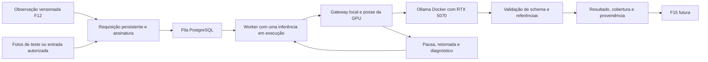

# F19 — Inferência multimodal local em Docker

## 1. Visão técnica e escopo

**Estado:** especificação documental; nenhum modelo/contêiner foi instalado por esta entrega. Fontes: [PRD](../PRD.md), [stack](../stack.md), [pesquisa de IA local](../ia-local-rtx5070.md), código F02/F12 e documentação oficial consultada em 2026-11-12 UTC. Dependências F02/F12; prioridade 1, onda 11. Complexidade complexa por GPU, lifecycle, fila, versionamento e serviço externo local.

**Included:** serviço Ollama oficial Docker, Qwen3.5 4B Q4_K_M, pin de artefatos, GPU real, requisições persistentes de texto/imagem, saída estruturada validada, cache por revisão, limites, retomada, modo equilibrado, pausa/retomada e diagnóstico operacional próprio. A integração pública será consumida por F15; F17 pode agregar suas métricas posteriormente.

F19 prova a infraestrutura com entradas de teste e foto autorizada identificadas. **Excluído:** capturar fotos de F14, decidir condição/precedência manual ou qualidade de F15, descobrir nichos, valorar anúncios, alterar composição, criar intenções ou enviar WhatsApp. O smoke test não promove anúncios reais a boas oportunidades. F14/F15/F17 não são pré-requisitos; contrato não exige suas implementações.

A base atual dispõe de Django/PostgreSQL, Procrastinate e worker separado; `compose.yaml` contém PostgreSQL e WAHA, sem Ollama. `runworker.py` consome runtime/listing/valuation/alert com concorrência padrão três. O novo processamento precisa preservar capacidade para essas filas; não colocar inferência no reconciliador, HTTP ou transação longa.

## 2. Impacto de arquitetura

Domínio representa requisição, revisão, cobertura e resultado validado, sem Django/HTTP/GPU. Casos de uso recebem repositório, consultas, relógio, gateway e coordenação por construtor; um `execute` por caso. Infraestrutura concentra Docker, HTTP, hashes/arquivos, fila, métricas e mutex da GPU. Configuração só em `config/env.py`; ligação em `main.py`. Reutilizar composição/lifecycle F02, sem Redis ou segundo banco.



### Fontes técnicas

Ollama aceita imagens base64 na API REST e schema no campo `format`; validar novamente a resposta na aplicação. As opções `stream`, `think` e `keep_alive` são documentadas na API; suporte a `think: false` precisa ser verificado para o artefato fixado. [Visão](https://docs.ollama.com/capabilities/vision), [saída estruturada](https://docs.ollama.com/capabilities/structured-outputs), [chat](https://docs.ollama.com/api/chat).

O carregamento na GPU é distinto de GPU visível no host: registrar `ollama ps`, modelos residentes e métricas do dispositivo durante inferência. A API de modelos residentes informa digest, contexto e memória; isso não comprova ausência de requisição em curso após timeout. [Inspeção de residência](https://docs.ollama.com/api/ps), [FAQ](https://docs.ollama.com/faq). O serviço segue a preparação NVIDIA documentada, sem instalar driver de display Linux no WSL. [Docker oficial](https://docs.ollama.com/docker), [CUDA no WSL](https://docs.nvidia.com/cuda/wsl-user-guide/index.html).

## 3. Decisões técnicas

| Decisão | Escolha | Alternativa | Trade-off |
|---|---|---|---|
| Serviço/modelo | Ollama oficial e `qwen3.5:4b-q4_K_M`, manifesto completo fixado | Modelo maior ou cloud | Capacidade depende da prova local; sem troca/fallback automáticos |
| Acesso | Worker chama REST local, navegador chama apenas Django | Chamar Ollama diretamente do browser | Mantém limites, validação e controles no servidor |
| Agendamento | Uma requisição executável de inferência por ambiente; demais ficam no estado persistente | Enfileirar todas as inferências concorrentes | Preserva slots do worker para coleta/alertas |
| Cobertura | Uma imagem por chamada; resultado identifica cada parte e omissão | Enviar todas as fotos sem limites | Consumo controlado; não promete inspeção completa |
| Cache | Chave de conteúdo/revisões/modelo/prompt/schema/opções | Cache apenas por ID do anúncio | Evita aplicar análise de material antigo |
| Pausa equilibrada | Bloquear novas chamadas, concluir a única chamada em curso dentro de seu timeout e descarregar | Cancelamento imediato sem confirmação | Fila preservada; liberação de GPU não é instantânea |

### 3.1. Pin e preparação reproduzível

Antes do primeiro smoke test, produzir `model-lock.json` nesta pasta com imagem oficial `ollama/ollama:<versão>@sha256:<digest>`, plataforma/arquitetura, versão reportada pelo servidor, tag selecionada, digest completo do manifesto/modelo e projetor/blobs, quantização, capacidades e data. Resolver metadados em fontes oficiais; não inventar hashes ou usar apenas o prefixo de digest. A release citada na pesquisa é candidata, não pin já resolvido.

Verificar pins antes de carregar: divergência de imagem/manifesto/capacidade bloqueia execução e exige preparo explícito. `latest` e tag de modelo mutável sem comparação de digest não são dependências válidas. Registrar identificação do tokenizer, prompt e schema junto ao lock. A [tag escolhida](https://ollama.com/library/qwen3.5:4b-q4_K_M) inclui componente visual; tamanho de download não mede VRAM de execução.

Download é preparação explícita por comando local, com verificação final. Reinício, nova análise, recuperação de erro e mudança de tag remota não autorizam atualização/novo download automáticos. Imagem/pesos incompletos nunca ficam prontos para uso. `operations.md` deverá explicar criação/verificação do lock e recuperação de volume próprio sem apagar análise ou volume de outro ambiente.

### 3.2. Perfil e limites contratuais iniciais

Parâmetros de partida técnicos, sem medições concluídas ou promessa de latência/precisão. Medir e, se necessário, revisar estes documentos antes da avaliação; não contornar teto silenciosamente.

| Limite | Valor inicial / comportamento |
|---|---|
| Modelos/inferência | `OLLAMA_MAX_LOADED_MODELS=1`, `OLLAMA_NUM_PARALLEL=1`; uma inferência em execução por GPU/ambiente |
| Contexto/saída | 4.096 tokens de contexto, até 512 tokens gerados; `num_ctx=4096`, `num_predict=512`; saída encerrada por limite não é resultado válido |
| Entrada textual | Até 16 KiB recebidos; conteúdo efetivamente enviado deve caber em 2.048 tokens incluindo instruções/schema; excedente explicitamente omitido ou requisição recusada |
| Imagens | Até 4 por requisição, 1 por chamada; PNG/JPEG verificados, até 10 MiB e 20 megapixels decodificados por arquivo; derivado de até 512×512, sem ampliar |
| Orçamento visual | Número de tokens visuais e margem restante validados no perfil fixado; sem garantia comprovada de cabimento, retornar `context_unverified` em vez de truncar silenciosamente |
| HTTP | Conexão até 3 s, prontidão/diagnóstico até 3 s, prazo total por chamada incluindo carga fria 180 s; limite da resposta 64 KiB |
| Requisição | No máximo 4 partes de imagem e uma parte textual; chamadas sequenciais, com checkpoint por parte |
| Fila | Até 100 requisições pendentes por ambiente; limite retorna `queue_full` sem perder trabalho confirmado |
| Recuperação | Até 3 tentativas por parte para falhas técnicas recuperáveis; atrasos 15 s e 30 s, com teto configurado de 300 s; após isso suspender a parte/requisição |
| Posse | 240 s por chamada, renovação antes de cada parte; publicação verifica geração e revisão, não somente tempo do lease |
| Inatividade | `keep_alive="5m"` por chamada, descarregar após 300 s sem uso; conferir residência a cada 5 s e registrar atraso real |
| Memória de trabalho em disco | Até 1 GiB de entradas derivadas/resultados desta etapa, sem contar volume de pesos; teto bloqueia novas entradas, sem apagar evidências confirmadas |

Limites lidos em `config/env.py` com nomes `GARIMPEI_AI_*`; configuração inválida falha com nome/formato esperado e sem segredos. Contagem textual usa tokenizer local correspondente ao modelo fixado, a materializar no preparo e testar com português/Unicode; truncamento, seleção e transformação geram cobertura explícita e hashes. Se nenhuma evidência couber, retornar entrada insuficiente; não publicar sucesso vazio. A cópia fonte de imagem permanece intacta; F19 cria somente derivados em diretório próprio.

Prompt/schema são versionados e finitos; registrar se a inferência visual recebe texto selecionado ou se a parte textual é separada. Deduplicação incorpora essa decisão e todas as opções que alteram resultado. Temperatura inicial zero é parâmetro reprodutível de partida, não garantia de determinismo semântico.

### 3.3. Localidade, lifecycle e GPU

Adicionar serviço Compose `ollama`, volume persistente próprio, labels de ambiente/checkout e reserva NVIDIA. Publicação de porta em `127.0.0.1`, alocada e persistida com as outras portas de F02; atualizar validação que hoje exige exatamente três portas sem invalidar manifests antigos. Não montar perfil Facebook, `.env`, sessão WAHA, socket Docker ou checkout completo no contêiner do modelo. `OLLAMA_NO_CLOUD=1`; nenhum modelo remoto ou endpoint arbitrário é aceito. Inferência preparada precisa funcionar com saída externa bloqueada; ambiente real não compartilha a rede de teste.

Estender init/stop e manifesto: iniciar serviço configurado sem baixar pesos implicitamente; prontidão **base** continua representando web/banco/worker. Diagnóstico IA distingue serviço vivo, pesos disponíveis, capacidade confirmada, GPU disponível e modelo residente. IA pausada/descarregada/indisponível não transforma toda a aplicação em falha. Parada normal preserva pesos, fila e resultados. Parada com chamada ativa espera dentro da janela de shutdown e, ao expirar, encerra somente processo/contêiner próprios, deixando parte pendente e sem publicar resultado incompleto.

Coordenar GPU por mutex do host e identificação do ambiente proprietário, além do lease do banco. Apenas um ambiente Garimpei usa o serviço GPU por vez; avaliação real aguarda liberação explícita do ambiente que já a possui. Manter posse enquanto o serviço/modelo deste ambiente puder executar; não liberar lock apenas porque a conexão HTTP caiu. Outros programas podem ocupar VRAM: registrar OOM/espera de recurso, sem encerrá-los ou prometer ausência de impacto.

Após falha do processo dono/timeout, provar encerramento da chamada antiga antes de novo despacho, inclusive reiniciando **somente** contêiner próprio quando necessário. `/api/ps` indica residência e não é prova suficiente de término de chamada. Geração da posse impede que resultado atrasado seja publicado. Nenhuma espera pela GPU segura transação do banco ou ocupa todos os slots do worker.

Inspecionar uso real durante a chamada, não apenas antes/depois. CPU ou divisão GPU/CPU é `gpu_degraded`: suspender a publicação normal, descarregar quando seguro e informar motivo. Não processar lentamente em CPU sem indicação. Confirmação operacional exige inferência efetiva com GPU e coexistência medida com web/worker/navegador/WAHA.

### 3.4. Entrada, resultado e invalidação

Requisição identifica anúncio/observação/revisão, texto/hash, imagens por ID/revisão/hash, modelo/manifesto, prompt/schema/opções e geração. O servidor resolve arquivos registrados em armazenamento autorizado: não aceita URL livre, caminho fornecido pelo anúncio ou credenciais como entrada do modelo. Mudança de observação invalida aplicabilidade mesmo quando parte do conteúdo coincide; reutilização de parte idêntica pode ocorrer com nova vinculação explicitamente validada, nunca como resultado integral atual sem conferência.

Estados: `pending`, `running`, `awaiting_resource`, `paused`, `succeeded`, `insufficient_input`, `failed`, `superseded`; partes mantêm estado próprio. Diagnóstico separa `service_unavailable`, `model_missing`, `model_corrupt`, `artifact_mismatch`, `gpu_unavailable`, `gpu_degraded`, `out_of_memory`, `timeout`, `execution_unknown`, `invalid_output`, `context_unverified` e `capacity_limit`. Pausa é estado do controle, não falha da análise.

Schema inicial `local-evidence-v1`: `findings` com descrição curta e referências de evidência, `unknowns`, `limitations`; arrays/strings limitados e `additionalProperties: false`. Referência textual exige trecho e offsets que correspondam ao texto enviado; referência visual só aceita ID da imagem efetivamente examinada naquela parte. Campos de preço, lucro, decisão de condição e comandos não compõem o schema. Mensagens de tool ou chamadas sugeridas são rejeitadas, nunca executadas. Schema válido não prova veracidade da inferência: avaliação da qualidade é F15.

Metadados de cobertura/proveniência são produzidos pela aplicação, nunca confiados ao modelo: material fornecido/enviado/examinado/omitido e motivo, revisões, hashes, data, modelo/digests, prompt/schema, opções e métricas. Validar envelope, término completo, JSON, schema e referências antes do commit. Falha/recusa conserva resultado anterior marcado como anterior, sem preencher condição ou dinheiro. Falha numa parte não autoriza declarar todas as fotos examinadas.

Chave idempotente inclui identidade/revisões, hashes ordenados de conteúdo, manifesto/modelo, prompt/schema, transformação e opções. Pedido repetido retorna resultado compatível ou trabalho em andamento; mudança relevante exige chave nova. Commit confirma geração e observação vigente. Partes concluídas são reaproveitadas após reinício; resposta de revisão substituída fica histórica/superseded, sem substituir a atual.

Pausa persiste imediatamente, bloqueia novas partes, mostra eventual chamada em curso e permite concluir somente essa chamada dentro do prazo de 180 s. Depois, solicitar unload e conferir que o modelo saiu da lista de residentes antes de anunciar memória liberada. Em timeout de unload, informar falha e manter despacho bloqueado. Retomar é explícito após pausa manual; descarregamento por inatividade recarrega automaticamente diante de trabalho válido sem novo download.

## 4. Componentes e caminhos

Destinos propostos no prefixo `apps/backend/src/garimpei/`; nenhuma alteração de backend faz parte desta entrega documental.

| Arquivos | Operação/responsabilidade |
|---|---|
| `domain/inference/{request,result,policy,ports,read_models,errors}.py` | Novos: invariantes de identidade/revisão/cobertura, portas e falhas tipadas |
| `usecase/inference/{request_analysis,run_analysis,read_analysis,read_status,pause_inference,resume_inference}_usecase.py` | Novos: interface de F15 e operação sem dependência de infra |
| `infra/gateway/inference/{ollama_gateway,input_preparer,gpu_guard}.py` | Novos: HTTP local, validação de arquivos e posse/recurso do host |
| `infra/repository/inference/{postgres_repository,mapper}.py` e `infra/queries/inference/postgres_queries.py` | Novos: escrita transacional e DTOs de leitura |
| `infra/persistence/inference_models.py`, `migrations/<next>_local_inference.py` | Novos: dados de requisição/partes/resultados/controle; registrar modelos no app |
| `infra/worker/inference_handler.py`, `infra/persistence/management/commands/runworker.py` | Integração da tarefa, reconciliador curto e preservação de slots |
| `infra/http/inference/{routes,inference_handler}.py`, `templates/inference/status.html`, `infra/http/urls.py` | Controles operacionais HTML, sem API Ollama no browser |
| `infra/persistence/management/commands/local_ai.py` | Novo: preparo explícito, status e smoke test sem efeitos de negócio |
| `config/env.py`, `main.py`, `infra/runtime/{lifecycle,manifest,containers,probes}.py` | Configuração, composição e lifecycle com migração de manifest |
| `compose.yaml`, `scripts/init.sh`, `scripts/stop.sh` | Serviço/volume isolados e operação pelos pontos existentes |
| `apps/backend/pyproject.toml`, `uv.lock` | Dependências justificadas de validação de schema, imagem e tokenização, com versões travadas ao implementar |

## 5. Interfaces e comandos

### Interface para F15

`RequestAnalysisUseCase.execute` recebe identidade de observação, revisão, referências a texto/imagens e versões aprovadas de prompt/schema. Retorna `request_id`, `state`, `reused` e cobertura conhecida; cliente lê o resultado por `ReadAnalysisUseCase`. Não aceitar um prompt livre que conceda tools, preço autoritativo ou acesso a arquivos.

Exemplo de entrada de serviço, não endpoint público:

```json
{"observation_id":"550e8400-e29b-41d4-a716-446655440000","revision":7,"text_hash":"sha256:<hash verificado>","images":[{"id":"photo-1","revision":2,"hash":"sha256:<hash verificado>"}],"prompt_version":"local-evidence-v1","schema_version":"local-evidence-v1"}
```

Resposta imediata exemplificativa: `{"request_id":"<uuid>","state":"pending","reused":false}`. Resultado final acrescenta metadados da aplicação, partes, cobertura, métricas e payload validado. IDs/hashes ilustrativos não são fixtures executáveis. Serviço roda com referências sintéticas válidas sem F14/F15.

### Operação HTTP

Loopback e sem login adicional, conforme MVP. Django valida método/forma/CSRF; erros delegados ao middleware central. Segredos/modelo bruto/base64/caminhos privados não aparecem em HTML.

| Método/caminho | Entrada | Resultado |
|---|---|---|
| `GET /integracoes/ia/` | Sem corpo | HTML 200 com modo, pausa, trabalho ativo/fila, motivo, modelo/versão, residência e última verificação; 503 de leitura preserva jornada |
| `POST /integracoes/ia/pausar/` | CSRF e revisão de controle | 303 após persistir pausa, mostrando drenagem se houver chamada em curso |
| `POST /integracoes/ia/retomar/` | CSRF e revisão de controle | 303 após persistir habilitação; recurso ausente permanece explicitamente aguardando |

Ambos comandos: 400 formato, 403 CSRF, 409 revisão concorrente e 503 falha de gravação; não confirmar ação rejeitada. Repetição de intenção já vigente é idempotente. Reutilizar design em `docs/design/`, navegação de Integrações, mensagens por estado e acessibilidade; os detalhes de análise por oferta pertencem a F15. UI não depende da tela global F17.

### CLI a produzir

Ponto de entrada: `uv run --project apps/backend --frozen --no-sync python apps/backend/manage.py local_ai <ação>`, usando ambiente privado escolhido pelos scripts F02.

| Ação | Comportamento |
|---|---|
| `status` | Diagnóstico sanitizado de serviço/pins/GPU/fila/pausa; saída legível, código 0 quando verificável, diferente de zero para falha de diagnóstico |
| `prepare --download` | Preparação explícita dos artefatos fixados e conferência do lock; não reconfigura driver/daemon ou encerra outro ambiente |
| `smoke --fixture <nome>` | Seleciona entrada identificada no corpus local, agenda execução e informa resultado/relatório; nenhum efeito de condição/alerta |

Documentar timeout do smoke, local das evidências e códigos de saída em `operations.md`: sucesso 0, pré-requisito ausente 2, falha de inferência/validação 1. Caminho de arquivo arbitrário da fonte não é argumento válido; foto autorizada entra por manifesto privado de preparo. A CLI não imprime conteúdo privado ou chain-of-thought.

## 6. Dados, migração e compatibilidade

| Registro | Campos/restrições |
|---|---|
| `InferenceControl` | Ambiente único, enabled/paused, revision bigint, requested_at; atualização concorrente por revisão |
| `InferenceRequest` | UUID do domínio, observação UUID/revisão ou subject de teste isolado, assinatura SHA-256 única, modelo/digests, prompt/schema/opções, estado/motivo, created_at, generation, lease_until; índice por estado/data e observação/revisão |
| `InferencePart` | FK protegida de request, chave da parte, texto/hash ou imagem ID/revisão/hash e derivado, estado/tentativas/next_attempt_at/cobertura; unicidade request/chave/versão |
| `InferenceResult` | FK protegida de parte, geração, payload validado limitado, proveniência/cobertura, timestamps e métricas; unicidade parte/assinatura validada; sem aplicação automática em condição/preço |
| `InferenceRuntimeState` | Ambiente, snapshot do serviço/GPU/modelo/residência, horário, motivo e última medição; distingue indisponibilidade de zero uso |

Usar índices de busca/agenda, checks de enums/contadores não negativos e relações protegidas, sem armazenar base64 em logs/filas. Transações curtas fazem enqueue/claim/commit; inferência fora da transação. Restrições de capacidade verificadas atomicamente na admissão para não ultrapassar fila/disco por concorrência. O limite de disco considera entradas/resultados reservados antes de aceitar escrita; incluir margem e falhar com motivo se faltarem recursos reais.

Migração aditiva sem alterar observações, escolhas manuais, composições ou recibos. Não cria análises retroativas de todo o histórico nesta etapa; F15 definirá adoção. Volumes/modelos não são apagados por parada normal; limpeza descartável só do ambiente proprietário. Foto original e resultado anterior não são removidos para tentar outra inferência. F17 poderá definir retenção futura, preservando referências necessárias.

## 7. Estratégia de verificação e pré-requisitos externos

Factories em `apps/backend/tests/factories/`, corpus em `tests/fixtures/inference/`, fake HTTP loopback nomeado, relógio e falhas controlados, PostgreSQL real por `prepare_instance` e `GARIMPEI_ENV=eval`. Nenhuma fixture depende de conta WhatsApp/Facebook real.

| Testes propostos em `apps/backend/tests/` | Casos necessários |
|---|---|
| `unit/test_inference_policy.py` | `test_signature_tracks_inputs`, `test_coverage_does_not_claim_omitted_media`, `test_schema_rejects_tool_and_money`: invariantes e referências |
| `integration/test_inference.py` | `test_restart_reuses_confirmed_parts`, `test_stale_response_is_not_current`, `test_timeout_does_not_overlap_requests`, `test_queue_capacity_is_atomic`: fila, lease, concorrência e recuperação |
| `integration/test_ollama_gateway.py` | API fake: OOM, GPU ausente/degradada, modelo ausente/corrompido, timeout, recusa, JSON inválido e limite de resposta |
| `http/test_inference.py` | CSRF/revisão/métodos, pausa persistida e diagnóstico sem segredos |
| `lifecycle/test_local_inference.py` | Manifest legado, propriedade, isolamento de volumes/portas/GPU, init/stop e preservação de pesos |
| `factories/inference.py`, `fixtures/inference/cases.json` | `OllamaGatewayFake`, `GpuProbeFake` e `InferenceClock`; duas imagens sintéticas PNG com manifesto/hash e respostas válidas/inválidas |

Produzir `operations.md`, `model-lock.json` e manifesto de evidências real durante implementação. Instalação/preparo de hardware, pins completos e inferência real não são fatos concluídos nesta especificação. Se GPU/artefatos não estiverem disponíveis, casos reais permanecem pendentes mesmo com todos os fakes passando.

Prova real: RTX 5070 no contêiner, texto, imagem sintética identificada e foto autorizada em manifesto privado; registrar serviço/modelo/digests, contexto, contagem textual/visual validada, uso efetivo GPU, pico VRAM/RAM e tempos frio/quente. Bloquear saída externa após preparo e comprovar inferência local. Medir coexistência com web/worker/navegador/WAHA sem enviar mensagens; simular as falhas destrutivas exclusivamente em serviço/volume de avaliação próprios. Conferir inatividade/recarga e pausa durante chamada.

Executar na implementação `node scripts/run-gates.mjs`, `uv run --project apps/backend --frozen --no-sync pytest`, `uv run --project apps/backend --frozen --no-sync python apps/backend/manage.py check --settings=garimpei.config.test_settings` e `uv build --project apps/backend`; migrations com PostgreSQL real isolado. Navegar em Integrações via `playwright-cli` e avaliar UI com frontend-ui-design. Nenhuma dessas verificações é declarada executada nesta entrega documental.
