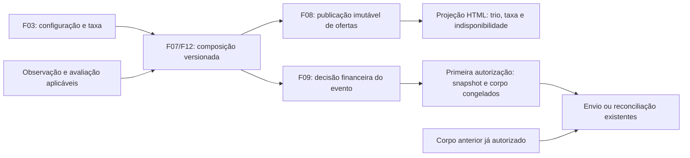

# F20 — Compra, venda estimada e lucro na apresentação

## 1. Visão técnica

**Complexidade média.** Atualizar configuração, cards, detalhes e novas mensagens com os três valores da mesma composição: **Preço de compra → Preço de venda estimado → Lucro estimado**. O lucro recebe maior destaque tipográfico; os demais valores permanecem próximos e legíveis. Remover os textos financeiros gerados de frete/transporte e preservar a taxa percentual. Fontes: [PRD, F20 e INT-23–26](../PRD.md), [stack](../stack.md), [design](../design/DESIGN.md) e [direção Mineral](../design/MASTER.md).

**Incluído:** projeção dos componentes conhecidos/indisponíveis, rastreabilidade de composição/revisão, snapshot completo de novas mensagens de primeiro alerta e redução, compatibilidade com corpos anteriores, configuração sem logística, recuperação de leitura e verificação visual. Dependências diretas: F07/F08/F09/F12; prioridade 1, onda 11. A futura F16 consome a mesma fronteira de composição/envio e não é pré-requisito.

**Fora do escopo:** alterar fórmula, política de comparáveis, classificação, elegibilidade, destino, cadência, limite mínimo de lucro ou semântica de reconciliação; novos canais, provedor de IA, endpoint financeiro público ou tela de histórico de alertas. Não implementar as demais features. Não instalar modelo nem enviar mensagem a grupo real para validar esta especificação.

F12 já calcula compra/venda/taxa sem custo logístico em `domain/valuation/profit.py`. A apresentação ainda usa “Lucro potencial antes de frete/transporte” e o card omite a venda. O snapshot em `infra/repository/alert/financial.py` conserva compra/lucro e referências, mas falta venda e percentual/valor da taxa; `AlertMessage` também não tem esses componentes. `delivery_state.py` fixa o corpo apenas na primeira autorização. Essas lacunas exigem extensão aditiva e transacional, preservando o texto já autorizado.

## 2. Impacto na arquitetura



Reutilizar composição, publicação e fluxo de alertas existentes. Domínio contém valores/invariantes e formatação de mensagem sem I/O; casos de uso orquestram; ORM, serialização, HTTP e navegador ficam na infraestrutura. Manter DI por construtor e composição em `main.py`. Handler valida entrada e chama casos de uso; erros continuam centralizados. Templates não calculam lucro/taxa nem consultam estado corrente para completar snapshots antigos. Não criar um segundo motor de cálculo ou armazenamento global de UI.

## 3. Decisões técnicas

| Decisão | Abordagem | Alternativa | Consequência |
|---|---|---|---|
| Autoridade monetária | Usar `ProfitComposition` da publicação/evento aplicável; Decimal e política F12 existentes. | Calcular novamente no template ou por diferença entre números. | Preserva arredondamento, estado e proveniência; ausências permanecem explícitas. |
| Formato compartilhado | Projeção de valores e include Django para cards/detalhes; mensagem usa o mesmo snapshot monetário. | Copiar fórmula e rótulos em cada consumidor. | Permite diferença de apresentação mantendo mesma origem dos valores. |
| Congelamento | Guardar snapshot tipado serializado e versão de formato na intenção, junto do corpo, sob a transação de autorização F09. | Ler decisão mutável ou oferta vigente ao retomar. | Acrescenta migration; impede mudança do corpo por recálculo, taxa ou reinício. |
| Compatibilidade | Corpo não vazio ou tentativa existente conserva seu formato; sem preenchimento retroativo de venda/taxa. | Reescrever todas as intenções na migração. | Histórico pode manter formato antigo; novas autorizações exigem dados completos e coerentes. |

### Apresentação e interação

Modo **Operate**: refinar o design Mineral existente, com Bricolage Grotesque nos títulos, Manrope nos valores/controles e tokens atuais. Usar um grupo semântico de termos/valores na ordem compra, venda estimada, lucro. O lucro tem tamanho/peso superiores aos demais valores; cor é reforço, acompanhada de sinal e rótulo. Indisponível permanece texto, sem valor fictício. Comprar/vender continuam fora do produto.

Em cards e detalhes, manter compra/venda próximas do lucro e apresentar todos os rótulos integralmente. Em janela estreita, empilhar o grupo, preservando ordem visual e de leitura; evitar que um valor monetário se divida entre linhas. Suportar 360, 768 e 1440 px, zoom de 200% e valores longos sem overflow da página ou corte do sinal. Reutilizar tokens em vez de introduzir paleta ou tipografia nova. Nos detalhes, taxa percentual e valor em BRL aparecem na composição; comparáveis usados e preço de novo ficam separados.

Formato de nova mensagem, com dados sintéticos:

```text
Nova oferta · Produto de teste
Facebook Marketplace
Preço de compra: R$ 1.000,00
Preço de venda estimado: R$ 1.500,00
*Lucro estimado: R$ 350,00*
Observado em 11/11/2026 às 12:00 (São Paulo)
https://exemplo.invalid/anuncio/positivo
Ref. <referência persistente da intenção>
```

Na redução, usar o cabeçalho existente “Preço reduzido”; o preço de compra do trio é o do evento de redução, e o preço anterior pode aparecer em linha separada, fora do trio. Preservar título, origem, data observada, URL e referência. O negrito aplica-se ao rótulo/valor completo do lucro, incluindo sinal. A taxa fica no snapshot e nos detalhes; a mensagem não precisa acrescentar uma quarta linha financeira. Escapar/normalizar conteúdo externo como já exigido por F09, sem executar instruções de títulos ou descrições.

### Consistência e indisponibilidade

- Usar compra, venda, taxa e lucro da mesma composição. A identidade/observação da publicação é a referência na web; evento/observação da decisão é a referência no alerta. Uma mensagem e a lista podem representar revisões diferentes sem erro, desde que não misturem componentes internamente.
- Compra conhecida é preservada se venda/lucro estiverem indisponíveis. Compra ausente mostra “Indisponível” e impede lucro; venda comprovadamente disponível na mesma composição pode continuar visível. Falta de taxa também impede lucro. Cada motivo permanece acessível nos detalhes.
- Não completar venda com referência de novo, variante diferente, avaliação atual de outra observação ou saída de IA. Não deduzir venda ausente somando lucro e compra. Composição incompatível mostra “Composição indisponível para esta revisão”; renderizar somente dados cuja associação à oferta/observação esteja comprovada. Venda/lucro inconsistentes não autorizam nova mensagem.
- Histórico de cálculo não é recalculado pela mudança de rótulos. Uma publicação antiga mantém sua composição/revisão, identificada como histórica quando necessário; uma publicação nova usa a política vigente. Estruturas legadas de logística podem permanecer persistidas para decodificar histórico, sem campos/explicações gerados na experiência financeira atual. Descrição original do vendedor não é apagada por conter essas palavras.
- Uma atualização HTMX falha conserva a composição já exibida, aba, filtros, página e revisão/data, com mensagem “Não foi possível atualizar os valores. Tente novamente”. A ação de recuperação usa o mesmo recorte. Primeira leitura sem dados prévios mostra erro recuperável, sem criar números ou sucesso. Versão expirada conserva a semântica 410 de F08 e oferece leitura da versão atual com filtros.

## 4. Componentes

Todos os caminhos de aplicação abaixo são relativos a `apps/backend/src/garimpei/`; nomes de arquivos novos são propostas a confirmar no início da implementação, preservando a responsabilidade indicada.

| Camada / arquivo | Situação | Responsabilidade |
|---|---|---|
| `domain/valuation/profit.py` | Reusar | Cálculo autoritativo Decimal; não mudar a política para alterar rótulos. |
| `domain/alert/financial_snapshot.py` | Novo | Snapshot imutável e tipado de valores e referências; validação de completude/coerência do formato novo. |
| `domain/alert/alert.py`, `eligibility.py` | Alterar | Associar dados do formato novo à mensagem e compor o texto; manter regras de elegibilidade existentes. |
| `infra/repository/alert/financial.py`, `delivery_state.py`, `postgres_repository.py` | Alterar | Serializar snapshot completo, materializar na primeira autorização e reutilizar corpo/snapshot em retomada. |
| `infra/persistence/alert_models.py` e nova migration sequencial `*_alert_message_snapshot.py` | Alterar / novo | Acrescentar snapshot e identificador de formato à intenção, sem regravar corpos ou remover dados. |
| `infra/http/listing/exploration_presentation.py` | Alterar | Projetar componentes e motivos da publicação, sem cálculo duplicado. |
| `infra/http/templates/listing/financial_values.html` | Novo | Grupo semântico do trio, reutilizado nos dois contextos. |
| `infra/http/templates/listing/results.html`, `offer_detail.html`; `infra/http/static/listing/exploration.css` | Alterar | Trio, hierarquia, estados e reflow preservando a composição editorial. |
| `infra/http/static/listing/exploration.js`, `infra/http/templates/listing/exploration_error.html` | Alterar se necessário | Falha de atualização/recuperação no mesmo contexto; conservar foco e leitura. |
| `infra/http/templates/monitoring/cost_fields.html`, `infra/http/monitoring/presentation.py` | Alterar | Textos sem logística e fluxo de configuração sem campos legados obrigatórios. |
| `infra/queries/listing/exploration_mapper.py`, `exploration_source.py` | Compatibilidade | Conservar observação/revisão e validar a associação na projeção; estender metadados se o snapshot atual não permitir essa verificação. |

Não introduzir novos pacotes. Evitar alterar arquivos compartilhados simultaneamente com F14/F16/F17/F18; integrar pelas interfaces atuais. Descrever mudanças de composição e persistência em `impl-report.md` durante implementação, sem editar avaliações históricas de F07/F08/F09/F12.

## 5. Contratos de superfície

### HTML e formulários existentes

Sem autenticação do Garimpei; somente loopback. POST conserva CSRF e validação central. Não criar endpoints JSON para esta feature.

| Método e rota | Entrada | Resposta observável |
|---|---|---|
| GET `/ofertas/` | `aba`, `q` até 120 caracteres, `categoria` existente, `pagina` positiva e `versao` UUID opcional; `aplicar=1` no fluxo atual. | HTML completo ou parcial HTMX com trio por card, ordenação/paginação existentes e contexto da revisão. Parâmetro de modalidade legado aceito pela compatibilidade existente não volta a ser filtro visível. |
| GET `/ofertas/<uuid>/` | Mesmos filtros/revisão para retorno. | Detalhe da publicação selecionada com trio, taxa, comparáveis, motivos e origem. |
| GET `/ofertas/atualizacoes/` | Revisão/recorte apresentados. | Aviso de atualização; não substitui valores por conta própria. |
| GET `/configuracoes/` e POST `/configuracoes/` | Formulário existente de edição; CEP/interesses/taxa, sem campo logístico obrigatório. | Edição persistente ou erros junto aos campos; conservar códigos/redirecionamentos existentes. |
| GET/POST `/configuracao/<etapa>/` e POST `/configuracao/concluir/` | Assistente atual, incluindo etapa `custos` com `resale_fee_percent`; não requer valor de logística. | Configuração concluível e reaberta com CEP, interesses e taxa intactos. |

Exemplo de leitura: `/ofertas/?aba=funcionam&q=Produto&categoria=&pagina=2&versao=<uuid-publicado>`. A resposta conserva o trio da publicação, mesmo havendo revisão mais nova; detalhe e retorno preservam o recorte. Datas/revisões ficam acessíveis como metadados, sem configuração técnica desnecessária no grupo de valores.

| Falha | Comportamento |
|---|---|
| Filtro malformado | 400, diagnóstico de entrada existente. |
| Oferta inexistente | 404. |
| Publicação expirada | 410, recuperação para versão atual conservando filtros. |
| Dependência de leitura indisponível | 503, erro recuperável; HTMX mantém DOM e contexto anteriores. |
| Composição ausente/incompatível dentro de uma oferta legível | HTML legível com componentes indisponíveis e motivo; nenhum número de revisão alheia. |
| Configuração inválida/CSRF | Preservar 400/403 e feedback do fluxo existente; nenhum campo logístico passa a ser exigido. |

### Mensagem autorizada e compatibilidade

Formatos persistidos: corpo anterior com formato vazio/legado; novo `financial-trio-v1`. A versão de apresentação é independente da política de cálculo F12. Não alterar `PROFIT_POLICY` só para adotar o novo texto.

Na primeira autorização de uma intenção sem corpo nem tentativa prévia, obter composição completa aplicável ao evento. Validar identidade, observação, moeda, referências/revisões e valores antes de congelar snapshot e corpo na mesma transação usada por F09 para criar tentativa e vincular destino. Não consultar valores atuais dentro do gateway WAHA.

Uma decisão antiga sem venda/taxa e ainda sem autorização deve passar novamente pela composição do evento F07, preservando sua observação. Se não houver composição aplicável, aguardar dados com motivo existente; não inferir campos nem autorizar corpo incompleto. Essa reavaliação é restrita à intenção existente ainda não autorizada: a adoção de F20 não cria eventos ou intenções retroativas.

Corpo já autorizado, inclusive em fila, retry seguro ou reconciliação, permanece byte a byte igual. Não exigir snapshot novo para reencontrar recibo de mensagem legada. Se houver tentativa mas faltar o corpo necessário à reconciliação, preservar a trilha e expor inconsistência para revisão, sem gerar um corpo substituto ou novo POST. Envio possivelmente transmitido continua somente em reconciliação conforme F09.

## 6. Dados e migração

Adicionar campos à tabela de intenções existente, sem tabela nova ou backfill financeiro de mensagens anteriores:

| Campo em `AlertIntent` | Tipo / estado inicial | Semântica |
|---|---|---|
| `financial` | JSON, objeto vazio em linhas antigas | Snapshot completo congelado na primeira autorização do formato novo. |
| `body_format` | Texto limitado, vazio em linhas antigas | `financial-trio-v1` para o corpo novo; vazio identifica compatibilidade legada. |

Conservar chaves/índices existentes de intenção por decisão, tentativa ordinal e recibo/destino. Os campos novos não precisam de índice: leitura é pela intenção já identificada. Aplicar migration aditiva pelo lifecycle existente, após parada coordenada dos processos próprios para não misturar versões de autorização. Não reescrever `body`, `financial` histórico da decisão, tentativas, eventos ou recibos. Rollback de código deve ser avaliado antes de voltar a um emissor que desconheça o formato novo; não apagar snapshots como mecanismo de retorno.

Snapshot novo serializa Decimal como texto decimal, UUID como texto e datas UTC. Exemplo de forma persistida, com referências sintéticas:

```json
{
  "schema_version": 1,
  "listing_id": "10000000-0000-4000-8000-000000000001",
  "event_id": "20000000-0000-4000-8000-000000000001",
  "observation_id": "30000000-0000-4000-8000-000000000001",
  "evaluation_id": "40000000-0000-4000-8000-000000000001",
  "evaluation_revision": 1,
  "configuration_id": "50000000-0000-4000-8000-000000000001",
  "configuration_revision": 1,
  "purchase": "1000.00",
  "resale": "1500.00",
  "fee_percent": "10.00",
  "fee": "150.00",
  "profit": "350.00",
  "currency": "BRL",
  "policy": "potential-before-freight-v2",
  "calculated_at": "2026-11-11T15:00:00Z"
}
```

O snapshot deriva da composição completa; validação rejeita discrepância entre taxa/lucro e os componentes, sem substituir o cálculo autoritativo. Validar presença das referências e associação ao evento, números finitos e precisão aplicável. Snapshot mais corpo e tentativa são publicados atomicamente; queda antes de commit não deixa autorização parcial, queda depois do commit reutiliza o que foi autorizado. Logs registram códigos/referências, sem corpo integral, destino ou segredos.

## 7. Estratégia de testes e evidências

| Conjunto proposto | Tipo e responsabilidade |
|---|---|
| `apps/backend/tests/unit/test_financial_presentation.py` | Formatação pt-BR, sinal, zero, indisponível e validação do snapshot; sem duplicar o motor de lucro. |
| `apps/backend/tests/integration/test_financial_messages.py` | PostgreSQL e fake WAHA nomeado; congelamento, legado, concorrência/queda, recálculo e reconciliação. |
| `apps/backend/tests/http/test_financial_presentation.py` | Rotas HTML/HTMX, revisão selecionada, erros e configuração sem logística. |
| `apps/backend/tests/factories/financial_presentation_lab.py` | Cenário isolado reproduzível para HTTP, browser e mensageria sintética, reusando factories de exploração/alerta. |
| `apps/backend/tests/fixtures/valuation/financial_presentation.json` | Casos POSITIVO, ZERO, NEGATIVO, FRACAO, SEM_VENDA, SEM_COMPRA, NOVO_APENAS, INCOMPATIVEL e revisões A/B; identificadores determinísticos. |

Criar fixture/lab como entregáveis da implementação, com instrução de execução e verificação em `operations.md` da F20. Definir a entrada de laboratório, a executar em `apps/backend/`: `uv run --frozen --no-sync python -m tests.factories.financial_presentation_lab --private-dir <diretorio-temporario-privado>`. O argumento recebe diretório próprio criado com `mktemp -d` fora do repositório; o lab publica URL/IDs/revisões sintéticos e mantém os processos próprios disponíveis para a jornada. Disponibiliza controle de nova revisão, falha de leitura, reinício e estado do fake WAHA, pelo mesmo padrão dos labs existentes. Não assumir que esses arquivos/comandos já existem nesta especificação.

Cenários base: venda R$ 1.500,00, taxa 10%; compras R$ 1.000,00/1.350,00/1.400,00 → lucros R$ 350,00/0,00/−50,00. Fração: venda R$ 101,00, compra R$ 70,00, taxa 12,50% → taxa arredondada R$ 12,63 e lucro R$ 18,37. Valores são entradas de teste, não defaults. Conjunto paginado tem 42 ofertas filtradas, incluindo zero/negativo/indisponível, para provar páginas 20/20/2 e ausência de ocultação/reordenação indevida. Casos de novo, incompatibilidade e ausência mantêm componentes conhecidos sem fabricar venda/lucro.

Executar todos os [gates e itens do contrato](contract.md) na implementação. Navegar com `playwright-cli` e avaliar com `frontend-ui-design`, capturando lista/detalhes/configuração em desktop, largura estreita e zoom; usar token check atual. Verificar conteúdo do corpo pelo snapshot financeiro e fake WAHA. Prova em canal real exige autorização explícita de envio, destino e mensagem; ausência dessa autorização não impede comprovar a fronteira sintética, e não pode ser apresentada como prova de renderização/entrega real. Esta rodada produz documentos, sem executar gates de implementação ou declarar a feature pronta.
