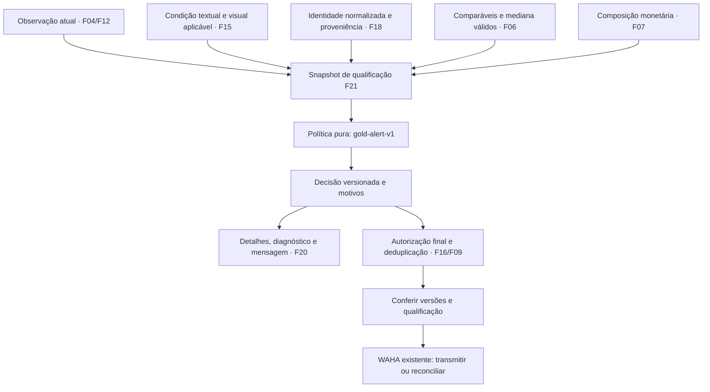

# F21 — Alertas ouro por condição e histórico comparável

## 1. Visão técnica

**Complexidade alta pela integração e pelo efeito externo.** Acrescentar qualificação obrigatória `gold-alert-v1` à avaliação e à autorização final dos alertas existentes. “Ouro” representa uma oferta com evidências suficientes de condição, identidade e revenda com lucro estimado positivo. A feature não cria outro coletor, estimador, canal ou cálculo monetário.

Fontes: [PRD](../PRD.md), [stack](../stack.md), [F15](../F15-avaliacao-conjunta-de-imagens-e-descricao/spec.md), [F16](../F16-alertas-pela-primeira-elegibilidade-e-diagnostico/spec.md), [F18](../F18-identificacao-de-produtos-e-busca-ativa-de-comparaveis/spec.md) e [F20](../F20-compra-venda-estimada-e-lucro-na-apresentacao/spec.md). F16 já foi avaliada; seus documentos e relatórios permanecem históricos. F21 é nova, prioridade 1, onda 13, dependências F06/F07/F15/F16/F18/F20 e status `pending`.

Inclui primeiro alerta e novas reduções de preço, evidências rastreáveis, adoção de filas e diagnóstico nas superfícies existentes. Mantém a janela inclusiva de 48 horas da publicação confiável somente para o primeiro alerta, o requisito de confirmação anterior nas reduções, a exceção de classificação manual isolada e a reconciliação de transmissão incerta. Zero/negativo continuam na lista; a restrição nova é para alertar.

Pré-requisitos de implementação/avaliação: F15 deve fornecer análise textual/visual aplicável e F18 deve fornecer identidade efetiva e proveniência da pesquisa histórica. Na leitura que originou este documento, F15 estava `implementing` e F18 `pending`; F14 tinha prova real pendente. Os estados atuais são os do progresso. A especificação não comprova essas entregas nem libera teste integrado sem elas. Sem margem adicional escolhida, o único corte financeiro é lucro em centavos estritamente positivo após a taxa.

## 2. Impacto arquitetural



Preservar `domain/` ← `usecase/` ← `infra/`, configuração central e DI por construtor. O domínio recebe entradas imutáveis e relógio; não consulta ORM, arquivos, inferência ou navegador. O caso de uso reúne portas e publica decisões; infraestrutura lê evidências, cuida de transações e projeta dados. A composição explícita permanece em `apps/backend/src/garimpei/main.py`, conforme clean-arch adaptada a Python.

O código consultado já possui `FirstAlertIdentity`, `FirstEligibilityDecision`, `AlertIntent`, snapshots financeiros e autorizações em `infra/repository/alert/first_authorization.py`, `message_authorization.py` e `delivery_state.py`. A assinatura automática atual elimina `media` da evidência e resume parte da análise: ela não basta, isoladamente, para afirmar que fotos, identidade e amostra da qualificação ainda são aplicáveis. Acrescentar uma assinatura própria de evidências F21 sem alterar silenciosamente a semântica da exceção manual F16.

## 3. Decisões técnicas e regras

| Decisão | Abordagem | Alternativa considerada | Consequência |
|---|---|---|---|
| Evolução | Nova F21 consumindo as fronteiras existentes | Reescrever o contrato já avaliado de F16 | Preserva evidência e status das entregas anteriores |
| Identidade | Consumir a identidade estruturada F18 e aliases validados | Agrupar por título parecido ou somente categoria | Produtos equivalentes compartilham chave; variantes permanecem distintas |
| Referência de preço | Mediana e filtros F06 sobre histórico persistido | Média aritmética nova ou preço imaginado por IA | Mantém política atual e permite reproduzir a estimativa |
| Qualificação | Conjunção de condição, identidade, amostra e lucro positivo | Texto positivo ou preço baixo isolado | Qualquer requisito ausente bloqueia nova autorização |
| Envio | Conferência final no fluxo F16/F09, para ambos os tipos | Conferir somente quando entra na fila | Alteração durante espera pode invalidar a intenção |
| Adoção | Histórico imutável e novas autorizações sob F21 | Reenviar estoque ou reescrever corpos existentes | Sem duplicação por troca de política |

### 3.1 Condição e produto normalizado

Para qualificar, a observação deve ser do anúncio correto, disponível e no interesse/escopo vigente. Título e descrição disponível devem ter sido coletados; descrição ausente na fonte é uma ausência explícita, não texto fabricado. A evidência textual precisa sustentar funcionamento conforme F15, em conjunto com análise visual aplicável concluída e suficiente. A ausência de dano visível não comprova funcionamento.

Exigir `Assessment.status=complete`, `sufficient=true`, condição automática boa, referência às fotos/hashes examinados e fingerprint compatível com a entrada atual. A condição efetiva também precisa ser boa: escolha manual ruim bloqueia; escolha manual boa não supera defeito, ausência de foto ou análise pendente/inconclusiva. Desgaste leve pode permanecer como ressalva nos termos F15. Não exigir que toda foto receba inferência se a cobertura parcial documentada já for suficiente pela política F15; omissões relevantes e material que não permite concluir mantêm bloqueio.

Usar `IdentificationResult` da F18 com `state=identified`, `product_key`, família, atributos determinantes, evidências, revisão da observação/política e correção manual quando aplicável. Acrescentar projeção legível `canonical_name`, derivada desses atributos; não usar esse rótulo como chave única. Exemplo: “PlayStation 5 Slim com leitor 1 TB” e “PS5 Slim 1TB c/ leitor”, com atributos comprovados, apontam para `sony:ps5:slim:disc:1tb`. “PS5 Slim digital”, “PS5 Pro” e “controle de PS5” não entram nesse grupo.

Não inferir capacidade, SKU ou edição pelo nome do interesse, preço, abreviação não validada ou similaridade visual. Família sem suporte, atributo determinante faltante e conflito bloqueiam com motivos distintos. Normalização é identidade do produto para comparação; identidades de anúncio continuam `(source, external_id)`. A correção de identidade F18 não converte uma escolha manual de condição em gatilho de envio.

### 3.2 Histórico, preço representativo e lucro

Reusar integralmente a seleção F06/F18: última observação aplicável por fonte/ID; alvo excluído; unidade usada e equivalente, preço integral positivo em BRL, disponibilidade e funcionamento conservador. Excluir repetição, variante incompatível, peça, acessório, lote, entrada, parcela e troca. Nunca selecionar os anúncios que maximizam o lucro desejado.

Amostra: observação com idade entre zero e 14 dias, inclusive; mediana preliminar; retenção entre 50% e 150% dessa mediana, inclusive; pelo menos cinco identidades retidas; máximo/mínimo até 1,5; mediana final em centavos. F21 consome o resultado e suas evidências; não mantém uma segunda implementação desses cálculos. Uma nova observação não conta como outro anúncio. Republicações com IDs diferentes seguem a política explícita F18, sem promessa de deduplicação por aparência.

Histórico significa registros persistidos das pesquisas, com links, fonte/ID, preços, datas, contexto comprovado e razões de inclusão/exclusão. Não é necessário inventar uma quantidade de dias de espera: uma pesquisa pode produzir histórico utilizável quando suas observações confirmadas forem suficientes. Preços pedidos não são preços de vendas concluídas; referência de novo é separada e não completa o mínimo de usados. Alterações de preço do próprio alvo podem ser mostradas, mas não são a amostra de mercado.

Exigir composição F07 da mesma observação, identidade, avaliação e configuração, sem razões de indisponibilidade. Calcular lucro e arredondamento exclusivamente pelo domínio monetário existente: venda estimada menos compra menos taxa percentual configurada. Comparar o resultado final em centavos com zero; `R$ 0,01` atende o requisito financeiro, `R$ 0,00` e negativo não. Não introduzir margem mínima percentual, garantia de ganho, custo de reparo ou frete/transporte.

### 3.3 Estado, versões e autorização

`GoldEvidence` reúne IDs/revisões da observação, identidade, análise/fingerprint, manifesto de fotos, avaliação/método/validade, configuração e composição. Sua assinatura canônica inclui políticas e revisões/conteúdo que determinam aplicabilidade; evita usar somente o nome normalizado ou o horário da tentativa como identidade de entrada. `GoldDecision` expõe `policy=gold-alert-v1`, `state`, `reasons`, evidências, `evaluated_at` e validade da amostra. `qualified` significa que os requisitos F21 foram satisfeitos naquele instante; canal e prazo ainda podem impedir envio.

| Motivo principal | Estado de qualificação | Recuperação |
|---|---|---|
| `gold_condition_pending`, `gold_photos_missing`, `gold_condition_insufficient` | `waiting` | Obter/analisar evidência aplicável |
| `gold_condition_defect`, `gold_condition_conflict` | `blocked` | Nova evidência ou revisão permitida pelo fluxo de condição |
| `gold_identity_pending`, `gold_identity_missing_attribute` | `waiting` | Investigação/correção de identidade F18 |
| `gold_identity_conflict`, `gold_item_incompatible` | `blocked` | Revisar identidade ou manter exclusão |
| `gold_history_pending`, `gold_history_insufficient`, `gold_history_dispersed`, `gold_history_expired` | `waiting` | Pesquisa/atualização F18 e estimativa F06 |
| `gold_profit_pending`, `gold_evidence_changed` | `waiting` | Composição/reavaliação consistente |
| `gold_profit_non_positive` | `blocked` | Nova entrada de preço/amostra/taxa; não excluir oferta |
| `gold_dependency_unavailable` | `waiting` | Recuperar a dependência sem liberar política anterior |
| `gold_qualified` | `qualified` | Submeter aos demais controles F16/F09 |

`blocked` não apaga histórico nem impede reavaliação por mudança relevante. Guardar todos os motivos comprovados; prioridade determinística de apresentação: condição, identidade, amostra, composição/lucro. Revisão incompatível e falha de leitura têm prioridade sobre afirmar resultado atual. Não afirmar variante divergente sem identidade/evidência de conflito.

A publicação de novos dados invalida duravelmente a qualificação correspondente. Usar os hooks e a fila persistente existentes; nenhuma nova fila externa é necessária. Repetição da mesma entrada reutiliza a decisão aplicável, mas validade temporal deve ser conferida na leitura/autorização, mesmo sem mudança de assinatura. Entradas novas que resolvem bloqueio podem completar primeira elegibilidade, respeitando janela de publicação e exceção manual F16.

Após os checks de canal potencialmente lentos, reunir novamente dados e conferir assinatura/validade na transação de autorização existente. A decisão persistida, sua referência na intenção e a autorização precisam concordar. Lock e revisão evitam autorizar contra publicação anterior já substituída; o POST ocorre fora da transação, preservando a fronteira atual de autorização F09/F16. Esta especificação não promete impedir mudança publicada depois de a transmissão ter sido autorizada.

Para redução, a qualificação usa a observação do evento e exige que ela permaneça aplicável ao estado vigente antes da autorização. Evento antigo com composição incompatível não ganha preço de outra revisão; deve permanecer bloqueado/superado com motivo. Não estender às reduções a janela de 48 horas do primeiro alerta. Ambos os tipos exigem lucro positivo e as demais evidências F21.

A ativação é uma barreira persistente de política da instalação, publicada sob a mesma ordem da autorização. Suspender despacho, drenar/reconciliar operações em voo e encerrar os consumidores antigos pelos recursos próprios antes da troca; verificar propriedade e ausência desses processos. Iniciar somente consumidores compatíveis e registrar quais autorizações ocorreram antes/depois. Após a barreira, todos os caminhos de nova autorização, inclusive workers antigos e repetição segura, precisam suportar F21; workers sem a revisão compatível não despacham. Não depender de flag lida uma única vez no startup. Dependência ausente/erro/falha da IA após ativação suspende novas autorizações, nunca retorna à política textual anterior.

Intenções ainda sem transmissão comprovada precisam passar a qualificação nova. Se já contêm corpo congelado, conservar texto e financeiro originais; só admitir transmissão se essa composição ainda for aplicável e qualificada, sem misturar evidência antiga com valores atuais. Corpos legados conservam seu formato histórico; mensagens recém-geradas usam o resumo F21. Se os dados divergem, suspender a intenção, sem reconstruir texto histórico com revisão nova. Autorização em voo, resposta incerta e recibo anterior conservam reconciliação e corpo: a adoção não os transforma em nunca enviados. F16 continua responsável pela identidade lógica do primeiro alerta e F09 pela identidade de cada redução.

## 4. Componentes e persistência

Caminhos relativos a `apps/backend/src/garimpei/`; nomes novos são proposta de organização da implementação, sem criar estes arquivos nesta geração.

| Arquivo/componente | Mudança | Responsabilidade |
|---|---|---|
| `domain/alert/gold_qualification.py`, `gold_evidence.py` | Novos | Decisão pura, DTOs tipados e contratos de leitura/persistência, sem recalcular mediana ou lucro |
| `domain/alert/diagnostic.py` | Ampliar | Qualificação/evidências atuais separadas do histórico de entrega |
| `usecase/alert/qualify_gold_alert_usecase.py` | Novo | Reunir portas, avaliar entrada consistente e publicar decisão |
| `usecase/alert/{refresh_first_eligibility,evaluate_alert,send_alert}_usecase.py` | Integrar | Impedir intenção elegível/autorizações que contornem F21 |
| `infra/repository/alert/gold_evidence_repository.py` | Novo | Adaptar F15/F18/F06/F07 para snapshot coerente e invalidar entrada obsoleta |
| `infra/repository/alert/{first_inputs,first_authorization,message_authorization,delivery_state}.py` | Ampliar | Assinatura própria, barreira de política e conferência final para primeiro alerta e redução |
| `infra/persistence/alert_models.py`, `models.py`, `migrations/` | Migração aditiva | Decisões de qualificação e vínculo opcional na intenção, sem alterar corpos/recibos |
| `infra/queries/alert/diagnostic_queries.py` | Ampliar | Motivos, evidências e validade atual, conservando histórico confirmado |
| `infra/http/listing/{alert_presentation,exploration_presentation}.py`, `infra/http/templates/listing/{alert_diagnostic,detail}.html` | Ampliar | Exposição de produto normalizado, histórico e qualificação no design existente |
| `domain/alert/eligibility.py`, `infra/repository/alert/assessment_note.py` | Ampliar | Mensagens recém-geradas com resumo rastreável e ressalvas |
| `infra/worker/alert_handler.py`, `main.py` | Integrar | Composição e agendamento existentes, sem chamadas de inferência na transação de envio |
| `config/env.py` e operação de adoção | Ampliar | Configuração central, versão compatível e publicação da barreira persistente |

### Schema proposto

`GoldQualification` é registro imutável, com atualização do ponteiro vigente separada. Reservar próximo número de migration livre; não editar migrations avaliadas. Reutilizar tipos de ID/timestamp e índices existentes.

| Campo | Tipo/obrigatoriedade | Semântica |
|---|---|---|
| `id` | UUID, PK | Identidade da decisão |
| `listing` | FK `Listing`, PROTECT | Anúncio; nunca identidade compartilhada de produto |
| `observation` | FK `ListingObservation`, PROTECT | Entrada examinada |
| `purpose_key` | Texto obrigatório | `first` ou `event:<uuid>`; evita ambiguidade de chaves nulas |
| `policy`, `input_fingerprint` | Texto obrigatório | Política e hash canônico da entrada |
| `state`, `reason` | Texto obrigatório | Estado/motivo principal da tabela §3.3 |
| `reasons` | JSON, lista validada | Todos os impedimentos comprovados |
| `evidence` | JSON, schema versionado | Identidade, atributos, proveniência, análise/fotos, comparáveis, método, validade, composição e referências |
| `evaluated_at` | Timestamp com fuso, obrigatório | Relógio de avaliação |
| `valid_until` | Timestamp com fuso, nullable | Menor validade aplicável das evidências; não substitui prazo F16 |

Unicidade em `(listing, purpose_key, policy, input_fingerprint)`; índices para `(listing, purpose_key, evaluated_at)` e `(state, valid_until)`. Acrescentar FK nullable PROTECT `gold_qualification` em `AlertIntent` para manter legado sem retropreencher evidência fictícia. A barreira de adoção deve usar registro de instalação existente ou migração aditiva de versão ativa, cuja ausência após ativação impede autorizar. Não alterar as chaves de deduplicação atuais.

Validar JSON por schema central, limites de entrada existentes e referências reais. Comparáveis do snapshot apontam para observações/avaliação persistidas, com valores e datas necessários à reprodução; nunca guardar perfil privado/cookies. Evidência ainda usada por decisão, corpo ou reconciliação não pode ser apagada silenciosamente pela retenção. Para legado sem evidência suficiente, manter qualificação desconhecida e não carimbar histórico como ouro.

## 5. Superfícies públicas

Reusar os GET HTML existentes, localhost e sem login na aplicação, preservando filtros e revisão. Nenhum novo endpoint de envio manual ou “forçar ouro” integra esta entrega.

| Método/rota | Entrada | Saída/efeitos |
|---|---|---|
| `GET /ofertas/` | `aba`, `q`, `categoria`, `pagina`, `versao` conforme F08 | HTML com qualificação resumida ou motivo pendente por oferta; mantém zero/negativo e não envia por leitura |
| `GET /ofertas/<uuid>/` | UUID e contexto de navegação vigente | HTML com diagnóstico/evidências F21 e separação entre revisão exibida e diagnóstico atual; não dispara processamento externo por consultar |

Manter validações e códigos HTTP F08; UUID inválido/inexistente não vira oferta. Falha exclusiva ao ler qualificação conserva a página com “Não foi possível consultar a qualificação do alerta”; falha da página segue tratamento recuperável existente. Não declarar ouro na ausência da projeção. DTO de diagnóstico consumido por F08 acrescenta `gold` opcional para legado: estado, motivos, política, momento, observação e evidências. API de leitura é somente leitura.

Exemplo do fragmento lógico projetado, não um novo endpoint JSON:

```json
{
  "gold": {
    "policy": "gold-alert-v1",
    "state": "qualified",
    "reason": "gold_qualified",
    "product_key": "sony:ps5:slim:disc:1tb",
    "canonical_name": "PlayStation 5 Slim com leitor 1 TB",
    "condition": {"status": "complete", "sufficient": true, "caveats": []},
    "history": {"method": "median-brl-v1", "retained": 5, "median": "3000.00", "currency": "BRL"},
    "purchase": "1900.00",
    "resale": "3000.00",
    "fee_percent": "10.00",
    "fee": "300.00",
    "profit": "800.00"
  }
}
```

As referências/momentos completos do snapshot §4 acompanham a projeção real. A mensagem recém-gerada preserva os três rótulos financeiros F20, acrescenta nome normalizado, quantidade/método e data-base do histórico, ressalvas de condição, link da fonte e referência estável para conferir evidências nos detalhes da aplicação. Identificar preço pedido e lucro estimado. Valores essenciais e resumo histórico constam da própria mensagem.

## 6. Plano de dados e adoção

Migração aditiva primeiro, consumidores capazes de ler legado sem decisão F21 depois; preparar fronteiras F15/F18 e qualificação antes da barreira. Enquanto implantação está em preparação, distinguir política vigente da futura, sem afirmar F21 ativa. Antes de trocar a política, inventariar intenções nunca transmitidas, autorizadas, incertas e confirmadas; salvar contagem e referências sanitizadas para conferir preservação.

Após instalar todos os consumidores compatíveis e drenar autorizações em voo, ativar F21 duravelmente e invalidar/reavaliar pendentes sem recriar descobertas. Estado confirmado não gera primeiro envio novo; incerto segue reconciliação; intenção sem transmissão precisa de qualificação. Falha depois da ativação conserva a barreira e suspende despacho dependente, sem rollback automático para critério menos restritivo. A avaliação em recurso isolado deve provar interrupção em cada fronteira, migração com legado e concorrência de publicação/autorização.

## 7. Estratégia de verificação e pré-requisitos reproduzíveis

Esta geração produz documentos. Fixtures, lab e evidências abaixo são entregas da implementação, não arquivos pressupostos já existentes. Usar PostgreSQL e recursos descartáveis pelo harness F02; não é necessário iniciar a aplicação para revisar esta especificação.

Criar `tests/fixtures/alert/gold_cases.json`, `tests/factories/gold_alerts.py` e `scripts/lab_gold_alerts.py` em `apps/backend`. Reusar factories de `runtime.py`, `listing.py`, `valuation.py`, `first_eligibility.py`, `assessment_corpus.py` e as portas F18; não importar testes como dependência de código de produção. O lab deve oferecer:

- `prepare --case <handle> --output <diretorio-temporario>`: cria ambiente eval próprio via factory F02, migrations, configuração, alvos, evidências de análise/identidade, amostra e canal fake; gera manifesto sem segredos com IDs, URLs, revisões, hashes, relógio UTC e recurso privado da instância. Recusar diretório/instância sem comprovação de propriedade.
- `status --manifest <caminho>`: verifica os pré-requisitos e imprime estado/IDs/revisões, política ativa, amostra/mediana/composição e contador de POSTs/recibos fake; retorna falha se o handle estiver incompleto.
- `act --manifest <caminho> --action <acao>`: executar publicação relevante, passo do worker, avanço de relógio, alteração de entrada ou injeção de falha declarados pelo caso. Não criar endpoint público de debug.
- `stop --manifest <caminho>`: encerra recursos próprios e preserva evidências. Limpeza de banco descarta somente o recurso eval criado pelo lab.

Invocar na raiz com `uv run --directory apps/backend --frozen --no-sync python scripts/lab_gold_alerts.py ...`. Protocolo/nomes das ações precisam ser entregues junto ao corpus. Exemplos de ações vinculantes: `evaluate`, `dispatch`, `complete_evidence`, `advance_clock`, `change_identity`, `change_price`, `change_fee`, `expire_sample`, `manual_condition`, `activate_policy`, `restart`. Casos de concorrência têm barreiras do lab com ações documentadas, sem sleeps usados como prova.

| Handle | Estado necessário e esperado |
|---|---|
| BASE | Alvo PS5 Slim disco 1TB, compra 1900; cinco identidades comparáveis a 2800/2900/3000/3100/3200; taxa 10%; mediana 3000, lucro 800; publicação confiável há uma hora; análise textual/visual F15 suficiente e identidade F18 comprovada; grupo fake ativo |
| ALIASES | Variações validadas do nome BASE e mesma chave de produto, incluindo repetições de anúncio; variantes digital/Pro/capacidade diferente, peça/acessório/lote e atributos ausentes/conflitantes como controles negativos |
| HISTORY | BASE com ausência/4 comparáveis/duplicatas/alvo na amostra/dispersão/vencimento; fronteiras de 14 dias inclusive e acima; referência de novo separada e preços do alvo que não completam amostra |
| PROFIT | BASE com compra 2699.99/2700/2800: lucro 0.01/0.00/-100.00; composição ausente/incompatível como variantes; taxa continua 10% |
| CONDITION | BASE com fotos ausentes, texto sem declaração suficiente, falha/pendência/inconclusão, defeito, conflito, análise antiga e desgaste leve suficiente; escolha manual boa não supera impedimento |
| QUEUED | Primeiro e redução aguardando canal; mudanças de condição/identidade/amostra/configuração antes da autorização; corpo congelado e entrada divergente ficam suspensos |
| AGE_MANUAL | BASE nas fronteiras de 48 horas, data sem confiança/futura, correção manual de condição isolada e redução após 48 horas com primeiro confirmado |
| LEGACY | Intenções sem transmissão, com corpo congelado, em voo, incertas e confirmadas anteriores à barreira; recibos e corpos conhecidos |
| RACE_FAILURE | Duas execuções, resultado antigo, queda entre publicação/autorizar, leitura falha e dependências ausentes após ativação; unidade saudável como controle |

Dados sintéticos do corpus são parâmetros de verificação, não novas metas comerciais. Cada caso declara campo/revisão, datas, texto, imagens, rótulos esperados e ações; `status` confere coerência antes dos itens. Fakes nomeados de relógio, catálogo/pesquisa, fotos/análise e WAHA tornam efeitos externos observáveis. Canal fake registra quantidade, identidade, corpo e recibo; ausência de POST deve ser observada por esse registro, não presumida por mensagem na UI.

| Arquivo de teste proposto | Verificação significativa |
|---|---|
| `tests/unit/test_gold_qualification.py` | Conjunção, motivos, lucro em centavos, aplicabilidade e bloqueio de manual sem análise; usar entradas públicas tipadas, sem repetir o estimador |
| `tests/integration/test_gold_evidence.py` | Identidade/aliases reais F18 e estimador F06 sobre observações persistidas, filtros/deduplicação, mediana reproduzível e validade |
| `tests/integration/test_gold_authorization.py` | Primeiro/redução, invalidação antes de autorizar, concorrência e canal fake com contador |
| `tests/integration/test_gold_adoption.py` | Migração/barreira, inventário legado, reinício e preservação de transmissão incerta/recibos |
| `tests/http/test_gold_diagnostic.py` | Leitura HTML, contexto/revisões e falha recuperável, sem criação de envio |

Executar `node scripts/run-gates.mjs` (seis grupos Python reais); regras/HTTP e integrações com `uv run --directory apps/backend --frozen --no-sync pytest tests/unit tests/http tests/integration tests/quality`; regressão completa com `uv run --directory apps/backend --frozen --no-sync pytest`. Para esta integração com efeito externo e migração, rodar a suíte completa em ambiente isolado antes de concluir implementação. Validar páginas por `playwright-cli`, incluindo 390 px, e avaliar alterações visuais pela skill `frontend-ui-design`.

Prova real separada: produzir `evidence/real-corpus.json` e relatório sanitizado da F21 com fotos autorizadas e referência assistida por IA identificada/congelada antes das saídas do modelo local, inferência local real F19/F15, identidade F18, pesquisas históricas reais e fontes/data/contexto verificáveis. Registrar erros, abstenções, cobertura e limitações, sem meta numérica inventada. Envio permanece em canal fake; esta especificação não autoriza mensagem ao grupo real. Se não houver oferta realmente qualificável, reportar essa ausência e a dimensão positiva real pendente, sem trocar dados por fixture ou reduzir qualidade. Pendência de qualquer dependência/gate/prova exigida impede declarar F21 `done`.


### Referência de avaliação aprovada em 2026-11-13

Por autorização explícita do usuário, a comparação da F21 usa uma referência assistida por IA com autoria, método, sinais, cobertura e hashes, congelada antes da inferência local. Registrar `reference_method=ai_assisted` e `independent_human_review=false`; nunca apresentar concordância entre IAs como precisão contra verdade humana. O rótulo de referência não substitui a análise aplicável do produto nem autoriza resultado positivo artificial. Políticas de condição/identidade/amostra/lucro e exigência de caso real qualificado permanecem inalteradas.
