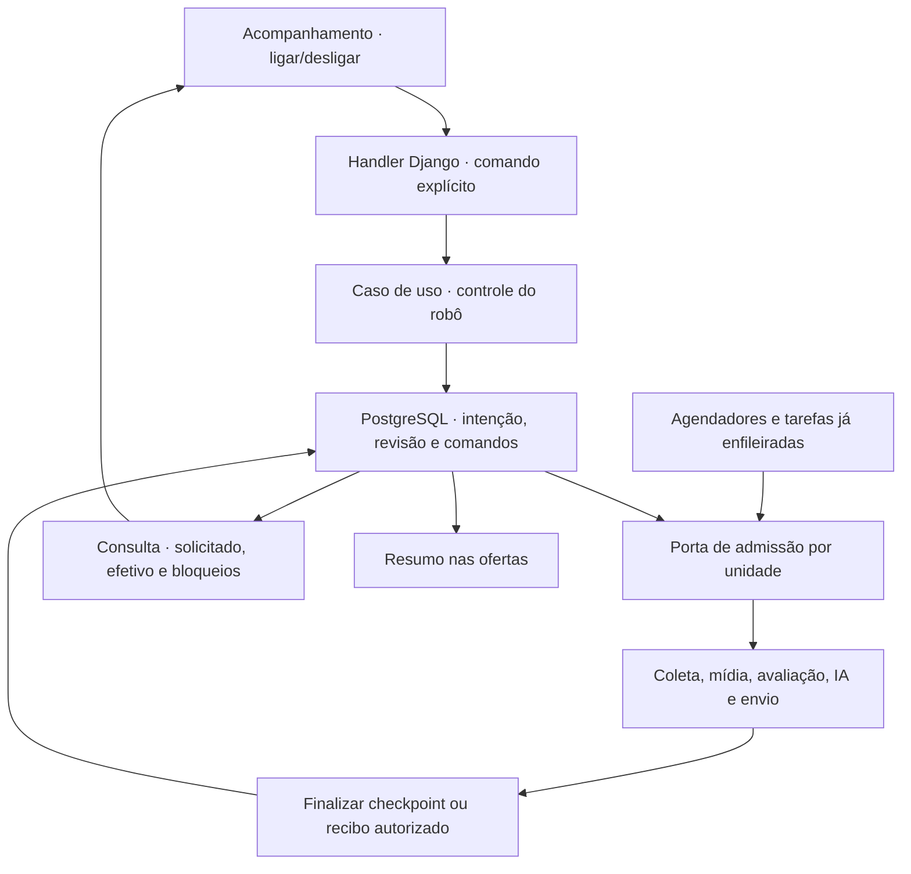

# F22 — Controle global de ligar e desligar o robô

## 1. Visão técnica

**Complexidade alta**, pela coordenação de filas, operações em curso e efeitos externos. Acrescentar um controle persistente por instalação para pausar conjuntamente coleta/pesquisa, mídia, avaliações/inferência e novas autorizações de alertas. Web, consulta de ofertas, edição de configurações e gravação de resultados/recibos já em curso permanecem disponíveis.

**Included:** ações globais explícitas, persistência, comandos idempotentes, estado solicitado versus efetivo, barreira nas fronteiras de trabalho, conclusão das unidades já autorizadas, migração compatível, retomada condicionada e verificação concorrente. **Fora do escopo:** encerrar Docker/web/worker, apagar filas, cancelar à força uma chamada externa, modificar elegibilidade/estimativa, remover bloqueios de acesso/restauração, implantar F17/F18 ou garantir liberação imediata de toda VRAM.

Dependências diretas: F02, F03, F08, F13, F14, F15, F16 e F19; onda 13. No progresso consultado, F14 está `implemented` e F15 `implementing`: a especificação pode ser produzida agora, mas a execução completa do contrato exige suas avaliações concluídas. A nova F22 começa `pending`. As demais features conservam seus estados e histórico.

Fontes: [PRD](../PRD.md), [stack](../stack.md), [F16](../F16-alertas-pela-primeira-elegibilidade-e-diagnostico/spec.md), [F19](../F19-inferencia-multimodal-local-em-docker/spec.md), código atual e clean-arch. O controle de alertas F10 e a pausa da IA F19 continuam independentes; a nova barreira acrescenta uma condição global, sem sobrescrever esses valores.

## 2. Impacto arquitetural

Regras e portas em `domain/robot/`; casos de uso pequenos em `usecase/robot/`, somente com dependências de domínio via construtor; ORM, HTTP, supervisão, fila e adapters em `infra/`; composição em `main.py` e configuração central em `config/env.py`. Não colocar I/O ou tratamento de Django no domínio. Preservar os locks, gerações e timeouts específicos existentes, acrescentando uma ordem de aquisição compatível.

O código atual agenda `listing`, `navigation`, `media`, `valuation`, `assessment`, `inference` e `alert` por reconciliadores em `runworker.py`/`main.py`. Há controle persistente da IA, mas não uma barreira global. Só deixar de criar jobs não bloqueia jobs já enfileirados; a implementação precisa verificar a decisão também imediatamente antes de cada unidade operacional.

## 3. Decisões e semântica

| Decisão | Abordagem | Alternativa | Consequência |
|---|---|---|---|
| Alcance confirmado | Pausa global de coleta, análises e novos alertas | Pausar só a coleta | Todas as fronteiras de trabalho recebem a barreira |
| Desligamento | Impedir novas autorizações e drenar unidades já autorizadas | Matar processos/contêineres | Preservar progresso e efeitos externos incertos |
| Persistência | Intenção por instalação, independente das configurações | Flag somente em memória ou por aba | Reinício não remove pausa manual |
| Comando | Ações ligar/desligar, revisão esperada e UUID idempotente | Alternar booleano sem revisão | Duas abas e retries não invertem a escolha silenciosamente |
| Preferências locais | Habilitação efetiva exige controle global e condições do estágio | Ligar global sobrescrever pausas específicas | IA/alertas desativados continuam assim |
| Adoção | Sem escolha anterior, conservar início automático após configuração | Pausar silenciosamente toda instalação existente | Compatibilidade com F03; decisão salva posteriormente prevalece |

### 3.1 Estados e disponibilidade

Persistir `requested_enabled`, `revision`, `changed_at` e uma geração de admissão. Expor separadamente a intenção confirmada e o estado efetivo:

| Estado efetivo | Significado e apresentação |
|---|---|
| `enabled` | “Robô ligado”: habilitado para trabalho; mostrar bloqueios específicos de configuração, acesso ou recursos separadamente |
| `draining` | “Desligando”: intenção desligada confirmada, com unidades já autorizadas ainda em conclusão |
| `disabled` | “Robô desligado”: intenção desligada e ausência comprovada de unidades executando |
| `unknown` | “Parada ainda não confirmada”: há operação de término indeterminado; não apresentar como desligado |
| `unavailable` | “Estado do robô indisponível”: controle não pôde ser consultado; não inferir a decisão persistida |

“Ligado” não comprova worker saudável ou progresso útil. Resposta de comando confirma a gravação da intenção, não o término instantâneo de chamadas em andamento. Worker ausente, lease vencido ou timeout não comprovam por si só que um efeito externo terminou; reconciliar pelos mecanismos do estágio. Uma mensagem apenas aguardando reconciliação pode ser exibida como pendência histórica sem afirmar que há chamada ativa quando sua conclusão local já foi comprovada.

Leitura e edição de dados continuam disponíveis desligado. Ações manuais de configuração/login/pareamento continuam explícitas e não autorizam coleta automática. Pedido manual de reprocessamento pode ser persistido, mas a execução automatizada espera o robô ligar. Heartbeats, leitura de status, recebimento de resposta já solicitada, reconciliação sem novo envio e manutenção necessária à integridade continuam. Backups F17, quando existirem, não são o garimpo pausado e não precisam ter o processo encerrado; F17 não é dependência desta etapa.

### 3.2 Fronteira de desligamento e operações em curso

O commit do comando desligar é a fronteira de ordenação. Cada operação recebe autorização persistente sob o mesmo controle: se a autorização precede a pausa, a unidade pode concluir; se a pausa precede a autorização, a operação não começa. Não manter lock do controle durante rede, navegador, cálculo longo ou inferência.

Granularidade obrigatória: uma página ou um detalhe da fonte; uma transferência de foto e seus derivados locais; uma avaliação/publicação finita; uma parte de inferência; uma autorização F16 de POST. Não emitir uma única autorização para todo ciclo/paginação/lote. Após desligar, terminar uma página não autoriza abrir a próxima; terminar uma inferência não autoriza a próxima parte ou um alerta subsequente. Trabalho que ainda só preparou dados ou reclamou um job deve passar pela barreira antes de operar.

Uma unidade já autorizada pode gravar observação/checkpoint, resultado da análise ou recibo aplicável, mesmo com a geração global antiga: desligar muda admissão, não invalida evidência confirmada. Continuam valendo as gerações específicas de entrada/recurso, a validade da revisão e a deduplicação existentes. Uma nova geração não pode republicar resultado ultrapassado.

Não apagar, consumir como concluída ou multiplicar tarefa negada pela pausa. Conservar pedido de negócio e próxima ação pausada; reconciliação posterior reconstitui tarefas deduplicadas. Desligado não consome orçamento de falhas/tentativas nem renova progresso útil. Uma unidade já iniciada mantém seu timeout vigente e não recebe novas tentativas enquanto desligado. Estado de execução indeterminado permanece visível até prova de encerramento; não prometer cancelamento remoto.

### 3.3 Alertas e preferência da IA

F16 confere a barreira global na mesma transação da autorização/tentativa, antes de permitir POST; a leitura inicial do agendador é apenas otimização. POST já autorizado pode retornar após desligar, e seu recibo precisa ser conservado. Envio possivelmente transmitido conserva reconciliação no vínculo original. `safe_retry` representa novo POST e fica bloqueado desligado, mesmo se o anterior comprovadamente não transmitiu. Nunca usar pausa ou expiração de lease para transformar incerteza em envio novo.

Na IA, a habilitação exige `requested_enabled` global e ausência de pausa específica F19, além de recurso/geração válidos. Desligar global não grava `InferenceControl.paused=true` nem o restaura depois: a preferência específica permanece intocada. Parte já autorizada pode concluir; nova parte e carregamento para nova inferência aguardam. Diagnóstico/descarregamento pelo lifecycle vigente F19 pode continuar; a interface não promete VRAM liberada imediatamente pelo botão global.

### 3.4 Ligar, reinício e falha fechada

Ligar altera somente a intenção global. Reconciliadores reexaminam pendências pelos checkpoints existentes, sem zerar marcos de monitoramento, cursores, orçamento, suspensões, posse de perfil, geração GPU ou recibos. Revalidar observação, escopo, identidade/condição, amostra e elegibilidade antes de retomar. O relógio continua avançando durante a pausa; a janela de primeiro alerta continua até 48 horas da publicação e referências vencidas não voltam a ser válidas por ligar.

Preservar alertas desativados, pausa manual da IA, desafios de acesso e barreiras de recuperação/restauração. Tarefas obsoletas são substituídas/encerradas conforme regras próprias, sem repetir efeitos ou publicar revisão antiga. F18, quando disponível, usará a mesma porta para identificação/buscas complementares; sua ausência não autoriza simular trabalho.

Sem registro global anterior, a migration cria estado habilitado para preservar o comportamento existente: configuração não concluída continua impedindo coleta; completá-la conserva o início automático anterior. Migration não inicia nem interrompe processo. Depois de uma escolha salva, editar configuração ou executar `init.sh` não a muda. Estado esperado por ambiente é independente; copiar configuração de outro checkout não deve copiar o comando de uma instalação em uso.

Falha ao verificar o controle impede novas autorizações. Falha de gravação preserva a última intenção confirmada e retorna erro; não marcar visualmente desligado por otimismo. A conclusão de unidade já autorizada deve continuar tentando registrar sua evidência pelo mecanismo de recuperação do estágio. Se o armazenamento falhar, conservar incerteza e bloquear admissão, sem fabricar confirmação.

## 4. Componentes afetados

Caminhos relativos a `apps/backend/src/garimpei/`; nomes novos são propostas de implementação.

| Caminho | Mudança | Responsabilidade |
|---|---|---|
| `domain/robot/control.py`, `ports.py`, `errors.py` | Novos | Política de admissão, controle/DTOs, revisão e erros tipados |
| `usecase/robot/set_robot_state_usecase.py`, `read_robot_status_usecase.py` | Novos | Um método `execute` por caso; DI explícita, sem ORM ou composição interna |
| `infra/repository/robot/postgres_repository.py` | Novo | Comando/CAS, autorização e conclusão durável da unidade |
| `infra/queries/robot/postgres_queries.py` | Novo | Intenção, operações em curso, incerteza e indisponibilidade |
| `infra/persistence/robot_models.py`, `models.py`, `migrations/` | Novo/modificados | Schema aditivo e adoção sem mudança de preferências; reservar próximo número livre |
| `infra/http/robot/robot_handler.py`, `routes.py`, `infra/http/urls.py` | Novos/modificado | Validar forma/método, chamar casos de uso e delegar erros ao tratamento central |
| `infra/http/templates/monitoring/tracking.html`, layouts/lista de ofertas | Modificados | Controle em Acompanhamento, resumo do estado e recuperação na jornada |
| `main.py`, `infra/persistence/management/commands/runworker.py` | Modificados | Composição e agendamento condicionados sem parar web/reconciliadores de integridade |
| `infra/worker/` e adapters de coleta/navegação/mídia/avaliação | Modificados | Conferir permissão por unidade, inclusive jobs antigos e reprocessamento manual |
| `infra/repository/inference/postgres_repository.py` | Modificado | Conferência global mais pausa específica na autorização por parte |
| `infra/repository/alert/delivery_state.py` e persistência de autorização F16 | Modificados | Barreira na autorização do POST; manter finalização/reconciliação |

A apresentação reutiliza o [design existente](../design/MASTER.md). Não inserir identificadores de locks, gerações ou dados privados no fluxo do usuário; mostrar operação em conclusão e impedimento legíveis.

## 5. Contratos públicos e erros

### HTTP servido por templates/HTMX

| Método/rota | Entrada e sucesso | Falhas |
|---|---|---|
| GET `/acompanhamento/` | Controle com intenção, revisão, estado efetivo e ação apropriada; fluxo de configuração F03 preservado | Erro recuperável de controle separado dos dados já legíveis |
| GET `/acompanhamento/robo/` | Fragmento HTML de estado, sem efeito de execução ou toggle; `Cache-Control: no-store` | 503 com fragmento de indisponibilidade, sem inferir desligamento |
| POST `/acompanhamento/robo/ligar/` | CSRF, `revision` inteiro não negativo e `command_id` UUID; 303 para Acompanhamento após commit | 400 forma inválida; 403 CSRF; 409 revisão/comando conflitante; 503 persistência indisponível |
| POST `/acompanhamento/robo/desligar/` | Mesmos campos; ação explícita evita inverter estado em retry; 303 após commit | Mesmos erros |

Método diferente do permitido retorna 405 com `Allow`. Acesso segue o produto local sem login e validação de host/CSRF existentes; não acrescentar login ou portas de rede. Handlers não contêm política de admissão nem capturam exceções genericamente. Somente o tratamento central converte os erros tipados em resposta.

Gerar `command_id` ao renderizar o formulário. Guardar idempotência por instalação/UUID: repetição do mesmo comando/payload não incrementa revisão nem inverte estado; reuso do UUID com payload diferente retorna conflito. Para comando novo, comparar revisão antes de alterar; revisão antiga retorna 409 e link para recarregar. Comando que já pede a intenção atual é no-op, sem nova geração de execução. Após replay, mostrar o estado atual confirmado, inclusive se outro comando legítimo mudou a intenção depois; não reaplicar a decisão antiga.

Exemplo de formulário: `revision=7`, `command_id=10e7e9db-d110-4011-88b5-14c09605a92f`; a ação vem da rota. Erros de campo indicam formato esperado sem expor configuração privada. A resposta 303 não afirma fim instantâneo da drenagem.

### Portas programáticas consumidas pelos estágios

`read_status(installation) -> RobotStatus`: intenção, revisão, data, estado efetivo, contagem/descrição sanitizada de unidades ativas, incerteza e bloqueios. `authorize(unit_key, stage, input_revision) -> Permit | Denied`: permissão idempotente vinculada ao pedido/unidade e geração do estágio; negativa por pausa não é falha de trabalho. `complete(permit, outcome)` registra conclusão/pendência sem criar nova autorização. Portas são tipadas no domínio e injetadas nos adapters/casos de uso apropriados.

Leitura não autoriza operação. Ausência inesperada de controle após adoção é falha, sem fallback habilitado. A criação inicial é transacional e exclusiva da adoção, distinguindo instalação ainda não migrada de leitura defeituosa.

## 6. Dados, concorrência e migração

| Modelo/campo | Tipo/regra | Finalidade |
|---|---|---|
| `RobotControl.installation` | Texto(40), PK, `local` na instalação atual | Uma decisão por banco/instalação |
| `requested_enabled`, `revision`, `epoch` | Booleano, inteiros não negativos | Intenção e ordenação das autorizações; adoção habilitada sem iniciar processos |
| `changed_at`, `last_command` | UTC e UUID opcional | Última escolha confirmada |
| `RobotControlCommand.id`, `installation` | UUID, FK protegida; unique instalação/id | Identidade de comando gerada no formulário |
| `target_enabled`, `expected_revision`, `result_revision`, `created_at` | Booleano, inteiros não negativos, UTC | Payload/resultado idempotente; não armazenar cookies/CSRF |
| `RobotOperation.id`, `installation` | UUID, FK protegida | Autorização de uma unidade já existente do domínio responsável |
| `stage`, `unit_key`, `input_revision`, `resource_generation` | Texto(40/200), revisão textual tipada e inteiro | Vínculo com trabalho e posse específica, sem identidade pessoal |
| `control_epoch`, `authorized_at`, `finished_at` | Inteiro e UTC opcional no término | Fronteira da admissão e drenagem |
| `state`, `reason`, `worker_reference` | Texto(24/64/80) | `active`, `completed`, `not_started`, `unknown`; referência local de supervisão |

Constraints: estados fechados; `completed` requer `finished_at`; operação única por instalação/etapa/chave/geração de recurso; comando UUID não pode ser reaproveitado para outra ação. Índices por instalação/estado e autorização; comandos por instalação/criação. Não apagar recibos ou autorização ainda incerta para reduzir tabela. Retenção de controles/comandos e operações referenciadas deve respeitar a necessidade de idempotência/reconciliação; esta feature não cria limpeza destrutiva automática.

Ordem de locks em transações curtas: controle global, fronteira de publicação compartilhada do estágio, recurso/identidade e tentativa. Adapters existentes que hoje adquirem primeiro a trava de publicação devem ser ajustados para manter uma ordem única; não chamar uma porta que inverte locks dentro de transação já aberta. Comando pausa adquire somente o controle; permissão e autorização de efeito são gravadas atomicamente na fronteira do estágio, sem janela de checagem em memória seguida de POST livre. Finalização não depende de habilitação global, mas exige a posse/geração correta do estágio.

Usar runtime/job/permit persistidos para reconstruir drenagem após reinício. Ausência de heartbeat, término de lease e fila vazia sozinhos não encerram operação em rede. Quando não há prova de execução ativa ou encerrada, manter `unknown` e aplicar recuperação específica sem novo efeito. Não segurar locks durante a verificação de processo ou rede. Ligar novamente durante drenagem não quebra o uso exclusivo do navegador/GPU ou a identidade de envio.

Migration aditiva em base nova e base com F01–F20, sem alterar configurações, estados individuais, perfis, tabelas de mensagens ou jobs para simular conclusão. Jobs antigos também passam pela barreira após a atualização. Inventariar autorizações/tentativas e recursos já em curso antes da F22: o diagnóstico considera esses registros mesmo sem permissão F22 anterior, conservando execução ativa ou indeterminada até sua reconciliação. Não cadastrar esse histórico como uma nova autorização de efeito nem concluí-lo por ter terminado o processo local. Coordenar adoção com workers da versão anterior: não declarar a função disponível enquanto um worker sem barreira puder executar; parar/substituir apenas os processos próprios pelo lifecycle de desenvolvimento autorizado na implementação, preservando banco e sessão. Validação ocorre em instância descartável.

## 7. Verificação e pressupostos

Reusar factories F02 e `tests/factories/{listing,valuation,alert_scenario}.py`; fornecer `tests/factories/robot.py` e `tests/fixtures/robot/control_cases.json`. Esses são entregáveis futuros, não arquivos já presentes. Usar fontes, inferência e WAHA programáveis em loopback, PostgreSQL real, relógio controlado e barreiras nos pontos de autorização, chamada e resposta. Não é necessário grupo WhatsApp real para provar controle; nenhum item autoriza contato externo.

| Verificação proposta | Evidência |
|---|---|
| `tests/unit/test_robot_control.py` | Intenção, revisão, comando idempotente, estados e negativa de admissão |
| `tests/integration/test_robot_admission.py` | Cada estágio e job antigo; pausa antes/depois da autorização; concorrência e progresso salvo |
| `tests/integration/test_robot_recovery.py` | Reinício, resultado atrasado, incerteza, retomada sem duplicação e preferência da IA/alertas preservada |
| `tests/integration/test_robot_migration.py` | Base nova/preenchida; configurações, filas, recibos e controles individuais intactos |
| `tests/http/test_robot_control.py` | CSRF, método, revisão, replay, falha de persistência e fragmento sem cache |
| Navegador com `playwright-cli` | Controle acessível, resumo nas ofertas, duas abas, erro e consulta durante pausa |

Executar os seis gates por `node scripts/run-gates.mjs`, testes, checks Django/migrations e build declarados no contrato. Esta entrega é documental; esses gates de aplicação serão executados na implementação. Antes de concluir a implementação, mapear todas as fronteiras reais da versão integrada, incluindo código novo de F14/F15 que estiver sendo finalizado, e provar que nenhuma inicia unidade sem a barreira.

**Pressupostos técnicos:** preservar início automático após configuração na ausência de escolha global; a fronteira da pausa é o commit e permite terminar unidade previamente autorizada; timeouts e limites de cada estágio permanecem os aprovados por suas features. Nenhum tempo comercial de desligamento foi prometido. A interface pode usar o polling existente, com leitura independente da oferta versionada, sem tratar sua latência como autorização para iniciar trabalho.

**Pendências de execução:** F14/F15 precisam de avaliação completa e as factories/integrações precisam ser materializadas; coordenação com futuras mudanças F17/F18 não é autorização para implementá-las. Não há decisão de produto em aberto sobre o alcance: o usuário escolheu pausa conjunta de coleta, análises e novos alertas.
