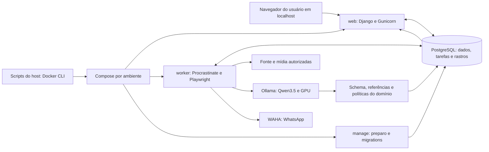

# F23 — Docker completo e IA integrada ao fluxo

## 1. Visão técnica e escopo

**Estado:** especificada em 2026-11-13; implementação não iniciada. Complexidade: complexa. Prioridade 1, onda 14. Dependências: F02, F13, F14, F15, F17, F18, F19, F20, F21 e F22. Fontes: [PRD](../PRD.md), [stack](../stack.md), código atual e [contrato](contract.md). A escolha de uma nova F23 foi confirmada pelo usuário nesta sessão. F21 permanece `implemented`, com prova real positiva pendente; esta especificação não encerra essa pendência.

**Included:** execução de web, worker e navegador dedicado em Docker, junto de PostgreSQL, WAHA e Ollama; preparação, migrations e ferramentas em contêineres; IA local efetivamente consumida na identificação, condição, revisão de comparáveis, apoio à investigação e explicação de diagnósticos; rastreabilidade, validação, cobertura por frente e prova integrada. Mantém um monólito modular Django, com a mesma imagem de aplicação para processos web/worker separados e sem Redis.

O código atual já integra F15 a F19 por `LocalAssessmentInference`; `compose.yaml` contém somente PostgreSQL/WAHA/Ollama e o transporte de inferência utiliza `docker exec` a partir do host. A identificação de F18 e as políticas financeiras têm regras próprias. F23 reaproveita essas fronteiras e acrescenta consumidores de IA explícitos; contêiner iniciado ou resposta gerada sem consumidor não demonstra integração.

IA apoia coerência por evidências, sem garantia de verdade universal. Uma conclusão precisa de referência verificável à observação; ausência, conflito e incerteza são resultados válidos. Matemática, validade temporal, equivalência, autorização, privacidade e deduplicação permanecem verificações determinísticas. Inclui avaliação humana independente e comparação com a base atual. Não inclui negociação, compra automática, inferência em nuvem, treinamento, novo modelo, novas fontes ou alterações automáticas de código, documentos e configuração pelo modelo.

## 2. Impacto arquitetural

Web e worker usam DNS interno `postgres`, `waha` e `ollama`; `localhost` dentro de um contêiner não representa outro serviço. Banco fica em rede privada de dados; Ollama, somente em rede interna de inferência compartilhada com o worker. Worker/WAHA têm saída externa necessária à fonte/canal. Não montar socket Docker em web, worker ou Ollama. Ollama não recebe credenciais, perfil Facebook, sessão WAHA ou checkout. Downloads pertencem ao preparo explícito, com saída temporária removida antes de inferir.

O controle de contêineres fica nos wrappers do host. Transporte normal muda para HTTP interno; o adaptador atual baseado em `docker exec` deixa o caminho da aplicação. Uma chamada com término incerto bloqueia novas inferências e mantém a reserva global da GPU; o operador executa recuperação pelo wrapper, que verifica labels/ID e comprova parada da execução anterior antes de reiniciar somente o Ollama próprio. Não presumir encerramento por timeout, lease expirado ou `/api/ps` vazio. Esta versão aceita recuperação manual nesse caso, exibindo ação clara.

### Matriz de contribuição por frente

| Frente e origem | Contribuição exigida da IA | Limite e consumidor verificável |
|---|---|---|
| F01/F02/F10/F11/F17/F19: integrações e operação | Explicar snapshot sanitizado de falha/cobertura e sugerir ação permitida, sob demanda ou em nova revisão de falha | Diagnóstico oficial é determinístico; sugestão não executa comandos, login ou recuperação |
| F03/F13: interesses e investigação | Sugerir termos e atributos faltantes a partir dos interesses ativos e evidências | Orquestrador aceita somente termos derivados de aliases validados; preserva região, orçamento e interesses |
| F04/F12/F14: observações e mídia | Consumir texto/fotos versionados e declarar cobertura e omissões | Extração de IDs, preço, datas, captura e armazenamento continuam fiéis à fonte |
| F05/F15: condição | Reusar análise multimodal F15/F19 e confrontar declarações com fotos | Domínio conserva precedência manual, limites de aparência e bloqueios F21 |
| F18: identidade | Propor família/modelo/atributos com trechos/fotos e sinalizar contradição | Normalizador valida família, aliases, atributos e correção manual; não cria suporte a família |
| F06/F18: comparáveis | Revisar evidências de equivalência e de preço parcial/acessório/defeito por candidato | Política F06 decide retenção, mínimo, dispersão, idade e mediana; não existe preço inventado |
| F07/F20: finanças | Explicar os valores e conferir consistência semântica das referências | Compra/mediana/taxa/lucro são calculados em centavos pelo domínio; resumo usa valores congelados |
| F08: exploração | Exibir origem, revisão, evidências, conflitos e motivo de decisão | Lista e detalhe compartilham o mesmo snapshot aplicável |
| F09/F16/F21: alertas | Fornecer revisões aplicáveis de condição/identidade/comparáveis para a qualificação | Autorização e corpo são determinísticos; modelo não envia mensagens nem altera destino |
| F22: controle | Respeitar pausa global e específica em cada nova chamada | Consultas permanecem disponíveis; IA não liga o robô ou remove pausas |

A matriz cobre responsabilidades do projeto, não exige chamadas de IA em cada CRUD ou leitura. Frentes sem chamada própria apontam o resultado efetivamente consumido e sua política. Alterar esta matriz exige atualizar Coverage Manifest e ensaio integrado, sem reescrever evidências anteriores.

## 3. Decisões técnicas

| Decisão | Escolha | Alternativa considerada | Custo assumido |
|---|---|---|---|
| Runtime | Compose completo, imagem Python 3.13 derivada de base fixada e dependências de `uv.lock`; Gunicorn e worker separados | Manter Python/Playwright no host | Mais trabalho de volumes, login e migração; host precisa somente Docker/Compose e shell para operar |
| Modelo | Preservar `qwen3.5:4b-q4_K_M`, lock de F19 e GPU NVIDIA | Trocar por modelo maior ou remoto | Novas tarefas precisam provar qualidade no mesmo hardware |
| Inferência | Uma fila/runtime F19 com perfis finitos por finalidade | Um agente autônomo com tools | Mais schemas e validação; nenhuma autoridade para executar ações |
| Coerência | Evidência citada + validação de domínio + revisão humana de corpus | Usar confiança declarada ou segundo LLM como verdade | Resultados inconclusivos bloqueiam novas qualificações que dependem deles |
| Recuperação GPU | Controle Docker pelo host e recuperação explícita de execução incerta | Socket Docker na aplicação | Operador pode precisar recuperar; reserva não é liberada por suposição |
| Adoção | Nova versão de política para novas decisões; histórico congelado | Reescrever decisões/recibos antigos | Coexistência de histórico e política vigente deve estar visível |

### 3.1. Docker, dados e lifecycle

Serviços: `postgres`, `waha`, `ollama`, `web`, `worker`; `manage` para operações pontuais e `quality` no profile `tools`. A imagem da aplicação contém Python/uv, pacote, templates/estáticos, tokenizer verificado e Chromium/dependências compatíveis com Playwright fixado no lock; ferramentas de qualidade usam estágio próprio, incluindo Node e `playwright-cli`. Registrar imagens base, versões de ferramentas e digests resolvidos em `runtime-lock.json` na implementação; não inventar hashes nesta especificação nem atualizar pins atuais por conveniência.

Wrappers `init.sh`/`stop.sh`/`migrate-dev.sh` mantêm suas entradas e identificação de ambiente, passando a invocar contêineres pontuais; não exigem Python/uv/Node instalados no host. `init.sh` prepara diretórios/configuração privada, verifica PostgreSQL saudável, executa migrations de aplicação/fila uma vez sob lock e inicia web/worker. Gunicorn atende em `0.0.0.0` dentro do contêiner; publicação é somente `127.0.0.1`. Verificar `/health`, `/health/ready` e heartbeat de cada grupo reservado de filas. WAHA sem sessão ou IA sem GPU não ocultam leitura da aplicação; diagnóstico diferencia base pronta de automação parcialmente indisponível. Subir contêiner não comprova prontidão. [Ordem e saúde no Compose](https://docs.docker.com/compose/how-tos/startup-order/).

Volumes/diretórios próprios conservam banco, sessão WAHA, perfil Facebook, mídia, entradas/resultados/tokenizer, pesos, backups e manifesto. Compartilhar mídia entre worker/web com permissão mínima; perfil privado é exclusivo do worker ou do login pontual, nunca simultaneamente. Arquivos de coordenação GPU ficam em diretório do host comum aos ambientes, montado no worker no mesmo caminho lógico, para preservar exclusão entre projetos Compose. Segredos só por ambiente/arquivos privados excluídos da imagem e relatórios; `.dockerignore` exclui `.env*`, perfis, dumps, evidências privadas e diretórios de execução.

Login humano F11 executa Chromium no contêiner `manage`, com acesso ao volume privado e encaminhamento gráfico WSLg/X11 opt-in. Pré-requisito verificável: janela de teste abre e retorna ao fluxo F11 no host Linux/WSL2 alvo. Não usar `xhost +`, perfil pessoal, modo privilegiado ou publicação de CDP/VNC. Worker libera lock do perfil durante login e retoma depois da confirmação. Ausência de display mantém estado `login_required` e instrução de preparo, sem fallback para Python/browser de coleta no host. Usuário do contêiner é não root; preservar sandbox do Chromium e memória compartilhada adequada, documentando permissões/seccomp necessárias. [Playwright em Docker](https://playwright.dev/python/docs/docker).

Migração da instalação atual é explícita: desligar admissão, drenar unidades, inventariar IDs/revisões/filas/recibos, fazer backup F17 e verificar restauração em ambiente descartável. Reutilizar volumes existentes somente após conferir labels, prefixo `garimpei_`, versão do banco e proprietário. Copiar arquivos privados para caminhos novos com checksum e inventário; nunca abrir simultaneamente o mesmo perfil. Se a migração de schema impedir voltar à versão anterior, rollback restaura backup verificado em recursos próprios e retoma sob barreira F17, sem replay de envios incertos. Se houve atividade após o backup, conservar também o registro mais recente de intenções/tentativas/recibos e reconciliá-lo antes de liberar envios; backup antigo não comprova ausência de transmissão posterior. `stop.sh` normal conserva tudo; `--clean` continua limitado ao ambiente descartável identificado e autorizado.

### 3.2. Perfis, dados de entrada e resposta

Reusar perfil de condição F15 sem mudar seus 1.024 tokens de saída. Adicionar `identity-review-v1`, `comparable-review-v1`, `investigation-support-v1` e `operations-support-v1`, inicialmente com até 512 tokens de saída cada, dentro de contexto total 4.096. Prompts/schemas/opções e tokenizer participam da assinatura. Mantêm limites F19: uma chamada por vez, 180 s total, até quatro imagens por requisição e uma por chamada, resposta até 64 KiB, até 100 pendentes, até três tentativas técnicas com atrasos 15/30 s. Texto tem teto 16 KiB e cabe no orçamento comprovado com instruções e saída reservada; excesso gera omissão explícita ou recusa. Nenhum truncamento silencioso ou ampliação automática do contexto/modelo.

Cada solicitação leva finalidade, alvo, observação/revisão, geração, revisão da correção manual, snapshot de configuração/política, referências com IDs/hashes e whitelist de fatos. Para comparáveis, incluir identidades e revisões do alvo e candidato; revisar candidatos em unidades finitas e reutilizar somente para pares/contextos compatíveis. Para apoio financeiro, não pedir ao LLM recalcular: fornecer os valores confirmados para explicação e compor os números pela apresentação determinística. Para operação, usar somente códigos, contagens e estados sanitizados; nenhum log bruto, cookie, contato ou conteúdo de mensagem privada.

A entrada F19 atual exige `observation_id` e sua FK é obrigatória. Evoluir contrato/persistência para alvo tipado (`listing_observation`, `interest` ou `operations_snapshot`) e revisão positiva do alvo, sem criar anúncio fictício para analisar operação ou interesse. Perfis legados F19 e condição F15 continuam exigindo observação/coorte e preservam assinaturas/cache existentes; campos novos entram na assinatura somente dos perfis novos. Identidade/comparáveis exigem observação real; investigação pode apontar interesse versionado; operação exige snapshot sanitizado persistido. Validar combinações por perfil e resolver o alvo antes de admitir trabalho.

Resposta de perfil novo tem schema fechado, `additionalProperties: false`, campos obrigatórios e limites: `outcome` em `supported|conflict|insufficient`, até oito `findings`, até oito referências por finding e até oito `limitations`. Cada finding tem `field` da enum do perfil, `value` em enum/valor admitido pelo catálogo, `evidence_refs` existentes e `reason_code` de enum finita. Trechos exigem limites dentro do texto e correspondência exata; foto exige hash da versão examinada e limita-se a característica visível. Apoio à investigação retorna no máximo três candidatos de termo da whitelist. Operação retorna somente códigos de ações permitidas e IDs de fatos; o template traduz esses códigos em texto e controles existentes.

JSON estruturado não prova veracidade. Validador confere schema, referência, suporte semântico verificável, revisões, combinação de atributos e política. Referência inexistente, valor não sustentado, tool call ou preço novo são `invalid_output`; não viram ausência de conflito. Conteúdo hostil em anúncio/imagem é dado externo, sem autoridade. [Saída estruturada do Ollama](https://docs.ollama.com/capabilities/structured-outputs); [modo local](https://docs.ollama.com/faq).

### 3.3. Consumo e regras de publicação

Pipeline incremental: observação → mídia/condição e revisão de identidade → pesquisa de comparáveis/revisão de cada candidato → F06 → F07 → F21/F16 → corpo F20/WAHA. Etapas independentes progridem sem aguardar uma análise indisponível. Apoio à investigação prioriza lacunas sob os limites F13/F18; não altera termos, região ou orçamento fora das escolhas válidas. Diagnóstico assistido é disparado por ação explícita ou nova revisão de falha, uma vez por assinatura, sem análise a cada polling da tela.

Normalizador F18 aceita somente atributos sustentados de família já suportada. Sugestão da IA não cria alias persistente nem substitui correção manual; conflito sustentado conserva as duas origens e exige revisão. Comparáveis são verificados individualmente contra o mesmo alvo normalizado. Resultado `insufficient`, falha ou pendência de revisão obrigatória não é aprovação. A IA não adiciona preço, dispensa amostra ou inclui anúncio para atingir lucro. F06 mantém cinco identidades retidas, até 14 dias, corte 50–150% da mediana preliminar e razão máximo/mínimo até 1,5; novo continua separado com validade de sete dias.

Na nova política F23, **novas autorizações** exigem condição F15 aplicável e revisões de identidade e de cada comparável retido com resultado sustentado, além dos critérios F21. Falha de apoio narrativo/investigação/diagnóstico não bloqueia uma qualificação já suficiente. Valores F20 e texto de mensagem continuam derivados de snapshot determinístico; saída livre da IA nunca é transmitida diretamente. Revalidar todas as revisões antes da transmissão. Controle global F22 e pausa IA são conferidos antes de cada nova chamada; retomada não amplia prazos nem duplica eventos. Intenções já autorizadas mantêm corpo/referência/destino; envios incertos continuam em reconciliação.

Cache inclui finalidade, alvo, candidato quando houver, conteúdo/revisões/hashes, correção manual, modelo/digest, prompt/schema, opções e política. Publicação usa comparação de geração/revisões em transação curta. Resultado atrasado permanece histórico `superseded`. Uma falha de atualização conserva o último resultado ainda aplicável identificado por data/revisão; se não for aplicável, continua histórico, sem autorizar nova ação. Expor `pending`, `running`, `supported`, `conflict`, `insufficient`, `failed`, `paused`, `awaiting_resource` e `superseded`, com motivo e próxima ação.

## 4. Componentes previstos

Todos os caminhos Python abaixo são relativos a `apps/backend/src/garimpei/`. São destinos previstos, não arquivos já implementados. Nomes de migrations são resolvidos contra o HEAD da implementação.

| Caminho | Operação | Responsabilidade |
|---|---|---|
| `compose.yaml`, `apps/backend/Dockerfile`, `.dockerignore` | Alterar/criar na raiz indicada | Serviços, estágios runtime/tools, redes, volumes, saúde e imagem reproduzível |
| `scripts/{init,stop,migrate-dev}.sh` | Alterar | Lifecycle pelo Docker, preparo e recuperação com propriedade verificada |
| `infra/runtime/{lifecycle,inference_runtime}.py` e manifesto | Adaptar módulos atuais | Comandos pontuais, ownership, migração e recuperação explícita |
| `config/env.py`, `config/settings.py`, `main.py` | Alterar | Configuração por serviço e composição dos novos consumidores por construtor |
| `domain/inference/{request,result,profile_limits}.py` | Alterar | Perfis e limites versionados sem quebrar F15/F19 |
| `domain/assistance/{review,ports,errors}.py` | Criar | Contratos de revisão, referências e invariantes sem Django/I/O |
| `usecase/assistance/` | Criar | Solicitar, concluir, ler e explicar por finalidade; uma ação por caso de uso |
| `infra/gateway/inference/{ollama_gateway,input_preparer}.py` | Alterar | HTTP interno, orçamento, validação e contagem de tokens |
| `infra/gateway/inference/docker_transport.py` | Retirar do runtime | Controle Docker passa aos comandos de operação; não deixar código órfão |
| `infra/gateway/assistance/`, `infra/worker/assistance_handler.py` | Criar | Preparar fatos, consumir fila F19 e aplicar revisões antes da publicação |
| `infra/persistence/assistance_models.py`, `infra/persistence/migrations/` | Criar | Vínculos e revisões de consumo transacionais |
| `infra/persistence/inference_models.py`, `infra/repository/inference/` | Alterar | Alvos tipados nos perfis novos, preservando observação/coorte e assinaturas dos perfis existentes |
| `infra/repository/assistance/`, `infra/queries/assistance/` | Criar | Escrita de decisões e projeções de cobertura separadas |
| `infra/http/assistance/`, `infra/http/urls.py` | Criar/alterar | HTTP fino, validação e erro central |
| `infra/http/templates/{listing,inference,operations}/` | Alterar | Evidências e cobertura nas páginas existentes, conforme design atual |
| `tests/factories/assistance.py`, `tests/fixtures/assistance/` | Criar em `apps/backend/` | Corpus e cenários reproduzíveis, sem segredos/destinatário real |

Repositórios e queries são portas do domínio; integração Ollama, Django e Compose fica em infra. Não chamar gateway diretamente de template/handler, nem importar Django/SDK em domínio/caso de uso. Preservar grupos reservados do worker para que inferência não impeça coleta/alertas/manutenção.

## 5. Interfaces públicas

Mantém acesso somente local e CSRF habilitado, sem adicionar login ao Garimpei. Reusar páginas/fragmentos atuais. Campos de formulário têm erro contextual, nunca incluem resposta crua do modelo. Métodos incompatíveis retornam 405; IDs ausentes, 404; CSRF inválido, 403; formato inválido, 400; revisão/idempotência conflitante, 409; dependência de persistência indisponível, 503 sem confirmação falsa.

| Método e caminho | Entrada | Saída observável |
|---|---|---|
| `GET /ofertas/<uuid>/ia/` | UUID de oferta existente; filtros de retorno conforme F08 | 200 HTML com revisões, finalidades, evidências, cobertura, modelo/data, conflitos e limites |
| `POST /ofertas/<uuid>/ia/reavaliar/` | `expected_revision`: inteiro positivo da observação; `command_id`: UUID; `purpose`: `identity|comparables|condition`; CSRF | 202 HTML com ID/estado do trabalho admitido ou reutilizado; execução é assíncrona; validação pode recusar entrada incompatível com 422 |
| `GET /integracoes/ia/cobertura/` | Sem novos parâmetros obrigatórios | 200 HTML com contagens por interesse/finalidade, denominador e data do recorte; estado sem dados explícito |
| `POST /acompanhamento/ia/explicar/` | `snapshot_id`: UUID persistido; `command_id`: UUID; CSRF | 202 HTML para explicação do snapshot sanitizado; 409 se recorte mudou; resultado aparece no acompanhamento |
| `GET /health`, `GET /health/ready` | Sem corpo | Preservam contrato F02; prontidão base não exige modelo residente ou WAHA pareado |

Exemplo de comando via formulário: `expected_revision=3&command_id=58ae1665-5af9-4e89-857e-8d735a0a1016&purpose=identity`. Resposta 202 contém `request_id`, finalidade e “Aguardando análise local” em HTML; sob pausa registra “Aguardando retomada”, sem executar. Repetição do mesmo comando/corpo devolve a mesma referência; mesmo comando com conteúdo distinto retorna 409. GET nunca cria trabalho. Explicação é assíncrona e deixa o diagnóstico determinístico legível enquanto aguarda.

Comandos operacionais entregues pela implementação: `./scripts/init.sh`, `./scripts/stop.sh`, `./scripts/migrate-dev.sh` e novas opções `./scripts/init.sh --prepare-ai` e `./scripts/init.sh --recover-ai`. Preparo encapsula o comando atual `manage.py local_ai prepare --download` no contêiner manage. Preservar semântica e flags atuais; documentação operacional explicará criação do arquivo privado, backup/adoção, acesso gráfico, preparo de pesos e verificação de cada resultado. Preparo baixa artefatos somente com ação explícita; reinício normal usa pins locais e mantém dados.

## 6. Modelo de dados e evolução

Reusar requisições/partes/resultados F19, observações F04, condição F15, identidade/pesquisa F18 e snapshots F20/F21. Nova tabela lógica `assistance_review` registra o consumidor sem copiar todos os dados do anúncio. Campos JSON são validados contra schemas versionados, com IDs de referências resolvidos antes da publicação.

| Campo | Tipo / nulidade | Restrição e significado |
|---|---|---|
| `id` | UUID, obrigatório | Chave primária |
| `purpose` | varchar(32), obrigatório | Enum das quatro finalidades novas |
| `target_kind`, `target_id` | varchar(32) e UUID, obrigatórios | Oferta, interesse ou snapshot operacional, validado conforme finalidade |
| `observation_id` | FK, nulo somente para interesse/operação | Observação examinada, proteção contra remoção silenciosa |
| `candidate_observation_id` | FK, nulo fora de comparáveis | Candidato examinado contra alvo |
| `input_signature` | char(64), obrigatório | Hash do contexto completo; unicidade por finalidade/alvo/assinatura |
| `generation` | bigint positivo, obrigatório | Token de publicação, não relógio |
| `input_snapshot` | JSONB, obrigatório | Revisões e referências sanitizadas necessárias à reprodução |
| `state`, `reason_code` | varchar(32)/varchar(64), obrigatórios | Estado explícito e motivo finito |
| `result` | JSONB, nulo enquanto pendente | Resultado validado com achados/referências/limitações |
| `created_at`, `updated_at`, `completed_at` | timestamptz; último nulo até terminar | Datas UTC |

Tabela de ligação `assistance_review_request`: FK de revisão e de requisição F19, ordem de parte; unicidade do par. Inexistência de análise não recebe sucesso por migration. Índices: `(target_kind, target_id, purpose, created_at)`, `(state, updated_at)` e unicidade `(purpose, target_kind, target_id, input_signature)`. Correlação `command_id` reutiliza padrão F22 ou registro próprio com UUID único, hash do comando e referência da revisão, criado atomicamente.

Entregar `operations_snapshot` imutável: UUID primário, revisão positiva, `content_hash` char(64) único, fatos sanitizados/recorte JSONB, versão de whitelist e `created_at` UTC. O fluxo determinístico de acompanhamento persiste snapshot quando o estado relevante muda, antes de oferecer explicação; GET/polling só consulta. Análise de operação protege a FK do snapshot. Sem snapshot confirmado, a interface mostra diagnóstico determinístico e não oferece explicação de recorte inexistente. Migração de `InferenceRequest` acrescenta tipo/ID/revisão do alvo e permite observação nula apenas nos perfis novos de interesse/operação; backfill dos perfis antigos aponta sua observação real sem recalcular assinaturas.

Cobertura deriva das projeções, sem duplicar contadores mutáveis: número de alvos elegíveis para análise no recorte, solicitados, concluídos aplicáveis, sem dados, falhos, inconclusivos, conflitos e cache reutilizado, por interesse/finalidade. Categorias são explicadas e não somadas como se fossem todas mutuamente exclusivas. Medir chamadas reais, tokens/duração/VRAM e quais decisões consumiram qual resultado; não expor prompts ou dados privados em logs. Publicação e alerta referenciam as revisões consumidas e versão de política F23. Dados legados permanecem com sua política original.

## 7. Estratégia de verificação

Preparar `tests/fixtures/assistance/cases.json` e `corpus.json`, com direitos/origem, IDs, hashes, revisão, finalidade, resultado humano esperado, evidência de suporte, limitações e marcação de casos críticos. Fotos reais reutilizam o corpus autorizado F15; texto/comparáveis derivados dos interesses ativos são minimizados e revisados antes de versionar. Se faltarem direitos ou rótulos humanos, a avaliação correspondente fica pendente. Não usar a saída do próprio modelo como gabarito.

| Arquivo previsto em `apps/backend/tests/` | Casos significativos |
|---|---|
| `unit/test_assistance_policy.py` | Referência inventada, atributo ausente, contradição, correção manual, preço parcial, prompt injection, desconhecido e limites de contexto |
| `integration/test_assistance_flow.py` | Consumidores reais, cache por finalidade/revisão, partes, geração, concorrência, revisão atrasada e revalidação de alerta |
| `integration/test_assistance_http.py` | HTML/CSRF, erro, idempotência, GET sem efeito e pausa |
| `integration/test_assistance_migration.py` | Base preenchida, observação/coorte e cache legados intactos, alvos sem anúncio artificial, histórico/recibos, backup/restauração e adoção de política |
| `e2e/test_docker_assistance.py` | Serviços em contêiner, queda/retomada, fonte/WAHA controlados, GPU e cadeia até mensagem capturada |

Comparar base atual e F23 no mesmo corpus/snapshot: identificação e atributos, condição, equivalência/retidos, contradições, abstenções, falhas, cobertura e custo. Critério de adoção: nenhum caso crítico do corpus autoriza incorretamente uma oferta; nenhum preço/atributo sem suporte é publicado como confirmado; nenhum caso previamente correto passa a confirmação incorreta. Registrar contagens, regressões de cobertura e justificativas humanas, sem inventar meta percentual de precisão ou latência. Caso crítico é aquele em que erro permite alerta sem condição/identidade/amostra/lucro aplicáveis. Um revisor humano confirma os rótulos e divergências; aprovação documental não substitui isso.

Executar os seis gates por `node scripts/run-gates.mjs` no contêiner `quality`, pytest a partir de `apps/backend/`, checks/migrations Django, build wheel/imagem, verificações do harness e jornadas via `playwright-cli`. Registrar comandos completos/códigos, revisão, pins, inventário de ambiente e relatórios em `evidence/`. IA real exige chamada GPU em cada perfil novo e no perfil F15, com entrada/saída validada e consumidor identificado; fakes nomeados provam falhas e concorrência, sem serem apresentados como execução do modelo. Ollama deve inferir com saída externa bloqueada após preparo.

Prova E2E usa anúncios/fonte e WAHA controlados em contêineres, modelo real, observação recente, fotos autorizadas e pelo menos cinco comparáveis elegíveis persistidos. Capturar a mensagem no simulador, conferir números e revisões e repetir a entrada para provar deduplicação. Prova de WhatsApp real/conta Facebook depende de sessão e autorização próprias; esta especificação não autoriza envio ao usuário nem encerra a prova real positiva pendente de F21. A conclusão integrada de F23 depende do aceite de F21 e de todos os seus próprios itens, inclusive corpus e GPU reais.

### Pré-requisitos e decisões pendentes

Escopo, modelo, Docker completo e responsabilidades estão definidos. Antes de avaliar: materializar pins de imagem/ferramentas sem atualizar dependências implicitamente, comprovar encaminhamento gráfico e sandbox no host alvo, reservar GPU sem concorrência de outro ambiente, dispor de corpus rotulado autorizado e resolver a pendência positiva real de F21. Credenciais, pareamento e autorização para provas externas não são presumidos. Esses são pré-requisitos observáveis; sua ausência permanece pendência, sem marcar a F23 `done`.
