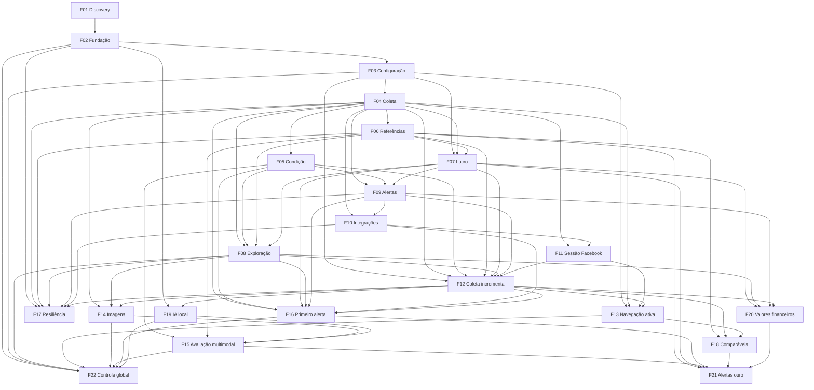

# Garimpei — PRD

Este PRD reúne requisitos e revisões de produto do Garimpei. O [progresso](prd_progress.json) e os relatórios de cada etapa registram sua situação efetiva; decisões documentais não comprovam implementação. **F21 — Alertas ouro** é a evolução especificada nesta revisão de 2026-11-12, ainda `pending`. IDs, contratos avaliados, ciclos e datas anteriores são preservados.

A base F12 consolidou uma busca por interesse, publicação incremental, cálculo por compra/venda/taxa e descoberta de publicações novas com histórico parcial. F16 acrescentou a primeira elegibilidade e F20 padronizou compra, venda estimada e lucro, conforme seus contratos e avaliações históricos. A F21 exige qualificação conjunta de condição por título/descrição/fotos, produto normalizado, histórico comparável e lucro estimado estritamente positivo para novas autorizações após sua adoção. Este adendo não altera o aplicativo nem reaprova contratos anteriores.

Adendo de controle operacional: **F22 — Controle global de ligar e desligar o robô**, requisito confirmado em 2026-11-12. A etapa começa `pending`; o estado das demais entregas permanece no progresso e em suas avaliações.

## 1. Resumo executivo

O Garimpei ajuda o próprio idealizador, iniciante na revenda de eletrônicos usados, a encontrar e avaliar oportunidades sem monitorar anúncios manualmente. Reúne interesses por categoria ou nome/modelo, acompanha preços, separa ofertas por condição e compara produtos equivalentes para estimar potencial de revenda. A jornada termina no acesso ao anúncio original; negociação, inspeção, compra e revenda acontecem fora do produto.

A base desenvolvida usa Facebook Marketplace com navegador dedicado, aplicação Python/Django com templates/HTMX, PostgreSQL, worker separado e WhatsApp via WAHA. Opera localmente no WSL2/Docker, com acesso somente por localhost, sem login no Garimpei e sem Redis. O monitoramento depende do computador e dos processos ativos. A [stack aprovada](stack.md) registra a direção técnica; versões e operação implementadas estão nos artefatos de F02.

A evolução solicitada acrescenta navegação ativa em busca de oportunidades e avaliação conjunta de fotos e descrição. O sistema deve explicar por que considera um produto promissor, quais danos vê e o que continua desconhecido. O primeiro alerta deverá ocorrer quando a oferta se tornar elegível, mesmo que já tenha sido coletada, com limite de 48 horas da publicação e controle de duplicatas. A exploração aprofunda os interesses cadastrados e pode sugerir novos nichos, sem adicioná-los ao monitoramento automaticamente. A IA escolhida é Qwen3.5 4B Q4_K_M, via Ollama em Docker local com GPU NVIDIA; a preparação está em F19 e a análise de qualidade em F15. Aparência não comprova funcionamento, e desempenho/precisão ainda exigem validação no corpus de ofertas.

## 2. Problema e oportunidade

- **Descoberta demorada:** buscas e detalhes precisam produzir resultados úteis durante o ciclo, evitando esperar a conclusão de todo o catálogo. A F12 melhorou esse fluxo; duração da navegação ainda se soma ao intervalo entre ciclos.
- **Qualidade pouco conhecida:** a classificação atual depende de declarações textuais. Fotos ausentes, defeitos não mencionados e contradições entre imagem e descrição impedem avaliar bem a oferta.
- **Estimativa restrita:** somente modelos/variantes reconhecidos com comparáveis suficientes recebem estimativa. Preço baixo, parcela, entrada e acessório não podem ser confundidos com um produto completo barato.
- **Alertas pouco compreensíveis:** aparecer na lista não significa estar elegível. O usuário precisa saber se a oferta aguarda dados, foi excluída, está na fila, foi confirmada ou teve envio incerto.

A oportunidade é transformar coleta em investigação rastreável: encontrar anúncio, abrir detalhes, obter fotos, identificar o produto, avaliar sinais de condição, reunir comparáveis e avisar quando houver dados suficientes para agir. A rapidez deve ser medida em cada etapa, com falhas e cobertura parcial explícitas.

### Base desenvolvida e evidências

Os relatórios abaixo estão `clean` no progresso consultado. Isso comprova seus contratos e condições avaliadas, sem garantir cobertura universal do Marketplace, funcionamento real do produto ou estabilidade futura da fonte.

| Feature | Entrega desenvolvida | Evidência canônica |
|---|---|---|
| F01 | Discovery de acesso, dados, referências, recursos locais e WAHA; Facebook escolhido como primeira fonte. | [Avaliação](F01-discovery-e-viabilidade-de-integracoes/eval-report-2026-11-10T19-53-58Z.md) |
| F02 | Base Django/PostgreSQL, web/worker, tarefas persistentes, lifecycle isolado e seis gates Python. | [Avaliação](F02-fundacao-tecnica-e-ambiente-local/eval-report-2026-11-10T21-15-47Z.md) |
| F03 | Configuração guiada persistente, CEP, categorias/nome-modelo e taxa provisória; frete dispensado pela F12. | [Avaliação](F03-configuracoes-e-interesses-de-monitoramento/eval-report-2026-11-10T22-12-38Z.md) |
| F04 | Identidades, observações, histórico de preços, eventos, retomada e indicação de coleta parcial. | [Avaliação](F04-coleta-e-acompanhamento-de-anuncios/eval-report-2026-11-11T14-50-42Z.md) |
| F05 | Classificação textual conservadora, três abas, correção manual persistente e conflitos. | [Avaliação](F05-classificacao-por-condicao/eval-report-2026-11-11T17-03-39Z.md) |
| F06 | Comparáveis equivalentes, mediana, amostra/validade/dispersão, referência de novo separada e estados indisponíveis. | [Avaliação](F06-referencias-de-precos-e-estimativa-de-revenda/eval-report-2026-11-11T17-41-40Z.md) |
| F07 | Composição monetária versionada; política atual da F12 calcula lucro estimado. | [Avaliação](F07-calculo-e-composicao-do-lucro-estimado/eval-report-2026-11-11T17-53-22Z.md) |
| F08 | Abas, filtros, ordenação, páginas de 20, detalhes, comparáveis e atualização da lista mediante clique. | [Avaliação](F08-exploracao-detalhes-e-acesso-ao-anuncio/eval-report-2026-11-11T19-05-22Z.md) |
| F09 | Decisões, intenções, tentativas e reconciliação persistentes de alertas WAHA, com deduplicação. | [Avaliação](F09-alertas-individuais-pelo-whatsapp/eval-report-2026-11-11T21-54-20Z.md) |
| F10 | Integrações pela interface: cookies como alternativa, pareamento WhatsApp, escolha de grupo e ativação. | [Avaliação](F10-configuracoes-de-integracoes/eval-report-2026-11-11T21-54-20Z.md) |
| F11 | Login manual em navegador dedicado e perfil privado persistente, com suspensão/retomada de acesso. | [Avaliação](F11-sessao-facebook-por-navegador/eval-report-2026-11-11T21-54-20Z.md) |
| F12 | Busca única por interesse, detalhes publicados incrementalmente, seis categorias verificadas, mais modelos e cadência corrigida. | [Avaliação](F12-coleta-e-oportunidades/eval-report-2026-11-12T00-44-24Z.md) |

### Diagnóstico observado nesta revisão

Leitura agregada do banco local em 2026-11-12, aproximadamente 00:58 UTC, com consultas somente de leitura:

- 1.563 anúncios; todos sem `image_url` na observação vigente. Há suporte à imagem nos templates, mas o dado não chegou às ofertas armazenadas. A causa exata de extração e a correção serão verificadas em F14; não atribuir a ausência a expiração de URL sem evidência.
- WhatsApp configurado e alertas ativados; nenhuma intenção ou tentativa de envio no banco consultado. Dos 45 eventos de descoberta não silenciosos, 41 foram excluídos pela condição e 4 por `produto_incompativel` na avaliação financeira. Isso não demonstra falha de entrega WAHA desses eventos, pois nenhum chegou ao envio.
- Na classificação automática vigente havia 148 anúncios com sinal de funcionamento, 21 com defeito e 1.394 incertos. Condição atual e elegibilidade histórica são recortes diferentes; esses números não indicam 148 alertas devidos.
- A recuperação inicial permanecia parcial. A F12 permite alertar publicações comprovadamente novas durante essa situação; não libera automaticamente o estoque anterior.

São observações pontuais, não benchmark nem teste de todos os anúncios relatados pelo usuário. [Análise de evolução](evolucao-produto-2026-11-12.md) reúne recomendações e decisões ainda abertas.

### Uso e testes desta segunda revisão

O [relatório de uso e robustez](validacao-produto-2026-11-12.md) registra comandos, dados agregados, screenshots e limites. Não é uma reavaliação dos contratos anteriores.

- Na leitura de 01:11 UTC, 1.546 dos 1.563 anúncios tinham produto indeterminado na avaliação e 17 tinham amostra insuficiente; não havia estimativa calculável nesse conjunto. A revisão visível tinha 100 ofertas, enquanto a coleta seguia atualizando o escopo. A interface precisa distinguir total armazenado, revalidado no escopo e apresentado; diferença de contagem não prova perda de dados.
- A primeira abertura de ofertas retornou 503 com `CONFIGURATION_READ_FAILED`; a recarga seguinte funcionou. A causa permaneceu indeterminada. A ação “Tentar novamente” apontava para a raiz, sem conservar a jornada da lista.
- Uma oferta sem identidade reconhecida exibiu “A avaliação disponível corresponde a outra variante”. O código usa o mesmo motivo também quando o produto é indeterminado: diagnóstico de identidade ausente não deve afirmar variante divergente sem evidência.
- 196 testes unitários, cinco integrações selecionadas, seis gates Python e quatro testes do harness passaram. Integrações exercitaram falhas de detalhe, rollback/retomada, queda de worker durante envio, chegada tardia de amostra e concorrência de valoração/coleta.
- Em cinco sondagens sintéticas adicionais de condição, os dois controles passaram e três casos contraditórios foram classificados indevidamente como bons: falha intermitente, restrição de energia e declaração de não teste seguida de frase positiva. São lacunas observadas, não resultados aprovados.
- No navegador real, páginas de 20 ofertas preservaram versão e não repetiram itens entre as duas páginas consultadas; filtros vazio/limpeza funcionaram. A largura de 390 px não teve overflow horizontal no recorte testado. Fotografias e diagnóstico de alerta continuavam ausentes.

Os resultados reforçam a necessidade de resiliência operacional e cobertura de identificação/comparáveis. Testes existentes aprovados não encerram a avaliação de qualidade real nem apagam as sondagens falhas.

## 3. Público-alvo

Usuário inicial: o próprio idealizador, começando na compra de eletrônicos usados/seminovos para revenda. Precisa entender estado, identidade, preço e incertezas antes de negociar. A ampliação para outros usuários não integra esta revisão.

### Recorte e operação confirmados

- Priorizar eletrônicos em bom estado, transportáveis e de avaliação viável. A interface oferece eletrônicos, câmeras, computadores, videogames/consoles, fones e TVs, validados na F12. Isso não prova suporte de identidade/preço a todos os produtos dessas categorias. A antiga rota de celulares indisponível permanece identificável, sem apagar histórico.
- Monitorar categorias e produtos por nome/modelo. Não exigir atributos adicionais para cadastrar um interesse; a estimativa poderá exigir atributos encontrados no anúncio.
- Manter as abas “Funcionam bem”, “Com defeito” e “Condição não confirmada”. Defeitos, reparo e peças continuam visíveis. Classificação manual prevalece nas coletas seguintes do mesmo anúncio, pode ser corrigida e não gera alerta por si só na política vigente.
- CEP contextualiza a busca. A política atual usa uma busca por interesse, sem duplicação envio/retirada. O adaptador solicita alcance de 500 km; não comprova aplicação do raio nem cobertura nacional. O antigo raio de retirada de 20 km e a entrega no CEP deixam de ser filtros obrigatórios após F12. Logística conhecida pode informar a decisão, sem bloquear coleta ou alerta.
- Primeiro uso guiado com CEP, interesses e taxa provisória. A taxa começa em branco e deve ser preenchida; não exigir frete. Somente concluir a configuração com sucesso libera a coleta. Reiniciar preserva configuração, histórico, decisões manuais e recibos.
- Operar no computador local, priorizando baixo custo. IA com inferência local em Docker e modelo Qwen3.5 4B Q4_K_M; não usar serviço de inferência pago ou fallback remoto automático. Recursos e latência ainda serão medidos. Fechar a aba não interrompe o worker; desligar computador/WSL2/serviços interrompe o acompanhamento.

### Avaliação e lucro

Uma oferta é qualquer anúncio apresentado, inclusive sem estimativa ou com condição incerta. Uma oportunidade precisa de evidências de condição, identidade e potencial de revenda; preço baixo isolado não basta. A lista admite lucro positivo, zero ou negativo, sem corte mínimo. Para novos alertas, a F21 acrescenta a exigência de lucro estimado estritamente positivo após a taxa configurada; ofertas zero/negativas continuam consultáveis.

A fórmula de produto é **lucro estimado = preço de venda estimado − preço de compra − taxa provisória de venda**. Taxa = preço de venda estimado × percentual configurado. A taxa já aprovada é preservada e aparece na composição detalhada; a retirada solicitada não elimina essa taxa. A composição distingue valores conhecidos, estimados e indisponíveis. O lucro é uma estimativa, não resultado de venda realizada.

### Apresentação financeira confirmada

Cards, detalhes e novas mensagens de WhatsApp devem mostrar conjuntamente, com rótulos consistentes:

1. **Preço de compra** — preço anunciado para adquirir o item.
2. **Preço de venda estimado** — estimativa de revenda baseada em comparáveis usados, distinta da referência de novo.
3. **Lucro estimado** — diferença após a taxa provisória configurada, com sinal preservado.

Retirar campos, filtros, subtítulos e menções de frete/transporte da configuração, cards, detalhes e conteúdo das novas mensagens. Não acrescentar custos logísticos ao cálculo. A composição detalhada explica a taxa e as referências, sem impor uma modalidade de compra. Textos e recibos de alertas históricos permanecem intactos.

Quando não houver amostra válida, manter preço de compra conhecido e exibir “indisponível” no preço de venda e no lucro; não inventar venda, preço zero ou ganho. Alterar apenas a apresentação não cria um novo evento nem reenvia mensagens. O rótulo de preço de venda permanece qualificado como estimado; negociar e vender continuam fora do sistema.

### Estimativa de preço

A revenda usa preços pedidos de usados equivalentes; referência de novo é independente. Para a F21, “preço médio” significa o preço representativo obtido pela mediana já adotada em F06; não há mudança para média aritmética nem afirmação de vendas realizadas. Normalizar nomes agrupa aliases comprovados da mesma identidade de produto, preservando marca/modelo/geração/edição/capacidade e demais atributos determinantes. Anúncios distintos continuam com suas próprias identidades. Atualmente a política exige no mínimo cinco comparáveis retidos, com até 14 dias da observação; usa mediana, remove valores fora de metade a 1,5 vez a mediana preliminar e rejeita dispersão máxima/mínima superior a 1,5. A referência de novo tem validade de sete dias e cobertura inicial restrita. Ausência de novo não invalida automaticamente os usados. Amostra insuficiente, identidade incerta ou referência vencida permanecem explícitas, sem fabricar lucro zero.

### Tempo, apresentação e alertas

A descoberta e recuperação usam janela de 48 horas. Completude exige prova de contexto, continuação e fronteira temporal; atingir limite sem comprovação deixa o ciclo parcial. Anúncios acompanhados conservam histórico depois da janela; falha técnica não equivale a indisponibilidade confirmada na fonte.

A F12 usa 60 segundos de espera entre ciclos com progresso, inclusive parcial; falha geral sem progresso começa com 15 segundos e tem teto técnico de 300 segundos. Prazo maior exigido pela fonte prevalece. Duração do ciclo, detalhe, avaliação e envio compõem a latência; não há garantia de alerta por minuto. A interface avisa quando há atualizações e aplica dados mediante clique, preservando leitura e filtros.

O destino é um grupo escolhido na conta WhatsApp pareada, com ativação explícita. Uma mensagem por evento, sem resumo periódico. A implementação F12 exige descoberta comprovadamente posterior ao marco persistente de monitoramento, condição boa e estimativa disponível; estoque histórico continua silencioso. Redução de preço exige alerta anterior confirmado e não se repete para o mesmo evento. Envio incerto aguarda reconciliação, sem repetir automaticamente o POST.

**Decisão nova para F16:** o primeiro alerta passa a depender da primeira elegibilidade da oferta, mesmo que coletada anteriormente ou inicialmente sem dados suficientes. Deve ocorrer até 48 horas da publicação na fonte; sem data confiável, aguardar confirmação, sem usar primeira coleta como substituto. A recuperação inicial não impõe silêncio global para essas ofertas. Recibos anteriores impedem duplicação. Confirmado no brainstorming de F16: classificar manualmente não gera alerta por essa ação nem pendência para envio posterior; reavaliações automáticas por entradas independentes continuam abrangidas pela mudança aprovada.

## 4. Objetivos

- **Reduzir** busca manual com navegação e enriquecimento automáticos dentro do perímetro autorizado; medir anúncios consultados, detalhes úteis, cobertura parcial e tempo por etapa.
- **Melhorar** avaliação de qualidade com fotos e texto, mostrando evidências, conflitos e limites; medir casos corretos, defeitos ignorados e abstenções contra avaliação humana de um conjunto documentado.
- **Explicar** oportunidades com identidade, comparáveis, composição e motivos de indisponibilidade; medir proporção com dados suficientes e causas de exclusão.
- **Agilizar** o primeiro alerta de ofertas elegíveis sem duplicá-lo; medir publicação → coleta → avaliação → fila → confirmação, distinguindo confirmação no servidor de entrega/leitura.
- **Manter** operação local com consumo local de GPU/RAM conhecido, retomada e falhas recuperáveis; medir consumo e recuperação antes de assumir escala.

Não há metas numéricas aprovadas de precisão, latência, orçamento ou cobertura. Os valores operacionais existentes não constituem metas de sucesso. A evidência inicial de valor continua sendo a primeira revenda lucrativa, registrada fora do produto com receita e custos reais; encontrar anúncio ou comprar são resultados intermediários.

### Requisitos transversais de robustez

“Robusto e implacável” significa investigar de forma persistente dentro do escopo aprovado, conservar o que foi confirmado e tornar toda interrupção ou incerteza compreensível. Não significa reduzir critérios de qualidade ou ignorar limites da fonte.

- **R01 — Progresso útil:** diferenciar serviço vivo, tarefa executando e nova evidência útil. Tentativas repetidas, rolagem e logs não provam avanço. Todo estágio informa último progresso, trabalho restante e razão da espera.
- **R02 — Recuperação:** após falha recuperável, retomar da última fronteira confirmada; falha de uma unidade não prende indefinidamente outros interesses ou estágios. Suspensão por acesso exige recuperação apropriada.
- **R03 — Integridade:** conservar configurações, observações, escolhas manuais, recibos e proveniência. Uma execução antiga ou resultado atrasado não substitui revisão mais recente.
- **R04 — Efeitos externos:** distinguir nunca enviado, possivelmente enviado e confirmado; reinício, concorrência ou nova análise não autorizam duplicar primeiro alerta.
- **R05 — Evidência suficiente:** qualidade, identidade, cobertura, publicação e estimativa não recebem certeza fabricada. Ressalva de funcionamento não é apagada por expressão positiva em outra parte do texto.
- **R06 — Falha isolada:** timeout de fonte, imagem, IA ou canal não impede consultar dados já carregados; falha de atualização conserva a apresentação anterior com indicação de desatualização. Na primeira abertura sem dados utilizáveis, apresentar erro recuperável na própria jornada.
- **R07 — Recursos finitos:** definir antes do contrato limites de duração, tentativas, retenção, armazenamento e custo por etapa. Recuo, espera da fonte e orçamento aparecem na operação; um teto atingido não é conclusão da busca.
- **R08 — Diagnóstico coerente:** contagens e motivos têm recorte, versão e horário. Separar estoque, oferta visível, oportunidade estimada, elegibilidade e confirmação de mensagem.
- **R09 — Verificação adversa:** testar casos bons, negativos, contraditórios, ausentes, limites de tempo e falhas injetadas em ambiente próprio. Falha conhecida continua registrada até regressão aprovada; não ajustar expectativa para esconder o defeito.
- **R10 — Validação de utilidade:** provar também um percurso com dados suficientes até oportunidade e recibo, em ambiente controlado, e registrar cobertura real. Uma aplicação que só acumula estados indisponíveis não comprova que o garimpo está útil.

Esses requisitos são aceites transversais das etapas de evolução. Limites técnicos serão fixados e testados nos contratos antes da implementação; metas de negócio, orçamento e nível de precisão ainda exigem definição, sem números inventados nesta revisão.

## 5. Histórias de usuário

### F01. Discovery e viabilidade de integrações

- Como usuário, quero comparar as plataformas candidatas com evidências de acesso, dados, custos e operação local para escolher a primeira integração.
- Como usuário, quero conhecer a viabilidade das referências de usados e novos e do WAHA antes de assumir uma solução técnica.

### F02. Fundação técnica e ambiente local

- Como desenvolvedor, quero preparar a aplicação e seus validadores com base nas decisões do discovery para desenvolver as funcionalidades em um ambiente reproduzível.
- Como operador, quero iniciar e parar o ambiente local pelos scripts do repositório, preservando seu isolamento.

### F03. Configurações e interesses de monitoramento

- Como usuário, quero selecionar categorias disponíveis na plataforma e também cadastrar produtos apenas por nome/modelo para definir meus interesses.
- Como usuário, quero configurar CEP e taxa percentual provisória de revenda para contextualizar a busca e o cálculo de lucro.
- Como usuário, quero concluir uma configuração guiada antes da primeira coleta e retomar o acompanhamento salvo nos próximos usos.

### F04. Coleta e acompanhamento de anúncios

- Como sistema, quero coletar anúncios dos interesses configurados, considerando retirada e envio, para alimentar a avaliação de ofertas.
- Como sistema, quero distinguir carga inicial, novos anúncios e reduções de preço, preservando o acompanhamento entre execuções para apoiar a retomada e os alertas.

### F05. Classificação por condição

- Como usuário, quero separar ofertas que funcionam bem, ofertas com defeitos/reparo/peças e ofertas com condição incerta.
- Como usuário, quero classificar uma oferta de condição incerta como “funciona bem” ou “não funciona bem” e corrigir minha escolha nos detalhes para encaminhá-la à aba correspondente.

### F06. Referências de preços e estimativa de revenda

- Como usuário, quero uma estimativa automática baseada em usados semelhantes e uma referência distinta de produto novo para avaliar a compra.
- Como usuário, quero reconhecer quando a amostra é insuficiente, sem interpretar falta de dados como preço ou lucro zero.

### F07. Cálculo e composição do lucro estimado

- Como usuário, quero ver preço de compra, preço de venda estimado e lucro estimado, com a taxa provisória explicada na composição.
- Como usuário, quero que a redução do preço de compra seja refletida no cálculo da oferta.

### F08. Exploração, detalhes e acesso ao anúncio

- Como usuário, quero explorar as três abas e comparar as ofertas do maior para o menor lucro estimado, sem corte mínimo.
- Como usuário, quero conferir os anúncios comparáveis e a composição do lucro e abrir o anúncio original para continuar a negociação fora do Garimpei.

### F09. Alertas individuais pelo WhatsApp

- Como usuário, quero receber pelo WhatsApp novas ofertas elegíveis e reduções de preço de ofertas já alertadas para agir rapidamente.
- Como usuário, quero que a retomada recupere ofertas elegíveis ainda não alertadas sem repetir envios registrados, conforme a política de primeira elegibilidade de F16.

### F10. Configurações de integrações

- Como usuário, quero adicionar/renovar cookies do Facebook no Garimpei e ser avisado quando o acesso expirar.
- Como usuário, quero conectar meu WhatsApp pelo menu e escolher um grupo para receber os alertas.

### F11. Sessão Facebook por navegador

- Como usuário, quero fazer login em uma janela dedicada e reutilizar a sessão nas coletas, com aviso e recuperação quando perder acesso.

### F12. Coleta e descoberta de oportunidades

- Como usuário, quero receber dados úteis enquanto a coleta acontece, sem duplicar buscas por logística ou aguardar todo o histórico.
- Como usuário, quero reconhecer categorias indisponíveis e consultar a composição financeira sem configurar custo logístico.

### F13. Navegação ativa em busca de oportunidades

- Como usuário, quero que o Garimpei percorra buscas, abra detalhes e procure evidências para encontrar oportunidades com autonomia dentro do escopo autorizado.
- Como usuário, quero acompanhar o que está sendo explorado e entender o que impediu a continuação.
- Como usuário, quero que descoberta de anúncios recentes e investigação de candidatos avancem de forma equilibrada entre meus interesses, sem que uma frente monopolize a navegação.
- Como usuário, quero que abreviações e nomes equivalentes validados ampliem automaticamente a pesquisa do mesmo produto, preservando modelo e restrições.
- Como usuário, quero receber sugestões de novos nichos relacionados aos meus interesses, sustentadas por anúncios reais, e decidir quais adicionar ao monitoramento.

### F14. Coleta e exibição confiável de imagens

- Como usuário, quero ver fotos reais do produto na lista e nos detalhes e distinguir falta de foto de falha de carregamento.
- Como usuário, quero consultar as cópias locais das fotos mesmo quando o endereço da fonte expirar, conservando-as enquanto o anúncio for acompanhado ou alguma análise depender delas.
- Como usuário, quero preservar a melhor imagem disponível na fonte para ampliar detalhes e apoiar análises futuras, com miniaturas para navegar pela interface.
- Como sistema, quero associar imagens verificadas ao anúncio correto para disponibilizá-las à avaliação de qualidade.

### F15. Avaliação conjunta de imagens e descrição

- Como usuário, quero uma avaliação provável do estado do produto baseada nas fotos e no texto, com os sinais que sustentam a classificação.
- Como usuário, quero ver contradições, limitações e o que preciso testar pessoalmente, preservando minha correção manual.

### F16. Alertas pela primeira elegibilidade e diagnóstico

- Como usuário, quero o primeiro alerta quando uma oferta se tornar válida, mesmo coletada antes, até 48 horas da publicação, sem duplicação.
- Como usuário, quero saber por que uma oferta não chegou ao grupo e distinguir espera, exclusão, falha e confirmação.

### F17. Resiliência operacional e progresso verificável

- Como usuário, quero saber se cada etapa está progredindo ou travada, o que falta e como recuperar a operação sem perder dados.
- Como usuário, quero continuar lendo os dados já carregados quando uma atualização falhar e repetir a operação mantendo a jornada e os filtros.
- Como usuário, quero entender as contagens do acompanhamento pelo mesmo recorte e saber quando foram atualizadas, sem confundir anúncios armazenados com oportunidades avaliadas ou alertas confirmados.
- Como usuário, quero backups automáticos locais de configuração, histórico e recibos, com opção de exportar uma cópia e saber se a recuperação foi verificada.
- Como operador, quero verificar retomada, concorrência, restauração e limites em testes isolados antes de confiar no uso contínuo.

### F18. Identificação de produtos e busca ativa de comparáveis

- Como usuário, quero que o sistema procure os atributos e comparáveis que faltam para avaliar meus interesses, em vez de apenas acumular anúncios sem estimativa.
- Como usuário, quero distinguir produto não reconhecido, atributo ausente, variante conflitante e amostra insuficiente, com a evidência e a próxima ação possível.
- Como usuário, quero conhecer a cobertura e as lacunas de cada interesse já cadastrado, sem preencher atributos adicionais para começar a monitorá-lo.
- Como usuário, quero conferir de onde vieram os comparáveis, por que foram aceitos ou rejeitados e quando a busca complementar foi interrompida ou poderá continuar.
- Como usuário, quero corrigir opcionalmente modelo e atributos de uma oferta, com origem manual registrada, e revisar contradições posteriores antes de liberar nova estimativa ou alerta.

### F19. Inferência multimodal local em Docker

- Como usuário, quero que texto e imagens sejam analisados localmente na minha RTX 5070, com o modelo em Docker e sem enviar anúncios a um provedor de IA externo.
- Como operador, quero conferir que a GPU está sendo usada, quanto recurso a análise consome e como retomar se o serviço/modelo ficar indisponível.
- Como usuário, quero distinguir análise atual, resultado anterior e material ainda não examinado, para não tratar uma análise parcial ou antiga como confirmação do anúncio vigente.
- Como usuário, quero análise automática em modo equilibrado, com liberação da memória do modelo após inatividade e pausa manual da IA para usar outros programas.

### F20. Compra, venda estimada e lucro na apresentação

- Como usuário, quero ver preço de compra, preço de venda estimado e lucro estimado juntos na lista, nos detalhes e no WhatsApp, com destaque visual para o lucro, para comparar o investimento e o retorno provável.
- Como usuário, quero uma apresentação sem campos ou menções de frete/transporte, com a taxa de venda explicada nos detalhes.
- Como usuário, quero distinguir preço conhecido de estimativa indisponível e conferir os valores usados em uma mensagem, mesmo depois de a oferta ser atualizada.

### F21. Alertas ouro por condição e histórico comparável

- Como usuário, quero receber alerta apenas de item com condição analisada em título, descrição e fotos, produto identificado e potencial de revenda com lucro positivo sustentado por histórico comparável.
- Como usuário, quero que nomes escritos de formas diferentes sejam normalizados para comparar o mesmo produto, preservando diferenças relevantes de modelo e variante.
- Como usuário, quero conferir quais anúncios históricos, preços e evidências sustentaram o alerta e por que uma oferta ainda não se qualifica.

### F22. Controle global de ligar e desligar o robô

- Como usuário, quero ligar e desligar o robô pela interface para controlar coleta, análises e novos alertas em conjunto, mantendo as ofertas já salvas acessíveis.
- Como usuário, quero que a pausa sobreviva ao reinício e que a retomada conserve histórico e trabalho válido, sem duplicar mensagens.
- Como usuário, quero distinguir robô ligado, desligando, desligado e estado não confirmado, sabendo se uma operação já iniciada ainda está concluindo.

## 6. Funcionalidades

F01–F12 descrevem a base e as substituições consolidadas da F12. F13–F20 registram as etapas de evolução, cujo estado efetivo consta do progresso e de suas avaliações. F21 acrescenta os requisitos de alertas ouro ainda pendentes de implementação. Sugestões adicionais do documento de evolução permanecem propostas.

### F01. Discovery e viabilidade de integrações

**Capacidades**: comparar fontes, acesso, autenticação, categorias, dados úteis, localização, referências de usados/novos, recursos locais e WAHA. Registrar evidências e limites. Facebook Marketplace é a primeira plataforma escolhida; OLX, Enjoei e Mercado Livre permanecem alternativas.

**Experiência**: o usuário consulta as provas e limitações e decide escopo de integração. Recomendação não constitui contratação ou cobertura garantida. Credenciais ficam fora dos documentos.

**Saída preparatória**: decisões para F02 e integrações posteriores; etapa documental, sem dados funcionais de anúncios.

### F02. Fundação técnica e ambiente local

**Capacidades**: aplicação Django, templates/HTMX, ORM/migrations PostgreSQL, web e worker Procrastinate separados, PostgreSQL/WAHA em Docker e acesso local. Scripts de início, prontidão, parada e isolamento; fila persistente; logs JSON; DI explícita e limites de camadas. Seis gates Python cobrem tipos, lint/templates, dependências, arquitetura, ciclos e não utilizados; testes complementam os gates.

**Experiência**: iniciar por `scripts/init.sh` com configuração privada; anunciar prontidão somente após os checks reais. Parar por `scripts/stop.sh` preservando dados e sessão. Limpeza fica restrita a avaliação descartável autorizada.

**Tratamento de erros**: configuração ausente, porta ocupada e dependência indisponível produzem diagnóstico seguro e falha de prontidão, sem encerrar recurso alheio.

**Saída preparatória**: infraestrutura compartilhada para as demais features. Fundação sequencial.

### F03. Configurações e interesses de monitoramento

**Fornece**: categorias, nomes/modelos e CEP para F04/F13; taxa provisória e revisão da configuração para F07. F12 consolida a configuração sem frete obrigatório.

**Capacidades**: configuração guiada, seleção de categorias e cadastro de nome/modelo sem atributos adicionais obrigatórios. Persistir CEP e taxa percentual explícita, inicialmente em branco. Não exigir valor de frete.

**Experiência**: preencher e concluir; somente gravação bem-sucedida libera a primeira coleta. Reinício reutiliza configuração. Seleções antigas indisponíveis recebem aviso e conservam histórico.

**Tratamento de erros**: campo inválido, produto sem nome/modelo ou falha de gravação não confirmam a etapa nem ativam configuração incompleta.

### F04. Coleta e acompanhamento de anúncios

**Consome**: interesses e CEP de F03.

**Fornece**: identidade, link, preço e evidências disponíveis para F05/F06/F07/F08/F13/F14/F16; observações e eventos persistentes para F09. F12 amplia sua operação.

**Capacidades**: coletar Facebook, preservar identidade por fonte/ID, acompanhar preços e distinguir carga inicial, descoberta e mudanças. Recuperar janela de publicação de 48 horas e atualizar anúncios acompanhados quando acessíveis. Retomar cursores/marcos sem inventar completude, geografia, data ou entrega. Não exigir logística confirmada na política atual.

**Experiência**: monitoramento independente da aba aberta, com estado completo/parcial/suspenso. O usuário reconhece a cobertura efetivamente consultada.

**Tratamento de erros**: fonte indisponível, bloqueio, paginação inconsistente e interrupção preservam progresso confirmado e diagnóstico. Falha de acesso não prova anúncio removido.

### F05. Classificação por condição

**Consome**: título, descrição e condição estruturada de F04.

**Fornece**: condição automática/manual, evidências, conflitos e aba para F08/F09/F15/F16.

**Capacidades**: três condições; declarações positivas explícitas permitem “funciona bem”, defeitos têm precedência automática e ausência de evidência mantém incerteza. A F12 amplia frases naturais com proteção para negação, ressalvas, acessórios e perguntas. Manter correção manual persistente e prioritária para o mesmo anúncio. Fotos ainda não são analisadas por esta implementação.

**Experiência**: classificar incertos ou corrigir escolha salva nos detalhes; mudar aba após gravação confirmada. A escolha manual não dispara alerta por si só na regra preservada nesta revisão.

**Tratamento de erros**: falha de gravação conserva escolha anterior; novos sinais conflitantes não apagam decisão manual. Classificar não certifica funcionamento real.

### F06. Referências de preços e estimativa de revenda

**Consome**: anúncio e identificação do produto de F04.

**Fornece**: estimativa usada, comparáveis, revisões, validade e referência independente de novo para F07/F08/F15; política de equivalência, atributos determinantes das famílias suportadas e motivos de insuficiência para F18.

**Capacidades**: equivalência conservadora por modelo/variante/capacidade explícitos nas famílias suportadas. Mediana de no mínimo cinco comparáveis retidos, janela de 14 dias, corte de discrepantes e dispersão definidos em §3. Excluir a própria oferta, acessórios, lotes, defeitos e preços parciais. Novo com validade de sete dias e cobertura restrita, independente do usado. Processamento persistente, versionado e recuperável.

**Experiência**: conferir os comparáveis efetivamente utilizados e motivos de indisponibilidade. Preços pedidos não são vendas realizadas. Não generalizar suporte de uma família para todo o catálogo.

### F07. Cálculo e composição do lucro estimado

**Consome**: taxa de F03, preço observado de F04 e revenda estimada de F06.

**Fornece**: composição com valores, revisões e motivos para F08/F09/F16/F20.

**Capacidades**: cálculo `preço de venda estimado − preço de compra − taxa de venda`. Taxa percentual configurada e arredondamento monetário ao centavo. Recalcular com mudanças de preço ou entradas válidas; conservar significado de composições e mensagens históricas. Nenhum corte por lucro mínimo. Venda estimada indisponível não vira lucro zero; o cálculo não depende de modalidade ou informação logística.

**Experiência**: apresentar preço de compra, preço de venda estimado e lucro estimado, com percentual e valor da taxa nos detalhes. F20 padroniza esses rótulos em todas as superfícies; estimativa não garante retorno.

### F08. Exploração, detalhes e acesso ao anúncio

**Consome**: anúncio/link de F04, condição de F05, referências de F06 e composição de F07.

**Capacidades**: três abas; filtros e ordenação antes de paginar em 20 ofertas. Lucro decrescente, incluindo zero/negativo; sem estimativa no fim. Empates por identificação mais recente e ID estável. Detalhes com evidências, comparáveis, cálculo e acesso à origem. Avisar “Há atualizações” sem reordenar automaticamente; aplicar mediante clique preservando filtros. Templates suportam imagem opcional; a aquisição/exibição real precisa de F14.

**Experiência**: composição editorial clara com verde mineral, conforme [design](design/MASTER.md). Conferir oferta e abrir origem. Nenhuma oferta é removida apenas por condição ou ausência de estimativa. O diagnóstico por oferta será ampliado em F16.

### F09. Alertas individuais pelo WhatsApp

**Consome**: eventos/identidade de F04, condição de F05 e composição de F07.

**Fornece**: decisões, intenções, tentativas e recibos para F10/F16.

**Capacidades**: uma mensagem por evento elegível com título, compra, lucro, data e link na implementação existente; F20 acrescenta obrigatoriamente o preço de venda estimado e padroniza o trio financeiro nas novas mensagens. Excluir defeitos/incertos/sem estimativa; não cortar por lucro mínimo. Estado persistente, deduplicação e reconciliação de transmissão incerta. Redução exige primeiro envio confirmado. A F12 admite descoberta nova com histórico parcial e espera por referências por até 48 horas da observação; decisões já excluídas não são reabertas na implementação atual. F16 acrescentará primeiro alerta por elegibilidade.

**Experiência**: mensagens no grupo configurado e ativado em F10. Recibo de aceitação no servidor não equivale a entrega/leitura. Classificação manual continua sem gerar mensagem por si só, conforme decisão confirmada no brainstorming de F16.

**Tratamento de erros**: indisponibilidade do canal preserva fila; troca de vínculo não redireciona intenção antiga. Transmissão possivelmente efetuada aguarda reconciliação e não libera repetição automática do POST.

### F10. Configurações de integrações

**Consome**: estado de acesso/coleta de F04 e canal/histórico de F09.

**Fornece**: configuração de canal e estado de acesso para F11/F16.

**Capacidades**: menu Integrações, cookies privados como opção avançada, aviso de expiração, pareamento WhatsApp por QR, estados de conexão, listagem/escolha de grupo e ativação explícita. Preservar vínculo dos envios anteriores.

**Experiência**: configurar pela interface, sem reapresentar segredos; salvar cookies não comprova autenticação. Sessão e QR são operados pelo usuário. F11 é o fluxo principal de acesso Facebook.

**Tratamento de erros**: rejeitar configuração inválida sem substituir a válida; estado pendente/indisponível não é mostrado como conectado.

### F11. Sessão Facebook por navegador

**Consome**: estado de acesso e coleta de F04/F10.

**Fornece**: acesso verificado em perfil dedicado para F12/F13, sem expor sessão ao produto ou ao modelo de IA.

**Capacidades**: abrir janela própria, login/desafio manual, verificação antes de liberar coleta, perfil privado persistente e uso exclusivo. Reinício não remove suspensão por perda de acesso. Não promete acesso indetectável.

**Experiência**: abrir navegador, entrar, confirmar/verificar e acompanhar estado; recuperar acesso preservando histórico e marcos.

**Tratamento de erros**: janela fechada, desafio, timeout ou sessão inválida suspendem acesso e apresentam recuperação. Não afetar o navegador pessoal.

### F12. Coleta e descoberta de oportunidades

**Consome**: configuração F03, coleta/eventos F04, condição F05, referências F06, cálculo F07, exploração F08, alertas F09 e acesso F11.

**Fornece**: coleta incremental e política consolidada de oportunidade para F13/F14/F16; observações com origem, identidade do anúncio, revisão, texto, preço, disponibilidade e datas conhecidas para F18.

**Capacidades**: uma busca por interesse sem sufixo envio; enriquecer detalhes entre páginas e publicar lotes de até dez antes do término. Preservar cursor, deduplicação e matches. Marco persistente admite publicações comprovadamente novas durante carga parcial. Seis categorias verificadas, modelos adicionais conservadores e lucro estimado. Evitar que análise de preços segure a trava de publicação. Cadência 60/15/300 segundos, respeitando espera maior da fonte.

**Experiência**: dados úteis chegam durante o ciclo, histórico é preservado e parcialidade não vira falha geral repetida. Completude e cobertura não são inferidas apenas da URL solicitada.

**Tratamento de erros**: três erros consecutivos de detalhe pausam a tentativa após publicar progresso confirmado; acesso negado suspende. Logs seguros distinguem timeout, rede e contexto.

### F13. Navegação ativa em busca de oportunidades

**Consome**: interesses de F03, anúncios/cobertura de F04, acesso de F11 e coleta incremental de F12.

**Fornece**: anúncios enriquecidos pelo mesmo fluxo persistente de F04/F12; contexto de busca, percurso, limites e pendências para a avaliação e a interface. Para F18, disponibiliza o recorte dos interesses ativos, navegação complementar pelo acesso dedicado e progresso/limites da pesquisa.

**Capacidades**

- Navegar automaticamente em buscas e detalhes, coletando evidências para identificar oportunidades. Abrir detalhes e percorrer continuação com contexto verificável, em vez de só repetir cartões iniciais.
- Política escolhida no brainstorming: equilibrar descoberta de anúncios recentes e investigação dos candidatos encontrados, garantindo progresso entre interesses. Equilíbrio não significa divisão fixa de 50%/50%; cotas e critérios técnicos serão medidos e fixados no contrato. Uma busca extensa ou candidato sem resolução não monopoliza a navegação nem impede a outra frente de avançar.
- Criar automaticamente variações controladas de pesquisa a partir de abreviações e nomes equivalentes validados, preservando modelo e restrições do interesse. Por exemplo, “PlayStation 5 Slim” pode gerar “PS5 Slim”; “PS5 Pro” não é um alias do mesmo produto. Termo sem equivalência validada não expande automaticamente a busca ativa. Registrar termo original, variação, vínculo ao interesse e evidência de equivalência; o termo pesquisado não comprova a identidade de cada resultado.
- F13 amplia a pesquisa de F12 com termos equivalentes controlados para o mesmo interesse, compartilhando orçamento e deduplicação por fonte/ID, sem reintroduzir buscas duplicadas por envio/retirada. Contratos anteriores permanecem históricos; o contrato de F13 deve exercitar essa extensão.
- Perímetro confirmado: aprofundar os interesses cadastrados e sugerir separadamente novos nichos de eletrônicos **relacionados aos interesses atuais**, com anúncios reais e explicação da relação. Outro modelo/produto permanece sugestão, sem se tornar uma variação equivalente do interesse. Não adicionar sugestões ao monitoramento, nem alertar suas ofertas, sem adoção explícita pelo usuário. A exploração de sugestões ocorre automaticamente quando houver tempo livre entre os interesses ativos, com orçamento próprio limitado; não deve adiar trabalho ativo nem abrange exploração indiscriminada de todos os eletrônicos.
- Usar orçamento de navegação, retomada, deduplicação e prioridade de enriquecimento sem declarar itens ignorados como consultados. O perfil técnico inicial e os desempates estão definidos na especificação de F13; sua calibração por medição permanece obrigatória na implementação. As decisões de produto acima estão confirmadas. Detalhamento do desenho e alternativas: [brainstorming da F13](F13-navegacao-ativa-em-busca-de-oportunidades/design.md).
- Conservar o progresso incremental e a busca rápida; pesquisas complementares não devem prender coleta, análise e alertas numa única espera global.
- Tratar instruções presentes em anúncios/páginas como dados externos. Conteúdo da fonte não autoriza mudar interesses, acessar credenciais, enviar mensagens ou realizar compras.

**Experiência**: mostrar busca em andamento, última evidência útil, o que foi percorrido e o que falta. Sugestões explicam por que o nicho pode interessar, evidência e limitações; o usuário decide adicioná-lo pela configuração existente. Explicar pausa e permitir retomar sem duplicar anúncio. Autonomia de pesquisa não inclui negociação ou compra.

**Tratamento de erros**: login/desafio exige intervenção manual; página inesperada não comprova resultado vazio; orçamento esgotado registra parcialidade e ponto de retomada.

### F14. Coleta e exibição confiável de imagens

**Consome**: identidades/observações de F04, apresentação de F08 e coleta incremental de F12.

**Fornece**: cópias locais das fotos na melhor qualidade disponível na fonte e efetivamente obtida, associadas ao anúncio/observação, com proveniência, versão e estado de disponibilidade para F15 e detalhes de F08; miniaturas derivadas dessas mesmas versões para a interface de F08.

**Capacidades**

- Corrigir a ausência de imagens na coleta real: extrair a principal e fotos adicionais disponíveis do item correto, conservando associação com anúncio/observação e origem.
- Guardar cópias locais das fotos para consulta e análise posterior. Lista, detalhes e F15 usam a cópia correspondente à observação; a expiração do endereço da fonte não invalida uma cópia local íntegra. Conservar origem e momento da obtenção, sem expor dados privados de acesso.
- Preservar o arquivo da melhor imagem disponível na fonte, dentro dos limites de obtenção definidos no contrato, sem substituí-lo por versão reduzida ou recomprimida para economizar espaço. Essa é a melhor versão fornecida pela plataforma que foi efetivamente obtida, sem prometer acesso ao original da câmera. Gerar miniaturas como arquivos derivados, mantendo vínculo com a mesma foto/versão. Ampliação pode consultar a cópia de maior qualidade; preparar entrada reduzida para F15/F19 conforme seus limites não remove nem substitui a cópia preservada.
- Mostrar miniatura na lista e permitir examinar as fotos disponíveis nos detalhes. Distinguir nenhuma imagem na fonte, pendente, falha e indisponível; não substituir a foto por imagem genérica apresentada como produto real.
- Conservar as cópias enquanto o anúncio for acompanhado ou houver análise que dependa delas. Depois que ambas as condições deixarem de existir, permitir limpeza controlada, preservando o registro da origem, versão e remoção. Foto nova não sobrescreve silenciosamente uma versão ainda referenciada por análise.
- Definir na especificação os mecanismos de obtenção e armazenamento local, renovação dos endereços da fonte, limites de quantidade/tamanho e execução da limpeza conforme a retenção aprovada, com prova na fonte real. Não há prazo fixo de retenção ou orçamento de armazenamento aprovado. Limite atingido deve deixar explícita a coleta parcial. Uma URL HTTPS ou o HTML com `` não comprova carregamento.
- Recuperar imagens dos anúncios já acompanhados quando acessíveis, sem recriar descoberta ou alertar por atualização de foto apenas.
- Separar a transferência de fotos do acesso privado. Na obtenção das cópias, validar origem, redirecionamentos, tipo e limites; não encaminhar cookies, perfis ou credenciais à interface/IA.

**Experiência**: ver miniatura na lista, abrir os detalhes e ampliar/alternar fotos locais com acesso à melhor qualidade conservada, contexto, carregamento e mensagem recuperável. Miniatura e ampliação correspondem à mesma versão da foto. Imagem ausente não impede ler descrição ou consultar a origem. Distinguir cópia conservada de foto atualmente verificada na fonte; remoção por limpeza fica identificável, sem apresentar a versão removida como disponível.

**Tratamento de erros**: URL vencida, acesso recusado, mídia inválida ou indisponibilidade da fonte geram estado específico, tentativa controlada e fallback honesto; nenhuma imagem de outro anúncio preenche a lacuna. Falha de download/gravação ou falta de espaço não apaga cópia íntegra anterior, histórico ou evidência protegida pela retenção; registrar a pendência sem bloquear a coleta dos demais dados. Falha ao gerar miniatura conserva a cópia de maior qualidade e permite repetir a derivação. Se um limite impedir obter a melhor versão disponível, informar a limitação e a qualidade efetivamente conservada, sem declarar obtenção completa nem degradar silenciosamente cópias existentes.

### F15. Avaliação conjunta de imagens e descrição

**Consome**: evidências/classificação e decisão manual de F05, identidade/referências de F06, fotos/versionamento de F14 e inferência local/estado do modelo de F19.

**Fornece**: avaliação multimodal versionada para a mesma consulta de condição consumida por F08/F09/F16; motivos, evidências e necessidade de revisão. F06 poderá consumir evidência de identidade após ajuste específico de contrato, sem reduzir equivalência por mera semelhança visual.

**Capacidades**

- Avaliar texto e conjunto de fotos: estado estético aparente, danos visíveis relevantes à categoria, indícios de item incompleto e consistência entre produto mostrado, título e descrição. Separar “sem dano visível” de “funciona”.
- Expor trecho textual e foto que sustentam cada sinal relevante, origem declarada/inferida, versão e momento da análise. Não apresentar percentual de certeza sem calibração validada.
- Distinguir declaração do vendedor, aparência visual provável e funcionamento não verificado. Produto com boa aparência pode continuar com funcionamento incerto; funcionamento declarado pode coexistir com dano visual.
- Política definida para F15: aceitar desgaste cosmético leve com ressalva, sem exigir aparência impecável. Falha funcional declarada ou dano relevante claramente identificado determina condição automática com defeito; suspeita visual ou contradição não resolvida mantém condição não confirmada. A especificação define exemplos por categoria, sem atribuir custo de reparo ou desconto automático.
- Com F15 ativa, aguardar a análise das fotos antes de liberar o requisito automático de condição para o primeiro alerta. Ausência de fotos, análise pendente, falha ou inconclusão mantém condição automática não confirmada e não autoriza alerta automático, mesmo com declaração positiva do vendedor. Declaração textual de defeito continua válida sem IA; escolha manual é preservada e não converte evidência ausente em análise concluída.
- Detectar contradições e encaminhar para revisão. Evidência de defeito relevante não é neutralizada por frase positiva genérica; critério de dano relevante e limiares de abstenção precisam ser definidos por categoria antes do contrato. Ressalvas textuais explícitas recebem proteção também sem IA: “funciona perfeitamente, mas desliga sozinho”, restrição de funcionamento na tomada e “não foi testado” contradito adiante não podem virar automaticamente boa condição por correspondência parcial.
- Reutilizar três abas e preservar decisão manual. Sem evidência suficiente, declarar incerteza; fotos ausentes/escuras/genéricas não sustentam promoção automática para boa condição. Nova inferência que conflite com escolha manual mostra aviso, sem sobrescrevê-la.
- Processar sem bloquear coleta; reanalisar quando texto/fotos ou política relevante mudarem, evitando inferência repetida por entrada idêntica. Falha de IA não apaga a análise anterior nem a transforma em resultado atual confirmado.
- Usar Qwen3.5 4B Q4_K_M via Ollama local em Docker, preparado em F19. Enviar apenas texto e fotos necessários, sem credenciais/sessão. Proibir fallback remoto automático. Conteúdo de foto/texto é evidência não confiável, sem autoridade para instruir ferramentas.
- Exigir resposta estruturada com sinais observados, trechos/fotos de suporte, contradições, atributos desconhecidos e motivo de abstenção. Validar a resposta antes de usá-la. A IA não determina preço de venda sem comparáveis nem calcula ou altera o lucro autoritativo; valores continuam em F06/F07.

**Experiência**: detalhes mostram avaliação provável, danos/sinais, conflitos e o que ainda precisa ser inspecionado. O usuário confere fotos/trechos e pode corrigir a classificação. A mensagem de alerta deverá refletir a avaliação vigente sem prometer estado comprovado.

**Tratamento de erros**: entrada insuficiente retorna abstenção; timeout/modelo indisponível retorna pendência/falha recuperável. Não liberar oferta por ausência de resposta do modelo.

### F16. Alertas pela primeira elegibilidade e diagnóstico

**Consome**: anúncio/data confiável de F04, condição vigente de F05 (ampliada por F15 quando disponível), composição F07, detalhes F08, histórico/recibos F09, grupo/ativação F10 e operação incremental F12.

**Capacidades**

- Gerar o primeiro alerta quando a oferta satisfizer automaticamente as condições de interesse, disponibilidade, condição boa e estimativa válida, mesmo que descoberta antes ou inicialmente sem dados. Não exigir publicação posterior ao início do monitoramento.
- Limitar esse primeiro alerta às 48 horas desde a publicação comprovada na fonte. Data ausente, futura ou duvidosa aguarda confirmação; primeira coleta não substitui publicação. Conferir idade novamente antes de autorizar envio para não despachar oportunidade vencida após espera longa.
- Reavaliar entradas relevantes como obtenção de detalhes, identificação, comparáveis e classificação automática. Não fabricar descoberta, reabrir decisões antigas indiscriminadamente nem gerar mensagem só porque uma foto apareceu.
- Na adoção e na retomada, considerar ofertas recentes ainda sem alerta confirmado, inclusive estoque inicial elegível. Preservar recibos anteriores, intenções em andamento e transmissão incerta; reinício, mudança de política ou oscilação elegível/incerta/elegível não criam outro primeiro alerta.
- Manter reduções de preço como eventos distintos, com exigência de primeiro envio confirmado e idempotência por evento. O limite de 48 horas aprovado é para o primeiro alerta; alterar a janela das reduções exige decisão separada.
- Preservar a escolha manual sem alerta por si só, conforme decisão confirmada no brainstorming de F16. Gravar ou corrigir essa escolha muda a aba e não cria intenção de envio, imediata ou adiada para a retomada; entradas automáticas independentes continuam sujeitas à política de elegibilidade vigente e à precedência da condição manual. Na política originalmente avaliada em F16 não há corte mínimo de lucro; a nova qualificação F21 exigirá lucro positivo nas novas autorizações após sua adoção.
- A regra de escolha manual acima refere-se à condição F05. Na integração posterior com F18, correção manual de identidade pode completar a primeira elegibilidade e autorizar primeiro alerta, com publicação confiável dentro de 48 horas, ausência de conflito e deduplicação; isso não torna F18 pré-requisito de F16.
- Mostrar por oferta um estado compreensível: aguardando data, condição, identificação, amostra, configuração ou análise; excluída com motivo; pronta/na fila; envio incerto; confirmada no servidor; falha recuperável. Distinguir causa atual do motivo histórico e mostrar horário da última avaliação.

**Experiência**: no detalhe, consultar por que houve ou não mensagem e qual etapa falta. Estado confirmado exige recibo, sem equivaler a leitura no grupo. A lista e o alerta usam a mesma avaliação/observação aplicável, com suas datas.

**Tratamento de erros**: indisponibilidade de dependência mantém espera; vencimento cancela envio ainda não autorizado com motivo; resposta incerta do WAHA preserva reconciliação. Configuração de grupo ativa não é exibida como prova de mensagem enviada.

### F17. Resiliência operacional e progresso verificável

**Consome**: ciclo de operação e prontidão de F02; identidades, observações, cursores e estados de coleta de F04/F12; identidade, amostra, revisão e validade da avaliação de F06; recorte, filtros e versão das projeções de F08; intenções, tentativas, recibos e estados/vínculos de integrações de F09/F10. O backup conserva também a configuração e as decisões manuais já persistidas, sem criar outra fonte de verdade para esses dados.

**Fornece**: diagnóstico por etapa/interesse, com recorte, revisão, horário, último progresso útil, filas, bloqueios e recuperação para Acompanhamento em F08; estado das cópias locais e do último exercício de restauração para operação. F13–F16/F18/F19 devem integrar seus estados a essa visão quando disponíveis; isso amplia interfaces existentes sem torná-las pré-requisitos da F17 nem inverter o DAG.

**Capacidades**

- Exibir anúncios armazenados, revalidados no escopo atual, com detalhe/foto, reconhecidos, com amostra, estimados, elegíveis e com envio confirmado. Cada contagem informa definição, recorte de interesses, revisão e horário. Etapas podem representar conjuntos sobrepostos; não apresentar uma sequência de totais decrescentes sem essa relação comprovada. Dados de etapas ainda não implementadas aparecem como indisponíveis, sem fabricar zero. Recibo de aceitação pelo WAHA não significa entrega ou leitura.
- Distinguir prontidão técnica, tarefa em execução e progresso útil: nova observação confirmada, detalhe obtido, avaliação concluída ou transição persistida de alerta. Heartbeat, rolagem, log ou repetição da mesma tentativa não renovam a evidência de avanço. Uma avaliação concluída sem dados suficientes é progresso de processamento, mas não oportunidade calculável; mostrar o motivo da insuficiência.
- Manter por etapa/interesse a última evidência útil e sua data, quantidade pendente, idade do trabalho mais antigo, unidade bloqueada, tentativas, motivo e próxima ação/horário quando conhecido. Sem trabalho pendente, não anunciar estagnação; espera agendada ou imposta pela fonte é distinguida de tarefa travada. Sem causa comprovada, informar diagnóstico inconclusivo, sem inventar explicação.
- Definir no contrato, após medição, limiares de estagnação, duração, tentativas, concorrência e recuo por etapa. Recuperar falhas técnicas transitórias dentro desses limites a partir da última fronteira confirmada; esgotamento suspende a unidade afetada e informa como retomar. Uma repetição não reinicia a descoberta inteira, nem ignora prazo da fonte, remove desafio de acesso ou repete transmissão incerta. Preservar a cadência vigente de F12 até alteração explicitamente especificada.
- Isolar fonte, imagens, identificação, valoração e mensageria. Falha persistente de um item/interesse ou análise lenta não impede trabalho independente. Preservar uso exclusivo do perfil, validade de cursores e limites da fonte; isolamento não autoriza navegação concorrente pelo mesmo perfil. Medir o cenário de falha e o controle saudável em recursos próprios.
- Preservar dados já carregados, rota, aba, filtros, ordenação, página e versão durante falha de atualização. Indicar última leitura válida e falha atual; permitir repetir na mesma jornada, sem reordenar ou substituir a leitura silenciosamente. Na primeira abertura sem leitura válida, apresentar erro recuperável nessa rota. Falha de leitura de configuração não equivale a configuração ausente nem libera gravação de valores padrão sobre os existentes.
- Provar concorrência e resultados fora de ordem, expiração da posse temporária de tarefas, queda antes/depois de commit, publicação e envio, além de migração com dados existentes. Conservar observações confirmadas, escolhas manuais, revisões e recibos; impedir publicação de resultado ultrapassado. Nunca converter transmissão possivelmente realizada em envio novo por reinício, repetição ou restauração.
- Adotar **backups automáticos locais, com opção de exportar uma cópia**, conforme decisão do usuário nesta revisão. Executar cópias periódicas durante a operação e, na inicialização, criar uma cópia quando o agendamento estiver atrasado; não assumir execução enquanto o computador estiver desligado. Preservar configuração, identidades, observações/histórico, decisões manuais, revisões e estados de alertas necessários à deduplicação e reconciliação. Documentar na especificação o conjunto de arquivos persistentes necessário à recuperação, inclusive fotos quando F14 estiver disponível; não anunciar recuperação completa se parte da evidência estiver ausente. Política confirmada na especificação F17: uma cópia a cada 24 horas, conservando as sete últimas cópias concluídas, em diretório local privado fora do repositório. Destino, reserva de espaço e limites técnicos iniciais constam da [especificação](F17-resiliencia-operacional-e-progresso-verificavel/spec.md); sua habilitação exige calibração documentada. RPO/RTO não têm valores aprovados.
- Identificar cada cópia por data, versão e escopo; distinguir criação em andamento, concluída, falha e restauração verificada. Não publicar cópia incompleta como válida. Exportar a cópia selecionada mantém a original e informa conteúdo e momento; não envia automaticamente a serviço externo. Cópia no mesmo disco não protege contra perda desse disco. Perfis privados, cookies, QR e segredos de ambiente não entram no pacote de dados exportável; a recuperação de acesso é documentada separadamente, sem apagar histórico.
- Exercitar restauração em instância isolada, com fontes e canal reais desconectados. Conferir integridade e compatibilidade dos dados antes de liberar tarefas com efeitos externos. Uma cópia anterior ao último envio pode omitir recibos posteriores: manter despacho suspenso enquanto houver dúvida sobre esse intervalo e exigir reconciliação, sem inferir que ausência de recibo restaurado significa nunca enviado. Informar momento da cópia e intervalo não coberto; restauração não recupera dados que nunca entraram no backup.
- Definir retenção e limites de armazenamento de observações, fotos, revisões, diagnósticos e backups. Ao atingir teto, suspender ou limitar o estágio afetado com motivo explícito; não apagar silenciosamente evidência necessária à avaliação, deduplicação ou reconciliação. Falha de criação/exportação preserva cópias anteriores e não as declara atualizadas. A política de limpeza deve ser verificável antes da execução automática.
- Diagnósticos e evidências sanitizados não expõem credenciais, QR, sessão ou destino privado. Testes de indisponibilidade, queda, migração, pressão de recursos e restauração usam recursos próprios descartáveis, sem alterar perfil, banco ou canal real do usuário. A validação inclui percurso saudável até estimativa e confirmação simulada de alerta, além dos casos adversos.

**Experiência**: abrir Acompanhamento, conferir o recorte e o horário e distinguir “coletando com progresso”, “aguardando fonte”, “aguardando análise”, “sem dados suficientes”, “sem trabalho pendente”, “etapa suspensa” e “intervenção necessária”. Conferir o bloqueio e a próxima ação por etapa/interesse, sem inspecionar diretamente o banco. Recuperações apresentam resultado confirmado ou falha; a leitura permanece estável até aplicar atualização. Na área operacional, consultar a última cópia concluída, a última falha e o último teste de restauração, selecionar uma cópia e solicitar exportação. A operação de restauração e seu procedimento seguro serão especificados, sem restauração automática sobre dados em uso.

**Tratamento de erros**

- Banco indisponível: “Não foi possível atualizar os dados. Tente novamente.” Conservar leitura anterior quando existir; não declarar perda nem primeira instalação.
- Limite de recuperação atingido: “Etapa suspensa após falhas repetidas.” Exibir etapa, último progresso e ação possível; trabalho independente continua dentro de seus limites.
- Espaço ou orçamento esgotado: informar recurso e estágio afetados, sem anunciar coleta/backup concluído ou apagar recibos para liberar espaço.
- Backup/exportação interrompido ou inválido: indicar falha e última cópia concluída; não substituir cópia válida por parcial nem confirmar arquivo exportado sem conclusão.
- Cópia incompatível, incompleta ou com intervalo de envios não reconciliado: bloquear despacho e informar a verificação necessária; o exercício isolado não altera a instalação real.

### F18. Identificação de produtos e busca ativa de comparáveis

**Consome**

- De F06: famílias suportadas, atributos determinantes, aliases validados, política de equivalência/amostra, avaliações e motivos de indisponibilidade.
- De F12: observação incremental com origem/ID do anúncio, revisão, título, descrição, preço integral quando conhecido, disponibilidade e datas com sua confiabilidade.
- De F13: interesses ativos provenientes de F03, contexto de pesquisa, navegação complementar no acesso dedicado, percurso confirmado e limites/estado de retomada.

**Fornece**

- Identificação versionada: família/modelo, atributos comprovados e desconhecidos, conflitos e trechos de suporte vinculados à observação e à política utilizadas (para F06).
- Candidatos a comparáveis com fonte/ID, link, preço, disponibilidade, momento observado, pesquisa de origem e motivo de aceitação/rejeição (para F06, que aplica sua política e fornece a estimativa a F07).
- Cobertura por interesse, estado da investigação, motivo legível, último progresso e próxima ação (para F08/F16/F17 quando disponíveis).

Essas saídas estendem as interfaces existentes durante F18. F06/F07 continuam responsáveis por estimativa e cálculo; F16 continua responsável por elegibilidade e envio. O fluxo de dados de volta a essas features não cria dependência circular de implementação. A base textual de F18 funciona sem F15/F19; evidência multimodal poderá ser integrada quando disponível, mediante alinhamento dos contratos afetados.

**Recorte confirmado**: partir dos interesses já cadastrados e registrar a cobertura e as lacunas de cada um. Não escolher silenciosamente uma nova lista de famílias nem prometer estimativa para toda categoria selecionável. A busca complementar usa o Facebook Marketplace pelo acesso já aprovado, no mesmo contexto geográfico do monitoramento, sem ampliação automática para obter amostra. Distinguir contexto solicitado de contexto comprovado pela fonte; uma busca sem contexto verificável permanece parcial. Integração de outra plataforma não é requisito desta etapa.

**Decisões do brainstorming**: permitir correção manual opcional de modelo/atributos, registrada para a mesma identidade do anúncio e preservada nas coletas seguintes. Contradição explícita posterior conserva a correção e o histórico, sinaliza conflito e suspende estimativa/lucro aplicáveis e autorização de novos alertas até revisão. Uma correção de identidade sem conflito pode habilitar primeiro alerta pela F16, respeitando todos os critérios vigentes, publicação confiável de até 48 horas e deduplicação. A exceção de F05/F16 para correção manual de condição sem alerta por si só continua válida. [Design da F18](F18-identificacao-de-produtos-e-busca-ativa-de-comparaveis/design.md) detalha o fluxo e as alternativas consideradas.

**Capacidades**

- Documentar um conjunto de avaliação derivado dos interesses ativos, com versão/data do recorte, famílias encontradas, atributos necessários e casos reconhecidos, desconhecidos, contraditórios e sem amostra. Informar por interesse o que foi examinado e o que permanece sem suporte ou sem evidência; publicar contagens e limitações sem inventar meta de cobertura.
- Examinar título, descrição e detalhes para extrair família/modelo e os atributos determinantes documentados por família, como geração, edição ou capacidade quando necessários. Normalizar apenas aliases validados e conservar o trecho/origem de cada atributo. Nome do interesse, categoria, preço baixo ou semelhança visual isolada não completam atributo ausente. Não exigir novos campos no cadastro de interesse.
- Distinguir falta de suporte à família, atributo determinante ausente e contradição entre atributos explícitos. Fotos podem ajudar quando F15 estiver disponível, com proveniência, sem adivinhar armazenamento/capacidade ou SKU oculto. Conteúdo da fonte e saída de IA são evidências externas, sem autoridade para alterar configuração ou acionar ferramentas.
- Permitir informar ou corrigir modelo e atributos nos detalhes da oferta, sem tornar essa ação obrigatória para monitorar. Registrar valores, origem manual, momento e revisão da observação examinada; não fabricar trecho da fonte para um valor informado pelo usuário. A correção não dispensa suporte à família, validação da combinação modelo/variante ou política de comparáveis. Nova coleta sem informação contraditória conserva a escolha; divergência explícita exige revisão do usuário, preservando as duas evidências e bloqueando a estimativa vigente e novos alertas dessa oferta. Reavaliar ao salvar/resolver e rejeitar resultado produzido para correção ou observação ultrapassadas.
- Priorizar investigação de candidatos recentes potencialmente avaliáveis, explicitando o dado que falta e por que merece esforço adicional. Compartilhar pesquisa aplicável a produtos equivalentes sem misturar variantes; limites de duração, consultas, detalhes, tentativas e prioridade serão medidos e fixados no contrato. Um candidato sem resolução não pode impedir progresso dos demais interesses.
- Procurar comparáveis além dos anúncios que casualmente chegaram ao catálogo inicial. Registrar termos/aliases, filtros solicitados e contexto efetivamente observado, origem, horários, percurso, resultados e interrupção. Não selecionar apenas anúncios baratos ou que produzam o lucro desejado. Comparáveis usam a janela de observação de F06; a janela de publicação de 48 horas para o primeiro alerta não reduz a amostra a publicações desse período.
- Aplicar integralmente a política F06: cinco identidades distintas retidas no mínimo, observações de até 14 dias, filtro de 50% a 150% da mediana preliminar e razão máxima/mínima de até 1,5. Usar a observação aplicável de cada identidade, excluir a própria oferta, acessórios, lotes, peças, defeitos/condição incerta, preços parciais, entrada, parcela e troca. Não completar preços desconhecidos nem misturar variantes para atingir o mínimo. Referência de novo permanece separada, com sua validade própria de sete dias.
- Persistir candidatos e decisões com proveniência pelo fluxo existente, sem duplicar anúncio/observação/evento numa retomada. A finalidade de pesquisa não adiciona interesses nem transforma automaticamente cada comparável em oportunidade ou alerta. Se um resultado também corresponder a interesse ativo, sua oferta segue as regras normais de coleta e elegibilidade, sem descoberta artificial por ter sido usada na amostra. Republicações com IDs distintos continuam sob a política explícita disponível; foto/título similares não comprovam identidade única.
- Versionar investigação pela observação, identidade e política utilizadas. Alteração relevante permite reavaliar; repetição da mesma entrada reutiliza trabalho válido e respeita próxima tentativa, sem pesquisa idêntica em ciclo infinito. Resultado atrasado não sobrescreve identificação ou estimativa de revisão mais recente; mudança de variante impede reutilizar amostra incompatível.
- Propagar motivos consistentes desde a avaliação até lista, detalhes e diagnóstico de alerta. Preservar também dispersão e vencimento já tratados em F06; diagnóstico de tentativa técnica não substitui o significado de avaliação anterior ainda válida. Zero estimativas persistente exige diagnóstico e revisão, sem fabricar oportunidade para satisfazer meta.

**Estados e significado**

| Situação | Informação ao usuário e comportamento |
|---|---|
| Produto não reconhecido | Família/modelo não estabelecidos ou sem suporte; informar a lacuna, sem afirmar variante divergente. |
| Atributo necessário ausente | Família reconhecida, mas falta um atributo determinante identificado; mostrar qual dado impede equivalência. |
| Variante incompatível ou identidade contraditória | Apontar os atributos e evidências concretos em conflito; não forçar correspondência. |
| Investigação/avaliação pendente | Informar a etapa aguardada, último progresso e próxima ação; não apresentar ausência de resultado como reprovação definitiva. |
| Amostra insuficiente, dispersa ou vencida | Mostrar contagens, motivos de exclusão e validade; venda estimada/lucro ficam indisponíveis se não houver avaliação aplicável. |
| Fonte indisponível ou limite atingido | Distinguir falha, suspensão de acesso e orçamento esgotado de busca concluída sem equivalentes; conservar progresso confirmado e indicar retomada. |

**Experiência**: consultar a cobertura e as lacunas do interesse, abrir uma oferta e ver o produto reconhecido, atributos comprovados/faltantes e seus trechos. Conferir pesquisas realizadas e comparáveis usados/rejeitados, com links, preços pedidos, datas e motivos. O sistema explica o bloqueio e a próxima ação sem pedir ao usuário que invente atributos. Quando dados suficientes chegam, F06 publica a estimativa e F07 recalcula; F16, quando implementada, reavalia primeira elegibilidade dentro de 48 horas da publicação confiável e preserva recibos. A F18 não envia diretamente mensagens nem garante venda ou funcionamento.

**Tratamento de erros**

- Busca sem resultado confirmado mantém amostra insuficiente; timeout, página inesperada ou acesso negado registram falha/suspensão, sem declarar que não existem comparáveis.
- Fonte indisponível conserva avaliação anterior ainda válida com sua data e registra separadamente a falha de atualização. Ao vencer a avaliação, venda estimada/lucro ficam indisponíveis; histórico confirmado permanece.
- Atributos contraditórios impedem correspondência forçada. Mudança de observação durante a busca exige conferir a revisão antes de publicar, sem combinar identidade nova e amostra antiga.
- Limite ou interrupção conserva percurso confirmado, motivo e próxima ação; retomar não duplica amostra/evento, não reduz critérios e não impede trabalho independente.

### F19. Inferência multimodal local em Docker

**Consome**: observações de F12 com identidade do anúncio, revisão e texto para vincular requisições persistentes de análise. F02 fornece a infraestrutura de configuração, processos e fila isolados; é pré-requisito técnico.

**Fornece**: resultado estruturado de inferência local, identidade/revisão do anúncio, referências ao texto/fotos examinados, modelo/quantização/revisão, versão de prompt/schema e momento da análise para F15; métricas de fila, uso de GPU e falhas para integração posterior ao diagnóstico de F17. São saídas do runtime, não estimativas financeiras. F17 pode entregar seu diagnóstico inicial sem depender de F19.

**Limite da etapa**: F19 prepara e valida o serviço e sua integração persistente. F15 associa as fotos coletadas por F14, aplica a política de condição, preserva a decisão manual e avalia a qualidade no corpus humano. F19 deve comprovar texto/imagem com entradas de teste identificadas e fotos autorizadas, sem exigir F14/F15 implementadas; o smoke test não classifica ofertas reais nem envia alertas.

**Capacidades**

- Preparar serviço Ollama em imagem oficial Docker com GPU NVIDIA e volume de modelos persistente. Seleção: **Qwen3.5 4B, tag `qwen3.5:4b-q4_K_M`**. Fixar versão/digest da imagem e revisão completa do modelo na implementação; não usar `latest` como dependência operacional.
- O hardware local foi verificado: RTX 5070, 12.227 MiB de VRAM, compute capability 12.0, driver 621.01 e aproximadamente 31 GiB de RAM visíveis ao WSL2. A memória livre variou em torno de 9 GiB; isso é leitura momentânea, não reserva para IA. O runtime NVIDIA está registrado no Docker, mas passagem de GPU e inferência em contêiner ainda precisam de prova real.
- O modelo é multimodal e quantizado; a seleção e fontes estão na [nota técnica de IA local](ia-local-rtx5070.md). Tamanho do pacote não equivale ao pico de VRAM, que inclui contexto, visão e runtime. A compatibilidade publicada da GPU não substitui teste do serviço nesta máquina.
- Perfil inicial para validação: um modelo carregado e uma inferência por vez, contexto de 4.096 tokens, solicitações com imagens limitadas e saída estruturada finita. São parâmetros técnicos de partida, sujeitos a ajuste medido; não prometem throughput ou latência. Definir limites de imagens/resolução e filas no contrato e informar quando parte do material não foi analisada.
- Modo de uso aprovado: **equilibrado**. Processar análises automaticamente e descarregar o modelo da memória após inatividade, preservando os pesos em disco. Permitir pausar e retomar a IA para compartilhar a GPU com outros programas, conservando a fila e os resultados confirmados. A pausa impede novas inferências; a coleta e a consulta continuam funcionando. O intervalo de inatividade e o tratamento de uma inferência já em execução ao pausar serão definidos no contrato e validados localmente; não prometer liberação imediata da GPU ou ausência de impacto nos demais programas.
- Executar somente inferência local, com cloud desabilitado, endpoint restrito a loopback/rede privada do ambiente e sem fallback de inferência externo. O preparo poderá baixar imagem/pesos de fontes oficiais; análise de anúncios não depende de conexão a um provedor de IA.
- Integrar tarefas ao worker persistente existente, com timeout, retomada e deduplicação por identidade/revisão, conteúdo de texto/fotos, modelo e versão de prompt/schema. Reutilizar somente resultado compatível; mudança relevante invalida o reaproveitamento. Registrar as fotos efetivamente examinadas e as omitidas com motivo. Resultado atrasado não substitui revisão mais recente. Uma análise lenta ou serviço desligado não trava coleta, interface ou alertas já independentes dessa análise.
- Validar resposta com schema e regras de negócio; saída inválida, recusa, erro ou falta de evidência mantém estado explícito. Não executar comandos/tools sugeridos pelo modelo nem entregar cookies, perfil do navegador ou credenciais ao contêiner de inferência.
- Medir carregamento frio/quente, pico de VRAM/RAM, uso efetivo de GPU e convivência com navegador/WAHA. GPU sem espaço não pode virar processamento CPU lento silencioso; mostrar indisponibilidade/degradação e aplicar recuperação controlada. Não adotar modelo maior automaticamente.
- Parada normal preserva pesos e análises confirmadas. Reinício retoma trabalho válido, sem duplicar primeira análise ou primeiro alerta. Ambientes de avaliação não consomem simultaneamente a GPU sem coordenação nem alteram o perfil real do usuário.

**Experiência**: a preparação informa se faltam serviço, GPU ou pesos; a prontidão distingue serviço respondendo de modelo disponível para inferência. Uma solicitação registra a revisão da entrada, aguarda na fila, executa e só publica resultado após validação. O usuário acompanha “preparando modelo”, “analisando localmente”, “aguardando recurso” e “modelo indisponível”, com motivo e próxima ação em caso de interrupção. O modelo selecionado, a data e a cobertura da análise ficam acessíveis nos detalhes integrados por F15. Resultado anterior conservado é identificado como anterior; texto ou foto não examinados não aparecem como analisados.

**Tratamento de erros**: GPU não disponível no contêiner, memória insuficiente, pesos ausentes/corrompidos, resposta fora do schema e timeout têm diagnósticos distintos. Falha conserva dados anteriores com versão/data e não libera automaticamente boa condição ou lucro.

No modo equilibrado, o acompanhamento distingue “IA pausada pelo usuário”, “modelo descarregado por inatividade” e “aguardando recurso”. A retomada manual permite continuar a fila válida; descarregamento por inatividade permite carregar o modelo novamente quando houver trabalho, sem novo download dos pesos já disponíveis.

### F20. Compra, venda estimada e lucro na apresentação

**Consome**:

- Composição monetária de F07: preço de compra, preço de venda estimado, percentual/valor da taxa, lucro, disponibilidade e motivos, com identidade da oferta, observação e revisão aplicáveis.
- Projeção de lista/detalhes de F08: oferta apresentada, revisão exibida, filtros, ordenação, página e aviso de atualização.
- Intenções, corpos autorizados, tentativas e recibos de F09: evento, composição congelada e estado de envio que distinguem mensagem nova de histórico ou retomada.
- Política financeira consolidada de F12: cálculo sem custo logístico e estados de avaliação disponíveis/indisponíveis no fluxo incremental.

**Capacidades**

- Mostrar **Preço de compra**, **Preço de venda estimado** e **Lucro estimado**, nessa ordem, juntos em cada card, nos detalhes e nas mensagens autorizadas após a adoção de F20. O preço de venda vem da estimativa de usados da composição, não da referência de produto novo. Manter título, data e link do anúncio nas mensagens, tanto de primeiro alerta quanto de redução de preço.
- Dar maior destaque visual ao **Lucro estimado**, preservando a ordem compra → venda estimada → lucro e mantendo compra e venda próximas e legíveis no mesmo grupo. Nos cards e detalhes, usar hierarquia tipográfica; nas novas mensagens, destacar rótulo e valor do lucro em negrito. O destaque preserva a qualificação de estimativa, o sinal e os estados zero, negativo e indisponível, sem depender apenas de cor nem sugerir ganho garantido.
- Retirar frete/transporte da configuração e da apresentação financeira: campos, filtros, subtítulos, explicações recorrentes e conteúdo das novas mensagens. Não calcular nem exigir custo logístico. A remoção abrange campos e textos gerados pelo produto; preservar evidências originais, dados históricos necessários à compatibilidade, contratos e recibos. Salvar e reabrir configurações sem esses campos deve conservar CEP, interesses e taxa percentual.
- Preservar a taxa percentual configurada no cálculo e explicar percentual e valor em BRL nos detalhes. Fórmula: venda estimada menos compra menos taxa; taxa é venda estimada multiplicada pelo percentual. Valores em BRL, com centavos e arredondamento da política vigente. Preservar sinal e distinguir lucro positivo, zero e negativo, sem corte mínimo ou ocultação da oferta.
- Propagar indisponibilidade por componente: compra conhecida continua visível; sem venda estimada válida, venda e lucro ficam indisponíveis e o motivo fica acessível nos detalhes. Compra ausente também não vira zero nem permite calcular lucro. Nenhuma lacuna é preenchida por preço de novo, outra variante, valor de outra revisão ou valor inventado pela IA local. Não derivar um valor ausente pela diferença entre os demais.
- Congelar compra, venda estimada, percentual/valor da taxa e lucro da mesma composição/observação/revisão ao autorizar uma nova mensagem. Troca de configuração ou recálculo posterior não muda seus valores ou corpo. Intenções com corpo já autorizado antes de F20 conservam o formato e os dados originais, mesmo em fila ou reconciliação; não completar a venda estimada ausente com dados atuais. Recibos e mensagens históricas permanecem intactos.
- Preservar elegibilidade, identidade dos eventos, destino vinculado, deduplicação e reconciliação de F09/F12. A mudança de apresentação não gera evento, intenção retroativa ou reenvio. A integração posterior com F16 usa a mesma composição, sem tornar F16 pré-requisito de F20.
- Preservar filtros, ordenação, paginação, acessibilidade e atualização mediante clique de F08. Cada superfície mostra uma composição coerente; a lista em uma revisão anterior e uma nova mensagem podem ter valores diferentes, desde que cada uma conserve sua própria revisão/data e os detalhes permitam identificar a composição consultada. Adaptar o trio em largura estreita sem ocultar rótulos, valores ou sinais necessários à decisão.

**Experiência**: ao abrir a lista, o usuário compara os três valores no próprio card, inclusive os estados indisponíveis. Ao abrir os detalhes, confere a mesma composição aplicável, os comparáveis usados, percentual/valor da taxa e o motivo de um dado ausente. Novos dados geram o aviso de atualização de F08; somente o clique aplica a nova revisão na lista. Ao receber um alerta novo, encontra os três rótulos e valores do momento da autorização. A palavra “estimado” acompanha venda/lucro, sem sugerir receita já obtida; negociação e venda continuam fora do produto.

**Tratamento de erros**:

- Composição ausente ou incompatível com a oferta/observação: indicar “Composição indisponível para esta revisão” e os componentes indisponíveis, sem juntar compra atual com venda/lucro antigos nem autorizar nova mensagem com essa mistura.
- Falha de leitura/atualização: informar “Não foi possível atualizar os valores. Tente novamente”; conservar a última composição aplicável já carregada, com revisão/data e indicação de falha, preservando filtros e página. Dados anteriores não são apresentados como atualização bem-sucedida.
- Estimativa inválida ou ausente: mostrar “Indisponível” em venda/lucro e o motivo nos detalhes; não fabricar preço zero, lucro ou nova elegibilidade.
- Mensagem com transmissão incerta ou retomada após falha: conservar corpo e estado de F09 para reconciliação. A adoção do novo formato não autoriza repetir o envio.

### F21. Alertas ouro por condição e histórico comparável

**Consome**: análise de condição e evidências de título/descrição/fotos de F15; identidade normalizada, atributos/proveniência e pesquisas de F18; amostra histórica, comparáveis, mediana e validade de F06; composição de compra/venda/taxa/lucro de F07; elegibilidade, prazo, intenções e recibos de F16; apresentação financeira versionada de F20. F14/F19 são pré-requisitos transitivos da análise F15.

**Fornece**: qualificação versionada e justificativa rastreável para autorização de primeiro alerta e redução de preço pelo fluxo existente de F16/F09; diagnóstico e evidências nos detalhes, na lista e nas novas mensagens. A extensão preserva o DAG e a responsabilidade de cada feature.

**Capacidades**

- Um alerta ouro é uma oferta no escopo vigente com potencial de revenda e lucro estimado positivo, sustentado conjuntamente por condição suficiente, identidade comparável e histórico válido. Todos os requisitos são obrigatórios para novas autorizações após a adoção de F21; indisponibilidade de uma dependência não libera o fluxo antigo como alternativa.
- Analisar título, descrição disponível e fotos versionadas do próprio anúncio com F15. Exigir evidência textual suficiente de funcionamento e análise visual aplicável concluída, sem defeito relevante ou conflito não resolvido. Ausência de foto, análise pendente/falha/inconclusiva ou resultado de revisão antiga mantém espera; desgaste leve pode ser aceito com ressalva. Uma escolha manual não fabrica análise visual nem supera esses requisitos.
- Usar identidade normalizada de F18 por família/modelo e atributos determinantes, com aliases validados e origem rastreável. Variação de escrita não separa produtos equivalentes; semelhança de nome não mistura geração, capacidade, edição, acessório, peça ou lote. Atributo obrigatório ausente ou contraditório bloqueia a comparação. Normalizar produto não funde anúncios distintos.
- Sustentar o preço de venda estimado no histórico persistido de pesquisas: última observação aplicável por fonte/ID, no mínimo cinco comparáveis usados equivalentes retidos, até 14 dias, com exclusões, corte de discrepantes e dispersão de F06. A própria oferta e repetições não contam; referência de novo não completa amostra usada. Expor mediana, preços, datas, origem e motivos; não exigir duração histórica adicional inventada nem tratar preço pedido como venda realizada.
- Exigir `lucro estimado > R$ 0,00`, calculado por F07 em centavos após a taxa configurada. Preservar compra, venda estimada e lucro da mesma composição. Não criar margem percentual ou valor mínimo adicional; zero/negativo e valores indisponíveis impedem alerta, mantendo a oferta visível para análise. Não acrescentar custo logístico ao cálculo.
- Reavaliar dados relevantes e conferir qualificação, versões e validade imediatamente antes de nova autorização de transmissão, inclusive para intenção já em fila e reduções. Preservar limite de 48 horas da publicação confiável para primeiro alerta, exceção da classificação manual isolada, identidade de cada redução e exigência de primeiro envio confirmado. Esta revisão não acrescenta janela de 48 horas às reduções.
- Na adoção, preservar recibos e corpos históricos; não criar outro primeiro alerta de oferta já confirmada nem repetir POST possivelmente transmitido. Intenção comprovadamente não transmitida precisa da qualificação nova antes de seguir. Estado sem prova de ausência de transmissão permanece em reconciliação; mudança de política não reescreve o corpo de mensagem histórica ou incerta.

**Experiência**: nos detalhes, conferir nome normalizado e atributos, sinais e fotos da análise, histórico de comparáveis, preço representativo e composição. Mostrar separadamente qualificação atual, motivo de espera/exclusão e histórico de envio. Mensagem nova traz nome do produto, compra, venda estimada, lucro e resumo da base histórica, com ressalvas e referência para consultar as evidências na aplicação; recepção no WAHA não significa entrega/leitura. Manter filtros, revisão e atualização mediante clique.

**Tratamento de erros**: foto/análise indisponível aguarda evidência; identidade incerta/conflitante aguarda identificação/revisão; histórico insuficiente/disperso/vencido aguarda amostra aplicável; lucro não positivo informa ausência de ganho estimado; erro de leitura suspende nova autorização e conserva diagnóstico anterior identificado como tal. Nenhuma falha gera evidência, preço ou confirmação fictícios.

### F22. Controle global de ligar e desligar o robô

**Consome**: processos/tarefas persistentes F02, configuração F03, navegação e leitura de ofertas F08, checkpoints de pesquisa/coleta F13, transferências de mídia F14, avaliações F15, autorizações/recibos F16 e controle da inferência F19.

**Fornece**: intenção global persistida de execução, revisão e estado efetivo, aplicados aos estágios existentes e exibidos na interface. F22 integra essas fronteiras durante sua implementação; os dados voltam aos estágios por extensão, sem inverter o DAG. F17/F18 integrarão o controle quando disponíveis, sem serem pré-requisitos desta etapa.

**Capacidades**

- Oferecer ações explícitas “Ligar robô” e “Desligar robô”. A decisão confirmada é pausar coleta, análises e novos alertas em conjunto; a aplicação, as configurações, as ofertas e o histórico continuam acessíveis.
- Persistir a intenção global por instalação. Fechar a aba, reiniciar processos ou editar configuração não reativa uma pausa salva. Preservar o comportamento anterior de início após configuração quando ainda não houver escolha global; a migração não pausa nem inicia processos por si só.
- Ao desligar, impedir novas unidades de pesquisa/coleta, download de imagens, identificação/valoração, análise multimodal/inferência e autorização de envio, inclusive de tarefas já enfileiradas ou workers concorrentes. Conferir a decisão também na fronteira da operação, além do agendamento.
- Concluir apenas unidades já autorizadas, dentro dos timeouts e regras existentes, salvando resultado/checkpoint aplicável. Não iniciar a próxima página, detalhe, imagem, parte de inferência ou mensagem por estar no mesmo job. Mostrar “Desligando” enquanto houver operação em curso; estado incerto não é apresentado como parada confirmada.
- Conservar filas, dados, escolhas manuais, perfis, pesos e recibos. Chamada de mensagem já autorizada pode concluir; transmissão incerta continua apenas em reconciliação, sem novo POST por pausa, reinício ou retomada. Operações de integridade, leitura de status e manutenção necessária permanecem disponíveis.
- Ao ligar, retomar trabalho válido a partir das fronteiras confirmadas, respeitando revisões, exclusividade dos recursos, limites da fonte, suspensão de acesso, barreiras de restauração e controles específicos de IA/alertas. Ligar o robô não liga alertas desativados nem remove pausa manual da IA.
- O tempo continua passando durante a pausa: revalidar elegibilidade, validade dos comparáveis e janela de 48 horas antes de autorizar um primeiro alerta após retomar. Não enviar um lote de ofertas vencidas para compensar o intervalo desligado.
- Confirmar a mudança somente depois de gravada, com proteção contra duas abas e comandos repetidos. Falha de banco/controle impede novas autorizações e mostra indisponibilidade; não exibir “Desligado” como consequência presumida de erro ou worker sem resposta.

**Experiência**: controle acessível em Acompanhamento, com resumo do estado global nas telas de ofertas. Exibir a ação correspondente à intenção atual, confirmação da gravação e indicação das unidades em conclusão quando aplicável. “Ligado” significa habilitado, e bloqueios de configuração/acesso/recursos ficam explícitos. Consultar ou editar dados continua possível desligado; uma ação manual que demande trabalho automatizado conserva a pendência até a retomada.

**Tratamento de erros**: revisão divergente solicita recarregar o estado; falha ao gravar conserva a última decisão confirmada sem anunciar sucesso; worker indisponível ou operação de término incerto mostra pendência de confirmação. Desligar não encerra serviços Docker nem tenta cancelar silenciosamente efeito externo possivelmente iniciado.

## 7. Fora de escopo

- Negociação, contato automático com vendedor, compra, pagamento, revenda e acompanhamento de transações dentro do Garimpei. A navegação autônoma cobre pesquisa e avaliação.
- Garantia de lucro, autenticidade, ausência de fraude, funcionamento real ou correspondência entre preço anunciado e venda realizada.
- Loja própria, integrações de venda, múltiplos usuários, acesso por rede/celular e hospedagem 24 horas. Operação atual é local e sem login no Garimpei.
- Integração obrigatória de outras plataformas além do Facebook nesta evolução; eletrodomésticos grandes continuam fora do recorte inicial.
- Resumos substituindo mensagens individuais, alertas de defeitos/incertos/sem estimativa, alertas com lucro não positivo após adoção de F21 e envio automático com data de publicação não confiável na nova política.
- Inferência em nuvem, contratação de API de IA paga e fallback remoto automático. A escolha é local via Ollama/Docker; limites e métricas operacionais serão especificados em F19.
- Cálculo ou apresentação de frete/transporte no fluxo financeiro desta versão; a informação não é necessária para compra, venda estimada e lucro.

A exploração de novos nichos para sugestões foi aprovada; monitorá-los e alertar suas ofertas automaticamente permanece fora do perímetro. O usuário pode adotar a sugestão como novo interesse explícito. Recomendações de risco, liquidez e custos adicionais estão no documento de evolução e não modificam silenciosamente o MVP.

## 8. Grafo de dependências

### Parte 1 — Tabela de dependências

| # | Feature | Prioridade | Dependências |
|---|---|---|---|
| F01 | Discovery e viabilidade de integrações | 1 | Nenhuma |
| F02 | Fundação técnica e ambiente local | 1 | F01 |
| F03 | Configurações e interesses de monitoramento | 1 | F02 |
| F04 | Coleta e acompanhamento de anúncios | 1 | F03 |
| F05 | Classificação por condição | 1 | F04 |
| F06 | Referências de preços e estimativa de revenda | 1 | F04 |
| F07 | Cálculo e composição do lucro estimado | 1 | F03, F04, F06 |
| F08 | Exploração, detalhes e acesso ao anúncio | 1 | F04, F05, F06, F07 |
| F09 | Alertas individuais pelo WhatsApp | 1 | F04, F05, F07 |
| F10 | Configurações de integrações | 1 | F04, F09 |
| F11 | Sessão Facebook por navegador | 1 | F04, F10 |
| F12 | Coleta e descoberta de oportunidades | 1 | F03, F04, F05, F06, F07, F08, F09, F11 |
| F13 | Navegação ativa em busca de oportunidades | 1 | F03, F04, F11, F12 |
| F14 | Coleta e exibição confiável de imagens | 1 | F04, F08, F12 |
| F16 | Alertas pela primeira elegibilidade e diagnóstico | 1 | F04, F05, F07, F08, F09, F10, F12 |
| F17 | Resiliência operacional e progresso verificável | 1 | F02, F04, F06, F08, F09, F10, F12 |
| F18 | Identificação de produtos e busca ativa de comparáveis | 1 | F06, F12, F13 |
| F19 | Inferência multimodal local em Docker | 1 | F02, F12 |
| F15 | Avaliação conjunta de imagens e descrição | 1 | F05, F06, F14, F19 |
| F20 | Compra, venda estimada e lucro na apresentação | 1 | F07, F08, F09, F12 |
| F21 | Alertas ouro por condição e histórico comparável | 1 | F06, F07, F15, F16, F18, F20 |
| F22 | Controle global de ligar e desligar o robô | 1 | F02, F03, F08, F13, F14, F15, F16, F19 |

Dependências têm semântica AND e ordem topológica. F13/F14/F16 podem usar a classificação textual existente sem aguardar F15; a análise multimodal entra na mesma fronteira de condição quando estiver disponível. As entregas incrementais compartilham partes do coletor, projeções e alertas; isso exige sequenciar alterações concorrentes nesses arquivos, mesmo quando as ondas coincidem. A ordem prática prioriza as falhas textuais identificadas, imagens e transparência, junto da recuperação operacional; a ampliação da identificação/amostra precisa acompanhar a nova regra de alertas para produzir oportunidades avaliáveis.

### Parte 2 — Fundação compartilhada

F02 prepara a infraestrutura comum e é sequencial. F19 acrescenta a infraestrutura de inferência local em Docker/GPU ao ambiente existente; suas alterações de Compose, configuração e lifecycle devem ser coordenadas com qualquer outra etapa que toque esses arquivos. Não reexecutar scaffold nem substituir a stack Django.

### Parte 3 — Ondas de execução

- **Onda 1**: F01.
- **Onda 2**: F02.
- **Onda 3**: F03.
- **Onda 4**: F04.
- **Onda 5**: F05, F06.
- **Onda 6**: F07.
- **Onda 7**: F08, F09.
- **Onda 8**: F10.
- **Onda 9**: F11.
- **Onda 10**: F12.
- **Onda 11**: F13, F14, F16, F17, F19, F20.
- **Onda 12**: F15, F18.
- **Onda 13**: F21, F22.

Cálculo: 1 sem dependências; caso contrário, 1 + maior onda das dependências. Ondas são relações de pré-requisito; não autorizam execução paralela ou início de implementação.

### Parte 4 — Prioridades

- **1** = Essencial ao recorte confirmado.
- **2** = Importante, valor adicional significativo.
- **3** = Desejável, melhoria incremental.

### Parte 5 — Visualização

## 9. Critérios de aceite

Os IDs existentes são preservados. Critérios consolidados de F03/F04/F07/F08/F09 refletem substituições já aprovadas e avaliadas na F12; seus contratos antigos continuam históricos. A primeira elegibilidade possui critérios próprios em F16; a nova qualificação ouro possui critérios em F21 e permanece pendente de implementação. `done` exige avaliação completa do contrato e gates aplicáveis; revisão documental não altera esse estado.

### F01. Discovery e viabilidade de integrações

- **F01-AC01**: a comparação documenta as candidatas citadas, acesso, autenticação, dados, custos, estabilidade, manutenção e limitações, com evidências ou lacunas explícitas por alternativa.
- **F01-AC02**: o relatório avalia categorias, produtos por nome/modelo, geografia/entrega, frete, acompanhamento de anúncios e recuperação após interrupção, além de referências de usados e novos.
- **F01-AC03**: o relatório avalia execução local, recursos do computador, WAHA, intervalo e latência viáveis, sem inventar compatibilidade, custo ou disponibilidade quando faltarem dados.
- **F01-AC04**: a recomendação identifica primeira plataforma e estratégia sugeridas, com limitações e decisões ainda necessárias; a escolha final é registrada separadamente da recomendação, sem credenciais ou cookies.

### F02. Fundação técnica e ambiente local

- **F02-AC01**: stack, persistência, requisitos locais e comandos de preparação estão documentados com base nas decisões registradas; instalação e inicialização podem ser reproduzidas no ambiente definido.
- **F02-AC02**: `init.sh` inicia web e worker, verifica sua prontidão e as dependências previstas na etapa; `stop.sh` encerra seus processos, respeitando isolamento de portas e prefixo `garimpei_`, preservando dados e sessão WAHA na parada normal.
- **F02-AC03**: arquitetura, configuração central, DI e logs seguem `AGENTS.md`; a entrada de gates definida no contrato executa e aprova as verificações de tipos, lint, limites de dependências, arquitetura, ciclos e código/dependências não utilizados adequadas a Python, além dos testes aplicáveis. Os comandos e suas evidências são explícitos; verificações ausentes ou não executadas permanecem pendentes.
- **F02-AC04**: configuração obrigatória ausente ou recurso indisponível impede declarar inicialização bem-sucedida e produz diagnóstico sem expor segredos.

### F03. Configurações e interesses de monitoramento

- **F03-AC01**: o usuário consegue selecionar categorias da plataforma e cadastrar produto apenas por nome/modelo; nenhum atributo adicional é obrigatório para o cadastro do produto.
- **F03-AC02**: CEP e percentual provisório são configuráveis; a taxa é identificada como estimada e não há frete obrigatório, conforme F12.
- **F03-AC03**: ao cadastrar produto sem nome/modelo ou falhar a gravação, a interface informa o problema e não confirma a operação como concluída.
- **F03-AC04**: a configuração guiada reúne CEP, interesses e taxa provisória inicialmente em branco e obrigatória; não exigir frete. Valores fictícios não são persistidos como padrões.
- **F03-AC05**: somente a conclusão bem-sucedida da configuração inicial libera a primeira coleta; salvar etapas intermediárias ou falhar ao gravar não confirma sua conclusão. Reiniciar preserva a configuração concluída, sem repetir o primeiro uso.

### F04. Coleta e acompanhamento de anúncios

- **F04-AC01**: a integração da primeira plataforma obtém anúncios associados às categorias e nomes/modelos configurados, conservando identidade, origem, link e preço disponíveis.
- **F04-AC02**: CEP contextualiza a busca; logística desconhecida não impede coleta ou oportunidade. Parâmetros geográficos solicitados e contexto comprovado são distintos, sem inventar raio aplicado ou entrega, conforme F12.
- **F04-AC03**: carga inicial, anúncio novo e redução de preço são distinguíveis; após reinício, o acompanhamento preserva o marco inicial e as identidades já conhecidas.
- **F04-AC04**: a retomada atualiza os anúncios acompanhados e recupera publicações disponíveis na fonte dentro da janela das últimas 48 horas; a execução comprova o término dessa janela e preserva identidades e eventos. Falhas de acesso ou paginação permanecem explícitas; preço, data e entrega desconhecidos conservam sua incerteza.
- **F04-AC05**: a primeira coleta aguarda configuração concluída e tenta a janela de 48 horas. Estoque anterior permanece silencioso na implementação F12; publicação comprovadamente nova pode alertar durante carga parcial. Reinícios preservam marco e histórico. A política posterior de primeiro alerta é avaliada em F16.

### F05. Classificação por condição

- **F05-AC01**: ofertas classificadas como funcionando bem, com defeitos/reparo/peças e com condição não confirmada recebem a aba correspondente; defeitos não causam descarte por si só.
- **F05-AC02**: classificar manualmente oferta incerta como “funciona bem” a encaminha à lista principal; “não funciona bem” a encaminha à aba de defeitos.
- **F05-AC03**: na ausência de classificação manual, evidência insuficiente mantém condição não confirmada; falha ao salvar classificação não confirma mudança de aba.
- **F05-AC04**: uma classificação manual gravada para o mesmo anúncio sobrevive ao reinício e às próximas coletas, sem ser substituída automaticamente.
- **F05-AC05**: nos detalhes de uma oferta com classificação manual salva, o usuário pode corrigi-la entre “funciona bem” e “não funciona bem”; a aba e a escolha preservada só mudam após gravação bem-sucedida. Falha mantém a classificação anterior e permite recuperação, sem confirmar a alteração.

### F06. Referências de preços e estimativa de revenda

- **F06-AC01**: a estimativa automática usa a mediana de no mínimo cinco comparáveis equivalentes retidos, com até 14 dias, corte de discrepantes e dispersão da política documentada em §3, permitindo identificar os anúncios utilizados.
- **F06-AC02**: a referência de novo é apresentada separadamente da amostra de usados, sem substituir preço de revenda por preço de novo ou apresentar preços anunciados como vendas confirmadas.
- **F06-AC03**: amostra insuficiente resulta em “estimativa indisponível”, sem preço de revenda ou lucro zero fabricado e sem remover a oferta da sua aba.

### F07. Cálculo e composição do lucro estimado

- **F07-AC01**: o cálculo usa venda estimada menos compra menos taxa provisória; percentual e valor arredondado da taxa permanecem rastreáveis. F20 define os rótulos e o trio exibido.
- **F07-AC02**: o cálculo não depende de modalidade ou informação logística e não subtrai esses custos. Composições históricas conservam seu significado; F20 retira esses campos/menções da apresentação nova.
- **F07-AC03**: redução do preço de compra recalcula o lucro; valores de lucro zero ou negativos calculáveis não excluem a oferta por corte mínimo.
- **F07-AC04**: ausência de estimativa de revenda não é exibida como lucro zero; a composição distingue valores conhecidos, estimados e indisponíveis.

### F08. Exploração, detalhes e acesso ao anúncio

- **F08-AC01**: as três abas exibem as ofertas segundo sua condição, incluindo aquelas sem estimativa; ofertas com lucro calculado aparecem do maior para o menor, sem filtro por lucro mínimo.
- **F08-AC02**: os detalhes conservam comparáveis, referência independente de novo, compra, venda estimada e percentual/valor da taxa usados no cálculo. A apresentação conjunta padronizada de compra/venda/lucro é avaliada em F20.
- **F08-AC03**: uma oferta sem estimativa permanece visível e identificada como “estimativa indisponível”, sem lucro calculado.
- **F08-AC04**: o usuário pode abrir o anúncio original na origem; a jornada não exige negociação, compra ou revenda dentro do Garimpei.
- **F08-AC05**: novos dados processados durante a consulta geram um aviso de atualização, sem reordenar automaticamente a lista; ao clicar, a lista recebe os dados novos e preserva os filtros, sem pausar coleta ou alertas.
- **F08-AC06**: ofertas sem estimativa ficam após as calculáveis, inclusive as de lucro zero ou negativo. Empates de lucro usam o momento mais recente de identificação e um identificador estável como desempate final, sem inventar data de publicação ausente.
- **F08-AC07**: a lista é filtrada e ordenada antes de ser dividida em páginas de 20 ofertas; a interface informa quantidade e página atual, permite anterior/próxima e retorna à primeira página ao mudar filtros.

### F09. Alertas individuais pelo WhatsApp

- **F09-AC01**: na implementação F12, descoberta comprovadamente posterior ao marco de monitoramento, com condição boa e estimativa disponível, pode gerar mensagem individual via WAHA mesmo com carga parcial, sem corte por lucro mínimo. A evolução para primeira elegibilidade é avaliada em F16.
- **F09-AC02**: na implementação F12, estoque histórico silencioso, defeitos, condição incerta e falta de estimativa não geram intenção de envio. A adoção do estoque recente elegível segue F16 quando implementada.
- **F09-AC03**: reiniciar não reenvia alertas registrados nem transforma a carga inicial silenciosa em pendências; a retomada envia ofertas elegíveis ainda não alertadas que a fonte disponibilizar.
- **F09-AC04**: anúncio já alertado com redução de preço gera novo alerta se continuar elegível, usando lucro recalculado; repetir a coleta do mesmo preço reduzido não repete o evento.
- **F09-AC05**: falha de WAHA/sessão ou confirmação incerta não é registrada como envio confirmado; tentativa possivelmente transmitida segue reconciliação persistente, sem repetição automática do POST.
- **F09-AC06**: classificar manualmente uma oferta incerta como “funciona bem” ou corrigir uma escolha manual já salva muda sua aba após gravação e não gera alerta nem pendência de envio por essa ação para uma retomada posterior.

### F10. Configurações de integrações

- **F10-AC01**: o menu permite adicionar cookies Facebook em header/JSON, com validação e confirmação sem reapresentar segredos.
- **F10-AC02**: falha de autenticação/expiração gera aviso com ação de renovação; nova sessão retoma a coleta sem perder histórico.
- **F10-AC03**: a área WhatsApp inicia conexão, apresenta QR e distingue conectado, pendente e indisponível.
- **F10-AC04**: o usuário escolhe um grupo da conta conectada e ativa os alertas; troca de destino não altera intenções anteriores.
- **F10-AC05**: configuração persiste após reinício; cookies/chave/QR ficam fora de logs/versionamento e falha não substitui configuração válida.

### F11. Sessão Facebook por navegador

- **F11-AC01**: o menu abre navegador dedicado, acompanha login e exige confirmação/verificação antes de declarar conectado.
- **F11-AC02**: perfil privado preserva cookies e armazenamento local entre execuções, com uso exclusivo e sem afetar o navegador pessoal.
- **F11-AC03**: login/desafio/interrupção suspendem coleta; retomada verificada preserva histórico e marco inicial, e reinício não libera bloqueio.
- **F11-AC04**: sessões da UI têm parâmetros de acesso real, mantendo overrides e compatibilidade das integrações.
- **F11-AC05**: login e coleta reais são demonstrados pelo usuário sem expor credenciais; testes sintéticos não substituem essa prova.

### F12. Coleta e descoberta de oportunidades

- **F12-AC01**: uma busca por interesse, sem sufixo envio, publica detalhes em lotes antes do fim do ciclo e preserva deduplicação/retomada.
- **F12-AC02**: anúncios com publicação comprovadamente posterior ao início do monitoramento podem alertar com histórico parcial; adoção e reinício não alertam estoque antigo.
- **F12-AC03**: ampliar categorias dentro de eletrônicos, validar cada opção na fonte e indicar rotas indisponíveis sem apagar histórico.
- **F12-AC04**: a política consolidada dispensa custo logístico e calcula lucro pela venda estimada menos compra menos taxa, sem exigir envio/retirada. F20 substitui os rótulos anteriores e exige os três valores juntos.
- **F12-AC05**: ampliar identificação conservadora de modelos e classificação por evidência, mantendo variantes distintas, amostra mínima e incerteza explícita.
- **F12-AC06**: contexto/paginação/falhas têm prova honesta; intervalo normal de 60 segundos com progresso, recuo técnico máximo de 5 minutos sem progresso e respeito a prazo maior da fonte; sistema opera após mudanças e resultados/limites são medidos e documentados.

### F13. Navegação ativa em busca de oportunidades

- **F13-AC01**: a jornada automática percorre busca, continuação e detalhe dentro do perímetro aprovado, produzindo anúncios e evidências persistentes antes de concluir toda a exploração.
- **F13-AC02**: retomada de navegação não duplica anúncio/evento; contexto errado ou orçamento esgotado mantém cobertura parcial e ponto de continuação explícitos.
- **F13-AC03**: login, desafio ou perda de acesso suspendem navegação com recuperação manual; instrução encontrada numa página não altera interesses nem autoriza contato/compra.
- **F13-AC04**: o usuário consulta escopo, progresso e razão da pausa. Novos nichos relacionados aos interesses atuais são sugestões separadas, com anúncios reais, explicação da relação e limitações; adotá-los exige alteração explícita de interesse. Ignorar uma sugestão não inicia monitoramento nem produz alertas de suas ofertas.
- **F13-AC05**: em cenário controlado com descoberta e investigação pendentes para mais de um interesse, ambas as frentes e os interesses aptos avançam dentro dos limites definidos no contrato. Um catálogo extenso, candidato sem resolução ou exploração de sugestões não monopoliza a navegação. Registrar ordem, consumo de orçamento, último progresso e razão da escolha; não exigir proporção numérica ainda não aprovada.
- **F13-AC06**: abreviação/nome equivalente validado gera pesquisa automaticamente, conservando o interesse e suas restrições. Alias não validado ou outro modelo não amplia a busca ativa; resultado incompatível não recebe identidade pelo termo pesquisado. O mesmo anúncio encontrado por termos diferentes conserva fonte/ID e não duplica evento nem primeiro alerta; variações compartilham orçamento do interesse.
- **F13-AC07**: orçamento próprio de sugestões é limitado e verificável; cenário com sugestão relacionada e sustentada por anúncios reais informa origem, data, relação e incertezas. Candidato sem relação demonstrada não é apresentado como sugestão válida. Sem adoção explícita não há novo interesse ou envio por essa sugestão; sugestão não é prova de lucro ou liquidez.

### F14. Coleta e exibição confiável de imagens

- **F14-AC01**: em amostra real documentada de anúncios acessíveis com fotos, obter cópias locais da principal e adicionais disponíveis, vinculadas ao item/observação corretos; a evidência demonstra gravação e carregamento real, não apenas a presença de uma URL. Caso um limite técnico impeça obter todas, informar a coleta parcial e seu motivo.
- **F14-AC02**: lista mostra miniatura e detalhes permitem examinar fotos disponíveis; entrada sem imagem, carregamento falho e imagem indisponível têm estados distintos e não impedem consultar texto/origem.
- **F14-AC03**: expiração, mídia inválida, recusa de acesso e atualização da foto têm recuperação controlada; não misturar fotos de anúncios diferentes ou expor sessão privada.
- **F14-AC04**: anúncios acompanhados podem receber imagens sem recriar descoberta, apagar histórico ou gerar primeiro alerta apenas por mudança de mídia; F15 recebe versão e proveniência da entrada utilizada.
- **F14-AC05**: uma cópia local íntegra permanece consultável quando o endereço da fonte expira; falha de renovação, transferência ou gravação conserva a cópia anterior identificada como tal, sem apresentá-la como nova verificação na fonte ou bloquear os demais dados do anúncio.
- **F14-AC06**: a limpeza conserva cópias de anúncios acompanhados e versões das quais alguma análise dependa. Somente fotos sem nenhuma dessas duas condições podem ser removidas; a remoção mantém registro de origem/versão e disponibilidade coerente na interface. Atualização de foto e falta de espaço não descartam silenciosamente evidência protegida.
- **F14-AC07**: em caso documentado com versões de resoluções distintas da mesma foto disponíveis na fonte, conservar o arquivo da melhor versão obtida dentro dos limites e gerar miniatura separada. A evidência compara o arquivo recebido e o conservado, comprovando que não foi substituído pela miniatura ou por recompressão com perda. Lista, ampliação e entrada para análise identificam a mesma foto/versão; eventual redução para inferência preserva a cópia de maior qualidade.
- **F14-AC08**: falha de miniatura permite retomar sua geração sem apagar ou baixar novamente uma cópia íntegra apenas por essa falha. Limite de tamanho/armazenamento que impeça obter a melhor versão gera estado parcial com motivo e qualidade conservada explícitos; não autoriza descarte de evidência protegida, redução destrutiva silenciosa ou anúncio de obtenção completa.

### F15. Avaliação conjunta de imagens e descrição

- **F15-AC01**: o conjunto de avaliação documentado inclui produto aparentemente conservado, dano visível, contradição texto/foto, foto insuficiente e foto ausente; cada resultado mostra sinais rastreáveis e distingue aparência, declaração de funcionamento e incerteza.
- **F15-AC02**: ausência de dano visível, foto genérica ou falta de resposta do modelo não comprova funcionamento nem promove automaticamente condição boa; conflito relevante segue regra conservadora e revisão definida no contrato.
- **F15-AC03**: decisão manual salva sobrevive a reanálise e reinício; conflito com nova evidência permanece visível, sem sobrescrever a escolha ou enviar alerta pela ação manual.
- **F15-AC04**: texto/fotos/política novos permitem reanálise versionada e entrada idêntica reutiliza resultado aplicável; falha técnica conserva histórico e não bloqueia coleta.
- **F15-AC05**: usar Qwen3.5 4B Q4_K_M em inferência local F19; comparar com revisão humana no corpus de texto/fotos e publicar erros, abstenções, consumo de GPU e latência. Não inventar meta de precisão ou percentual de certeza.

- **F15-AC06**: as três sondagens textuais contraditórias registradas no relatório deixam de ser promovidas automaticamente a boa condição; controles positivo/negativo continuam corretos e a proteção funciona sem depender de resposta da IA. Ressalvas preservam seu trecho e motivo.
- **F15-AC07**: desgaste cosmético leve é mostrado como ressalva e não exclui sozinho uma oferta com evidências suficientes; falha funcional ou dano relevante claramente identificado produz condição automática com defeito. Suspeita visual sem conclusão e conflito relevante não resolvido mantêm condição não confirmada, com critérios e exemplos por categoria documentados.
- **F15-AC08**: com F15 ativa, declaração positiva sem fotos ou enquanto a análise está pendente, falhou ou é inconclusiva não autoriza alerta automático; análise visual aplicável concluída e evidência textual suficiente permitem reavaliar o requisito de condição. Uma escolha manual não fabrica análise concluída nem cria envio por si só; demais requisitos e recibos continuam sendo verificados pelo fluxo de alertas.

### F16. Alertas pela primeira elegibilidade e diagnóstico

- **F16-AC01**: uma oferta coletada antes, inicialmente incerta ou sem estimativa, gera um único primeiro alerta quando se torna automaticamente elegível dentro das 48 horas da publicação confiável, independentemente de o marco de monitoramento ser posterior à publicação.
- **F16-AC02**: sem data confiável, com data futura ou idade superior à janela, não autorizar primeiro envio; confirmação de data válida permite reavaliar. A idade é conferida também na autorização do envio, sem usar primeira coleta como data de publicação.
- **F16-AC03**: adoção e retomada consideram estoque recente elegível sem envio confirmado e preservam recibos/intentos anteriores; reinício, oscilação de classificação e troca de versão não duplicam o primeiro alerta. Transmissão incerta continua em reconciliação.
- **F16-AC04**: detalhes exibem estado, motivo legível e data da avaliação para espera, exclusão, fila, falha, incerteza e confirmação; cadastro de grupo ativo não é confundido com mensagem enviada ou lida.
- **F16-AC05**: reduções elegíveis conservam identidade de evento e exigência de envio anterior confirmado. Gravar ou corrigir classificação manual muda a aba após sucesso e não gera alerta nem intenção adiada para a retomada; entradas automáticas independentes continuam sujeitas à política vigente e à precedência manual. Vencimento de janela não altera recibos existentes.
- **F16-AC06**: teste de ponta a ponta comprova anúncio inicialmente inelegível → enriquecimento → primeira elegibilidade → envio ao grupo correto → recibo persistido → retomada sem duplicação. Prova real autorizada é distinguida dos testes com canal fake.

### F17. Resiliência operacional e progresso verificável

- **F17-AC01**: Acompanhamento distingue serviço vivo de progresso útil; heartbeat e tentativas idênticas não renovam o último avanço. Com trabalho pendente sem avanço além do limiar técnico medido e definido no contrato, mostra etapa/interesse, último progresso, fila/idade, motivo e recuperação. Sem pendências ou durante espera válida, não anuncia estagnação nem coleta concluída sem evidência.
- **F17-AC02**: timeout e erro recuperável em atualização preservam dados já carregados, rota, aba, filtros, ordenação, página e versão, com indicação da última leitura válida. Repetir recupera a própria jornada e mantém aplicação de atualização mediante clique; primeira abertura com falha não se apresenta como instalação desconfigurada nem sobrescreve configuração existente.
- **F17-AC03**: falha persistente de um item/interesse e demora de imagem/IA/valoração/canal não impedem progresso de trabalho independente. Validar falha injetada e controle saudável em ambiente isolado, com limites técnicos explícitos, preservando exclusividade do perfil e prazo imposto pela fonte. Recuperação limitada retoma fronteira confirmada; esgotamento mostra suspensão e próxima ação, sem repetição ilimitada.
- **F17-AC04**: quedas antes/depois de commit/publicação/envio, tarefas com posse expirada e resultados concorrentes/fora de ordem não perdem observações confirmadas, decisões manuais ou recibos, não publicam revisão ultrapassada e não repetem primeiro alerta ou POST de transmissão incerta.
- **F17-AC05**: contagens informam definição, recorte, versão e horário e distinguem armazenados, revalidados, com detalhe/foto, reconhecidos, com amostra, estimados, elegíveis e com envio confirmado. Conjunto controlado comprova as contagens e explica diferenças de escopo/atualidade e sobreposições; estágio ausente é indisponível. Aceitação WAHA não é apresentada como entrega/leitura.
- **F17-AC06**: restauração isolada e migração preservam configuração, identidades, observações, escolhas, revisões e histórico de envio cobertos pela cópia. Testar cópia anterior a um envio: ausência do recibo posterior não autoriza reenvio; despacho permanece suspenso até reconciliação do intervalo. Cópia incompatível/incompleta é rejeitada sem alterar dados em uso; criação concluída e restauração verificada têm estados distintos.
- **F17-AC07**: limites de duração, tentativas, filas, armazenamento e retenção são definidos e exercitados; atingir teto gera suspensão/parcialidade explícita, sem apagar evidências/recibos necessários ou registrar sucesso fictício. Política de limpeza preserva dados necessários à reconciliação; falhas e medições usam recursos próprios e evidências sanitizadas.
- **F17-AC08**: política especificada de backups automáticos locais produz cópias periódicas durante a operação, consistentes e identificadas por data/versão/escopo, e registra resultado e última cópia concluída. Falha injetada não publica cópia parcial como válida nem destrói a anterior. Testar inicialização com agendamento atrasado, que cria uma cópia, e sem atraso, que mantém a próxima execução prevista, sem assumir operação com o computador desligado. Frequência e retenção constam do contrato, sem inventar RPO/RTO.
- **F17-AC09**: exportação da cópia selecionada gera arquivo completo com o escopo declarado, conserva a cópia local e não envia a serviço externo. Testar conclusão e interrupção; pacote não contém perfis privados, cookies, QR ou segredos de ambiente. Procedimento distingue recuperação de dados de recuperação de acesso e informa que cópias no mesmo disco não cobrem perda do disco.
- **F17-AC10**: percurso controlado com dados suficientes produz observação, avaliação calculável, elegibilidade conforme política vigente e recibo simulado, refletidos na mesma visão operacional. Etapas futuras ainda ausentes não são exigidas como implementadas; nos cenários adversos correspondentes, diagnóstico identifica a etapa afetada sem fabricar estimativa ou confirmação.

### F18. Identificação de produtos e busca ativa de comparáveis

- **F18-AC01**: o conjunto de avaliação parte dos interesses já cadastrados, registra versão/data do recorte e apresenta por interesse famílias examinadas, atributos determinantes, reconhecimentos, lacunas de suporte/evidência e amostras insuficientes. Inclui casos positivos, ausentes e contraditórios; categoria disponível e capacidade de estimar são apresentadas distintamente, sem alegar suporte a toda categoria.
- **F18-AC02**: quando faltam comparáveis para produto identificável, navegação complementar no Facebook obtém candidatos rastreáveis e os submete à mesma política F06 de equivalência, observação até 14 dias, filtro de discrepantes, mínimo de cinco retidos e dispersão. Sem dados suficientes, mantém indisponibilidade com motivo; a janela de publicação de 48 horas do primeiro alerta não é aplicada como idade máxima dos comparáveis.
- **F18-AC03**: produto sem identidade não recebe mensagem de variante divergente; atributo ausente, incompatibilidade real, pendência de avaliação e falha de fonte têm motivos distintos e consistentes na lista, nos detalhes e no diagnóstico de alertas.
- **F18-AC04**: acessórios, lotes, peças, parcelas/entradas e variantes incompatíveis não inflam a amostra; o próprio anúncio e repetições da mesma identidade são excluídos da contagem. Republicações seguem a política explícita disponível, sem prometer deduplicação entre IDs ainda não comprovada.
- **F18-AC05**: em cenário controlado, uma oferta identificável inicialmente sem amostra suficiente recebe comparáveis pela busca complementar, produz estimativa F06 e composição F07 rastreáveis e pode habilitar primeira elegibilidade F16 quando disponível, sem duplicação. A prova real registra fonte, percurso, resultados, cobertura e limitações separadamente da fixture; acesso indisponível deixa a verificação externa pendente.
- **F18-AC06**: contrato fixa limites medidos de consultas, detalhes, duração, tentativas e prioridade e os exercita. Busca limitada, fonte indisponível ou entrada contraditória não causa repetição infinita nem bloqueia outros candidatos; orçamento, último progresso confirmado, motivo e próxima ação são consultáveis. Falha de acesso ou página inesperada não vira busca concluída sem resultados.
- **F18-AC07**: família/modelo e atributos determinantes extraídos automaticamente apontam para a observação e trechos que os sustentam; valores corrigidos pelo usuário identificam origem manual, momento e observação examinada, sem inventar trecho de suporte. Atributo sem evidência nem correção permanece desconhecido, e conflito explícito não recebe correspondência forçada. O cenário textual funciona com F15/F19 indisponíveis; a configuração do interesse continua exigindo apenas os campos existentes.
- **F18-AC08**: repetir entrada idêntica ou retomar após queda reutiliza progresso válido sem duplicar candidatos/eventos nem repetir consultas sem respeitar a próxima tentativa. Se uma revisão nova mudar variante durante uma pesquisa, resultado antigo não substitui a identidade/avaliação vigente nem fornece amostra incompatível ao cálculo.
- **F18-AC09**: pesquisas e candidatos aceitos/rejeitados conservam termos, filtros solicitados/contexto observado, fonte/ID, link, preço conhecido, disponibilidade, data e motivos. O resultado calculável pode ser reproduzido a partir dessas evidências, sem seleção por lucro desejado; referência de novo não completa o mínimo de usados. Falha de atualização conserva avaliação anterior apenas enquanto aplicável e válida; vencimento propaga indisponibilidade sem apagar histórico.
- **F18-AC10**: pesquisa complementar preserva interesses, configuração, decisões manuais e recibos existentes. Resultado obtido apenas como comparável não gera alerta por esse fato; se corresponder a interesse ativo, segue o fluxo normal. Com F16 disponível, oferta recente que se torna elegível é reavaliada e ofertas fora das 48 horas ou sem publicação confiável permanecem sem autorização de primeiro envio; reinício não duplica recibo ou transmissão incerta.
- **F18-AC11**: busca complementar conserva o mesmo contexto geográfico do monitoramento e registra parâmetros solicitados/contexto observado. Amostra insuficiente não amplia a região automaticamente; resultados de contexto divergente ou não comprovado não são apresentados como amostra local validada e a pesquisa conserva sua limitação explícita.
- **F18-AC12**: correção manual opcional de modelo/atributos fica vinculada à identidade do anúncio, mantém a observação original, registra autoria manual/momento/revisão e provoca reavaliação com a política F06. Não exige campos novos para cadastrar interesse, não altera condição manual nem se aplica automaticamente a outros anúncios.
- **F18-AC13**: coleta posterior contraditória conserva a correção e mostra os atributos em conflito; venda estimada/lucro aplicáveis e autorização de novos alertas ficam suspensos até revisão. Histórico e recibos permanecem consultáveis; resultado antigo não desbloqueia a oferta. Revisão explícita permite reavaliar a identidade resolvida, sujeita a dados suficientes e validade.
- **F18-AC14**: com F16 integrada, correção manual de identidade que complete a primeira elegibilidade pode autorizar primeiro envio dentro das 48 horas da publicação confiável, sem conflito e com todas as demais condições satisfeitas. Sem data confiável, fora da janela, com conflito, recibo confirmado ou transmissão incerta não autorizar novo primeiro envio. Correção apenas da condição conserva a regra F05/F16 de não alertar por essa ação isolada.

### F19. Inferência multimodal local em Docker

- **F19-AC01**: contêiner Ollama oficial com imagem/revisão fixadas carrega `qwen3.5:4b-q4_K_M` e demonstra inferência de texto e imagem usando a RTX 5070 real; registrar passagem de GPU, uso efetivo e pico de memória. Host com `nvidia-smi` funcional não substitui a prova do contêiner.
- **F19-AC02**: análise funciona localmente sem chamada a provedor de inferência externo, com cloud desabilitado, endpoint restrito ao ambiente e sem encaminhar cookies/perfil/segredos. Obter imagem/pesos no preparo é distinguido da inferência dos anúncios.
- **F19-AC03**: concorrência/contexto/fila/limites de imagem e timeout estão definidos no contrato e são exercitados; falta de VRAM, GPU ausente ou CPU fallback aparecem como degradação/falha explícita, sem travar web/coleta nem trocar de modelo silenciosamente.
- **F19-AC04**: saída estruturada é validada; texto/foto malicioso, resultado fora do schema e falta de evidência não instruem ferramentas nem geram boa condição ou valor monetário fabricado.
- **F19-AC05**: reinício, entrada repetida e resultado atrasado preservam pesos e análises válidas, deduplicam trabalho aplicável e rejeitam publicação ultrapassada. F15 recebe modelo, revisão e evidência correspondentes.
- **F19-AC06**: o teste local mede cenário frio/quente, uso de GPU/RAM, falhas e convivência com os demais processos; sem teste executado, capacidade/latência/qualidade permanecem pendentes, sem declaração de compatibilidade operacional concluída.
- **F19-AC07**: em ambiente isolado, modelo ausente/corrompido, timeout, GPU indisponível e falta de memória produzem motivos distintos e recuperação limitada conforme contrato. Parada/reinício preservam pesos e resultados confirmados e retomam trabalho válido; coleta e leitura continuam disponíveis durante falha exclusiva da inferência. Recursos de outro ambiente permanecem intactos.
- **F19-AC08**: entrada idêntica com as mesmas revisões reutiliza resultado válido sem nova inferência; mudança de texto, foto, modelo ou prompt/schema impede reutilização incompatível. O resultado identifica material examinado/omitido e sua revisão; uma resposta antiga não é publicada como atual. O smoke test de F19 não altera condição, composição financeira ou recibos e não cria envio ao WhatsApp.
- **F19-AC09**: no modo equilibrado, trabalho válido inicia análise automaticamente quando habilitada e com recursos disponíveis. Após o intervalo de inatividade definido no contrato, comprovar descarregamento do modelo e liberação da memória correspondente, preservando pesos e resultados; novo trabalho carrega o modelo sem baixar novamente pesos íntegros. Medir o custo de recarga sem inventar meta de latência.
- **F19-AC10**: pausar a IA impede novas inferências e mostra o estado da pausa e de eventual análise em execução, conforme a política definida no contrato. A fila e os resultados confirmados são conservados, coleta e consulta continuam disponíveis e retomada explícita processa trabalho ainda válido sem publicar revisão ultrapassada. Distinguir pausa manual, descarregamento por inatividade e espera por recurso.

### F20. Compra, venda estimada e lucro na apresentação

- **F20-AC01**: cada card, detalhe e mensagem autorizada após a adoção de F20 mostra conjuntamente, nessa ordem, Preço de compra, Preço de venda estimado e Lucro estimado, em BRL com centavos e derivados da mesma composição aplicável. Referência de novo não preenche venda de usado. Mensagens de primeiro alerta e redução preservam título, data e link.
- **F20-AC02**: configuração, filtros, cards, detalhes e novas mensagens não exibem campos, títulos ou explicações geradas de frete/transporte, nem exigem custo logístico. Salvar, reabrir a configuração e reiniciar conservam CEP, interesses e percentual da taxa; evidências originais, dados históricos, recibos e corpos autorizados permanecem intactos.
- **F20-AC03**: no cenário sintético compra R$ 1.000,00, venda estimada R$ 1.500,00 e taxa configurada de 10%, exibir lucro estimado R$ 350,00 e, nos detalhes, taxa de 10% e R$ 150,00. Com a mesma venda/taxa, compra de R$ 1.350,00 produz lucro R$ 0,00 e compra de R$ 1.400,00 produz lucro negativo de R$ 50,00, com sinal visível e sem ocultar a oferta. Esses números são teste, não padrões de configuração; aplicar o arredondamento vigente também a casos com fração de centavo.
- **F20-AC04**: sem venda estimada válida, manter compra conhecida e indicar venda/lucro indisponíveis, com motivo nos detalhes. Sem compra, indicá-la como indisponível e não calcular lucro. Nenhum caso usa zero substituto, outra variante, referência de novo ou preço criado por IA. A oferta continua visível e não ganha elegibilidade por preencher apenas rótulos.
- **F20-AC05**: nova mensagem congela compra, venda, percentual/valor da taxa e lucro da mesma revisão/observação; recálculo posterior, mudança de taxa, alteração visual e reinício não modificam corpo autorizado nem geram reenvio. Conferir valores com a composição congelada, mesmo quando a lista já apresenta uma revisão posterior.
- **F20-AC06**: navegador comprova o trio completo e legível na lista/detalhes em desktop e largura estreita, na ordem compra → venda estimada → lucro, com maior destaque tipográfico para o lucro e compra/venda próximas no mesmo grupo. Rótulos e sinais permanecem acessíveis, sem depender apenas de cor ou causar overflow, mantendo ordenação, filtros, páginas de 20 e atualização mediante clique. Novas mensagens preservam a mesma ordem e destacam rótulo/valor do lucro em negrito; conteúdo é verificado pelo mesmo snapshot financeiro, com prova de canal real separada quando autorizada.
- **F20-AC07**: intenção anterior à adoção de F20, já com corpo autorizado, mantém seu texto/valores originais em fila, retomada, confirmação ou reconciliação, ainda que não contenha venda estimada. A atualização de formato não completa esse dado com a avaliação atual, não cria intenção duplicada nem repete POST possivelmente transmitido; recibos anteriores continuam associados ao mesmo evento e destino.
- **F20-AC08**: composição ausente ou incompatível informa indisponibilidade sem misturar revisões ou autorizar mensagem com valores inconsistentes. Falha de atualização conserva a leitura anterior aplicável com revisão/data, erro visível e opção de tentar novamente, preservando filtros/página; a falha não confirma atualização nem libera alerta.

### F21. Alertas ouro por condição e histórico comparável

- **F21-AC01**: nova autorização de alerta exige conjuntamente análise aplicável de título/descrição/fotos com condição suficiente, identidade normalizada sem conflito, amostra histórica equivalente válida e lucro estimado estritamente positivo após a taxa; falta de qualquer requisito impede envio.
- **F21-AC02**: nomes equivalentes validados produzem a mesma identidade de produto e permitem comparação, preservando atributos determinantes. Modelo/variante incompatível, peça, acessório, lote, atributo obrigatório ausente ou conflito não são equivalentes; anúncios diferentes preservam fonte/ID e histórico próprios.
- **F21-AC03**: estimativa histórica é reproduzível pelos comparáveis persistidos e segue F06: última observação por fonte/ID, exclusão do alvo/repetições/incompatíveis, mínimo de cinco retidos, observação até 14 dias, corte de discrepantes, dispersão e mediana. Referência de novo e preço da própria oferta não completam a amostra; ausência/insuficiência/vencimento não vira preço ou lucro fictício.
- **F21-AC04**: lucro em centavos maior que zero após taxa pode satisfazer o requisito financeiro; lucro zero, negativo ou indisponível bloqueia alerta sem ocultar a oferta. Não há margem percentual ou valor mínimo adicional, custo logístico ou garantia de venda/lucro.
- **F21-AC05**: ausência de fotos, análise pendente/falha/inconclusiva, defeito relevante, conflito ou análise antiga não autorizam alerta, mesmo com frase positiva ou escolha manual boa. Desgaste cosmético leve é aceito com ressalva somente quando a evidência de funcionamento e a análise são suficientes.
- **F21-AC06**: dados relevantes são conferidos novamente antes de nova transmissão para primeiro alerta e redução, inclusive após espera na fila. Revisão de identidade/condição/amostra/configuração incompatível ou vencida suspende a autorização e provoca reavaliação; comparação com histórico de outra variante nunca sustenta envio.
- **F21-AC07**: detalhes e mensagem nova explicam produto normalizado, compra, venda estimada, lucro e base histórica com datas/quantidade/método, ressalvas e acesso às evidências. Diagnóstico distingue falta de análise, identidade, amostra e lucro não positivo, conserva revisão/data e separa situação atual de recibos históricos; falha de atualização preserva leitura e filtros.
- **F21-AC08**: chegada de evidências suficientes pode completar a primeira elegibilidade dentro de 48 horas da publicação confiável; repetição, concorrência e troca de política não duplicam primeiro alerta ou redução. Classificação manual isolada não gera intenção adiada; reduções continuam exigindo primeiro envio confirmado e não ganham nova janela de publicação nesta revisão.
- **F21-AC09**: adoção e reinício preservam corpos/recibos e reconciliação anteriores; intenção comprovadamente não transmitida só segue após qualificação F21. Transmissão incerta não repete POST, e ausência/falha de dependência suspende novas autorizações sem recorrer à política anterior. Provar percurso completo e casos adversos em recursos isolados, distinguindo teste controlado de análise real.

### F22. Controle global de ligar e desligar o robô

- **F22-AC01**: O usuário liga e desliga o robô por ações explícitas em Acompanhamento; estado global fica visível também nas ofertas, e desligar mantém interface, configuração, dados e histórico consultáveis.
- **F22-AC02**: Após confirmar a pausa, nenhuma nova unidade de coleta/pesquisa, mídia, identificação/valoração, avaliação/inferência ou envio é autorizada, inclusive por tarefa já enfileirada e por workers concorrentes; verificar a barreira antes da operação, sem depender apenas do agendador.
- **F22-AC03**: Unidades já autorizadas podem concluir e persistir resultado/checkpoint aplicável sem iniciar a próxima unidade; mostrar desligando enquanto houver operação em curso e não declarar desligado quando sua conclusão for indeterminada.
- **F22-AC04**: Pausa, reinício e retomada preservam filas, escolhas, configurações, sessão, pesos, intenções e recibos. Mensagem já autorizada pode concluir; envio incerto continua em reconciliação no vínculo original sem novo POST automático.
- **F22-AC05**: A intenção global salva sobrevive ao fechamento da aba, reinício e edição de configuração. Comando repetido é idempotente; comando conflitante de outra aba não sobrescreve decisão mais recente. Adoção sem escolha global preserva o comportamento anterior de configuração/início.
- **F22-AC06**: Ligar retoma apenas trabalho aplicável, sem duplicar coleta/evento/primeiro alerta, sem remover suspensão de acesso, barreira de recuperação ou pausas específicas da IA/alertas. Validade das referências e idade de publicação são conferidas novamente; oferta vencida durante a pausa não recebe primeiro envio.
- **F22-AC07**: Falha ao ler ou gravar o controle mostra erro recuperável sem confirmação falsa nem mudança silenciosa da decisão persistida; novas operações ficam bloqueadas quando o estado não puder ser verificado. Worker ausente ou conclusão incerta aparece distinto de desligado confirmado.
- **F22-AC08**: Jornada em ambiente isolado comprova desligar durante atividade, preservar consulta de ofertas, bloquear novos trabalhos/envios, reiniciar mantendo a pausa e ligar retomando trabalho válido sem mensagens duplicadas; testes não alteram recursos reais do usuário.

### Integração entre features

- **INT-01 — F03 → F04**: categorias, produtos e CEP salvos alimentam a coleta; as duas formas de interesse coexistem.
- **INT-02 — F04 → F05**: evidência textual chega à classificação; insuficiência conserva incerteza e decisão manual prevalece.
- **INT-03 — F04 → F06**: identidade orienta comparáveis; falta de equivalência/amostra propaga indisponibilidade sem referência fictícia.
- **INT-04 — F03/F04/F06 → F07**: taxa, compra e revenda geram a composição de compra, venda estimada, taxa e lucro; informação logística não participa e falta de venda estimada não fabrica lucro.
- **INT-05 — F04/F05 → F08**: identidade/origem/link e condição correspondem à aba; escolha manual gravada altera a apresentação.
- **INT-06 — F06/F07 → F08**: detalhes exibem comparáveis e valores da mesma avaliação aplicável, com validade e indisponibilidade.
- **INT-07 — F04/F05/F07 → F09**: evento, condição e composição consistentes determinam envio; redução usa preço/lucro aplicáveis ao evento.
- **INT-08 — F04 → F09**: histórico e recibos sobrevivem à retomada sem repetir mensagens; estoque recente passa a ser reavaliado somente com a adoção de F16.
- **INT-09 — F03 → F04**: configuração incompleta não libera coleta e reinício não recria primeira instalação.
- **INT-10 — F05 → F09**: escolha manual isolada não gera intenção retroativa; eventos posteriores consultam a condição aplicável.
- **INT-11 — F04/F06/F07 → F08**: dados processados geram aviso aplicado por clique, sem pausar coleta ou alertas.
- **INT-12 — F04/F09 → F10**: configuração de sessão/grupo é validada e persistida sem mudar vínculo de intenções anteriores.
- **INT-13 — F04/F10 → F11**: verificação de acesso libera o perfil da coleta correspondente; falha ou reinício não removem suspensão por conta própria.
- **INT-14 — F03/F04/F05/F06/F07/F08/F09/F11 → F12**: busca única publica lotes deduplicados, produz avaliação e alerta elegível com histórico parcial e sem exigir logística.
- **INT-15 — F03/F04/F11/F12 → F13**: navegação usa interesses e restrições vigentes, aliases validados e acesso dedicado, equilibrando descoberta e investigação, e devolve evidências pelo mesmo fluxo incremental, sem perder identidade ou contexto de retomada. Sugestões relacionadas ficam separadas até adoção por F03; variações equivalentes não criam novo interesse nem duplicam eventos de F04/F12.
- **INT-16 — F04/F08/F12 → F14**: foto da coleta é conservada localmente na melhor qualidade obtida; miniatura e ampliação chegam à lista e aos detalhes do anúncio/observação corretos e mantêm vínculo com a mesma versão. URL expirada não impede consulta à cópia íntegra e recuperação de mídia indisponível não apaga histórico.
- **INT-17 — F05/F06/F14/F19 → F15**: análise usa texto, identidade, versão das fotos e inferência local correspondentes; resultado conserva modelo/revisão, evidências, abstenção e escolha manual.
- **INT-18 — F04/F05/F07/F08/F09/F10/F12 → F16**: enriquecimento de oferta recente muda elegibilidade e produz primeiro alerta no vínculo correto, com motivo na interface e recibo deduplicado. Quando F15 estiver disponível, sua condição alimenta o mesmo fluxo sem criar segundo primeiro alerta.
- **INT-19 — F02/F04/F06/F08/F09/F10/F12 → F17**: controles técnicos e estados de negócio produzem diagnóstico coerente por etapa, sem converter serviço vivo ou grupo configurado em oportunidade avaliada ou mensagem confirmada; falha de atualização conserva a leitura anterior.
- **INT-19a — F04/F06/F08/F09/F10/F12 ↔ F17**: filas, observações, avaliações e recibos do mesmo recorte/revisão sustentam as contagens e o último progresso; recuperação de unidade falha conserva leitura e estados confirmados, enquanto outra unidade avança. Extensões F13–F16/F18/F19 alimentam a mesma visão quando disponíveis, sem criar dependências circulares.
- **INT-19b — F02/F04/F09/F10/F12 → F17**: backup automático e exportação conservam dados e vínculos necessários à retomada. Restauração isolada mantém recibos da cópia, identifica intervalo posterior não coberto e bloqueia despacho até reconciliá-lo, sem contatar fonte/canal reais ou duplicar alerta.
- **INT-20 — F06/F12/F13 → F18**: interesses ativos/contexto de F13, observações revisionadas de F12 e atributos/política de F06 orientam investigação de identidade ou amostra faltante. A pesquisa preserva acesso, percurso e limites do navegador dedicado; falta de atributo ou falha da fonte mantém seu motivo, sem inventar variante ou completude.
- **INT-20a — F18 → F06/F07/F08/F16/F17**: candidatos com proveniência passam novamente pela política F06; amostra suficiente da identidade/revisão vigente produz estimativa e composição F07, enquanto insuficiência propaga indisponibilidade. Lista/detalhes F08 recebem atributos/motivos e F17 recebe cobertura/progresso quando disponível. F16 reavalia primeira elegibilidade na janela aprovada, preservando recibos e reconciliação; F18 não despacha mensagens. São extensões das interfaces existentes, sem inverter o DAG.
- **INT-20b — F18 → F06/F07/F08/F16**: correção manual versionada de identidade reavalia comparáveis no contexto geográfico vigente; conflito posterior bloqueia estimativa e nova autorização até revisão, preservando histórico/recibos. Correção de identidade resolvida pode habilitar primeiro alerta F16 dentro da janela e com deduplicação, sem alterar a exceção de condição manual F05/F16.
- **INT-21 — F15/F16/F17/F18**: no conjunto adverso e no cenário com dados suficientes, condição, identidade, composição e motivo de alerta correspondem à mesma revisão aplicável. Falha conhecida, entrada ausente ou resultado antigo não se apresenta como oportunidade aprovada.

- **INT-22 — F02/F12 → F19**: configuração isolada, worker e observações versionadas produzem requisição local rastreável; o resultado conserva identidade/revisão da observação, conteúdo examinado, modelo e prompt/schema, sem acessar credenciais ou serviço externo de inferência. Provar o vínculo e a rejeição de resultado ultrapassado em F19 com entradas controladas; o consumo por F15 com fotos de F14 é verificado em INT-17 quando essas etapas estiverem disponíveis.
- **INT-23 — F07/F08/F09/F12 → F20**: a mesma composição fornece compra, venda estimada, taxa e lucro aos cards, detalhes e novas mensagens, sem custo logístico; observação/revisão e motivos de indisponibilidade permitem conferir cada valor sem substituir usado por novo ou misturar variantes.
- **INT-24 — F08 → F20**: lista e detalhes preservam filtros, ordenação, paginação e revisão exibida; chegada de nova composição gera aviso, e o clique aplica a atualização mantendo o trio coerente. Falha conserva a leitura aplicável com erro e revisão/data visíveis.
- **INT-25 — F09 → F20**: mensagens novas de primeiro alerta e redução usam os três valores congelados na autorização. Corpos anteriores, inclusive pendentes ou incertos, e recibos conservam composição, evento e destino; mudança de formato, taxa ou revisão não reautoriza nem duplica envio.
- **INT-26 — F12 → F20**: publicação incremental preserva estados de cálculo e indisponibilidade da política sem custo logístico. Venda/lucro ausentes não viram zero e mudança de rótulo não altera os eventos ou a elegibilidade vigentes; a integração futura com F16 conserva essa fronteira.

- **INT-27 — F15/F18/F06/F07 → F21**: condição multimodal aplicável e identidade normalizada vinculam a mesma oferta aos comparáveis históricos; mediana e composição sustentam lucro positivo com proveniência, sem misturar variantes ou revisões.
- **INT-28 — F16/F20 ↔ F21**: qualificação bloqueia novas autorizações inelegíveis e explica evidências no trio financeiro e diagnóstico, preservando prazo, exceção manual, identidade de envio e reconciliação. Estados históricos não são recalculados como se tivessem sido qualificados por F21.

- **INT-29 — F02/F03/F08/F13/F14/F15/F16/F19 → F22**: controles e tarefas existentes compõem uma decisão global persistente, sem sobrescrever configuração, checkpoints ou preferências específicas. A pausa alcança cada fronteira de execução já disponível.
- **INT-30 — F22 → coleta/mídia/avaliação/inferência/alertas**: comando de desligar confirmado impede nova unidade mesmo com job antigo reclamado; unidade já autorizada pode terminar e conservar checkpoint/recibo, sem encadear outra. Reconciliação não produz novo envio.
- **INT-31 — F22 → F08/F16/F19**: estado visível distingue intenção e execução efetiva; ligar preserva controles de IA/alertas e revalida prazo/versões antes do próximo efeito, sem duplicar primeiro alerta ou liberar publicação ultrapassada.

A primeira revenda lucrativa é validação de valor fora do sistema; não substitui estes critérios técnicos.

## Pendências e decisões da revisão

| ID | Estado e definição necessária | Features |
|---|---|---|
| P01 | Resolvida a primeira fonte e acesso: Facebook, perfil dedicado e prova real. Continuam limitações de estabilidade, paginação, ordenação e cobertura integral; preservar evidência parcial. | F01, F04, F11, F12, F13 |
| P02 | Base implementada. IA definida: Qwen3.5 4B Q4_K_M via Ollama em Docker local com RTX 5070 de aproximadamente 12 GB. Faltam pin de imagem/modelo, prova da GPU no contêiner, medições e implementação do serviço. | F02, F15, F19 |
| P03 | Seis categorias atuais verificadas; a especificação de F15 define a rubrica visual inicial por categoria, pendente de validação no corpus humano. Limites do recorte para novos nichos continuam em F13. | F03, F13, F15 |
| P04 | Identidade por fonte/ID e equivalência conservadora implementadas. Republicações com IDs distintos e duplicatas entre vendedores/fontes exigem política adicional; não fundir apenas por foto/título. | F04, F06, F13 |
| P05 | Três abas e precedência manual preservadas. Definido para F15: desgaste leve com ressalva; defeito claro em Com defeito; suspeita/conflito não resolvido em Condição não confirmada. Sem fotos ou com análise pendente/falha/inconclusiva não há alerta automático. Especificação detalha critérios por categoria e evidências, sem percentual de certeza não calibrado. | F05, F15 |
| P06 | Resolvida nesta revisão: remover frete/transporte da configuração e apresentação financeira. Mostrar compra, venda estimada e lucro, mantendo taxa configurada e sem criar custo logístico. | F07, F20 |
| P07 | Política atual de usados definida em §3 e novos independentes com cobertura restrita. Ampliar modelos/fontes e calibrar preço pedido versus realizável permanecem melhorias, sem afrouxar equivalência. | F06, F15 |
| P08 | Taxa provisória explícita preservada; seu valor aparece nos detalhes. Modelo de desconto por condição, reparo e impacto de liquidez não têm decisão de negócio. Não reintroduzir custo logístico nesta versão. | F03, F07, F20 |
| P09 | Cadência 60/15/300, estados de envio e reconciliação definidos/avaliados. Meta ponta a ponta continua sem número aprovado. Nova primeira elegibilidade/idade definida para F16. | F04, F09, F12, F16 |
| P10 | Design, filtros, atualização mediante clique e paginação implementados. Falta prova real de imagens e diagnóstico de alerta por oferta. | F08, F14, F16 |
| P11 | Prazo e registro da primeira revenda lucrativa e metas quantitativas de qualidade, cobertura, latência e custo continuam em decisão. | Validação do produto |
| P12 | Confirmado no brainstorming: equilibrar descoberta/investigação com progresso entre interesses; pesquisar automaticamente abreviações/nomes equivalentes validados, preservando modelo/restrições; sugerir apenas nichos relacionados aos interesses atuais, com anúncios reais e adoção explícita, explorados automaticamente em tempo livre entre os interesses ativos. Perfil técnico inicial, desempates, catálogo e apresentação estão descritos na especificação de F13; materializar os artefatos e calibrar os limites com medição na implementação. | F13 |
| P13 | Aprovados: preservar a melhor imagem disponível na fonte e efetivamente obtida, com miniaturas derivadas, para consulta/ampliação/análise; conservar enquanto o anúncio for acompanhado ou houver análise dependente e, depois, permitir limpeza controlada. Faltam limites de quantidade/tamanho, dimensões das miniaturas, orçamento de armazenamento, mecanismos de obtenção/renovação/limpeza e prova na fonte real para corrigir a ausência observada. Limites não autorizam redução destrutiva silenciosa das cópias preservadas. Sem prazo fixo de retenção aprovado. | F14 |
| P14 | Modelo e política conservadora definidos; critérios por categoria e abstenção são detalhados na especificação de F15. Falta produzir e revisar o corpus humano e medir a qualidade real. As três falhas textuais são regressões obrigatórias, sem depender de IA para proteger ressalvas explícitas. | F15, F19 |
| P15 | Aprovado: primeiro alerta na primeira elegibilidade, até 48 horas da publicação; sem data confiável, aguardar confirmação. Adoção do estoque recente, estado por oferta e preservação de recibos precisam de contrato e implementação. | F16 |
| P16 | Resolvida no brainstorming de F16: manter classificação manual sem alerta por essa ação, inclusive sem criar intenção adiada para a retomada. Entradas automáticas independentes continuam sujeitas à política vigente, preservando a precedência da escolha manual. | F05, F16 |
| P17 | Aprovados nesta revisão: backups automáticos locais, com opção de exportar uma cópia, periódicos durante a operação e com criação de uma cópia na inicialização quando o agendamento estiver atrasado. Fixar no contrato limites técnicos de estagnação, filas, armazenamento/retenção, orçamento e recuperação a partir de medição. Política aprovada nesta especificação: cópia a cada 24 horas e sete últimas cópias concluídas. Spec/plano e contrato preliminar em `docs/F17-resiliencia-operacional-e-progresso-verificavel/` definem destino privado, escopo, reserva e perfil técnico inicial; medir e confirmar os limites antes de fechar o contrato, conforme R07, e exercitar restauração isolada/reconciliação dos envios posteriores à cópia. RPO/RTO continuam sem valores aprovados. | F17 |
| P18 | Recorte dos interesses ativos e contexto Facebook existentes; brainstorming confirmou mesma região sem ampliação automática, correção manual opcional de identidade, conflito posterior bloqueante até revisão e primeiro alerta após correção elegível com F16. Na especificação, materializar corpus/atributos/aliases, persistência e concorrência das correções, validação geográfica e limites medidos de duração, consultas, detalhes, tentativas e prioridade. Cobertura real e amostra suficiente permanecem a verificar, sem reduzir a política F06. | F18 |
| P19 | Modelo, execução local e modo equilibrado definidos: análise automática, descarregamento após inatividade e pausa/retomada manual da IA. Na especificação/contrato, fixar versão/digest do Ollama, revisão completa de `qwen3.5:4b-q4_K_M`, intervalo de inatividade, tratamento da inferência em execução ao pausar, limites de imagens/resolução/saída/fila, timeouts, tentativas e recuperação; calibrar contexto e recursos com medição na GPU real antes de concluir a etapa. O perfil inicial é referência de teste, sem meta numérica de desempenho aprovada. A qualidade da decisão de condição permanece em F15. O modelo não foi instalado nesta revisão. | F19 |
| P20 | Escopo de produto consolidado em F20: trio financeiro, retirada de custo logístico, valores indisponíveis e preservação de corpos já autorizados/recibos. Pendente especificar contrato e implementar a transição do formato e suas evidências; a revisão do PRD não conclui a feature. | F20 |

| P21 | Definição confirmada pelo usuário: alerta exige condição por título/descrição/fotos, produto normalizado, histórico de equivalentes e lucro positivo. Especificação F21 preserva mediana e qualidade F06, cálculo F07 e entrega F16/F20; falta implementar/avaliar a integração após F15 e F18. Não foi definida margem adicional além de lucro estritamente positivo. | F21 |
| P22 | Confirmado: controle global liga/desliga pausa coleta, análises e novos alertas, com consulta e dados preservados. Especificação define persistência, drenagem das unidades em andamento, barreira de autorização e retomada sem duplicação. Implementação e avaliação permanecem pendentes. | F22 |

A documentação registra decisões confirmadas e lacunas. Resolver pendência material antes de especificar o trecho afetado; novas features começam `pending`, sem ciclos, relatórios ou conclusão. [Recomendações de evolução](evolucao-produto-2026-11-12.md) não são requisitos aprovados por estarem documentadas.
