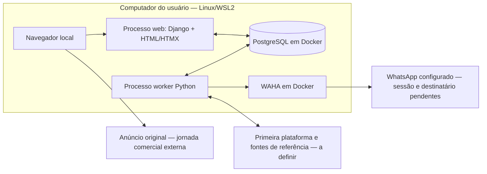

# Garimpei — arquitetura

Desenho inicial: 2026-11-10. Atualização: 2026-11-13. A aplicação Django está implementada; leia o [mapa da implementação](implementation.md) e o [estado de execução](../status-atual.md). Os desenhos abaixo preservam a proposta original e suas fontes.

Esta documentação detalha como implementar o [PRD](../PRD.md) com a [stack aprovada](../stack.md). Não substitui as especificações e contratos das features nem resolve automaticamente as pendências do discovery.

## Como ler

| Documento | Conteúdo |
|---|---|
| [Organização e dependências](organizacao-e-dependencias.md) | Tradução de clean architecture para Python/Django, módulos, contratos, composição e configuração |
| [Dados, fluxos e confiabilidade](dados-fluxos-e-confiabilidade.md) | Persistência conceitual, coleta, estimativas, alertas, transações e retomada |
| [Operação, validação e pendências](operacao-validacao-e-pendencias.md) | Processos locais, isolamento, readiness, gates e decisões que bloqueiam implementação |
| [Índice dos ADRs](../adrs/README.md) | Decisões já tomadas, alternativas e consequências |
| [Vocabulário](../../CONTEXT.md) | Termos do produto extraídos do PRD |
| [Interface e design](../design/implementation.md) | Convenções da aplicação, auditoria visual e limites; o laboratório histórico permanece separado |
| [Implementação atual](implementation.md) | Processos, módulos, fontes operacionais e integração de F21/F22 |

## Estado observado na elaboração original — histórico de 2026-11-10

No início deste trabalho, `apps/` não existia; os diretórios `docs/architecture/` e `docs/adrs/` também não existiam. O repositório continha instruções, PRD, decisões de stack e o harness, com F01–F09 em `pending`. Não havia código Django, migrations do produto, worker ou avaliação de integração a apresentar como arquitetura implementada.

| Categoria | Estado |
|---|---|
| Requisitos e stack | Documentados e aprovados, conforme PRD e stack |
| Harness | Scripts e templates existentes, ainda baseados em TypeScript/npm/Prisma |
| Django, PostgreSQL do produto, worker e interface do produto | Planejados; sem evidência de execução |
| Laboratório visual | Protótipos HTML e Storybook isolados em docs/design; artefatos de design executáveis, sem integração com o produto |
| Forma de acesso à primeira plataforma | Pendente de F01 |
| Procrastinate | Primeiro candidato a validar; não é uma biblioteca já adotada |
| Detalhes descritos nestes documentos | Proposta de desenho para arquitetura e especificação; não execução nem aceite de feature |

Um ADR com status **Aceito** registra uma decisão de direção. Não significa que sua implementação exista ou tenha passado pelos gates.

## Direção aprovada

- Python/Django para a aplicação, com templates e HTMX para a interface.
- PostgreSQL com Django ORM/migrations e tarefas persistentes no mesmo serviço de banco.
- Um projeto modular compartilhado por dois processos: web e worker.
- Aplicação e worker no Linux/WSL2; PostgreSQL e WAHA em Docker.
- Acesso somente neste computador, via localhost, sem login no Garimpei.
- Sem Redis inicialmente; sem stack de microserviços ou infraestrutura em nuvem exigida pelo MVP.
- Dependências voltadas às regras de negócio, DI por construtor, composição explícita e configuração central, conforme [AGENTS.md](../../AGENTS.md).

## Visão de execução da proposta original

As setas mostram comunicação em execução. As dependências de código obedecem ao diagrama de camadas em [organização](organizacao-e-dependencias.md). A fila é um mecanismo sobre PostgreSQL, não um serviço Redis adicional. O eventual navegador automatizado é recurso do adaptador de coleta e depende do resultado de F01.

## Módulos propostos e rastreabilidade

Os nomes de código abaixo são convenções propostas em inglês; o vocabulário do produto permanece em português. Módulo não equivale a uma feature de entrega nem a um serviço implantado.

| Módulo | Responsabilidade | Features e contratos do PRD |
|---|---|---|
| `monitoring` | Configuração guiada e sua conclusão, interesses por categoria/nome/modelo, CEP e parâmetros de custo | F03; F03-AC01–AC05 |
| `listing` | Identidade do anúncio, observações de preço, marco inicial e classificação por condição | F04/F05; F04-AC01–AC05 e F05-AC01–AC05 |
| `valuation` | Comparáveis, referência de novo, disponibilidade da estimativa e composição do lucro | F06/F07; F06-AC01–AC03 e F07-AC01–AC04 |
| `alert` | Intenções e histórico de alertas, elegibilidade e resultado do envio | F09; F09-AC01–AC06 |
| Leitura para a interface | Consultas dos módulos anteriores para abas e detalhes; não um domínio de negociação | F08; F08-AC01–AC07 |
| Adaptadores e composição | ORM, fonte, WAHA, HTTP, worker e ambiente | F02 e interfaces consumidas por F03–F09 |

F01 produz evidências e decisões preparatórias, não um módulo de produção. F02 prepara infraestrutura compartilhada e deve continuar sequencial. O grafo de dependências e as ondas permanecem os do PRD; este desenho não inicia execução paralela.

## Decisões registradas

| ADR | Decisão de direção aceita |
|---|---|
| [ADR-001](../adrs/ADR-001-python-django.md) | Python/Django como base da aplicação |
| [ADR-002](../adrs/ADR-002-templates-htmx.md) | Templates Django e HTMX para a interface |
| [ADR-003](../adrs/ADR-003-postgresql-django-orm.md) | PostgreSQL com Django ORM/migrations |
| [ADR-004](../adrs/ADR-004-worker-fila-postgresql.md) | Worker separado e tarefas persistentes no PostgreSQL, sem Redis inicialmente |
| [ADR-005](../adrs/ADR-005-operacao-local-wsl2.md) | Operação híbrida local, acesso restrito ao computador e ausência de login |
| [ADR-006](../adrs/ADR-006-isolamento-regras-negocio.md) | Independência das regras e casos de uso em relação ao framework e ao I/O |

A localização dos modelos ORM, a integração transacional com a fila e os exemplos de interfaces são propostas técnicas detalhadas nos documentos. Não há ADR aceito para Procrastinate, para uma plataforma específica ou para um algoritmo de estimativa.

## Fontes e evidências consultadas

As fontes locais prevalecem para requisitos e autorização. Documentação de biblioteca comprova capacidades e limitações do framework, não compatibilidade do produto já testada.

| Fonte local | Evidência usada |
|---|---|
| [PRD](../PRD.md) | Funcionalidades F01–F09, critérios de aceite, integrações e pendências P01–P11 |
| [Stack](../stack.md) | Composição aprovada, operação, candidatos e adaptações ainda necessárias |
| [Reavaliação](../stack-reavaliacao.md) | Alternativas e trade-offs discutidos antes da decisão |
| [AGENTS.md](../../AGENTS.md) | Regras canônicas de arquitetura, configuração, documentação e verificação |
| [Harness](../harness.md) | Suporte executável atual e limites dos validadores preservados |
| [clean-arch](../../.agents/skills/clean-arch/SKILL.md) | Regra de dependências, contratos, composição e separação leitura/escrita |

Foram consultados também os recursos locais de geração ADR da skill `adrs-management` e as referências de composição, configuração, eventos e anti-patterns de `clean-arch`. Não foram inferidos commits, métricas ou decisões a partir de código inexistente.

Fontes oficiais para os pontos de integração: [registro de aplicações Django](https://docs.djangoproject.com/en/5.2/ref/applications/), [transações Django](https://docs.djangoproject.com/en/5.2/topics/db/transactions/), [suporte assíncrono Django](https://docs.djangoproject.com/en/5.2/topics/async/), [conexão externa no Procrastinate](https://procrastinate.readthedocs.io/en/stable/howto/production/external_connection.html), [integração Django/Procrastinate](https://procrastinate.readthedocs.io/en/stable/howto/django/configuration.html), [HTMX](https://htmx.org/docs/). As referências documentam a proposta original; as versões efetivas estão no lockfile e em F02/versions.md. A implementação atual está no mapa indicado no início.
