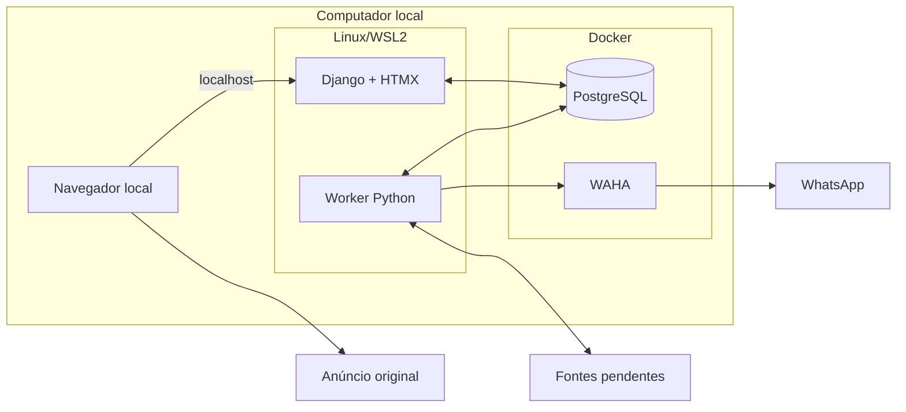
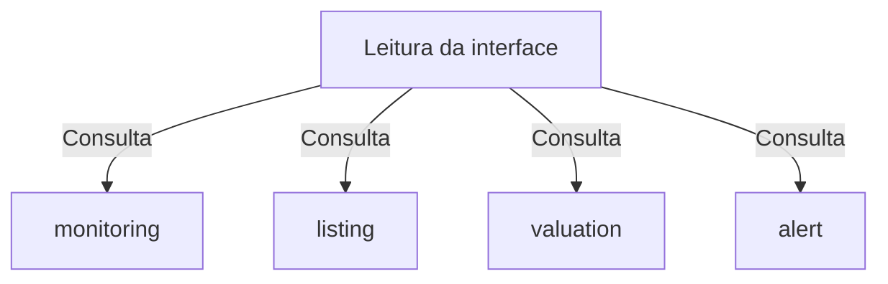

# Diagramas Mermaid — arquitetura proposta do Garimpei

## Visão geral

Fonte: [Garimpei — arquitetura proposta](../README.md), em português, consultada em 2026-11-10. O usuário confirmou essa fonte em substituição ao caminho inexistente `docs/architecture/visao-geral.md`. Os diagramas representam uma proposta de aplicação Python/Django, com interface em templates/HTMX, PostgreSQL e Worker separado. Não constituem evidência de implementação, compatibilidade local ou aceite de feature.

Foram selecionadas duas vistas: comunicação entre processos/serviços e consultas dos módulos pela interface. A primeira explica a separação operacional; a segunda mostra a organização funcional sem sugerir microserviços. Os fontes `.mmd` são preservados separadamente e repetidos abaixo para leitura em Markdown com suporte a Mermaid. A opção `--no-images` mantém esta entrega sem arquivos de imagem.

## Elementos identificados

### Fluxos externos

- Navegador deste computador acessa Django por localhost, sem login no Garimpei.
- Worker se comunica com a primeira plataforma e as fontes de referência, ainda por definir.
- Worker utiliza WAHA em Docker para o fluxo de WhatsApp; sessão e destinatário continuam pendentes.
- Navegador abre o anúncio original para a jornada comercial externa.

### Processos internos

- Web Django e Worker Python são processos separados de um mesmo projeto modular.
- PostgreSQL em Docker reúne dados e tarefas persistentes; a fila não é um serviço separado no desenho.
- `monitoring`, `listing`, `valuation` e `alert` delimitam responsabilidades funcionais.
- A leitura para abas e detalhes consulta esses módulos, conforme a tabela de módulos da fonte.
- ORM, fonte, WAHA, HTTP, Worker e ambiente são responsabilidades de adaptadores e composição; não são novos domínios.

### Variações de comportamento

- Procrastinate é candidato a validar, sem adoção definitiva; por isso não aparece como componente escolhido.
- Plataforma, ferramenta de coleta e eventual navegador automatizado dependem de F01; os diagramas não escolhem uma alternativa.
- Linux/WSL2 abriga aplicação e Worker; PostgreSQL/WAHA são executados em Docker. Os agrupamentos mostram a operação aprovada, sem especificar a topologia interna do Docker.
- F01 produz decisões preparatórias; F02 prepara a infraestrutura de forma sequencial. Essa divisão não cria módulos de produção nem autoriza paralelismo.

### Contratos públicos

A fonte identifica fronteiras de integração, mas não define endpoints, métodos, mensagens, DTOs ou esquemas de banco suficientes para representá-los. Não foram gerados diagramas de classes ou ER por falta de assinaturas, campos e cardinalidades. Sequências detalhadas, estados de tarefas e políticas de falha/retomada também foram omitidos: os documentos vinculados tratam desses assuntos, mas não foram incorporados como novas fontes a esta geração.

## Diagramas

### Execução local

Este fluxograma mostra a comunicação proposta entre navegador, aplicação, persistência e serviços externos. Ele destaca a separação entre web e Worker e a localização operacional de PostgreSQL e WAHA em Docker. A vista ajuda a distinguir o acesso local à interface dos acessos externos necessários ao monitoramento e aos alertas. As setas representam comunicação, sem impor uma ordem de execução ou dependências de importação.

Fonte editável: [01-execucao-local.mmd](01-execucao-local.mmd). Rastreabilidade: seções “Direção aprovada” e “Visão de execução proposta” do [documento de origem](../README.md).

**Notas:**

- “Django + HTMX” inclui templates servidos pelo Django; não pressupõe aplicação frontend separada.
- PostgreSQL representa tanto dados quanto tarefas persistentes. A biblioteca de fila e sua integração transacional continuam por validar.
- “Fontes pendentes” agrupa a primeira plataforma e as fontes de referência, sem afirmar que serão a mesma integração.
- WhatsApp depende de sessão e destinatário ainda não definidos; a seta não comprova envio real.
- Acesso local sem login aplica-se ao Garimpei, sem dispensar configuração de acesso aos serviços.
- O desenho não inclui Redis, serviços em nuvem, microserviços ou uma ferramenta de coleta escolhida.

### Consultas dos módulos

Este fluxograma relaciona a leitura para a interface aos módulos funcionais propostos. Cada seta significa uma consulta conceitual para compor abas e detalhes, conforme a tabela da fonte. A vista ajuda a localizar responsabilidades e suas features sem inventar chamadas concretas ou contratos de transporte. Os módulos pertencem ao mesmo projeto; cada caixa não representa um processo ou serviço implantado.

Fonte editável: [02-consultas-dos-modulos.mmd](02-consultas-dos-modulos.mmd). Rastreabilidade: seção “Módulos propostos e rastreabilidade” do [documento de origem](../README.md).

**Notas:**

| Elemento | Responsabilidade na fonte | Features |
|---|---|---|
| `monitoring` | Configuração guiada, interesses, CEP e parâmetros de custo | F03 |
| `listing` | Identidade, observações de preço, marco inicial e condição | F04/F05 |
| `valuation` | Comparáveis, referência de novo, estimativa e composição do lucro | F06/F07 |
| `alert` | Intenções/histórico, elegibilidade e resultado de envio | F09 |
| Leitura da interface | Consultas para abas e detalhes | F08 |

- As setas não são um grafo de dependências das features nem de importações entre camadas.
- Não se afirma dependência entre os quatro módulos, pois a tabela da fonte não especifica essas relações.
- Adaptadores e composição sustentam as entradas e integrações; seus detalhes ficam fora desta vista funcional.
