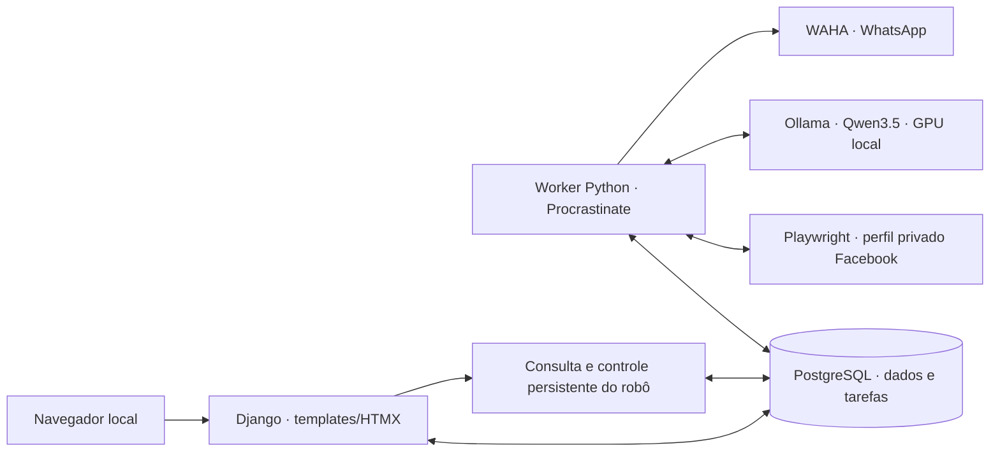

# Arquitetura implementada

Revisão de 2026-11-13, após integrar a UI à master da onda F21/F22. O [estado atual](../status-atual.md) e as avaliações definem os limites de aceite; este mapa descreve código existente.

## Processos e dependências

A aplicação em `apps/backend/` usa Python 3.13/Django 5.2, templates e HTMX. Web e worker compartilham módulos, configuração e PostgreSQL, com processos separados. Django ORM registra modelos e migrations; Procrastinate mantém tarefas no PostgreSQL, sem Redis. Scripts de lifecycle verificam propriedade dos processos/contêineres e prontidão antes de anunciar a URL local.

A dependência de código continua `domain` ← `usecase` ← `infra`, com composição em [main.py](../../apps/backend/src/garimpei/main.py) e leitura central em [config/env.py](../../apps/backend/src/garimpei/config/env.py). A entrada dos seis grupos de validação é [run-gates.mjs](../../scripts/run-gates.mjs).

## Código por responsabilidade

| Área | Localização efetiva | Responsabilidade |
|---|---|---|
| Regras e contratos | `src/garimpei/domain/` | Monitoramento, anúncios, condição, avaliação, mídia, inferência, alertas, navegação, operação e admissão do robô. |
| Casos de uso | `src/garimpei/usecase/` | Orquestração, portas injetadas e unidades de trabalho. Sem dependência de Django/I/O. |
| HTTP e apresentação | [infra/http](../../apps/backend/src/garimpei/infra/http/) | Rotas/handlers, validação de entrada, tratamento central, templates/fragmentos e estáticos. |
| Leitura/escrita | `infra/queries/`, `infra/repository/` | Projeções e persistência, locking, barreiras, resultados e revisões. |
| Persistência | [infra/persistence](../../apps/backend/src/garimpei/infra/persistence/) | Registro ORM e migrations, inclusive 0026 para controle global, 0027 para qualificação ouro e 0028/0029 para alvos tipados e revisões F23, 0030 para preencher alvos legados e 0031 para a guarda da autorização assistida. |
| Adaptadores externos | `infra/gateway/` | Facebook, referências, WAHA, inferência, mídia local e arquivos de backup. |
| Tarefas | [infra/worker](../../apps/backend/src/garimpei/infra/worker/) | Agendamento/consumo de unidades de trabalho e retomada persistente. |
| Operação local | [infra/runtime](../../apps/backend/src/garimpei/infra/runtime/) | Bootstrap, ownership, readiness, logs e lifecycle por ambiente. |

Os caminhos abreviados acima são relativos a `apps/backend/src/garimpei/`. As versões exatas e as dependências instaláveis vêm de `apps/backend/uv.lock` e das imagens fixadas no Compose.

## Fronteiras de apresentação

`monitoring/layout.html` compartilha navegação, avisos e contexto. Os context processors de integrações, orientação por rota e resumo do robô coexistem. O controle F22 continua no acompanhamento; desligar bloqueia novas unidades sem encerrar os serviços ou apagar filas/dados. Pausas individuais, acesso suspenso e barreiras de recuperação continuam adicionais à intenção global.

Ofertas e detalhes conservam revisões, retorno com filtros/página e atualização aplicada pelo usuário. Estados de foco/erro pertencem ao componente que iniciou a ação. A [documentação da interface](../design/implementation.md) descreve a composição e as verificações visuais.

A apresentação ouro consome qualificação registrada e proveniência de condição/identidade/comparáveis/lucro. Sua presença no código não encerra a pendência de prova real positiva de F21. F15/F19 possuem avaliações anteriores próprias, sem garantia de classificação correta para qualquer anúncio novo.

## Operação e validação

- [Ambiente F02](../F02-fundacao-tecnica-e-ambiente-local/operations.md): ferramentas, segredos privados, serviços, migrations, readiness e parada.
- [F17](../F17-resiliencia-operacional-e-progresso-verificavel/operations.md): progresso, backups, exportação e recuperação.
- [F19](../F19-inferencia-multimodal-local-em-docker/operations.md): modelo/serviço GPU e pausa da IA.
- [F22](../F22-controle-global-do-robo/operations.md): intenção global, estados e barreiras de admissão.
- [Harness](../harness.md): seis grupos Python, testes e comandos de diagnóstico.

Os documentos de desenho de 2026-11-10 permanecem no índice como histórico de decisões e propostas. Este mapa e os arquivos atuais prevalecem para a localização de módulos e comandos; os contratos e seus relatórios prevalecem para o comportamento avaliado.

## Runtime e assistência F23 implementados, com aceite pendente

[F23 — Docker completo e IA integrada](../F23-docker-completo-e-ia-integrada/spec.md) acrescenta web/worker/Chromium em contêineres, mesma imagem de monólito com processos separados, preparo/migrations/ferramentas pontuais e transporte HTTP privado para Ollama. Os wrappers do host verificam proprietário de contêineres, redes e volumes antes de alterações. Web/worker/Ollama não recebem socket Docker; perfil Facebook é separado e login pontual preserva a exclusividade do navegador. O runtime host legado permanece explícito para compatibilidade de regressões.

Os consumidores locais de identidade/comparáveis e apoio limitado à investigação/diagnóstico usam a fila F19 com alvos tipados, snapshots, assinaturas de contexto e vínculos de consumo. A condição F15 permanece multimodal. Schemas, referências e revisões limitam a publicação; a correção manual é preservada, e comparáveis revisados entram antes da política determinística F06. Cálculos e corpos de mensagem continuam congelados pelas fronteiras atuais. Ativação da política assistida é explícita e exige Ouro local ativo. A guarda SQL recusa política incompatível e estado misto; dados legados não são promovidos a revisados por migration.

Há provas dos cinco perfis reais na GPU, seis gates aprovados e adoção/rollback de uma instalação controlada na versão anterior, com backup F17 restaurado antes da migração, reinício real do PostgreSQL/worker e inventário conservado. Sessões/perfis/pesos desse ensaio são superfícies sintéticas explicitadas no relatório. Um resultado parcial/incerto não virou Ouro. Corpus humano independente e cadeia positiva com modelo real até WAHA controlado têm aceites próprios ainda pendentes; F21 continua com prova real positiva bloqueada. Ver [implementação](../F23-docker-completo-e-ia-integrada/impl-report.md), [operação](../F23-docker-completo-e-ia-integrada/operations.md), [migração](../F23-docker-completo-e-ia-integrada/migration-runbook.md) e [progresso](../prd_progress.json).
