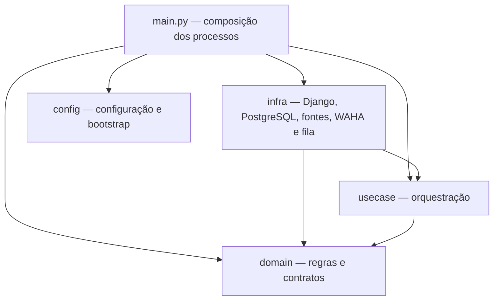

# Organização e dependências propostas

Estado: **desenho proposto, sem arquivos de aplicação criados**. A direção de stack e os princípios canônicos já estão aceitos; esta tradução para Django precisa ser especificada e verificada em F02.

## Regra de dependências



As setas são imports permitidos, não a ordem de execução. `domain` e `usecase` não importam Django, ORM, filas, clientes HTTP ou configuração do ambiente. A biblioteca padrão e dependências puras necessárias às regras podem ser usadas sem introduzir I/O.

| Área | Contém | Evita |
|---|---|---|
| `domain` | Entidades, objetos de valor, invariantes e contratos de repositórios/consultas/gateways | Modelos ORM, acesso à rede/disco, templates e configuração |
| `usecase` | Uma classe por ação, com `execute`, dependências por construtor e DTOs próprios | Regras de negócio duplicadas, imports de infraestrutura e validação de formulário |
| `infra` | Implementações dos contratos, entrada HTTP/worker, mapeamento ORM e apresentação | Escolher invariantes que pertencem ao domínio |
| `config` | Leitura central do ambiente e configuração de bootstrap do Django | Funcionar como localizador de serviços usado pelos casos de uso |
| `main.py` | Construção explícita dos adapters, casos de uso e handlers de cada processo | Executar coleta ou envio durante importação |

## Estrutura de referência

Os caminhos abaixo são propostos e não existem como aplicação. A lista é ilustrativa, não uma exigência de criar arquivos vazios ou CRUD para cada conceito.

```text
apps/backend/
  manage.py
  pyproject.toml
  src/garimpei/
    main.py
    config/
      env.py
      settings.py
      asgi.py ou wsgi.py          # servidor e versão serão definidos em F02
    domain/
      _shared/                    # id, erros, unit of work e paginação
      monitoring/
      listing/
      valuation/
      alert/
    usecase/
      monitoring/
      listing/
      valuation/
      alert/
    infra/
      http/
        urls.py                   # entrada de rotas do Django
        routes.py                 # montagem das rotas com handlers injetados
        error_handler.py
        monitoring/
        listing/
        valuation/
        alert/
        templates/
        static/
      repository/
        monitoring/
        listing/
        valuation/
        alert/
      queries/
        monitoring/
        listing/
        valuation/
        alert/
      gateway/
      worker/
      persistence/
        apps.py
        models.py                 # descoberta explícita de modelos pelo Django
        migrations/
        monitoring/
        listing/
        valuation/
        alert/
        django_unit_of_work.py
```

Os pacotes Python terão os `__init__.py` necessários, sem reexportar interfaces como fachada genérica. Os diretórios de feature serão espelhados conforme sua responsabilidade real; não se criam handlers de uma feature que só precise de processamento interno.

Dentro de cada feature, os módulos ficam planos. Nomes de arquivos usam `snake_case`, compatível com imports Python, preservando o papel no sufixo: `listing_entity.py`, `listing_repository.py`, `listing_django_repository.py`, `listing_mapper.py`, `refresh_listing_usecase.py` e `refresh_listing_dto.py`. São exemplos de nomes, não contratos de ação já aprovados.

## Tradução das regras de clean-arch

| Regra canônica | Proposta em Python/Django |
|---|---|
| Três camadas, dependências para dentro | Pacotes `domain`, `usecase` e `infra`, com verificações de imports em F02 |
| Configuração central | Apenas `config/env.py` lê ou prepara variáveis de ambiente autorais; settings e launchers consomem esse bootstrap |
| Composição em `main.ts` | `main.py` concentra construção de repositórios, consultas, gateways e handlers; entradas web/worker acionam suas fábricas |
| Sem barrels | Imports de módulos concretos; registro de rotas e descoberta ORM têm funções específicas, não viram interfaces de consumo do domínio |
| `_shared` fechado | Somente equivalentes de ID, erros, unit of work e paginação; dinheiro e outros conceitos ficam na feature responsável |
| Entidades ricas | Fábricas distintas para criação e restauração; mutações com nomes do domínio, sem setters públicos genéricos |
| Objetos de valor | Fábricas com validação, leitura imutável e comparação por valor; criação de ID interno no domínio, com tipo específico e UUID v4 |
| Bibliotecas puras no domínio | Permitir recursos de datas, validação e números; vedar I/O e objetos Django |
| Um caso de uso, uma ação | Classe com um método público de execução; dependências de I/O recebidas por construtor |
| Separação de validação | HTTP/worker valida formato; domínio valida invariantes; caso de uso verifica regras entre agregados que exigem estado consultado |
| Repository versus Queries | Repositório devolve entidade para escrita; consulta devolve estrutura tipada para leitura, sem objetos ORM vazando |
| Contratos e mapeamento | Contratos ficam no domínio; mapper de infraestrutura restaura a entidade com o ID persistido |
| Handler sem tratamento disperso de exceções | Handler adapta entrada/saída e chama caso de uso; adapter central traduz erros para HTTP ou resultado técnico de tarefa |
| DTO na saída | Templates e transporte recebem DTOs explícitos, nunca entidade ou QuerySet lazy |
| Autenticação e autorização | Não criar login ou `actorId` fictício no MVP local; eventual expansão precisa de decisão de escopo |
| Self-audit | Gates Python definidos e executados em F02; o runner TypeScript atual permanece incapaz de validá-los |

Python não oferece a mesma privacidade de construtor de TypeScript. A proposta usa convenções, factories, imutabilidade apropriada, verificação estática e testes para proteger essas interfaces. Não se deve apresentar essa disciplina como garantia equivalente de linguagem.

## Django ORM na infraestrutura

Modelos Django representam persistência. Entidades do domínio não herdam de modelos do framework. Um mapper converte estado persistido em entidade; as consultas de leitura podem fazer joins e agregações, devolvendo estruturas tipadas livres de Django. Os DTOs de saída dos casos de uso pertencem a `usecase`; os contratos de consulta em `domain` usam estruturas definidas no próprio domínio, evitando import reverso para DTOs de aplicação.

O desenho propõe uma aplicação Django de persistência registrada em `infra/persistence`. Seu `models.py` importa explicitamente os modelos dos módulos de cada feature para descoberta do framework. Esse registro é uma adaptação técnica a validar, não um barrel que consumidores importam para obter repositórios ou entidades. A documentação Django exige que modelos sejam definidos ou importados no módulo de modelos registrado. [Aplicações Django](https://docs.djangoproject.com/en/5.2/ref/applications/).

Migrations, constraints e detalhes de coluna são de infraestrutura e serão definidos junto aos contratos das features. Modelos são registrados pelo framework; adapters de repositório/gateway são construídos pela composição. Essas duas responsabilidades não se confundem.

Signals, métodos de modelo, forms e templates não disparam decisões de alerta nem concentram regras de lucro. Isso mantém a mesma regra observável nas entradas web e worker.

## Composição e bootstrap por processo

1. O launcher prepara o bootstrap central e escolhe o processo, sem criar dependências de negócio.
2. O Django carrega settings e registra suas aplicações/modelos antes de construir adapters que os importem.
3. A entrada web ou worker chama a fábrica apropriada de `main.py`, que recebe a configuração tipada.
4. A composição cria adapters, injeta-os nos casos de uso e injeta estes nos handlers.
5. A entrada do framework mantém o grafo já construído para sua execução; handlers e casos de uso não buscam dependências globais.

Para o web, a entrada de URLConf pode chamar a fábrica do composition root e receber rotas prontas; o construtor de rotas de infraestrutura recebe handlers, sem importar a entrada URLConf de volta. Para o worker, a composição registra explicitamente os handlers de tarefas. O ciclo preciso será comprovado em F02, incluindo ausência de imports circulares e inicialização antes das migrations existirem.

Não iniciar o worker no hook de inicialização de uma aplicação Django nem fazer queries em importação/construtores. O framework carrega aplicações também ao executar comandos administrativos; tarefas de negócio precisam de uma entrada explícita. [Inicialização Django](https://docs.djangoproject.com/en/5.2/ref/applications/).

O processo web não é usado como supervisor do worker. Cada processo possui configuração, identidade, readiness e encerramento conhecidos pelos scripts. `main.py` concentra montagem; não se propõe um service locator importado por módulos internos.

## Contratos propostos entre módulos

| Contrato no domínio | Adapter em infraestrutura | Garantia a especificar |
|---|---|---|
| Repositório de interesses | Django ORM | Gravação confirmada ou falha explícita, preservando categorias e produtos por nome/modelo |
| Gateway da plataforma | HTTP/API/browser, após F01 | Anúncios com origem e incertezas explícitas; falha não equivale a consulta vazia bem-sucedida |
| Repositório de anúncios | Django ORM | Identidade interna estável e restauração do marco inicial/histórico |
| Consultas de ofertas | Django ORM | Três abas e projeções tipadas, inclusive valores indisponíveis |
| Política de avaliação | Implementação pura da política definida após F01 | Resultado e evidências coerentes; não inventar critérios de suficiência |
| Registro de alertas e unit of work | PostgreSQL/Django | Intenção persistente e estados de envio sem I/O externo dentro de transação longa |
| Gateway de mensageria | Cliente WAHA | Distinguir confirmação, falha conhecida e resultado incerto |
| Gateway de tarefas | Fila PostgreSQL, biblioteca pendente | Recuperabilidade, concorrência e tentativas nos termos a definir |

Contratos de repositório mantêm operações equivalentes a buscar por ID, salvar e excluir conforme `clean-arch`. Isso não expõe exclusão de ofertas na interface nem cria uma jornada CRUD fora do PRD. Interfaces adicionais só são criadas onde há responsabilidade real e alternativa testável, como adapter externo e fake nomeado.

Para cálculos monetários, propõe-se representação decimal explícita no domínio. Moeda, escala e arredondamento precisam de especificação em P08; a escolha do tipo não fecha esses parâmetros. Não se usa um default numérico para esconder configuração ou estimativa ausente.

## Critérios de verificação da proposta

- Importar regras e casos de uso em teste sem inicializar Django ou acessar o banco.
- Verificar violações de dependências, leitura de ambiente fora do bootstrap e ciclos.
- Exercitar o mesmo caso de uso por handlers web/worker com fakes nomeados e resultados coerentes.
- Confirmar registro de modelos, descoberta de migrations e construção dos dois processos sem consultas de negócio no bootstrap.
- Verificar que entidades, QuerySets e credenciais não chegam ao contexto dos templates ou ao payload das tarefas por serialização automática.

Esses são critérios para contratos futuros, não testes executados nesta documentação. [Dados e confiabilidade](dados-fluxos-e-confiabilidade.md) detalha as transações; [operação](operacao-validacao-e-pendencias.md) lista pendências e evidências necessárias.
