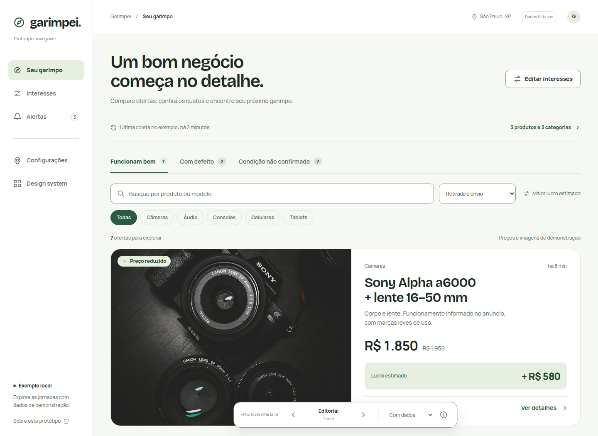

# Garimpei — design system e protótipos

Direção e composição escolhidas: **clara e editorial, com verde mineral e foco nos produtos**. Versão visual 0.2, preparada em 2026-11-10. Fluxos e estados estão detalhados e demonstrados em memória; a aplicação Django não foi implementada. Veja a [referência de interação](flows-reference.md) e a [verificação atual](verification-v02.md).

## Abrir os protótipos

Na raiz do repositório:

```bash
python3 docs/design/serve.py
```

Abra [o protótipo editorial](http://127.0.0.1:4173/prototypes/?variant=editorial). O servidor usa apenas Python, atende em `127.0.0.1` e pode ser encerrado com `Ctrl+C`. Se a porta estiver ocupada, use `--port 4174`.

Para revisar as novas jornadas, abra [primeiro uso](http://127.0.0.1:4173/prototypes/?scenario=first-use), [atualizações](http://127.0.0.1:4173/prototypes/?scenario=updates), [paginação](http://127.0.0.1:4173/prototypes/?scenario=many) ou [dados ausentes](http://127.0.0.1:4173/prototypes/?scenario=gaps). As ferramentas da barra inferior permitem simular falha de gravação e reinício; recarregar restaura os exemplos.

| Composição | O que compara | Trade-off |
|---|---|---|
| [Editorial — escolhida](http://127.0.0.1:4173/prototypes/?variant=editorial) | Uma oferta em destaque, fotos amplas e custos em evidência | Facilita a exploração inicial; mostra menos ofertas por tela |
| [Comparação](http://127.0.0.1:4173/prototypes/?variant=compact) | Tabela para comparar preços, revenda e lucro | Aumenta a densidade; precisa de rolagem horizontal em telas estreitas |
| [Mesa de análise](http://127.0.0.1:4173/prototypes/?variant=night) | Lista selecionável com prévia ao lado, em tema escuro experimental | Reduz idas aos detalhes; divide a atenção e reduz o espaço da fotografia |

A barra inferior alterna os três estudos, oferece estados de carregamento, vazio, falha e carga inicial e permite inspecionar o estado. Setas do teclado alternam composições fora dos campos e das abas. As abas usam as setas para sua própria navegação.

Explore ofertas, detalhes, interesses, configurações, alertas e a galeria do design system. Busca, filtros, cadastro por nome/modelo, classificação e custos funcionam em memória. Recarregar restaura os dados fictícios. Fotografias ilustram categorias, sem corresponder necessariamente aos modelos descritos. Nenhum anúncio é coletado e nenhuma mensagem é enviada.

## Fonte única e biblioteca

[tokens.json](tokens.json) define os tokens. O gerador produz [tokens.css](tokens.css) e os CSS de componentes/composição a partir dos respectivos `.css.in`, inclusive os breakpoints. Protótipos e Storybook importam os mesmos arquivos e [componentes](components/ui.js). O check bloqueia drift e é executado antes de dev/build da biblioteca.

```bash
python3 docs/design/generate_tokens.py
python3 docs/design/generate_tokens.py --check
npm --prefix docs/design/storybook ci
npm --prefix docs/design/storybook run dev
```

O Storybook HTML/Vite abre em `http://127.0.0.1:6006`, com componentes e estados isolados de jornadas, incluindo primeiro uso, falhas, correção, atualização, paginação e dados ausentes. As transições completas são verificadas no protótipo. Para gerar a versão estática: `npm --prefix docs/design/storybook run build`. Node/npm e axe-core são ferramentas deste laboratório; a stack do produto continua Django/templates/HTMX.

## Documentação

| Documento | Uso |
|---|---|
| [MASTER.md](MASTER.md) | Direção, decisões visuais e autoridade dos arquivos |
| [PRODUCT.md](PRODUCT.md) | Briefing e limites do protótipo derivados do PRD |
| [DESIGN.md](DESIGN.md) | Regras de composição, componentes, estados e acessibilidade |
| [Jornadas e rastreabilidade](journeys.md) | Superfícies, features e decisões ainda abertas |
| [Ferramentas](TOOLS.md) | Skills utilizadas, instalação e adaptação à stack |
| [Créditos](CREDITS.md) | Fotografias, fontes e licenças |
| [Avaliação visual](review.md) | Evidências de navegador e limites da verificação |
| [Auditoria de definição](definition-audit.md) | O que já foi decidido, o que falta e em qual etapa resolver |
| [Referência de fluxos 0.2](flows-reference.md) | Regras, transições, dados ausentes, biblioteca e critérios de acessibilidade |
| [Verificação 0.2](verification-v02.md) | Jornadas, biblioteca, acessibilidade, reflow e evidências atuais |
| [Roteiros de verificação](verification/) | Percursos reproduzíveis pelo playwright-cli, sem projeto E2E adicional |



Esta entrega implementa **artefatos de design**. Não conclui F02–F09, não substitui os contratos futuros e não altera o progresso das features. A [arquitetura proposta](../architecture/README.md) e o [PRD](../PRD.md) continuam as referências de implementação e comportamento.
