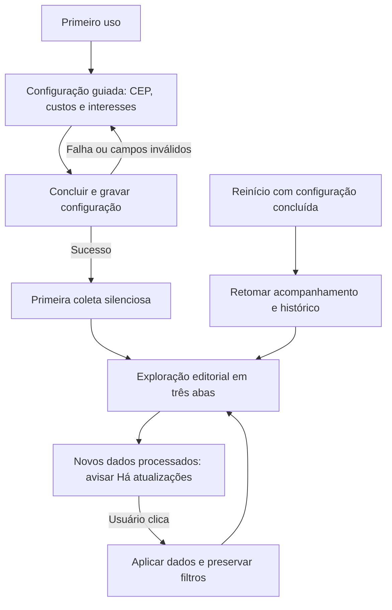

# Jornadas, propostas e pendências

| Jornada demonstrada | Relação com o PRD | Limite da evidência |
|---|---|---|
| Configurar CEP, frete e taxa provisória | F03, F07 | Valores e validação demonstrativos; P05/P08 permanecem |
| Adicionar produto por nome/modelo e selecionar categorias | F03 | Sem campos adicionais; categorias fictícias e correspondência pendente em P03/P04 |
| Buscar e filtrar ofertas nas três abas | F05, F08 | Exibe lista local; não comprova classificação automática nem coleta F04 |
| Classificar oferta incerta e mudar de aba | F05 | Estado só em memória. A regra aprovada exige preservar a escolha no produto e não disparar alerta por essa ação; o protótipo não comprova persistência |
| Conferir comparáveis, referência de novo e composição | F06, F07, F08 | Amostras e método ilustrativos; P07/P08 continuam |
| Manter lucro negativo, zero e indisponibilidade | F07, F08 | Distingue ausência de estimativa de valor calculado; não avalia fonte real |
| Acessar anúncio original | F08 | Explica a ação externa; link real depende da integração |
| Ver exemplos de mensagens e histórico | F09 | Não envia nem registra entrega; operação e conteúdo permanecem P02/P09 |

## Propostas para P10

A composição editorial foi escolhida: o usuário inicial precisa reconhecer o produto e entender o custo antes de comparar dezenas de linhas. Tabela e mesa de análise permanecem alternativas de estudo, sem compromisso de implementação.

Ofertas calculáveis são ordenadas pelo lucro decrescente; as sem estimativa ficam no fim, conforme escolha do usuário. Empates usam identificação mais recente e identificador estável. Páginas de 20, contagem e controles anterior/próxima estão demonstrados. Busca e filtros usam fixtures, não o total da plataforma. Regras detalhadas estão em [flows-reference.md](flows-reference.md).

## Decisões que não foram tomadas pelo design

O protótipo não escolhe plataforma, engine WAHA, destinatário, intervalo de coleta, política de tentativas/reconciliação, método estatístico ou amostra mínima. Os custos iniciais do produto serão preenchidos pelo usuário em campos inicialmente em branco, conforme decisão posterior registrada no PRD. O protótipo também não acrescenta autenticação, multiusuário, compra interna, rede local ou app móvel.

Antes de implementar cada feature, resolver suas pendências no fluxo de especificação. Uma decisão visual aprovada não equivale a feature implementada ou avaliada.

## Fluxos definidos após os protótipos

Fonte canônica: regras de primeiro uso, classificação e interface do [PRD](../PRD.md). O desenho abaixo descreve comportamento aprovado e demonstrado em memória na versão 0.2, sem implementação Django.

Os custos começam em branco e exigem preenchimento para concluir. A tela preenchida atual é um cenário posterior à configuração. Atualizar a apresentação ao clicar não controla a execução do worker nem o envio de alertas. A classificação manual muda a aba após gravação, deve ser preservada nas próximas coletas do mesmo anúncio e não cria um alerta pela ação, inclusive para envio posterior na retomada.

O usuário também pode corrigir nos detalhes uma classificação manual já salva entre as duas opções de funcionamento. Só a última escolha gravada passa a valer; em caso de falha, a anterior continua válida. Essa correção não dispara WhatsApp e já está demonstrada em memória, inclusive com falha de gravação e reinício simulado.
