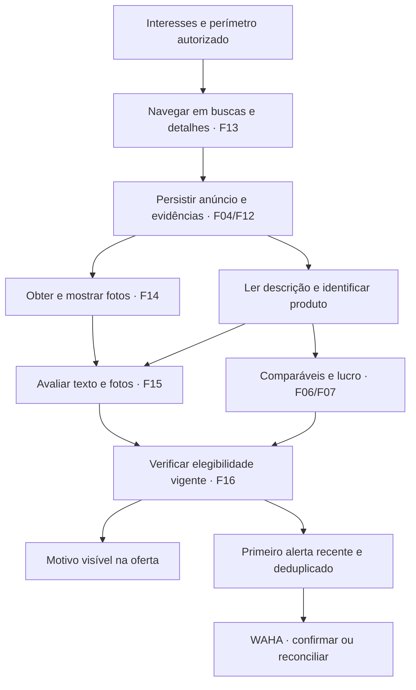

# Evolução do Garimpei — análise de produto

Data: 2026-11-11 em São Paulo / 2026-11-12 UTC. Complemento do [PRD](PRD.md). Esta análise separa requisitos confirmados, diagnóstico local e propostas para discussão. Não é plano de implementação nem aprovação de serviços, custos ou novos canais.

## O que mudou na direção do produto

O produto já reúne anúncios e calcula estimativas conservadoras, mas o usuário quer delegar a investigação: procurar oportunidades, abrir detalhes, examinar fotos e descrição e receber a mensagem quando houver dados suficientes. A utilidade depende de todo esse caminho; ampliar categorias sem conseguir obter fotos, reconhecer o produto ou explicar o bloqueio do alerta aumenta o volume sem necessariamente melhorar as oportunidades.

Decisões confirmadas nesta conversa:

- Atualizar o PRD com a base desenvolvida e suas limitações.
- Acrescentar navegação ativa em busca de oportunidades.
- Ler imagens e avaliar qualidade junto da descrição; a ausência de fotos no sistema é uma lacuna prioritária.
- Primeiro alerta ao se tornar elegível, mesmo coletada antes; até 48 horas da publicação. Sem data confiável, aguardar confirmação.

Nesta segunda revisão, o usuário definiu o perímetro: investigar os interesses cadastrados e sugerir novos nichos sem monitorá-los automaticamente. A nova decisão escolheu Qwen3.5 4B Q4_K_M via Ollama em Docker local, preparada em F19; faltam medição e integração. Permanecem em decisão critérios visuais por categoria e primeiro alerta causado exclusivamente por escolha manual.

O [relatório de uso e testes](validacao-produto-2026-11-12.md) acrescentou evidências de ausência de estimativas, motivos imprecisos, erro transitório de leitura e três falhas de classificação em descrições contraditórias. O PRD passou a incluir F17 (resiliência/progresso verificável) e F18 (identificação/busca de comparáveis), ambas pendentes. A revisão seguinte acrescentou F19 (runtime IA local) e F20 (compra/venda estimada/lucro, com retirada da apresentação logística); os requisitos anteriores não foram marcados como implementados por essas revisões.

## Diagnóstico que orienta as prioridades

As avaliações canônicas de F01–F12 estão `clean`, com escopos e substituições históricas preservados. A leitura somente de dados agregados da instalação em aproximadamente 00:58 UTC encontrou:

| Observação | Implicação | O que não foi demonstrado |
|---|---|---|
| 1.563 anúncios sem imagem vigente | Corrigir o caminho fonte → evidência → armazenamento → apresentação antes de validar visão | Não foi identificado neste levantamento o campo exato que o adaptador deixou de extrair |
| WhatsApp configurado/ativado, zero intenções e tentativas | Investigar a elegibilidade antes de atribuir o silêncio ao canal | Não houve teste novo de entrega ao grupo |
| 45 descobertas não silenciosas: 41 excluídas por condição, 4 por produto incompatível na avaliação financeira | Dados/identificação e regra de alerta explicam o bloqueio observado | Isso não prova que toda oferta apontada pelo usuário foi individualmente identificada |
| Classificação vigente: 148 boas, 21 com defeito, 1.394 incertas | Muito do conjunto ainda precisa de evidência; lista não equivale a fila de envio | Esses totais não são número de oportunidades ou de alertas devidos |
| Carga inicial parcial | Falta de completude precisa continuar visível | Nenhuma garantia de catálogo completo ou fronteira temporal universal |

A nova regra de elegibilidade resolve uma incompatibilidade de expectativa: a regra antiga podia registrar uma oferta em condição incerta e nunca enviar seu primeiro alerta após o enriquecimento. A implementação F12 espera alguns motivos de falta de amostra por até 48 horas da observação, mas mantém exclusões anteriores fechadas e exige publicação posterior ao marco para descoberta. A F16 deverá acrescentar uma identidade durável de primeiro alerta por anúncio, reavaliar ofertas recentes e conservar recibos/intentos anteriores; não basta remover um `if` de silêncio ou reenfileirar todos os eventos antigos.

## Fluxo proposto e pontos de decisão

O diagrama representa fluxo de dados, não um pipeline que bloqueia tudo até a última análise. Texto, imagem, preço e canal podem concluir em tempos diferentes. Cada resultado precisa de versão, estado e motivo para que o sistema reavalie a oportunidade sem repetir efeitos externos.

### Navegação: autonomia com finalidade

A escolha confirmada é aprofundar a busca nos interesses cadastrados e apresentar novos nichos somente como sugestões que o usuário pode adotar. A pesquisa para sugestões terá orçamento próprio e não deve privar os interesses ativos de progresso. A expansão não modifica interesses nem libera alertas sem adoção explícita pelo usuário. Essa escolha concentra o esforço de identificação e amostra nos interesses que ele deseja investigar.

Mesmo dentro do perímetro, navegar melhor envolve priorizar detalhe faltante, reconhecer produto completo versus acessório, verificar disponibilidade e buscar comparáveis relevantes. Mais páginas não equivalem a maior cobertura útil. Pesquisa de novos candidatos e atualização dos já acompanhados precisam progredir sem fome de recursos; orçamento e política de prioridade serão especificados com medições.

### Qualidade: separar o que cada evidência permite dizer

| Dimensão | Evidência possível | Limite e apresentação |
|---|---|---|
| Aparência | Riscos, trincas, amassados, oxidação visível, conservação aparente | “Aparência conservada nas fotos disponíveis”; partes ocultas continuam desconhecidas |
| Funcionamento declarado | Afirmações explícitas ou ressalvas do vendedor | “Vendedor declara que funciona”; não é inspeção |
| Indícios de funcionamento | Tela ligada ou interface apresentada em foto | Registrar o indício e o que não testa, como bateria, portas e uso prolongado |
| Completude | Acessórios descritos/mostrados e composição anunciada | Ausência em uma foto não prova ausência na venda; contradição pede revisão |
| Identidade | Modelo/variante descritos e sinais visuais compatíveis | Não inventar capacidade ou SKU oculto; sem identidade suficiente, sem comparável exato |
| Consistência | Mesmo item/modelo entre fotos e descrição | Divergência é sinal para revisão, não prova automática de fraude |
| Risco | Preço parcial, contradições ou condições de venda incomuns | Explicar sinais verificáveis; não prometer autenticidade ou rotular vendedor sem prova |

Essas dimensões alimentam uma condição efetiva, mantendo as três abas. Uma nota geral “qualidade 90%” esconderia a diferença entre aparência bonita e funcionamento desconhecido; recomendam-se motivos e níveis de evidência antes de qualquer escore. A definição final de dano relevante e da combinação entre sinais deve preceder o contrato da F15.

O sistema deve poder se abster. Fotos escuras, genéricas, repetidas ou de apenas um lado não recebem a mesma conclusão que imagens úteis do item. Sem fotos, a avaliação textual existente pode continuar identificada como tal, sem fingir análise visual. Uma falha do modelo deve aparecer como falha/pendência, preservando a última avaliação aplicável e sua data.

### Alertas: transição para oportunidade válida

A mudança aprovada é de “descoberta nova” para “primeira elegibilidade recente”. Exemplos de aceite:

1. Oferta publicada há duas horas entra sem descrição; após obter detalhe e comparáveis, fica elegível e gera um primeiro alerta.
2. Oferta já conhecida, sem estimativa, recebe comparáveis suficientes antes de completar 48 horas: pode gerar o primeiro alerta.
3. Oferta aparentemente boa, sem data confiável: aguarda confirmação da publicação. A data da coleta não supre essa lacuna.
4. Oferta fica boa, incerta e boa novamente: não gera outro primeiro alerta se já houver confirmação ou intenção em andamento. Nova queda de preço segue sua própria identidade de evento.
5. Oferta vence a janela enquanto o canal está indisponível: não autorizar um primeiro envio vencido; manter o motivo visível.
6. Adoção da política encontra estoque recente: avaliar o que ainda não foi alertado, preservando histórico e reconciliando envios incertos antes de qualquer repetição.

A idade deve ser verificada na avaliação e antes do envio. O contrato definirá a fronteira exata do intervalo, a interpretação dos horários da fonte, a consistência entre resultado atual e observação enviada e a migração idempotente. A regra de não alertar somente por classificação manual permanece até decisão específica.

## Melhorias adicionais para discutir

A segunda revisão promoveu o funil operacional a requisito de F17 e a busca complementar de comparáveis a F18, a partir do pedido de robustez e das evidências de uso. As demais propostas abaixo continuam em discussão; não alteram regras de negócio automaticamente.

| Proposta | Valor esperado e trade-off | Como validar |
|---|---|---|
| Adotada em F17: explicar funil de oportunidades | Contagens de coletados, com detalhe/fotos, identificados, avaliados e alertados revelam gargalos. Exige estados consistentes, sem misturar tempos diferentes | Conferir uma oferta de cada estado e conciliar totais do mesmo recorte |
| Adotada em F18: buscar comparáveis onde faltam | Direcionar esforço para modelos com candidato recente pode produzir estimativas úteis antes. Amplia navegação/custo e pode enviesar amostra se só buscar preços desejados | Comparar tempo até amostra suficiente e diversidade/proveniência dos comparáveis |
| Separar preço pedido e cenário conservador de revenda | Mostrar intervalo/cenários reduz falsa precisão. Percentual de desconto e fórmula precisam de decisão, não de palpite do modelo | Comparar estimativas com vendas reais registradas voluntariamente |
| Liquidez e capital imobilizado | Potencial alto pode conviver com venda difícil. Tempo ativo de anúncio não comprova tempo até venda; fonte pode não informar venda realizada | Registrar histórico disponível e distinguir sinal de liquidez de dado confirmado |
| Prioridade de revisão por risco | Destacar parcela, entrada, acessório, variação incompatível e contradição ajuda iniciante. Não ocultar automaticamente todo caso estranho | Conjunto de casos revisado por humano, com falso positivo e motivo visível |
| Duplicatas e republicações | Evitar comparáveis inflados e alertas repetidos melhora confiança. Similaridade de foto/título sozinha pode unir produtos diferentes | Casos rotulados de mesmo anúncio, republicação e unidades realmente distintas |
| Favoritos, descarte com motivo e checklist de inspeção | Organizar decisão e orientar verificação de tela, bateria, portas e acessórios. Exige definir feedback sem treinar automaticamente com qualquer clique | Jornada curta e revisão de casos onde o checklist mudou a decisão |
| Medir custo e latência da análise | Cache por conteúdo/versão e análise em etapas podem conter gasto, mas limites precisam ser medidos | Painel local por etapa e custo por oferta avaliada, sem expor dados privados |
| Aprender com revendas reais | Retorno real calibra estimativa e seleção. Acrescenta acompanhamento comercial hoje fora do escopo | Primeiro validar com registro manual fora do produto; discutir feature se houver utilidade |

## Ordem recomendada

1. Transformar as três falhas textuais observadas em regressões e proteger a classificação contra ressalvas explícitas, antes de aumentar a quantidade de alertas. O aceite da F15 incorpora essa proteção também sem IA.
2. Especificar fotos reais (F14), primeiro alerta/diagnóstico (F16) e progresso/recuperação (F17). Os problemas atuais precisam aparecer com motivo e recuperação útil.
3. Implementar a investigação dentro do perímetro confirmado (F13) e a busca ativa de atributos/comparáveis (F18). O objetivo é superar a ausência de estimativas com evidência suficiente, mantendo equivalência e limites.
4. Preparar o runtime local da RTX 5070 (F19), validar o Qwen3.5 4B por categoria (F15), padronizar compra/venda/lucro (F20), integrar condição e primeira elegibilidade e medir até o recibo. Ampliar fontes ou ranking além de lucro depende das decisões de produto correspondentes.

As dependências do PRD permitem F13/F14/F16/F17 após F12, F15 após F14/F19 e F18 após F13. F19/F20 dependem da base consolidada e não reabrem automaticamente os contratos antigos. A ordem acima é uma recomendação prática; etapas que editam os mesmos módulos precisam ser coordenadas. Esta análise não inicia implementação, execução paralela ou envio ao grupo.

## Validação proporcional

- Documentação: todos os IDs nas histórias, funcionalidades, dependências e aceites; DAG/ondas corretos; registros anteriores preservados.
- Imagens: prova real do adaptador e carregamento no navegador da lista/detalhes; testes de ausência, falha, troca e vínculo com item. Fixture com foto não comprova coleta real.
- Avaliação: conjunto humano com condições boas, defeitos, conflito e dados insuficientes; medir erro de aceitar item ruim e abstenção separadamente. Não criar meta de precisão sem acordo.
- Alertas: teste persistente de transição tardia para elegível, adoção, idade, data ausente, concorrência, recibos e retomada; prova real no grupo somente dentro do escopo autorizado da implementação.
- Operação: medir ponta a ponta e impedir que análise lenta bloqueie coleta/publicação; declarar custos, falhas e limites efetivamente observados.

## Decisão posterior — valores e IA local

O produto deve apresentar preço de compra, preço de venda estimado e lucro estimado juntos. A taxa provisória configurada continua na fórmula e é explicada nos detalhes; frete/transporte foi retirado da configuração e apresentação financeira por decisão do usuário. A proposta anterior de acrescentar custos logísticos não integra esta versão. F20 tratará interface e novas mensagens, sem alterar corpos e recibos históricos.

A análise será local por Qwen3.5 4B Q4_K_M em Ollama/Docker com a RTX 5070 de aproximadamente 12 GB. A [nota técnica](ia-local-rtx5070.md) documenta seleção e fontes. Recursos, precisão e desempenho permanecem a comprovar em F19/F15; os preços e o lucro continuam derivados de evidências e cálculo do sistema, sem invenção monetária pelo modelo.
