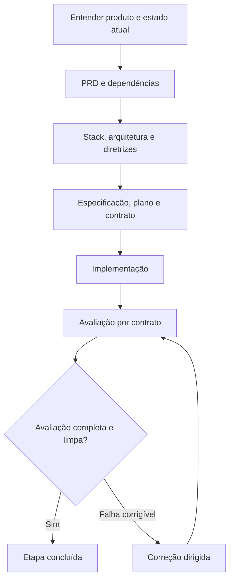

# Guia de desenvolvimento com o harness

Este guia explica como preparar e desenvolver um produto usando o harness deste repositório, tanto ao começar uma aplicação quanto ao evoluir uma aplicação existente. A referência operacional dos scripts e estados está em [harness.md](harness.md); as regras canônicas estão em [AGENTS.md](../AGENTS.md).

## 1. O que o harness faz

O harness combina instruções, skills, scripts de ambiente, validadores e registros de execução. O objetivo é tornar o desenvolvimento verificável: cada etapa tem requisitos, um plano, um contrato de comportamento e evidências do resultado.



Uma skill orienta o trabalho do agente. Ela não é um serviço executado continuamente. Escrever `$spec-writer F01` em uma conversa pede ao agente que siga esse procedimento; os scripts mencionados na skill são executados quando a tarefa os exige. Os exemplos deste guia são mensagens para o Codex, exceto os blocos identificados como comandos de terminal.

O harness não define sozinho o produto nem aprova decisões de negócio. Também não transforma um teste parcial em conclusão da feature. Commit, push, PR, merge e deploy seguem o escopo autorizado na conversa.

## 2. Onde cada informação fica

| Arquivo ou pasta | Papel |
| --- | --- |
| `AGENTS.md` | Regras canônicas para os agentes |
| `docs/PRD.md` | Produto, escopo, features, prioridades, dependências e aceite |
| `docs/prd_progress.json` | Estado de execução das features do PRD |
| `docs/FXX-slug/spec.md` | Comportamento e decisões da feature |
| `docs/FXX-slug/plan.md` | Ordem de implementação e verificações |
| `docs/FXX-slug/contract.md` | Comportamentos observáveis que serão avaliados |
| `docs/FXX-slug/impl-report.md` | Mudanças, verificações e pendências da implementação |
| `docs/FXX-slug/eval-report-*.md` | Evidências e veredito de cada avaliação |
| `docs/FXX-slug/orchestration-*.md` | Diário do ciclo completo |
| `.agents/skills/` | Skills e recursos versionados com o projeto |
| `.codex/` | Configuração e papéis de agentes |
| `scripts/` | Ambiente, gates e validação do harness |

Destinos recomendados para documentos adicionais são `docs/development-guidelines.md`, `docs/adrs/`, `docs/design/` e `docs/architecture/`. `CONTEXT.md`, quando usado, é um glossário do domínio, não uma especificação técnica. Crie esses documentos quando houver conteúdo real para registrar.

Em um projeto novo, o harness pode começar com o progresso vazio. Neste repositório, a aplicação Django já existe e o [estado atual](status-atual.md) consolida as entregas. Templates de outras tecnologias não substituem a stack aprovada.

## 3. Skills do repositório e skills do ambiente

As skills em `.agents/skills/` acompanham o repositório. Outras skills disponíveis nesta sessão, como `brainstorming`, `domain-modeling`, `diagnosing-bugs` e `code-review`, vêm da instalação pessoal. Ao usar o harness em outra máquina, confira o catálogo descoberto pelo Codex: copiar o repositório não instala automaticamente essas skills pessoais nem conexões MCP.

| Necessidade | Skill principal | Quando usar |
| --- | --- | --- |
| Definir produto e comparar alternativas | `brainstorming` | Quando houver decisões relevantes em aberto |
| Organizar requisitos e etapas | `prd-writer` | Para criar ou revisar o PRD |
| Esclarecer termos de negócio | `domain-modeling` | Quando conceitos tiverem significados ambíguos |
| Investigar aplicação existente | `project-analizer` | Para arquitetura, componentes ou dependências reais |
| Registrar decisões arquiteturais | `adrs-management` | Para decisões relevantes com alternativas e consequências |
| Definir convenções da stack | `development-guidelines` | Após escolher as tecnologias |
| Orientar o backend | `clean-arch` | Antes de mudanças no backend |
| Especificar uma feature | `spec-writer` | Antes de implementar a etapa |
| Documentar visualmente a arquitetura | `diagrams-generator` | Quando a fonte arquitetural já estiver definida |
| Implementar sem orquestrar avaliação | `implement-feature` | Quando se desejar executar as fases separadamente |
| Implementar, avaliar e corrigir | `implement-and-evaluate` | Para o ciclo completo de uma feature |
| Avaliar o contrato | `evaluator` | Para obter evidências e veredito |
| Corrigir uma avaliação reprovada | `fix-runner` | A partir do relatório e dos IDs reprovados |
| Verificar jornadas no navegador | `playwright-cli` | Quando existir interface executável |
| Avaliar acabamento visual | `frontend-ui-design` | Com telas observáveis e referências de design |
| Executar uma onda em paralelo | `implement-and-evaluate-tmux` | Somente quando esse modo for solicitado explicitamente |

Não é necessário executar todas as skills em toda tarefa. Uma mudança pequena exige documentação e verificação proporcionais; um novo produto exige resolver as decisões que condicionam sua implementação.

## 4. Caminho para um projeto novo

### Passo 1 — Conferir a preparação

Leia `AGENTS.md`, `docs/harness.md` e o catálogo de skills. No terminal, execute:

```bash
node scripts/check-harness.mjs
node --test scripts/test/harness.test.mjs
```

Essas verificações cobrem o harness. Antes do scaffold, `./scripts/init.sh` apenas informa o estado de preparação; não cria a aplicação. Os gates de backend ainda dependem de código e dependências instaladas.

### Passo 2 — Descobrir o produto

Defina público, problema, jornadas, valor entregue, limites do MVP, integrações e restrições de operação. Separe requisitos confirmados de hipóteses. Não invente métricas, volumes ou regras financeiras para preencher um template.

Mensagem sugerida:

> Use $brainstorming para definir o produto comigo. Faça perguntas sobre problema, público, jornadas e MVP, uma decisão por vez. Identifique hipóteses e pendências. Prepare apenas documentação nesta fase.

### Passo 3 — Criar o PRD

Mensagem sugerida:

> Use $prd-writer para registrar os requisitos definidos em docs/PRD.md. Inclua uma etapa de fundação, funcionalidades do MVP, fora de escopo, dependências e critérios de aceite. Atualize docs/prd_progress.json com as novas features como pending.

O PRD atribui IDs estáveis como `F01`. As dependências determinam as ondas: uma feature entra na onda seguinte à maior onda de suas dependências. Fundações que alteram os mesmos arquivos são sequenciais mesmo quando aparecem na mesma onda.

O resultado precisa permitir responder: o que será entregue, em qual ordem, de que depende e como reconhecer o resultado esperado?

### Passo 4 — Esclarecer o domínio

Quando houver termos ambíguos, use `domain-modeling` para produzir um glossário em `CONTEXT.md`. Discuta exemplos e exceções: dois nomes representam o mesmo conceito? Um conceito possui estados diferentes? Quais atores podem agir sobre ele?

Esse glossário deve usar a linguagem do negócio. Tipos de banco, frameworks e decisões de implementação pertencem a outros documentos.

### Passo 5 — Escolher a stack

Escolha tecnologias a partir dos requisitos: linguagem/runtime, frontend, backend, persistência, autenticação, testes, hospedagem e serviços externos necessários. Compare operação, custo, compatibilidade e familiaridade da equipe. Confirme versões e APIs em documentação oficial atual.

Mensagem sugerida:

> Use $brainstorming para comparar stacks adequadas ao PRD e ao harness. Recomende uma opção com os principais trade-offs. Identifique quais scripts e gates precisarão de adaptação. Resolva comigo as decisões que mudam escopo ou operação antes de documentar a escolha final.

No Garimpei, a decisão já está registrada em [stack.md](stack.md): Python/Django, templates/HTMX, PostgreSQL e worker separado com tarefas persistentes, sem Redis inicialmente. A comparação está em [stack-reavaliacao.md](stack-reavaliacao.md). A ferramenta de coleta depende de F01.

Os templates preservados oferecem TypeScript/Fastify, Next.js e PostgreSQL/Prisma, e os scripts atuais esperam workspaces npm em `apps/backend/` e, opcionalmente, `apps/web/`. Adaptar e verificar esse suporte para Python é trabalho de F02; a interface Django dispensa um workspace web separado. A decisão documental não substitui essa adaptação.

### Passo 6 — Arquitetura e ADRs

Defina responsabilidades, fluxos, integrações e armazenamento. Consulte `clean-arch` para preservar dependências voltadas às regras de negócio, DI por construtor, composição explícita e configuração central. Mapeie esses princípios para Django e para os processos web/worker conforme `AGENTS.md`; caminhos e exemplos TypeScript dos templates precisam de adaptação na arquitetura/F02.

Mensagem sugerida:

> Documente a arquitetura proposta em docs/architecture/ com base no PRD e na stack escolhida. Consulte $clean-arch. Use $adrs-management generate para registrar em docs/adrs/ as decisões relevantes já tomadas, suas alternativas e consequências. Diferencie proposta de arquitetura implementada.

ADRs são úteis quando a decisão envolve um trade-off relevante e seria difícil entender seu motivo no futuro. Não é necessário um ADR para cada biblioteca. Antes de existir código, as operações de mapear e identificar arquitetura implementada têm alcance limitado.

### Passo 7 — Guidelines e design

Mensagem sugerida:

> Use $development-guidelines para gerar docs/development-guidelines.md com a stack escolhida e fontes oficiais atuais. Inclua organização, validação, erros, logs, testes, configuração e dependências. Preserve AGENTS.md e diferencie regras existentes de propostas novas.

A geração não instala ferramentas nem altera automaticamente `AGENTS.md`. Configurar essas regras executáveis é trabalho da fundação.

Se houver interface, defina também navegação, jornadas, direção visual, acessibilidade, responsividade e estados de carregamento, vazio, erro e sucesso em `docs/design/`. `brainstorming` ajuda a resolver essas decisões. `frontend-ui-design` avalia telas executáveis posteriormente.

### Passo 8 — Especificar a fundação e as próximas features

Mensagem sugerida:

> Use $spec-writer F01 para produzir spec.md, plan.md e contract.md. Inclua preparação do ambiente, integração seletiva do scaffold, testes, gates e pré-requisitos verificáveis. Prepare somente os documentos.

Os três documentos têm papéis diferentes:

| Documento | Pergunta que responde |
| --- | --- |
| `spec.md` | O que a etapa faz e quais regras precisa respeitar? |
| `plan.md` | Em que ordem implementar e verificar? |
| `contract.md` | Que comportamento observável prova cada critério de aceite? |

O contrato inclui pré-requisitos, gates, itens Given/When/Then com IDs e um Coverage Manifest que relaciona itens aos critérios de aceite do PRD. Dados de teste, migrations, seeds e referências a credenciais precisam ter criação e verificação descritas. Os valores secretos ficam no ambiente.

Especifique primeiro a fundação e as etapas próximas. Detalhar toda uma aplicação antes de validar suas primeiras dependências pode produzir planos obsoletos. O `plan.md` dessa skill já organiza a implementação; evite um segundo plano duplicado.

### Passo 9 — Diagramar e revisar a preparação

Use `diagrams-generator` com uma especificação ou documento de arquitetura como fonte. Por exemplo:

> Use $diagrams-generator mermaid docs/architecture/visao-geral.md docs/architecture/diagramas --no-images.

O caminho da fonte é ilustrativo: substitua pelo documento realmente criado. Preserve os fontes dos diagramas e não apresente uma imagem como renderizada se apenas o fonte foi gerado.

Antes de implementar, confira se PRD, stack, guidelines, arquitetura e contrato concordam. As dependências da primeira etapa e as decisões que a bloqueiam devem estar resolvidas. Features futuras podem manter pendências explícitas.

### Passo 10 — Implementar a primeira etapa

Mensagem sugerida:

> Use $implement-and-evaluate F01 para executar o ciclo completo com até três ciclos de correção. Preserve o harness ao integrar o scaffold. Registre evidências e pendências. Não faça commit, push ou PR neste pedido.

O scaffold deve ser gerado em pasta temporária e integrado seletivamente. Preserve instruções, configuração, scripts e arquivos existentes. A opção `--force` não substitui essa integração. Os detalhes de prévia do gerador estão em [harness.md](harness.md#scaffold-sem-substituir-o-harness).

## 5. Caminho para um projeto existente

### Passo 1 — Registrar o estado atual

Antes de propor uma reorganização, leia as instruções, documentação, estrutura, comandos de desenvolvimento e testes. Confira o estado do Git e preserve trabalho em andamento. Execute as verificações existentes para distinguir falhas anteriores de regressões da mudança.

Mensagem sugerida:

> Use $project-analizer architecture para analisar a aplicação existente. Registre em docs/architecture/diagnostico-atual.md a estrutura observada, fluxos e riscos com evidências de arquivos. Diferencie fatos de hipóteses. Não altere a aplicação.

Use as operações `component` e `dependencies` quando precisar aprofundar um módulo ou auditar dependências. O analisador deve excluir templates e dependências geradas das conclusões sobre o produto.

### Passo 2 — Integrar o harness ao funcionamento real

Este harness foi adaptado ao Garimpei; não é uma instalação universal independente da stack. Em outro repositório, revise as instruções locais, caminhos, comandos, prefixo de banco, workspaces, health check e validadores antes de reutilizá-los.

Preserve os comandos que já funcionam e adapte o lifecycle de forma incremental. Uma aplicação existente não precisa receber um novo scaffold para usar PRD, contratos e avaliação. Se a arquitetura atual divergir das regras desejadas, documente o estado observado e planeje a transição explicitamente, sem declarar uma migração concluída.

### Passo 3 — Delimitar a evolução pretendida

Use `prd-writer` para registrar as mudanças solicitadas e suas dependências. Não atribua `done` retrospectivamente a funcionalidades existentes sem avaliação pelo contrato. Funcionalidades já disponíveis podem ser descritas como contexto e pré-requisitos verificáveis.

Mensagem sugerida:

> Use $prd-writer para documentar a evolução solicitada sobre a aplicação existente. Preserve IDs e histórico atuais. Descreva capacidades existentes como contexto verificável e crie features para as mudanças necessárias, sem pressupor reescrita.

### Passo 4 — Atualizar decisões e especificar a mudança

Revise guidelines e registre ADRs somente onde houver decisões reais. Use `spec-writer` para delimitar a alteração, incluindo compatibilidade, migrations, integrações afetadas e comportamentos que precisam ser preservados. Quando aplicável, planeje reversão de migrations e implantação gradual.

Se a tarefa for um defeito, investigue e reproduza primeiro; `diagnosing-bugs` auxilia essa investigação. Para comportamento corrigido, mantenha uma regressão significativa. Não converta automaticamente um bug localizado em uma reformulação do produto.

### Passo 5 — Implementar e avaliar incrementalmente

Execute a etapa com `implement-and-evaluate` ou separe implementação, avaliação e correção. Verifique o comportamento novo e as regressões relevantes da aplicação. Falhas anteriores devem permanecer identificadas; não representam aprovação dos gates exigidos.

## 6. Rotina de uma feature

1. Leia a feature, seu contrato, dependências e estado atual do Git.
2. Prepare isolamento quando necessário; uma worktree evita misturar trabalho incompatível, mas não resolve compartilhamento de bancos ou serviços externos por si só.
3. Execute `./scripts/init.sh` antes de trabalho que precise da aplicação.
4. Implemente as fases do plano, incluindo pré-requisitos e testes significativos.
5. Execute gates e testes aplicáveis pelos comandos definidos no contrato. A entrada atual `node scripts/run-gates.mjs` precisa ser adaptada para Python em F02 antes de servir como validação do backend escolhido.
6. Avalie o contrato e registre esperado, observado e evidência por item.
7. Corrija falhas a partir do relatório e reavalie o contrato.
8. Encerre processos desta execução com `./scripts/stop.sh` quando não precisar preservar o ambiente.

O runner preservado executa os seis gates TypeScript, ESLint, Dependency Cruiser, Architecture, Madge e Knip. Para a stack Python aprovada, F02 deve definir e implementar validadores de tipos, lint, dependências, arquitetura, ciclos e código/dependências não utilizados, além dos testes. Gate ausente ou não executado permanece pendente. Antes de existir backend/dependências, o runner atual retorna erro de pré-requisito; isso não é sucesso nem validação da aplicação Python.

Para executar as fases separadamente, envie mensagens como:

```text
$implement-feature F02
$evaluator F02
```

Se houver reprovação, forneça dados concretos ao corretor:

```text
Use $fix-runner com o relatório <caminho-real-do-relatorio>,
os itens reprovados <IDs-reais> e ciclo 1. Depois, use $evaluator F02.
```

O avaliador produz evidências e veredito; correções pertencem ao `fix-runner`. Não altere contratos para fazer uma implementação reprovada parecer correta. Mudanças reais de requisito devem ser explícitas e refletidas nos documentos pertinentes.

## 7. Interface, ambiente e dados

Use `playwright-cli` para jornadas reais no navegador e `frontend-ui-design` para os critérios visuais solicitados. Screenshots precisam ser examinadas. Menus, diálogos, mídia, estados de erro e diferentes tamanhos de tela entram na verificação quando relevantes ao contrato. Uma nota visual não substitui a comprovação das regras de negócio.

Os scripts atuais procuram portas livres com offset por branch e usam bancos com prefixo `garimpei_`. Logs, PIDs e portas ficam sob seu controle. Com Prisma habilitado, migrations de desenvolvimento passam por `./scripts/migrate-dev.sh -- --name <mudanca>` no ambiente apropriado.

`./scripts/stop.sh --clean` também remove o banco de desenvolvimento da branch. Use essa opção somente em ambiente descartável autorizado. A avaliação deve manipular apenas dados e processos identificados como pertencentes à sua execução.

Segredos ficam em variáveis de ambiente; relatórios registram nomes e pré-requisitos sem valores secretos. Temporários ficam fora da raiz, em diretório temporário do sistema ou pasta de execução ignorada.

## 8. Progresso e conclusão

| Estado | Interpretação |
| --- | --- |
| `pending` | Feature definida, ainda não iniciada |
| `implementing` | Implementação em andamento |
| `implemented` | Implementação pronta para avaliação |
| `done` | Contrato completamente aprovado e gates aprovados |
| `fail` | Falha terminal documentada |
| `pr-blocked` | Avaliação limpa, mas integração de PR autorizada bloqueada |
| `removed` | Feature retirada do PRD, com histórico preservado |

Somente a avaliação completa pode levar a `done`. `BLOCKED`, `MANUAL` e `SKIPPED` não equivalem a `PASS`. Uma avaliação filtrada é útil para diagnóstico, mas não conclui a etapa. Preserve relatórios anteriores e mantenha o JSON coerente com o PRD.

O ciclo completo usa, por padrão, até três ciclos de correção além da implementação inicial. Dependências externas indisponíveis e decisões de produto pendentes devem ser relatadas; a execução não deve simular sucesso. Os detalhes de estados e timestamps estão em [harness.md](harness.md#progresso).

## 9. Paralelismo, revisão e integração

O fluxo normal pode ocorrer na sessão atual. Papéis disponíveis em `.codex/agents/` não autorizam automaticamente delegação.

Quando quiser uma onda em paralelo, peça explicitamente `$implement-and-evaluate-tmux wave N`. São necessárias features especificadas, base Git e ambientes preparados. Cada feature usa worktree e ambiente próprios; fundações que alteram arquivos comuns permanecem sequenciais. tmux é opcional. O coordenador consolida evidências e progresso.

Quando apropriado, use `code-review` para revisar um diff ou `requesting-code-review` para uma revisão independente autorizada. Revisão de código e avaliação do contrato têm funções distintas. A primeira examina a mudança; a segunda comprova os comportamentos exigidos.

Uma feature `done` ainda não implica publicação. Peça commit, push, abertura de PR, merge ou deploy conforme o resultado desejado e o escopo autorizado.

## 10. Continuidade entre sessões

Os documentos do repositório mantêm requisitos, decisões e evidências canônicas. ai-memory auxilia recuperação de histórico e handoffs conforme as instruções e skills instaladas. Memória recuperada é evidência histórica e precisa ser confrontada com os arquivos atuais; não aprova requisitos nem substitui o contrato.

Ao retomar, peça para recuperar o handoff e conferir PRD, progresso, último relatório e estado do Git antes de continuar. Não é necessário salvar manualmente cada atividade: os hooks já capturam observações de sessão. Memória durável só deve ser escrita quando solicitada explicitamente.

## 11. Erros de uso a evitar

| Situação | Conduta recomendada |
| --- | --- |
| Escolher stack antes de entender as necessidades | Primeiro definir requisitos e restrições |
| Tratar templates como tecnologia aprovada | Registrar a escolha real e adaptar o lifecycle |
| Gerar scaffold sobre aplicação existente | Analisar e integrar seletivamente quando necessário |
| Implementar uma feature sem contrato | Especificar comportamento e pré-requisitos primeiro |
| Criar dois planos equivalentes | Usar o `plan.md` da feature como referência |
| Marcar conclusão após apenas compilar | Avaliar contrato, gates e jornadas aplicáveis |
| Usar relatório antigo como prova atual | Produzir evidências da execução em avaliação |
| Paralelizar fundações com arquivos comuns | Executá-las sequencialmente |
| Reescrever aplicação existente para adotar o harness | Integrar o processo de forma incremental |

## Referências locais

- [Operação e configuração do harness](harness.md)
- [Regras canônicas do projeto](../AGENTS.md)
- [Plugins Full Cycle](../plugins.md)
- [Skills versionadas](../.agents/skills/)
- [Formato do PRD e schema de progresso](../.agents/skills/prd-writer/references/prd-format.md)
- [Template de especificação e plano](../.agents/skills/spec-writer/references/feature-template.md)
- [Template de contrato](../.agents/skills/spec-writer/references/contract-template.md)
