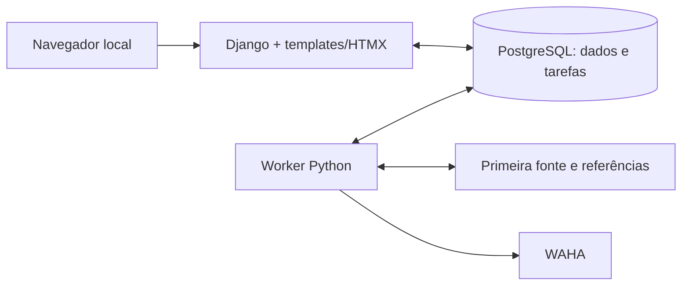

# Garimpei — reavaliação da stack para o MVP

Data: 2026-11-10. Status: análise que fundamentou a direção técnica posteriormente aprovada pelo usuário: Python/Django, templates/HTMX, PostgreSQL e worker separado com tarefas persistentes, sem Redis inicialmente. A decisão vigente está em [stack.md](stack.md) e no [PRD](PRD.md). Os argumentos e graus de confiança abaixo preservam a comparação realizada; recomendações condicionais e bibliotecas candidatas não se tornam escolhas aprovadas apenas por constarem da análise.

## 1. O produto que a stack precisa atender

O MVP ajuda uma pessoa iniciante a encontrar eletrônicos usados para revender. A evidência de valor será uma primeira revenda lucrativa, observada fora da aplicação. Os comportamentos confirmados no PRD são:

- Monitorar categorias e produtos cadastrados por nome/modelo, começando por uma plataforma ainda a escolher.
- Considerar retirada em São Paulo e envio ao CEP, conforme dados e verificações disponíveis.
- Separar funcionamento adequado, defeitos/reparo/peças e condição não confirmada, com classificação manual dos incertos.
- Estimar revenda com comparáveis usados, mostrar referência distinta de novo, calcular custos e deixar indisponibilidade explícita quando a amostra não bastar.
- Exibir três abas, ordenar por lucro, mostrar os comparáveis e encaminhar ao anúncio original.
- Enviar alertas individuais via WAHA para eventos elegíveis, conservando carga inicial silenciosa, histórico e retomada após interrupções.
- Rodar localmente no Linux/WSL2, com Docker disponível e acesso pelo mesmo computador, sem login no Garimpei.

Não há exigência de muitos usuários, cluster, aplicação nativa, processamento de imagens, modelo de IA, funcionamento offline da interface ou negociação/compra dentro do sistema. Esses cenários não justificam serviços adicionais neste momento.

Continuam desconhecidos: primeira plataforma e forma de acesso, volume de anúncios, frequência sustentável, CPU/RAM disponíveis, método de equivalência/classificação e parâmetros estatísticos. Logo, não existe benchmark do Garimpei que prove uma linguagem mais rápida, um banco insuficiente ou um requisito de Redis.

## 2. Critérios e método de comparação

A comparação prioriza, nesta ordem:

1. Reduzir o risco de obter dados úteis e ajustar integrações e regras ainda desconhecidas.
2. Preservar acompanhamento, evidências e intenções de alerta entre reinícios e falhas.
3. Entregar e manter as jornadas do MVP com poucas peças independentes.
4. Operar localmente com dependências e recursos compreensíveis.
5. Manter tipos, testes e limites entre responsabilidades que permitam mudanças seguras.
6. Otimizar consumo e throughput quando as medições mostrarem necessidade.

A rapidez dos alertas continua prioritária. É uma hipótese de trabalho que a espera pela fonte, seus limites de acesso e a renderização expliquem grande parte da latência. Por isso, benchmark de HTTP de framework não determina a escolha. A linguagem influencia processamento e concorrência, mas não torna anúncios disponíveis antes de a fonte permitir.

As conclusões de adequação abaixo são julgamentos de engenharia a partir desses critérios. As fontes oficiais comprovam recursos das ferramentas; não comprovam desempenho ou viabilidade de integração com os marketplaces deste produto. O reaproveitamento do harness não entra como vantagem na classificação.

## 3. Linguagem e runtime: quatro candidatas reais

| Candidata | Pontos favoráveis neste produto | Custo ou risco relevante | Parecer para o MVP |
|---|---|---|---|
| Python | Bibliotecas de coleta HTTP/browser, tratamento de texto e exploração dos dados; Django pode reunir persistência e interface | Tipos precisam de verificação adicional; dependências de runtime; trabalho de CPU deve ser medido e isolado quando necessário | Primeira preferência para ajustar integrações e critérios de equivalência durante o MVP |
| Node.js + TypeScript | Playwright/Crawlee, tipagem estática e possibilidade de compartilhar linguagem com frontend; bom candidato a coleta assíncrona | Tarefas intensivas de CPU no event loop exigem atenção; uma API com SPA demanda contratos e coordenação entre aplicações | Finalista muito próxima; vence se coleta/browser e frontend React forem as prioridades dominantes |
| Go | Tipagem estática, concorrência explícita e distribuição da aplicação compilada; HTTP, templates, coleta e filas disponíveis | Mais composição para formulários, persistência e ferramentas de inspeção; experimentação de regras e dados pode exigir mais trabalho de aplicação | Alternativa legítima, especialmente para serviço estável de coleta por API/HTTP e distribuição simples |
| Rust | Controle de recursos, tipos e garantias de memória; componentes web, SQL e automação disponíveis | Maior investimento esperado na implementação e manutenção de integração assíncrona/tipos para requisitos ainda móveis | Não escolheria como base inicial sem limitação concreta de recursos ou processamento que compense esse investimento |

Python não é necessário para média, mediana, percentuais ou cálculo de lucro. Todos os candidatos podem implementar essas regras. Sua vantagem proposta é facilitar o ciclo de examinar anúncios reais, descobrir exceções e ajustar correspondência e amostragem. Isso precisa ser confrontado com os resultados de F01.

TypeScript não precisa perder para Python em scraping: ambos têm suporte oficial do Playwright e implementações do Crawlee. O Playwright lista JavaScript/TypeScript, Python, Java e .NET como linguagens oficiais; Go e Rust têm outras bibliotecas e integrações que devem ser avaliadas por seus próprios méritos. [Playwright](https://playwright.dev/docs/languages), [Crawlee Python](https://crawlee.dev/python/), [Crawlee JavaScript](https://crawlee.dev/js).

Em Go, Colly atende coleta HTTP e Rod controla Chrome/Chromium por DevTools. A biblioteca padrão cobre HTTP e templates HTML, e River fornece tarefas persistentes. Em Rust, Axum, SQLx e Chromiumoxide compõem um caminho possível; a documentação atual do River também apresenta integração Rust. Não se trata de ausência de ferramentas. [Colly](https://github.com/gocolly/colly), [Rod](https://github.com/go-rod/rod), [HTTP Go](https://pkg.go.dev/net/http), [templates Go](https://pkg.go.dev/html/template), [River](https://riverqueue.com/docs), [Axum](https://github.com/tokio-rs/axum), [SQLx](https://github.com/transact-rs/sqlx), [Chromiumoxide](https://github.com/mattsse/chromiumoxide).

Distribuir um executável Go ou Rust não elimina PostgreSQL, WAHA e eventual navegador automatizado. A diferença de consumo da aplicação não equivale à diferença de consumo do ambiente completo. É necessário medir os processos juntos na máquina real.

Node também permite isolar processamento pesado. A recomendação de worker separado vale para as quatro candidatas; Python não torna automaticamente o processamento paralelo, nem a adoção de Go/Rust garante o controle correto de carga. [Orientações de Node sobre bloqueio](https://nodejs.org/en/learn/asynchronous-work/dont-block-the-event-loop), [concorrência em Go](https://go.dev/doc/effective_go#concurrency).

## 4. Framework e interface

| Composição | Encaixe nas jornadas atuais | Quando eu a escolheria |
|---|---|---|
| Django + templates + HTMX | ORM, migrations, formulários e páginas integrados; atualizações parciais para abas, filtros, classificação e detalhes | Melhor composição inicial para uma interface orientada aos dados com interações locais e persistência no servidor |
| FastAPI + React/Vite | API independente e frontend com estado/componentes próprios; ORM/migrations precisam de escolha e integração | Se a independência da API ou a complexidade de interação no navegador justificar dois projetos |
| Fastify + React/Vite | Base TypeScript com separação clara entre frontend e API | Melhor finalista se escolhermos TypeScript e quisermos uma SPA |
| Go + templates/HTMX ou React | Permite interface renderizada no servidor ou SPA | Se escolhermos Go por requisitos de execução/distribuição, sem presumir que React seja obrigatório |
| Rust + Axum + templates ou React | Tecnicamente viável para a interface e API | Se Rust vencer por uma necessidade concreta do núcleo, aproveitando a mesma linguagem no servidor |

Django fornece ORM e templates; sua vantagem proposta aqui é reduzir integração entre peças. A administração embutida pode ajudar no desenvolvimento, mas não substitui a interface do produto nem introduz um requisito de login no MVP. FastAPI oferece API tipada e documentação automática, vantagens reais quando existe uma API independente a servir. [Django](https://docs.djangoproject.com/en/5.2/intro/overview/), [FastAPI](https://fastapi.tiangolo.com/features/).

React organiza componentes e estado no cliente; HTMX atualiza a página com respostas HTML do servidor. Ambos podem entregar filtros, detalhes e uma apresentação cuidada. React ganha valor com muitas interações coordenadas no cliente, edição prolongada, visualizações interativas complexas ou necessidade de clientes independentes. HTMX reduz a necessidade de manter uma SPA separada neste recorte, mas ainda exige tratar concorrência de requisições, foco, histórico, carregamento, erros e testes de navegador. [React](https://react.dev/learn/thinking-in-react), [HTMX](https://htmx.org/docs/).

Não há motivo para rejeitar React por ser apenas um usuário. A decisão deve vir das interações necessárias e do custo de manter frontend/API. Minha preferência por HTMX é moderada: um requisito novo de interação pode invertê-la sem mudar a linguagem da coleta.

Não adicionaria Next.js apenas para SEO ou renderização no servidor: o produto é um painel privado local. A decisão importante neste MVP é quem administra o estado e renderiza as jornadas, e não a popularidade do framework.

## 5. Dados: PostgreSQL, MySQL, SQLite e Redis

| Tecnologia | Papel possível | Avaliação para o Garimpei |
|---|---|---|
| PostgreSQL | Fonte de verdade relacional e armazenamento de tarefas persistentes | Minha escolha: combina histórico, restrições e consultas com candidatos de fila que usam o mesmo serviço |
| MySQL/InnoDB | Fonte de verdade relacional; também permite construir processamento de fila | Atende ao MVP. Não identifiquei vantagem específica que motive preferi-lo na ausência de experiência prévia ou infraestrutura MySQL |
| SQLite | Fonte de verdade local em arquivo | Alternativa forte se a prioridade absoluta for eliminar o serviço de banco; exige compatibilizar concorrência e solução de tarefas |
| Redis | Cache, coordenação, broker ou streams; persistência configurável | Não adicionaria inicialmente. Falta um requisito de cache/coordenação que justifique outro serviço e outra política de persistência |

PostgreSQL oferece `jsonb` e índices de similaridade textual com `pg_trgm`. Isso pode ajudar a guardar dados específicos das fontes e encontrar candidatos a comparáveis. É uma possibilidade de evolução, não um motivo para armazenar todo o domínio em JSON nem uma prova de que dois modelos são equivalentes. [JSON PostgreSQL](https://www.postgresql.org/docs/current/datatype-json.html), [pg_trgm](https://www.postgresql.org/docs/current/pgtrgm.html).

MySQL/InnoDB tem transações, recuperação após falhas, chaves estrangeiras e JSON nativo. Também possui `SKIP LOCKED`, recurso útil em cenários de filas. Portanto, a preferência por PostgreSQL não se apoia numa suposta falta de durabilidade ou capacidade de MySQL. A integração com a biblioteca de tarefas escolhida é uma diferença concreta a avaliar. [InnoDB](https://dev.mysql.com/doc/refman/8.4/en/innodb-introduction.html), [JSON MySQL](https://dev.mysql.com/doc/refman/8.4/en/json.html), [locking reads](https://dev.mysql.com/doc/refman/8.4/en/innodb-locking-reads.html).

SQLite foi concebido para armazenamento local simples e admite uma gravação por vez por arquivo. Isso não impede um MVP durável com um worker e transações curtas. PostgreSQL passa à frente nesta proposta porque permite adotar uma fila baseada nele sem outro servidor; se escolhermos SQLite, a solução de tarefas precisa ser escolhida junto. [Usos de SQLite](https://www.sqlite.org/whentouse.html).

Redis pode persistir com snapshots RDB e/ou AOF; a durabilidade depende da configuração. Não seria correto tratá-lo como incapaz de persistir ou como substituto automaticamente equivalente do histórico relacional. Para este MVP, usar Redis além do banco aumentaria a superfície de configuração, recuperação e diagnóstico antes de demonstrar necessidade. [Persistência Redis](https://github.com/redis/docs/blob/main/content/operate/oss_and_stack/management/persistence.md).

## 6. Coleta, tarefas e confiabilidade

A solução de coleta deve seguir F01: API/HTTP simples quando suficiente; navegador quando necessário; framework de crawling quando filas de URLs, concorrência e sessões justificarem sua adoção. Não escolher simultaneamente Scrapy, Crawlee e Playwright sem delimitar responsabilidades.

Proposta para Python: um projeto com processo web e processo worker separado. Avaliar Procrastinate para agendamento e tarefas no PostgreSQL. Para TypeScript, pg-boss é um candidato equivalente em papel. Para Go, River é outro candidato. Suas semânticas e integração transacional precisam de verificação; o nome da biblioteca não constitui garantia de entrega. [Procrastinate](https://procrastinate.readthedocs.io/en/stable/), [pg-boss](https://github.com/timgit/pg-boss), [River](https://riverqueue.com/docs).

O framework de tasks do Django não inclui o worker de execução. Escolher Django continua exigindo resolver essa parte. O worker deve ter inicialização, prontidão, parada e retomada próprias; criar dois processos não exige dois repositórios ou microserviços. [Tasks Django](https://docs.djangoproject.com/en/6.0/topics/tasks/).

As tarefas periódicas devem consultar a fonte novamente. A deduplicação de URLs de um crawler não pode impedir que anúncios conhecidos sejam revisitados para detectar redução de preço. Filas de URLs de crawling e filas de tarefas de negócio possuem responsabilidades diferentes; é preciso definir os limites e evitar repetir mecanismos sem necessidade.

Independente da linguagem, especificar e verificar:

- Identidade de anúncio, carga inicial e eventos de preço persistidos.
- Intenção de alerta e seus estados, evitando perder o evento entre gravação e agendamento; avaliar registro transacional de intenções/outbox.
- Retentativas, controle de concorrência, timeouts e retomada de trabalho interrompido.
- Progresso dos alertas sem ficar indefinidamente atrás de uma coleta lenta.
- Resultado incerto do WAHA separado de envio confirmado. Não há garantia automática de entrega exatamente uma vez.
- Método e versão de cálculo rastreáveis aos comparáveis usados, sem substituir insuficiência de dados por lucro zero.

As políticas de alerta e amostragem ainda pendentes não são decididas por este documento. Similaridade lexical, inclusive RapidFuzz ou `pg_trgm`, pode gerar candidatos; é preciso separar modelo, variante e condição antes de comparar preços. Não adicionaria embeddings ou LLM antes de avaliar regras e amostras reais. [RapidFuzz](https://rapidfuzz.github.io/RapidFuzz/Usage/index.html).

## 7. Recomendação e grau de confiança

| Responsabilidade | Recomendação proposta | Confiança e motivo |
|---|---|---|
| Núcleo e aplicação web | Python + Django | Moderada: favorece integração da aplicação e ajuste das regras; Node/TypeScript é uma finalista próxima |
| Interface | Templates Django + HTMX | Moderada: corresponde às jornadas atuais; reavaliar se surgir estado complexo no cliente |
| Persistência | PostgreSQL + Django ORM/migrations | Alta para adequação ao recorte; SQLite/MySQL também atendem, com outros trade-offs |
| Tarefas | Processo worker e fila persistente no PostgreSQL; Procrastinate como primeiro candidato a validar | Alta para necessidade de estado persistente; biblioteca e integração ainda exigem verificação |
| Coleta | Adaptador da primeira plataforma; HTTP/API ou Playwright conforme F01 | Baixa para ferramenta concreta enquanto a fonte não foi escolhida |
| WhatsApp | WAHA isolado, acessado pelo backend/worker | Requisito confirmado; engine, sessão e comportamento precisam de discovery |
| Cache/broker adicional | Sem Redis inicialmente | Alta enquanto não existir requisito ou medição que compense outro serviço |

Arquitetura proposta:

Um projeto modular e dois processos de aplicação, com PostgreSQL e WAHA em Docker, é a base aprovada. Monitoramento continua após fechar a aba enquanto os processos necessários estiverem ativos. Isso não adiciona operação 24 horas. A separação do worker substitui a proposta original de tarefas no processo da API; essa mudança operacional foi incluída na aprovação do usuário.

Não combinaria Python + Go + Rust + Node no MVP por especialização antecipada. Primeiro medir um componente concreto e só então avaliar outra linguagem. Usar JavaScript do HTMX e ferramentas de navegador não transforma, por si só, a aplicação em uma arquitetura de serviços em múltiplas linguagens.

## 8. O que mudaria a recomendação

| Evidência encontrada | Mudança a considerar |
|---|---|
| Primeira integração depende de biblioteca JS específica sem alternativa adequada | Node/TypeScript pode passar à frente de Python |
| Interface exige muito estado e interação coordenada no navegador | React/Vite ganha preferência; backend Python continua possível |
| Fontes oferecem APIs estáveis e o principal requisito passa a ser distribuir serviço compilado | Go + templates/HTMX ou React passa a competir mais diretamente |
| Perfil real demonstra gargalo crítico de CPU/memória no código da aplicação | Avaliar otimização e, se necessário, componente Go/Rust; medir ambiente com navegador/WAHA |
| Operação precisa caber em máquina com recursos muito limitados | Reavaliar SQLite, engine WAHA, concorrência de navegador e serviços antes de trocar apenas a linguagem |
| Banco/filas medidos não atendem ao volume ou há dependência concreta de broker/cache | Avaliar Redis e biblioteca associada, com persistência e recuperação definidas |
| Experiência ou infraestrutura MySQL já existente reduz substancialmente o custo operacional | MySQL pode ser a melhor escolha prática |

## 9. Validação futura e impacto no harness

Não foi executada coleta, PoC ou benchmark nesta reavaliação. Uma investigação prática pertence ao escopo a definir para F01. Nela, medir acesso e dados necessários, tempo de aquisição, dados comparáveis, limites da fonte e recursos do conjunto. Para o sistema implementado, testar também parada/retomada, queda durante gravação/envio e preservação de classificações. Só comparar protótipos de linguagens diferentes se houver uma dúvida concreta que essa comparação resolva.

Com Python/Django aprovado, adaptar `init.sh`, `stop.sh` e `resolve-env.sh` para web/worker Python, portas e recursos Docker; substituir o wrapper Prisma de migrations pelos comandos Django e da fila; integrar o scaffold apropriado. Um frontend HTMX permite servir a interface no processo web, sem servidor Vite separado.

Os seis gates atuais e caminhos TypeScript de `AGENTS.md`/F02 não validam Python. Será necessário revisar as instruções e o contrato da fundação explicitamente, definindo verificações de tipos, lint, dependências, limites arquiteturais, código não usado, testes e build/execução adequadas à linguagem. Remover ferramentas inaplicáveis não equivale a aprovar sua execução nem autoriza omitir os objetivos de qualidade. As jornadas de navegador e testes do lifecycle continuam necessários.

Essa adaptação é consequência da escolha do produto, não critério usado para favorecê-la. Este documento preserva a análise comparativa; a escolha aprovada e seu mapa de adaptações estão em stack.md. A documentação foi alinhada, mas scripts e validadores ainda serão adaptados em F02; F01–F09 continuam `pending`.
