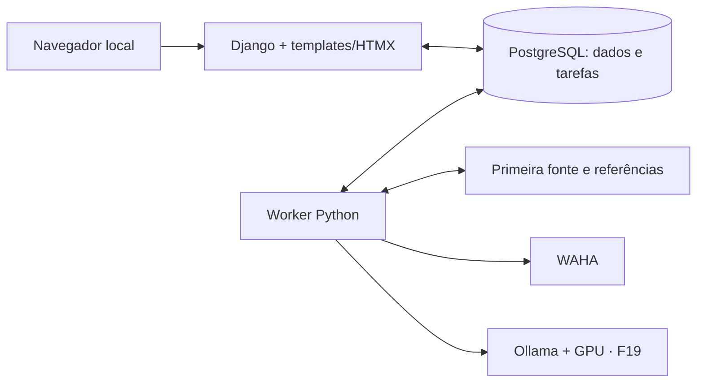

# Garimpei — stack aprovada para o MVP

Data da decisão inicial: 2026-11-10. Adendo de IA local: 2026-11-12 UTC. A base Python/Django foi implementada e avaliada em F02; o [progresso](prd_progress.json) registra a situação atual de cada etapa. Esta página preserva também o planejamento histórico da fundação. Fontes canônicas: [PRD](PRD.md) e [AGENTS.md](../AGENTS.md). F19 e F20 estão implementadas e avaliadas; F22 acrescenta controle global. F21 está implementada com prova real positiva pendente. Consulte o [estado atual](status-atual.md) para evidências e limites.

## Escolha final

| Responsabilidade | Escolha aprovada |
|---|---|
| Linguagem e aplicação web | Python + Django |
| Interface | Templates Django + HTMX |
| Persistência | PostgreSQL em Docker, com Django ORM e migrations |
| Processamento contínuo | Worker Python separado do processo web, compartilhando código e banco |
| Tarefas | Fila persistente no PostgreSQL com Procrastinate, validada em F02 |
| Coleta | Facebook Marketplace por Playwright, perfil dedicado e publicação incremental em F11/F12 |
| Alertas | WAHA em Docker, acessado pela aplicação/worker |
| IA multimodal local | Qwen3.5 4B Q4_K_M via Ollama em Docker com GPU NVIDIA; implementação e avaliação em F19 |
| Cache ou broker adicional | Sem Redis inicialmente |
| Ambiente | Operação padrão F23 em Docker/Compose: web, worker/Chromium, PostgreSQL, WAHA e Ollama; preparo e ferramentas em contêineres. Runtime host permanece opção explícita de compatibilidade das regressões anteriores |
| Acesso | Navegador deste computador, via localhost, sem login no Garimpei |

Esta decisão substitui React/Vite, a execução da aplicação em Node e a recomendação anterior de Fastify/Prisma. Node continua necessário às ferramentas atuais do harness enquanto elas forem utilizadas; isso não o torna runtime da aplicação.

## Evolução aprovada — Docker completo e IA integrada (F23)

Requisito confirmado e implementado em 2026-11-13: [F23](F23-docker-completo-e-ia-integrada/spec.md), prioridade 1, onda 14, estado `implemented`, com aceite completo pendente. O Compose reúne PostgreSQL, WAHA, Ollama, Django/Gunicorn e worker/Playwright. Web e worker continuam processos separados do mesmo monólito modular; preparo, migrations e ferramentas usam contêineres pontuais. O lifecycle padrão exige Docker/Compose e ferramentas Unix usuais no host, sem Python/uv/Node locais. Prontidão real, seis gates e cinco perfis GPU possuem evidências na feature; adoção e rollback controlados também foram verificados, sem substituir a referência humana ou a cadeia positiva real.

IA local passa a ter consumidores explícitos também em identidade e revisão de comparáveis, além da condição F15; apoia investigação e diagnóstico por dados sanitizados. Cada resultado precisa de evidências, versões e vínculo com a decisão que o utilizou. Preços, mediana, cálculos, autorização e corpo de alerta continuam sujeitos às regras determinísticas e aos snapshots. Inferência não garante veracidade: corpus humano independente e prova real de GPU/consumo fazem parte do contrato.

Preservar Qwen3.5 4B Q4_K_M e locks F19. O transporte padrão da aplicação usa HTTP privado entre contêineres, sem socket Docker em web/worker/Ollama; controle e recuperação de contêineres permanecem nos wrappers do host. Manter rede de inferência sem saída externa após preparo, coordenação GPU entre ambientes, persistência e pausas F22. Migração exige inventário, backup restaurado e rollback verificado; recuperação de chamada incerta será explícita pelo wrapper de operação. O aceite integrado depende também da prova real positiva ainda pendente de F21. As seções históricas seguintes descrevem a base anterior e seus aceites, sem comprovar F23.

O usuário aprovou a direção de stack e a separação do worker. Procrastinate, Playwright, gerenciador uv e seis gates Python foram preparados e avaliados nas etapas existentes; versões e operação constam dos artefatos de F02 e integrações. O serviço de inferência foi integrado pela F19, preservando Django, templates/HTMX e PostgreSQL.

## Motivos e trade-offs

Python favorece o ciclo de examinar dados reais e ajustar correspondência, classificação e amostragem ainda desconhecidas. Django reúne persistência, migrations, formulários e páginas. Templates/HTMX correspondem às jornadas atuais de configuração, três abas, filtros, classificação manual e detalhes. Essa preferência não depende de reaproveitar o harness e não representa um benchmark de desempenho. [Django](https://docs.djangoproject.com/en/5.2/intro/overview/), [HTMX](https://htmx.org/docs/).

O custo é manter o ambiente Python e validar tipos, dependências e processamento. HTMX ainda exige cuidado com estado da página, foco, navegação, requisições concorrentes e erros. React continua uma alternativa se futuras jornadas precisarem de muito estado no cliente; Node/TypeScript continua uma alternativa se o discovery revelar uma dependência decisiva do ecossistema JavaScript.

Go e Rust também atendem tecnicamente. Não há limitação medida de processamento ou distribuição que compense, neste MVP, o investimento adicional esperado para montar a aplicação e ajustar integrações nessas linguagens. A análise das quatro candidatas e as condições que inverteriam a recomendação estão na [reavaliação](stack-reavaliacao.md).

PostgreSQL permite reunir histórico relacional e tarefas persistentes no mesmo serviço. MySQL e SQLite também seriam viáveis, com outros trade-offs. Redis não entra sem necessidade demonstrada de cache ou broker adicional. Configuração, capacidade e recuperação da instalação precisam de verificação em F02.

## Operação aprovada

O projeto modular tem dois processos de aplicação: web e worker. A interface é servida pelo Django. Fechar a aba não interromperá o monitoramento enquanto worker, banco e serviços necessários estiverem ativos. Computador, WSL2 e Docker precisam permanecer em execução; não há exigência de operação 24 horas.

Coleta, processamento e envio têm estado persistente para retomada. Agendamento, concorrência, tentativas, timeouts, prontidão e parada foram especificados e implementados nas features correspondentes; as avaliações e os limites estão no estado atual. Procrastinate é a biblioteca adotada em F02 para tarefas no PostgreSQL; sua adoção não garante entrega exatamente uma vez nem resolve por si só uma resposta incerta do WAHA. [Procrastinate](https://procrastinate.readthedocs.io/en/stable/).

O acesso da aplicação e a publicação de portas dos serviços são locais. Preservar o prefixo de banco `garimpei_` e o isolamento dos ambientes de desenvolvimento/avaliação. Parada normal conserva dados e sessão WAHA. Identificar recursos próprios antes de reutilizar ou encerrar processos, contêineres e sessões.

A leitura desta revisão identificou RTX 5070 com 12.227 MiB de VRAM, compute capability 12.0, driver 621.01 e aproximadamente 31 GiB de RAM visíveis ao WSL2. A memória livre oscilou em torno de 9 GiB. O runtime NVIDIA aparece registrado no Docker; isso não prova passagem da GPU ou inferência no contêiner. A convivência do modelo com os demais processos foi avaliada no escopo de F19; os resultados não garantem capacidade livre em outra execução. A escolha e fontes oficiais estão na [nota de IA local](ia-local-rtx5070.md).

## Histórico de adaptações da fundação

A tabela abaixo registra o trabalho definido no planejamento inicial e tratado na F02; não descreve a aplicação atual como TypeScript/Prisma. Consulte contrato, avaliação e operação da F02 para os resultados. F19 estenderá o lifecycle com o serviço GPU e preservará os mesmos requisitos de propriedade, isolamento e parada.

| Recurso | Trabalho necessário em F02 |
|---|---|
| `scripts/init.sh` | Substituir o início por npm pela preparação do ambiente Python, migrations e início de web/worker. Preparar serviços previstos na etapa e verificar prontidão de cada processo e dependência. Preservar configuração adicional e segredos. |
| `scripts/resolve-env.sh` | Resolver portas e identificar recursos por ambiente. Preservar nomes `garimpei_` e isolamento; a porta PostgreSQL hoje é fixa em 5432. |
| `scripts/stop.sh` | Reconhecer e encerrar processos Python e recursos próprios conforme lifecycle especificado. Preservar dados e sessão na parada normal; revisar identificação antes da limpeza descartável autorizada. |
| `scripts/spawn-detached.mjs` e identificação de PIDs | Avaliar reutilização ou adaptação equivalente. A verificação de propriedade atual reconhece comandos npm; precisa distinguir processos Python deste checkout e seus grupos. |
| `scripts/migrate-dev.sh` | Substituir o wrapper Prisma pelo fluxo de migrations Django e da fila escolhida, com banco explicitamente identificado. |
| `scripts/run-gates.mjs` | Adaptar a entrada de validação à aplicação Python. O runner atual exige package/tsconfig e ferramentas TypeScript; manter diagnóstico de pré-requisitos e códigos de falha reais. |
| `scripts/test/harness.test.mjs` | Preservar regressões relevantes e adaptar expectativas de npm/Prisma quando o lifecycle mudar. Cobrir propriedade dos processos, isolamento, prontidão e parada sem perda de dados. |
| `scripts/check-harness.mjs` | Preservar verificações estruturais e revisar pressupostos quando a fundação alterar recursos. Sua aprovação não comprova funcionamento da aplicação. |
| Scaffold e skills de implementação/avaliação | Integrar a base Django em temporário, preservando o repositório. Revisar pressupostos de npm, Fastify, Prisma, caminhos e gates antes de utilizar templates/skills para Python. |
| Organização da aplicação | Tomar `apps/backend/` como referência para o projeto Python; definir módulos, templates, estáticos e composição na arquitetura/F02. A interface escolhida dispensa um workspace web separado. |
| Futuro Compose/configuração local | Preparar PostgreSQL/WAHA, nomes, portas locais e volumes persistentes conforme F01. Separar uso contínuo dos ambientes descartáveis. |

## Qualidade e critérios de validação

As finalidades dos gates foram preservadas na implementação Python de F02. A tabela compara as ferramentas de origem com a finalidade da validação atual. A migração não aprova verificações por serem incompatíveis com a stack antiga.

| Gate do harness TypeScript de origem | Cobertura requerida para a base Python |
|---|---|
| TypeScript | Verificação de tipos Python e dos módulos efetivamente usados |
| ESLint | Lint e análise estática Python; verificações de templates e JavaScript autoral quando aplicáveis |
| Dependency Cruiser | Limites de importação e dependências; bloqueio de I/O nas regras de negócio |
| Architecture | Regras estruturais e composição adaptadas a Django, web e worker, com configuração central e injeção de dependências |
| Madge | Detecção de dependências circulares nos módulos Python |
| Knip | Análise de código e dependências não utilizados, considerando registros e entradas do framework |

Complementar com testes de regras, integração PostgreSQL/fila, inicialização real de web/worker e jornadas via `playwright-cli`. Testar retomada e eventos de alerta nas features responsáveis. Validar que os controles rejeitam violações representativas, em vez de apenas passar o scaffold.

F02 definiu e implementou essa cobertura; `node scripts/run-gates.mjs` executa mypy, Ruff/djlint, import-linter, os verificadores de arquitetura/ciclos, Vulture e deptry. Os comandos e os pré-requisitos estão em [harness.md](harness.md). O helper TypeScript preservado nas skills não valida o produto Python.

## Pendências do planejamento inicial e estado atual

- F01: plataforma, acesso, cobertura, referências de usados/novos, recursos locais e configuração/engine WAHA.
- Arquitetura/F02: versões, dependências, comandos, módulos, validadores e escolha final da biblioteca de tarefas.
- F04/F09: identidades e eventos, políticas de retomada, agendamento, tentativas e reconciliação de envios incertos.
- Demais decisões de classificação, amostragem, custos e interface listadas no PRD.

A lista anterior preserva as perguntas originais do planejamento. Seus resultados e as pendências atuais estão no PRD e no progresso: F01–F20 e F22 foram avaliadas como `done`; F21 permanece `implemented` com a dimensão positiva real bloqueada. Aprovação de direção técnica não comprova inferência, envio de mensagens ou implementação de uma etapa nova.

## Arquitetura e decisões registradas

O detalhamento está na [arquitetura proposta](architecture/README.md), com organização Python/Django, fluxos, operação e pendências. Os [ADRs](adrs/README.md) registram as decisões de direção já tomadas. Esses documentos distinguem decisão aceita de implementação verificada; o progresso e as avaliações determinam o estado efetivo de cada entrega.

## Adendo — IA local escolhida para a RTX 5070

Direção solicitada pelo usuário: análise de texto e imagens localmente em Docker. Seleção: **Qwen3.5 4B Q4_K_M**, tag explícita `qwen3.5:4b-q4_K_M`, por Ollama na imagem oficial `ollama/ollama`. Escolher 4B conserva mais margem de memória que os candidatos maiores; essa é inferência de engenharia, sem benchmark local concluído. A [nota técnica](ia-local-rtx5070.md) compara alternativas, registra versões candidatas e aponta as fontes oficiais.

O contrato de F19 exigiu fixar versão/digest e revisão dos pesos, comprovar a GPU e testar consumo. A implementação e a evidência estão em [F19](F19-inferencia-multimodal-local-em-docker/spec.md) e sua avaliação registrada no progresso. Perfil inicial de validação: um modelo e uma inferência simultânea, contexto de 4.096 tokens e imagens limitadas por chamada, sem truncamento silencioso de evidência. Esses valores são parâmetros de partida, não metas de desempenho nem garantia de capacidade.

Modo de uso aprovado para F19: **equilibrado**, com análise automática, descarregamento do modelo da memória após inatividade e pausa/retomada manual da IA para compartilhar a GPU. Pesos em disco, fila e resultados confirmados são preservados. O intervalo de cinco minutos sem uso e o tratamento da inferência em execução ao pausar constam da implementação e do contrato F19; não há garantia de impacto nulo nos demais programas. Os critérios observáveis constam de F19-AC09/F19-AC10 no PRD.

A API fica restrita ao ambiente local; `OLLAMA_NO_CLOUD=1` e ausência de fallback remoto mantêm a inferência no computador. Preparação pode baixar pesos/imagem de fontes oficiais. Fila, timeouts, cache por conteúdo/modelo, resposta estruturada validada e resultados versionados foram integrados ao worker em F19/F15. Falta de GPU/VRAM ou modelo indisponível é estado explícito e não deve bloquear coleta ou apagar avaliação anterior.

A IA apoia identificação, análise de texto/fotos e contradições. Comparáveis rastreáveis sustentam o preço de venda estimado e o domínio calcula o lucro; o modelo não inventa preço ou retorno. A apresentação de compra, venda estimada e lucro, sem frete/transporte, foi implementada em F20. A revisão documental original não iniciou GPU; instalação, inferência e validação posteriores estão nos relatórios F19/F15. A pendência real de F21 não é substituída por esses aceites anteriores.
